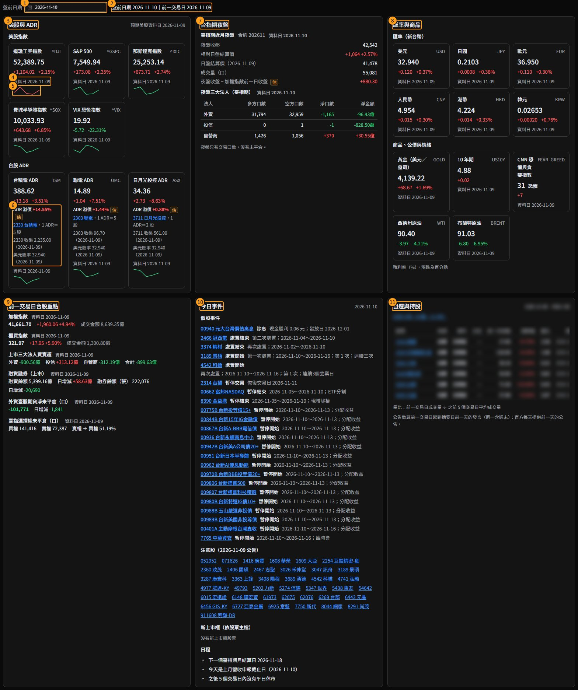

<!-- routes: /market?tab=preopen -->
# 大盤籌碼｜盤前摘要

> 位置：頂部選單「大盤籌碼」→「盤前摘要」分頁（網址 `/market?tab=preopen`，可加 `&date=2026-11-10` 看過去某一天）；台北時間平日 07:00～09:00，頂部選單旁另有「盤前摘要」捷徑（手機顯示「盤前」）
> 資料更新：國際行情每天 07:50（美股還沒拿到時 08:05 再補抓）；交易日 08:15 與 08:35 再補抓一次還沒拿到的國際行情代號、臺指期（TX）夜盤，以及臺指期（TX）與臺指選擇權（TXO）夜盤三大法人；夜盤列在 15:20 由期貨日資料覆寫。前一交易日台股的資料依各資料集（整體三大法人 15:05、期貨選擇權 15:20、全市場日 K 17:35、大盤資券 21:05 後）。伺服器快取 5 分鐘；07:00～09:00 開著這個分頁時每 5 分鐘自動重查，切回視窗時也重查

## 這個功能可以做什麼
開盤前一頁看完前一晚到今天早上的數字：美股主要指數與台股 ADR、臺指期夜盤、匯率與商品、前一交易日的台股重點、今天的除權息與處置等事件，以及自選股與持股裡今天有事件或最近有公告（重大訊息）的股票。

每個數字旁都標「資料日」。資料日早於應有的日子時標「資料較舊」；落後超過 10 天時標「來源未更新」（例如來源的原油資料停在 2026-10-20）。這一頁只列數字與定義，不做判讀。

## 畫面說明

| 編號 | 名稱 | 說明 |
|---|---|---|
| 1 | 「盤前日期」 | 空白時為今天（今天不是交易日時為下一個交易日）；可選過去的日子，用當時已有的資料重算 |
| 2 | 盤前日期與前一交易日 | 例如「盤前日期 2026-11-11｜前一交易日 2026-11-10」 |
| 3 | 「美股與 ADR」 | 美股指數（道瓊、S&P 500、那斯達克、費城半導體、VIX）與台積電、聯電、日月光投控 ADR；右上為「預期美股資料日」 |
| 4 | 資料日與標示 | 「資料日 2026-11-10」；較舊時加「資料較舊」，超過 10 天加「來源未更新」，查不到時為「沒有資料」 |
| 5 | 近 5 筆走勢 | 美股指數與 ADR 最近 5 筆收盤的小走勢圖 |
| 6 | 「ADR 溢價」 | 旁邊標「估」；下方列出對應的台股、「1 ADR＝5 股」這類換算比例、台股收盤與美元匯率（各附日期） |
| 7 | 「台指期夜盤」 | 「臺指期近月夜盤」的收盤、「相對日盤結算價」的漲跌、成交量，以及「夜盤收盤 − 加權指數前一日收盤」（估）；下方為「夜盤三大法人（臺指期）」 |
| 8 | 「匯率與商品」 | 新台幣匯率，以及黃金、10 年期美國公債殖利率、CNN 恐懼與貪婪指數、西德州原油、布蘭特原油 |
| 9 | 「前一交易日台股重點」 | 加權指數、櫃買指數（收盤、漲跌、成交金額）、「上市三大法人買賣超」、「融資融券（上市）」、「外資臺股期貨淨未平倉（口）」、「臺指選擇權未平倉（口）」 |
| 10 | 「今日事件」 | 個股事件、前一交易日公告的注意股、新上市櫃股票，以及臺指期月結算日、營收申報截止日、之後 5 個交易日內的休市日 |
| 11 | 「自選與持股」 | 自選股或持股中今天有事件、或期間內有公告的股票（截圖已遮蔽）；區段標題下一行為公告數，表格的「公告」欄接在「事件」之後，見下方「自選與持股的公告」 |

## 操作步驟
1. 開盤前打開「大盤籌碼」→「盤前摘要」，或在 07:00～09:00 點頂部的「盤前摘要」捷徑。
2. 先看各區塊數字旁的資料日；有「資料較舊」「來源未更新」時，表示那一筆不是最新一天的資料。
3. 在「今日事件」或「自選與持股」點股票代號名稱，開啟個股分析頁；點「公告 N 則（…）」開啟這段期間自選與持股的[重大訊息](../events/material.md)清單，點「公告」欄開啟該股的[公告](../stock/material.md)分頁。
4. 要看過去某一天開盤前的樣子，在「盤前日期」選日期；網址會帶 `date=`，可加入書籤或分享。按日期欄的清除鈕回到最新。

## 欄位與名詞
- **預期資料日**：美股、ADR、黃金、公債、恐懼與貪婪指數、原油為盤前日期之前最近的一個週一至週五（不考慮美國假日）；匯率與前一交易日台股為前一交易日；夜盤為盤前日期當天（夜盤標在所屬的交易日：前一個交易日 15:00 到當天 05:00）。
- **「資料較舊」**：資料日早於預期資料日，落後 10 天以內。美國假日、或來源還沒發布前一晚的資料時會出現；全部美股指數都較舊時，上方另有一行說明。
- **「來源未更新」**：資料日比預期資料日早超過 10 天，表示來源停止更新，畫面顯示最後一筆。
- **「ADR 溢價」**（估）＝ADR 收盤 × 美元匯率 ÷ 每 ADR 股數 ÷ 台股收盤 − 1。美元匯率為即期賣匯匯率（來源為 FinMind 外幣對台幣匯率資料集；沒有即期時用現金賣匯）；匯率與台股收盤兩邊都取 ADR 資料日當天或之前的最新一筆，各自的日期標在溢價下方（台股收盤不晚於前一交易日）。ADR 資料較舊時，溢價旁也標「資料較舊」（停更超過 10 天時為「來源未更新」）。換算比例預設台積電 1 ADR＝5 股、聯電 1 ADR＝5 股、日月光投控 1 ADR＝2 股，可在[設定](../settings.md)的「清單」區塊修改（`Preopen:AdrMap`）。ADR 與台股的交易時間不同，所以標「估」。
- **「夜盤收盤 − 加權指數前一日收盤」**（估）：臺指期近月夜盤收盤點數減去加權指數前一交易日收盤點數。期貨與現貨的標的、時間不同，只列差值。
- **「相對日盤結算價」**：近月合約（不含週契約）的夜盤收盤減去同一合約前一交易日一般時段的結算價，以及漲跌幅；沒有結算價時改用一般時段收盤（與期貨頁的漲跌基準相同）。下方「日盤結算價」附該價格的日期。
- **「夜盤三大法人（臺指期）」**：外資、投信、自營商在夜盤的「多方口數」「空方口數」「淨口數」（多方 − 空方）與「淨金額」。夜盤只有交易口數，沒有未平倉。
- **「上市三大法人買賣超」**：與「大盤籌碼」分頁的摘要相同，單位為元（以萬、億顯示）。
- **「融資融券（上市）」**：「融資餘額」（金額）與「融券餘額（張）」，各自後面的「日增減」為與前一筆相比的變化。
- **「外資臺股期貨淨未平倉（口）」**：只計臺股期貨（大台），與前一筆相比的「日增減」。
- **「臺指選擇權未平倉（口）」**：一般時段全市場的「買權」「賣權」未平倉口數，與「賣權 ÷ 買權」（%）。
- **「新上市櫃（依股票主檔）」**：依股票主檔判斷，盤前可能還沒有當天新掛牌的股票。
- **「量比」**：前一交易日成交量 ÷ 之前 5 個交易日平均成交量；不足 5 日時為「—」。
- **「自選與持股」的事件**：當日事件的類型（除息、除權、處置等）、「注意股」（前一交易日公告）與「ADR 相關」（台積電、聯電、日月光投控）。只有公告、沒有事件的股票，「事件」欄為「—」。

### 自選與持股的公告
- **算哪幾天**：前一交易日 00:00 起到盤前日期前一天 23:59:59 的發言時間（週一含上週五到週日；連假後含整個連假），最多 14 天，超過時只算最近 14 天。過去的日期也照同樣的方式重算。
- **公告數那一行**：「公告 N 則（M 檔，MM-DD～MM-DD）」，N 與[個股事件｜重大訊息](../events/material.md)範圍選「自選與持股」、同一段日期的總則數相同；點一下開啟那份清單。某個市場最新的公告日早於這段期間最後一天時，後面加「上櫃公告資料到 MM-DD」（或上市），表示那個市場還沒有最後一天的公告。
- **「公告」欄**：「3 則：財報、法說會」為則數與最多 3 個類別（依類別順序）；點一下開啟該股的公告分頁。沒有公告時為「—」。這一頁只列則數與類別，主旨與說明在重大訊息頁。
- 官方開放資料事件來源關閉、而且這段期間全市場都沒有公告時，公告數那一行與「公告」欄都不顯示。
- 官方每天提供前一天的公告（上市約 05:25、上櫃約 20:00 更新），所以早上看到的多半到前一天為止。

## 資料來源與更新時間
- 國際行情（美股、ADR、匯率、黃金、原油、公債殖利率、恐懼與貪婪指數）：FinMind，每天 07:50 抓取（美股還沒拿到時 08:05 再補抓）；交易日 08:15 與 08:35 只補抓還沒拿到的代號。
- 「匯率與商品」的幣別由[設定](../settings.md)的「盤前摘要匯率幣別」（`Preopen:Currencies`，預設美元、日圓、歐元、人民幣、港幣、韓元）決定，不隨國際總經的 19 種擴充；早上 08:15、08:35 補抓的匯率與公債只限盤前清單（`Preopen:Currencies`、`Preopen:Bonds`，公債預設 2、10、30 年期）。
- 黃金是以 UTC 日為界的日資料，早上看到的是前一個完整的 UTC 日。來源發布較晚時，可能還沒有前一晚的美股收盤，這時顯示前一盤並標「資料較舊」。
- 自選與持股的公告數：證交所與櫃買中心的官方開放資料（見[個股事件｜重大訊息](../events/material.md)），由已入庫的公告計算。
- 臺指期夜盤與夜盤三大法人：FinMind，交易日 08:15 與 08:35 抓臺指期（TX）夜盤，以及臺指期（TX）與臺指選擇權（TXO）夜盤三大法人（已有就不再抓）；15:20 的期貨日資料會覆寫夜盤列。還沒有時顯示「還沒有這一天的夜盤資料」並標「沒有資料」。
- 前一交易日台股、事件、注意股：已入庫的日資料（見[資料來源與更新時間](../reference/data-sources.md)）。
- 畫面本身不向外部來源查詢；同一個日期的結果在伺服器保留 5 分鐘。

## 注意事項與限制
- 只列數字與定義，不做判讀；標「估」的數字請看上面的算法。
- 預期資料日不考慮美國假日：美國假日後的早上，美股會標「資料較舊」。
- 原油資料目前停在 2026-10-20（來源未更新），畫面顯示最後一筆並標「來源未更新」。
- 選過去的日期時，用的是當時以前的資料重算；之後才補進來的資料也會算進去，可能和當天早上看到的不完全相同。
- 「自選與持股」用的是目前的自選股與持股清單（看過去日期時也一樣，不是當天的清單）；自選股與持股全站共用，不分使用者。
- 頂部捷徑只看時間（平日 07:00～09:00），國定假日的平日也會出現。

## 相關功能
- [國際總經](global.md)：國際行情的完整清單、長期走勢與統計
- [當日事件](events.md)：任一天的完整事件清單
- [個股事件｜重大訊息](../events/material.md)：公告的主旨與說明
- [大盤籌碼](chips.md)：三大法人、融資、外資期貨的長期走勢
- [自選股](../watchlist.md)、[持股](../portfolio.md)
