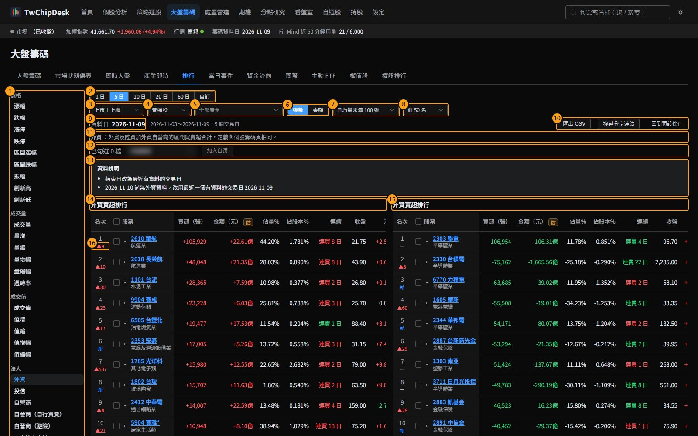
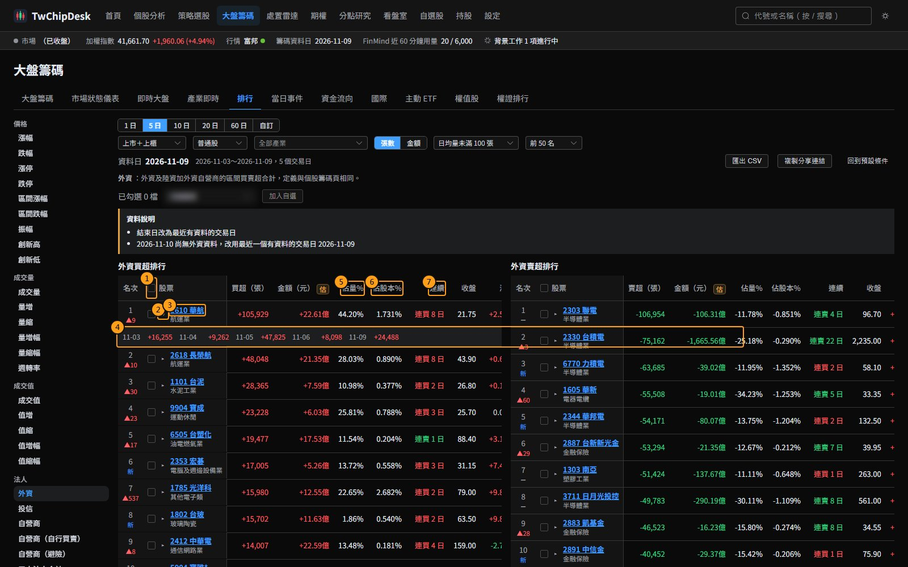
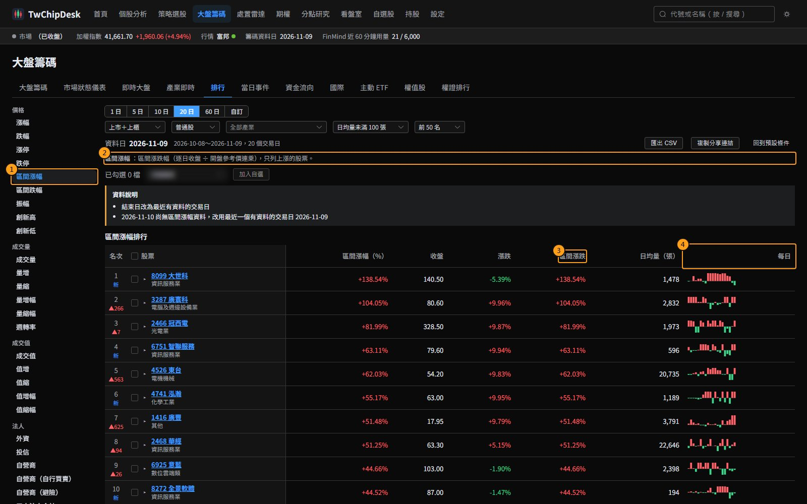
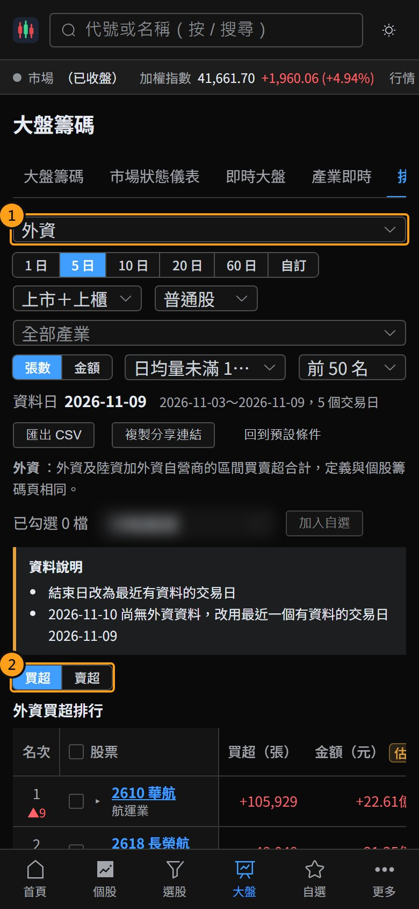
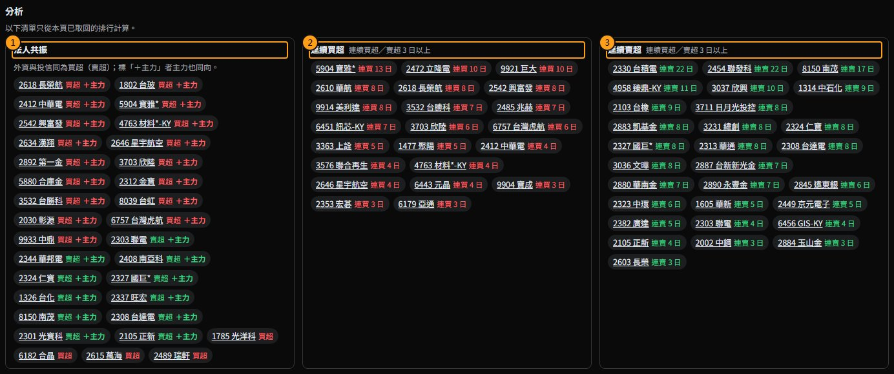

<!-- routes: /market?tab=rankings -->
# 大盤籌碼｜排行（排行中心）

> 位置：頂部選單「大盤籌碼」→「排行」分頁（網址 `/market?tab=rankings`）
> 資料更新（交易日）：價格、成交量、成交值 13:40 收盤快照後先有「暫定」結果，17:35 全市場日 K 寫入後定版；八大行庫 18:35 後；個股三大法人 20:05 後；主力、散戶、中實戶、隔日沖分點在分點資料（18:10 起）與個股三大法人都到齊後計算；融資融券、借券 21:05 後

## 這個功能可以做什麼
排行中心把全市場股票依一個指標排名，共 6 大類 36 種排行：價格（漲跌幅、漲跌停、區間漲跌、振幅、創新高新低）、成交量、成交值、法人（外資、投信、自營商、三大法人合計）、主力籌碼（主力、散戶、中實戶、隔日沖分點、八大行庫）、資券（融資、融券、券資比、借券）。

期間可選 1／5／10／20／60 個交易日，或自訂起迄日（最長 250 個交易日）；可依市場、上市櫃、普通股或 ETF、產業篩選。買賣超類的排行「買超｜賣超」左右並排，並列出佔成交量、佔股本的比例、連續買賣超天數、名次升降與法人共振；表格下方的分析區整理出法人同向與連續買賣超的股票。全部條件都在網址上，可以存成書籤或分享給別人。

適合用來：看今天或這一週外資、投信買最多與賣最多的股票；找區間漲幅最大、量增最多的股票；找外資與投信同時買超、而且連續買超好幾天的股票，再勾選加入自選股追蹤。

## 畫面說明

| 編號 | 名稱 | 說明 |
|---|---|---|
| 1 | 分類清單 | 左側依「價格」「成交量」「成交值」「法人」「主力籌碼」「資券」分組列出全部分類，點一下切換；目前的分類反白。手機版改成上方的下拉選單（見下方手機版說明） |
| 2 | 期間 | 「1 日」「5 日」「10 日」「20 日」「60 日」與「自訂」。期間以交易日計，結束日為該分類最新有資料的交易日 |
| 3 | 市場 | 「上市＋上櫃」（預設）、「上市」、「上櫃」。不含興櫃 |
| 4 | 類型 | 「普通股」（預設）、「ETF」、「全部」 |
| 5 | 產業 | 可多選、可輸入文字搜尋；沒選時為「全部產業」 |
| 6 | 單位 | 只有買賣超類與資券增減類才有：「張數」（預設）或「金額」。金額旁的「估」說明計算方式 |
| 7 | 排除冷門 | 「日均量未滿 100 張」（預設）、「日均量未滿 500 張」、「日均量未滿 1000 張」或「不排除」，以區間日均成交量判斷 |
| 8 | 筆數 | 「前 50 名」（預設）、「前 100 名」、「前 200 名」；買賣超類兩邊各取這麼多名 |
| 9 | 資料日與區間 | 「資料日」為實際結束日；旁邊列出實際計算的起迄日與交易日數，例如「2026-11-03～2026-11-09，5 個交易日」 |
| 10 | 匯出、分享、重設 | 「匯出 CSV」「複製分享連結」「回到預設條件」 |
| 11 | 分類定義 | 目前分類的名稱與計算方式；只看結束日的分類另標「依結束日排序」 |
| 12 | 勾選與加入自選 | 「已勾選 n 檔」、自選群組選單與「加入自選」按鈕 |
| 13 | 資料說明 | 結束日改用其他日子、資料只入庫一部分、超過 60 日不提供每日值等情況時出現，見下方「資料說明與退回規則」 |
| 14 | 買超表 | 買賣超類左邊為買超（資券類為「增加」），依區間合計由大到小 |
| 15 | 賣超表 | 右邊為賣超（資券類為「減少」），依區間合計由小到大（賣最多的在前） |
| 16 | 名次升降 | 名次下方的箭頭與數字，和前一個同長度區間比較 |

### 表格欄位

| 編號 | 名稱 | 說明 |
|---|---|---|
| 1 | 全選 | 勾選這張表的全部股票 |
| 2 | 展開 | 「▸」展開這檔股票在區間內每一天的值（期間 60 個交易日以內才有） |
| 3 | 股票 | 代號與名稱，下方小字為產業；點擊開啟個股頁（法人類開「籌碼明細」的「法人」，主力籌碼類開「主力」，八大行庫開「八大行庫」，資券類開「資券」，價格與量值類開 K線籌碼圖） |
| 4 | 每日明細 | 展開後列出每個交易日的日期與當日值 |
| 5 | 佔量% | 區間買賣超 ÷ 區間成交量 |
| 6 | 佔股本% | 區間買賣超 ÷ 發行股數 |
| 7 | 連續 | 到結束日為止連續同方向的天數，例如「連買 8 日」「連賣 4 日」（資券類為「連增」「連減」） |

完整的欄位依分類不同：

| 欄位 | 出現在 | 說明 |
|---|---|---|
| 「名次」 | 全部 | 名次與升降：「▲n」名次上升、「▼n」名次下降、「－」不變、「新」前一期不在排行內；沒有前一期可比較時不顯示 |
| 排序值（例如「買超（張）」「區間漲幅（%）」） | 全部 | 這個分類排名用的數值，欄名寫出單位 |
| 「金額（元）」或「張數（張）」 | 買賣超類、資券增減類 | 單位為張數時第二欄是金額（估）；單位切成金額時第二欄改為張數 |
| 「佔量%」「佔股本%」「連續」 | 買賣超類、資券增減類 | 見上表 |
| 「收盤」「漲跌」 | 全部 | 結束日的收盤價與漲跌幅 |
| 「區間漲跌」 | 全部 | 區間的漲跌幅（逐日以開盤參考價計，除權息日不失真） |
| 「日均量（張）」 | 全部 | 區間日均成交量 |
| 「每日」 | 期間 60 個交易日以內 | 每日值的小長條圖 |
| 「共振」 | 法人、主力籌碼類 | 「外資＋投信」：同一期間外資與投信同為買超（或同為賣超）；「外資＋投信＋主力」：主力也同方向 |

點欄名可以排序（再點一次反向、第三次恢復原順序），只排目前已取回的列，不會重新查詢；名次欄的數字不變。名次與股票欄固定在左側，其他欄位在表格內左右捲動。

### 非買賣超類（單一表）

| 編號 | 名稱 | 說明 |
|---|---|---|
| 1 | 分類 | 價格、成交量、成交值與券資比、借券賣量是單一表，依排序值排名 |
| 2 | 分類定義 | 這個分類怎麼計算 |
| 3 | 區間漲跌 | 區間漲跌幅 |
| 4 | 每日 | 每日值的小長條圖（正值與負值分色） |

## 分類清單
| 大類 | 分類 | 計算方式 |
|---|---|---|
| 價格 | 「漲幅」「跌幅」 | 結束日漲跌幅（相對開盤參考價，除權息日不失真）；只看結束日 |
| 價格 | 「漲停」「跌停」 | 區間內收盤等於漲停價（跌停價）的天數；1 日即結束日收漲停（跌停）。同天數依區間成交值排序 |
| 價格 | 「區間漲幅」「區間跌幅」 | 區間漲跌幅（逐日收盤 ÷ 開盤參考價連乘） |
| 價格 | 「振幅」 | （區間最高 − 區間最低）÷ 區間第一個有成交日的開盤參考價；1 日即當日振幅 |
| 價格 | 「創新高」「創新低」 | 結束日收盤高於（低於）前 N − 1 個交易日的最高（最低）收盤，依超過的幅度排序。N 用工具列的「N 日」選擇：20、60（預設）、120、240 日；只看結束日 |
| 成交量 | 「成交量」 | 區間成交量合計（張），另列日均量 |
| 成交量 | 「量增」「量縮」 | 區間日均量 − 前一個同長度區間的日均量（張） |
| 成交量 | 「量增幅」「量縮幅」 | 區間日均量 ÷ 前一個同長度區間的日均量 − 1 |
| 成交量 | 「週轉率」 | 區間成交股數 ÷ 發行股數（沒有發行股數的股票不列） |
| 成交值 | 「成交值」 | 區間成交金額合計 |
| 成交值 | 「值增」「值縮」「值增幅」「值縮幅」 | 與量增類相同，改用日均成交值 |
| 法人 | 「外資」 | 外資及陸資加外資自營商的區間買賣超合計（定義與個股籌碼頁相同） |
| 法人 | 「投信」 | 投信區間買賣超合計 |
| 法人 | 「自營商」「自營商（自行買賣）」「自營商（避險）」 | 自營商合計（自行買賣＋避險），或只算其中一個部位 |
| 法人 | 「三大法人合計」 | 外資、投信、自營商的區間買賣超合計 |
| 主力籌碼 | 「主力」 | 每日買超前 15 名分點減賣超前 15 名分點，區間加總 |
| 主力籌碼 | 「散戶」（估） | 前 15 名以外所有分點的淨買合計，區間加總 |
| 主力籌碼 | 「中實戶」 | 中實戶區間買賣超合計 |
| 主力籌碼 | 「隔日沖分點」 | 隔日沖分點清單內分點的區間買賣超合計 |
| 主力籌碼 | 「八大行庫」 | 八大行庫區間買賣超合計；金額為來源的實際金額，不是估計 |
| 資券 | 「融資增減」「融券增減」 | 結束日餘額 − 區間前一筆餘額（張），兩邊為「增加」「減少」 |
| 資券 | 「券資比」 | 結束日的融券餘額 ÷ 融資餘額（融資餘額需大於 0）；只看結束日 |
| 資券 | 「借券賣量」 | 區間內借券賣量合計（張） |
| 資券 | 「借券餘額增減」 | 借券賣量餘額在區間內的增減（張） |

「量增」到「值縮幅」比較的是「這個區間」和「前一個同長度區間」。區間內有分割、減資、面額變更等股數變動的股票，前後的量值不能直接比較，列上會標「股數變動」。

## 操作步驟

### 看某一類的排行
1. 在左側清單點分類（例如「法人」下的「投信」）。
2. 點期間快捷鈕（例如「5 日」）。
3. 需要時調整市場、類型、產業、排除冷門與筆數。條件一改就重新查詢，網址同步更新。

### 自訂起迄日

1. 點期間的「自訂」（編號 1），旁邊出現起迄日期選擇（編號 2）。
2. 選起日與迄日；不能選未來的日子。最長 250 個交易日，起迄日遇到非交易日時只算範圍內的交易日。
3. 工具列顯示實際計算的區間（編號 3）。清除日期會回到「1 日」。

自訂區間的結束日一樣依「這個分類最新有資料的日子」處理：迄日選今天而資料還沒入庫時，會自動改用最近一個有資料的交易日（見下方退回規則）。

### 看每日明細
點股票前面的「▸」展開，列出區間內每一天的值；再點一次收合。期間超過 60 個交易日時不提供每日明細與小長條圖。

### 勾選後加入自選
1. 勾選列前面的方塊，或勾表頭的方塊選取整張表。左右兩張表可以一起勾。
2. 在「自選群組」選要加入的群組（預設為排在第一個的群組）。
3. 點「加入自選」，成功後顯示「已加入 n 檔到「群組名稱」」，勾選自動清除。已在群組內的股票不會重複加入。
4. 「清除勾選」取消全部勾選。還沒有任何自選群組時，畫面提示「還沒有自選群組，可到自選股頁新增」。

### 匯出 CSV
點「匯出 CSV」，下載目前畫面上的排行（買賣超類兩邊都在同一個檔案，第一欄為「方向」）。檔名為「排行_分類_起日_迄日.csv」，例如 `排行_外資_2026-11-03_2026-11-09.csv`。欄位：方向（買賣超類）、名次、前一期名次、股票、名稱、市場、產業、排序值、張數、金額、佔量%、佔股本%、連續、收盤、漲跌、區間漲跌、日均量、缺資料天數、共振（法人、主力籌碼類）。估計值的欄名加「（估）」。

### 分享連結
點「複製分享連結」複製目前網址，貼給別人或存成書籤，打開時還原全部條件。瀏覽器不允許自動複製時，畫面提示「無法自動複製，請直接複製網址列」，直接複製網址列即可。

網址參數（預設值不寫進網址）：

| 參數 | 意思 | 例 |
|---|---|---|
| `cat` | 分類 | `cat=trust` |
| `days` | 期間快捷 1／5／10／20／60 | `days=5` |
| `from`、`to` | 自訂起迄日（與 `days` 擇一） | `from=2026-10-27&to=2026-11-09` |
| `mkt` | 市場 `all`、`twse`、`tpex` | `mkt=tpex` |
| `type` | 類型 `stock`、`etf`、`all` | `type=etf` |
| `ind` | 產業，逗號分隔 | `ind=半導體業` |
| `unit` | 單位 `lots`、`amount` | `unit=amount` |
| `min` | 排除冷門門檻 0／100／500／1000 | `min=500` |
| `limit` | 筆數 50／100／200 | `limit=100` |
| `nh` | 創新高新低的 N 日 | `nh=240` |
| `side` | 手機版顯示的一邊 `buy`、`sell` | `side=sell` |

### 回到預設條件
「回到預設條件」把期間、市場、類型、產業、單位、排除冷門、筆數恢復預設，分類不變。

### 手機版

| 編號 | 名稱 | 說明 |
|---|---|---|
| 1 | 分類下拉 | 左側清單改成可搜尋的下拉選單，依大類分組 |
| 2 | 買超／賣超切換 | 買賣超類一次顯示一邊，用切換鈕換邊 |

表格在自己的範圍內左右捲動，名次與股票欄固定。

## 分析區

表格下方的「分析」只從本頁已取回的排行計算（也就是左右兩張表目前的列），不另外查詢：

| 編號 | 名稱 | 說明 |
|---|---|---|
| 1 | 法人共振 | 只在法人、主力籌碼類出現：外資與投信同為買超（或同為賣超）的股票，標「買超」或「賣超」；主力也同方向的另標「＋主力」 |
| 2 | 連續買超 | 「連續買超／賣超 3 日以上」：買超表中連續買超 3 日以上的股票與天數 |
| 3 | 連續賣超 | 賣超表中連續賣超 3 日以上的股票與天數 |

資券增減類改為「連續增加」「連續減少」。非買賣超類（價格、量、值、券資比、借券賣量）顯示「這個分類不是買賣超類，沒有共振與連續天數。」

## 欄位與名詞
- **單位**：法人、主力籌碼、借券原始資料是股數，一律換成張（÷ 1,000，去掉小數部分）；排名用原始股數，所以同樣顯示 0 張的股票仍有先後。融資融券本來就是張。成交值以元計，畫面顯示億元或萬元。
- **金額（估）**：買賣超類的金額＝每日買賣超股數 × 當日成交均價（成交金額 ÷ 成交股數）後加總，是估計值。八大行庫的金額是來源的實際金額，不標「估」。
- **散戶（估）**：前 15 名以外所有分點的淨買合計，是估計值。
- **前一期名次**：用前一個同長度區間、相同的市場、類型、產業、排除冷門（以前一區間自己的日均量判斷）與方向排名後比較。「創新高」「創新低」沒有前一期名次；期間超過 60 個交易日時，「區間漲幅」「區間跌幅」「振幅」也不比較前一期名次。
- **連續天數**：到結束日為止連續同方向的天數，最多回看 60 個交易日；當天持平（0）時中斷。法人、八大行庫在全市場有資料、但這檔沒有資料的日子當作 0，連續會中斷。
- **缺 k 日**：區間內有 k 個交易日沒有這檔的資料（例如停牌），以有資料的日子加總。法人與八大行庫只有全市場都沒有資料的日子才算缺。
- **股數變動**：只出現在量增、量縮、值增、值縮與其增幅類，表示比較期間內有分割、反分割、面額變更、除權或減資，前後的量值不能直接比較。

## 資料說明與退回規則
排行的結束日取「這個分類最新、而且入庫完整的資料日」：

| 情況 | 畫面 | 說明 |
|---|---|---|
| 結束日當天這類資料還沒入庫（例如晚上 8 點前看今天的外資） | 「資料說明」：「結束日改為最近有資料的交易日」，下面一行寫出原本的日子與改用的日子 | 自動改用最近一個有資料的交易日，資料入庫後重新整理就會變成當天 |
| 最新一天的資料只入庫一部分（覆蓋不到九成的股票） | 「最新一天的資料只入庫一部分，已改用前一個資料日；入庫完成後會自動更新。」 | 退回前一個資料日 |
| 結束日的日 K 是 13:40 收盤快照的暫定值 | 「暫定：結束日的日 K 是收盤快照的暫定值，數值為估計，盤後資料入庫後會更新。」排序值欄標「估」 | 只含整股成交；用到成交量的欄位（佔量%、日均量、排除冷門）也是暫定 |
| 期間超過 60 個交易日 | 「區間超過 60 個交易日，不提供每日值與每日小長條圖」 | 不提供每日明細 |
| 區間內有股數變動的股票 | 「部分股票區間內有分割、減資或面額變更，列上標「股數變動」」 | 只出現在量值增減類 |
| 自訂區間沒有任何交易日（例如只選了週末） | 「所選區間沒有交易日」 | 改選其他日期 |
| 自訂起日之後還沒有這類資料 | 「所選起日之後還沒有這類資料」 | 改選較早的起日，或改用期間快捷 |
| 這個分類完全沒有資料 | 「這個分類還沒有資料入庫」 | 盤後資料入庫後自動顯示 |
| 條件太嚴，沒有股票符合 | 「這個條件沒有符合的股票」 | 放寬排除冷門、市場、類型或產業 |

工具列的「資料日」是實際結束日；分類的最新資料日和它不同時，旁邊另列「分類最新資料日」。

## 資料來源與更新時間
| 大類 | 來源 | 更新時間（交易日） |
|---|---|---|
| 價格、成交量、成交值 | 日 K、漲跌停價、發行股數 | 13:40 收盤快照（暫定，只含整股），17:35 全市場日 K 定版 |
| 法人 | 個股三大法人 | 20:05 起 |
| 主力籌碼 | 分點資料計算的主力、散戶、中實戶、隔日沖分點；八大行庫 | 分點 18:10 起，主力類在個股三大法人入庫後計算；八大行庫 18:35 |
| 資券 | 融資融券、借券 | 21:05 |

全部使用已入庫的資料，不額外向外部來源查詢。條件相同的查詢，伺服器 10 分鐘內回傳同一份結果（暫定或部分入庫的結果只保留 1 分鐘）。

## 注意事項與限制
- 預設只含上市＋上櫃普通股，不含興櫃；要看 ETF 請切「類型」。
- 排除冷門以區間日均成交量判斷，期間越長越平滑。
- 排序值相同時的先後由伺服器決定；點欄名排序只排已取回的列。
- 排行只呈現歷史資料，不構成任何投資判斷。

## 常見問題
- **晚上 7 點看「外資 1 日」，資料日還是昨天？** 個股三大法人每個交易日 20:05 起才入庫，在那之前自動改用最近一個有資料的日子，並在「資料說明」寫出原因。
- **為什麼佔量% 會超過 100%？** 佔量% 是買賣超 ÷ 區間成交量，買賣超集中在少數幾天、成交量又不大時可能很高；請一併看「張數」與「日均量」。
- **為什麼點欄名排序後，名次欄沒有重排？** 名次是伺服器依排序值排出的名次，欄名排序只改變畫面上的順序。

## 相關功能
- [當日事件](events.md)：除權息、減資、分割等會讓股數或價格變動的事件
- [資金流向](flow.md)：以族群為單位的成交金額與法人買賣超
- [個股分析](../stock/README.md)：籌碼明細的法人、主力、資券、八大行庫
- [自選股](../watchlist.md)
