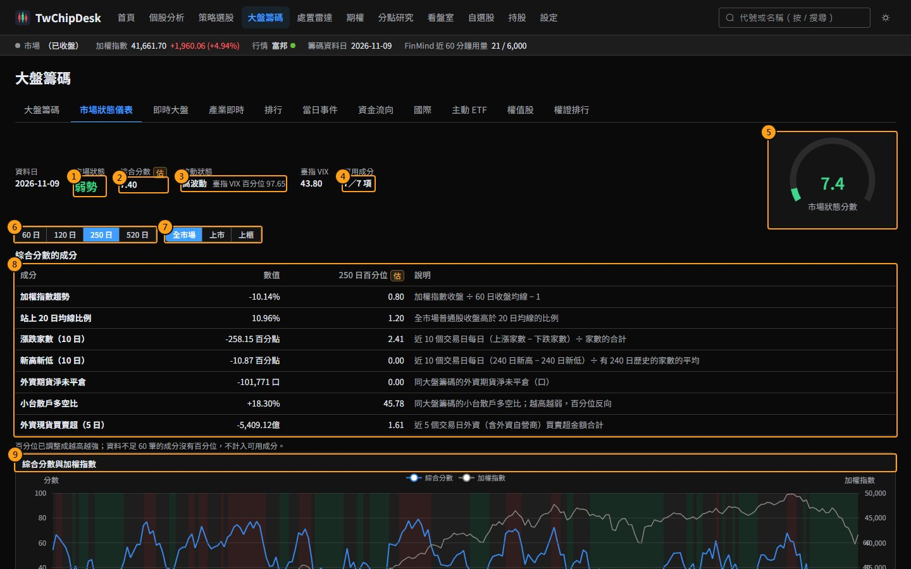
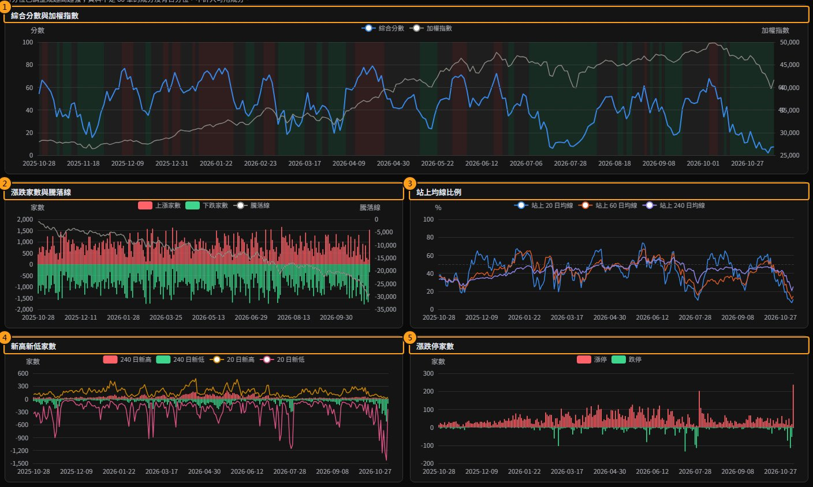
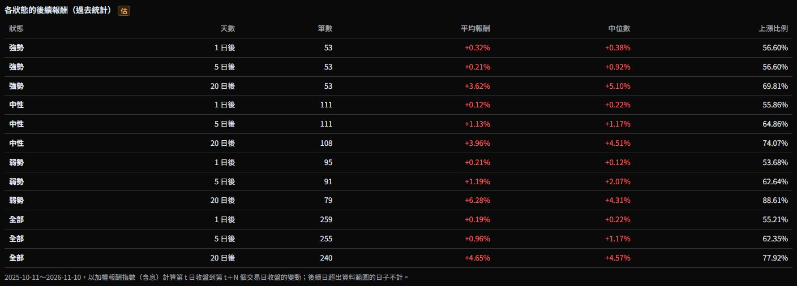

<!-- routes: /market?tab=regime -->
# 大盤籌碼｜市場狀態儀表

> 位置：頂部選單「大盤籌碼」→「市場狀態儀表」分頁（網址 `/market?tab=regime`）
> 資料更新：交易日選股特徵寫好後計算一次，22:45 再計算一次（每次重算最近 10 個交易日，延遲到的資料會更正過去幾天）

## 這個功能可以做什麼
把大盤的趨勢、市場廣度與期現貨籌碼共 7 項成分，各自換算成過去 250 個交易日的百分位，再平均成 0～100 的「綜合分數」，標出「強勢」「中性」「弱勢」；另依臺指 VIX 標出「高波動」「一般」「低波動」。下方的圖表列出漲跌家數、騰落線、站上均線比例、新高新低與漲跌停家數，最後統計過去各狀態之後 1、5、20 日加權指數的報酬。適合用來快速了解目前大盤在歷史上的相對位置。

綜合分數與百分位是統計估算（標「估」），統計表為過去統計，不代表未來。

## 畫面說明

| 編號 | 名稱 | 說明 |
|---|---|---|
| 1 | 市場狀態 | 「強勢」「中性」「弱勢」；可用成分不足時為「資料不足」。左邊的「資料日」是這份狀態的交易日 |
| 2 | 綜合分數 | 0～100，越高越強（估） |
| 3 | 波動狀態 | 「高波動」「一般」「低波動」，旁邊小字寫出依據，例如「臺指 VIX 百分位 97.65」；VIX 缺值時改用「TXO 隱含波動率百分位（VIX 缺值）」。右邊另列「臺指 VIX」當天數值 |
| 4 | 可用成分 | 有百分位的成分數，例如「7／7 項」 |
| 5 | 分數儀表 | 「市場狀態分數」的半圓儀表 |
| 6 | 期間 | 圖表與統計的期間：「60 日」「120 日」「250 日」（預設）「520 日」（交易日），選擇記在瀏覽器 |
| 7 | 廣度範圍 | 漲跌家數、均線比例、新高新低、漲跌停圖的範圍：「全市場」「上市」「上櫃」 |
| 8 | 成分表 | 「綜合分數的成分」：成分、數值、250 日百分位（估）、說明；欄名可排序 |
| 9 | 綜合分數與加權指數圖 | 綜合分數（左軸）與加權指數（右軸），背景依每天的狀態上色 |

### 圖表

| 編號 | 名稱 | 說明 |
|---|---|---|
| 1 | 綜合分數與加權指數 | 同上，背景色為強勢、中性、弱勢 |
| 2 | 漲跌家數與騰落線 | 每天的上漲家數、下跌家數（柱狀）與騰落線（從期間第一天起累計上漲 − 下跌） |
| 3 | 站上均線比例 | 收盤站上 20、60、240 日均線的股票比例 |
| 4 | 新高新低家數 | 創 20 日、240 日新高與新低的家數 |
| 5 | 漲跌停家數 | 收漲停、跌停的家數 |

圖表下方的「參考面板（只顯示、不進分數）」列出融資餘額、融資 20 日增減、大盤融資維持率、P/C 未平倉、P/C 成交量、前十大交易人淨未平倉，這些指標方向有爭議，所以只顯示、不計入分數。

### 各狀態的後續報酬

「各狀態的後續報酬（過去統計）」：在所選期間內，依每天的狀態（強勢、中性、弱勢、全部）分組，統計第 t 日收盤到第 t＋1、t＋5、t＋20 個交易日收盤的加權指數變動：筆數、平均報酬、中位數、上漲比例。有加權報酬指數時用「加權報酬指數（含息）」，否則用「加權指數（不含息）」，表格下方註明。後續日超出資料範圍的日子不計。

## 操作步驟
1. 看上方的狀態、分數與波動狀態。
2. 在成分表看哪些成分偏強、哪些偏弱（點「250 日百分位」欄名排序）。
3. 切換期間看較長或較短的歷史；切換廣度範圍比較上市、上櫃。
4. 往下看各狀態的後續報酬統計。

## 欄位與名詞
| 成分 | 數值 | 說明 |
|---|---|---|
| 「加權指數趨勢」 | % | 加權指數收盤 ÷ 60 日收盤均線 − 1 |
| 「站上 20 日均線比例」 | % | 全市場普通股收盤高於 20 日均線的比例 |
| 「漲跌家數（10 日）」 | 百分點 | 近 10 個交易日每日（上漲家數 − 下跌家數）÷ 家數的合計 |
| 「新高新低（10 日）」 | 百分點 | 近 10 個交易日每日（240 日新高 − 240 日新低）÷ 有 240 日歷史的家數的平均 |
| 「外資期貨淨未平倉」 | 口 | 同大盤籌碼的外資期貨淨未平倉 |
| 「小台散戶多空比」 | % | 同大盤籌碼的散戶小台多空比；越高越弱，百分位反向計算 |
| 「外資現貨買賣超（5 日）」 | 億元 | 近 5 個交易日外資（含外資自營商）買賣超金額合計 |

- **250 日百分位**：這個成分今天的值在過去 250 個交易日中的排名百分位（0～100），已調整成越高越強。資料不足 60 筆的成分沒有百分位，不計入可用成分。
- **綜合分數**：可用成分百分位的平均（0～100）；至少 4 項可用才計算，否則標「資料不足」。
- **市場狀態**：分數 ≥ 60 為強勢、≤ 40 為弱勢，其他為中性。
- **波動狀態**：臺指 VIX 的 250 日百分位 ≥ 80 為高波動、≤ 20 為低波動，其他為一般；VIX 缺值時改用 TXO 隱含波動率百分位。
- **廣度的計算**：家數只算當天有成交的普通股（上市、上櫃）；漲跌對當日參考價；新高新低為收盤高於前 N−1 個交易日的最高收盤（相等不算），歷史不足 N 日的股票不計。

以上門檻依系統設定，頁面最下方「定義與限制」會列出目前使用的數字。

## 資料來源與更新時間
只讀已入庫的日 K、漲跌停價、加權指數、三大法人、期貨法人與大額交易人、選擇權、臺指 VIX、融資，不另外向外部來源查詢。交易日選股特徵寫好後（三大法人與分點資料完成後）計算一次，22:45 再計算一次；每次都重算最近 10 個交易日。頁面最下方顯示「資料計算時間」。

## 注意事項與限制
- 第一次上線時會回補過去約兩年的資料；回補完成前，上方顯示「目前只有 某日 起共 n 個交易日的資料（回補中或歷史不足）」。
- 還沒有任何資料時顯示「市場狀態尚未計算或正在回補」。
- 過去統計不代表未來，不構成操作依據。

## 相關功能
- [大盤籌碼](chips.md)：外資期貨、散戶小台多空比、融資等原始序列
- [策略選股](../screener/README.md)：「大盤」類條件可用市場狀態、綜合分數、波動狀態篩選；策略實驗室可限制只在某些狀態進場
