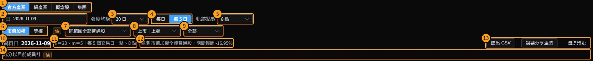
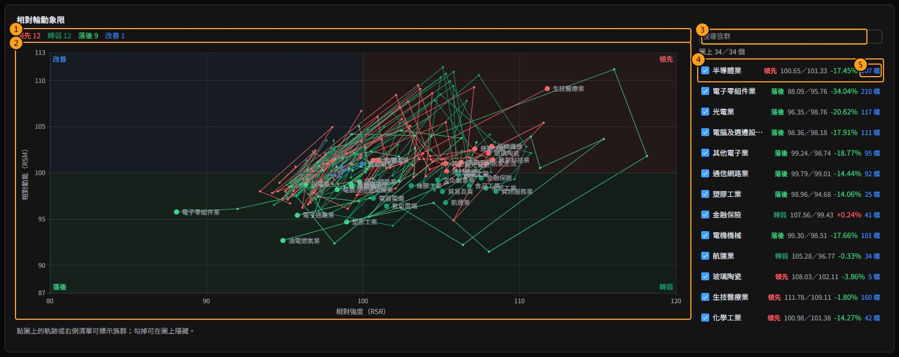
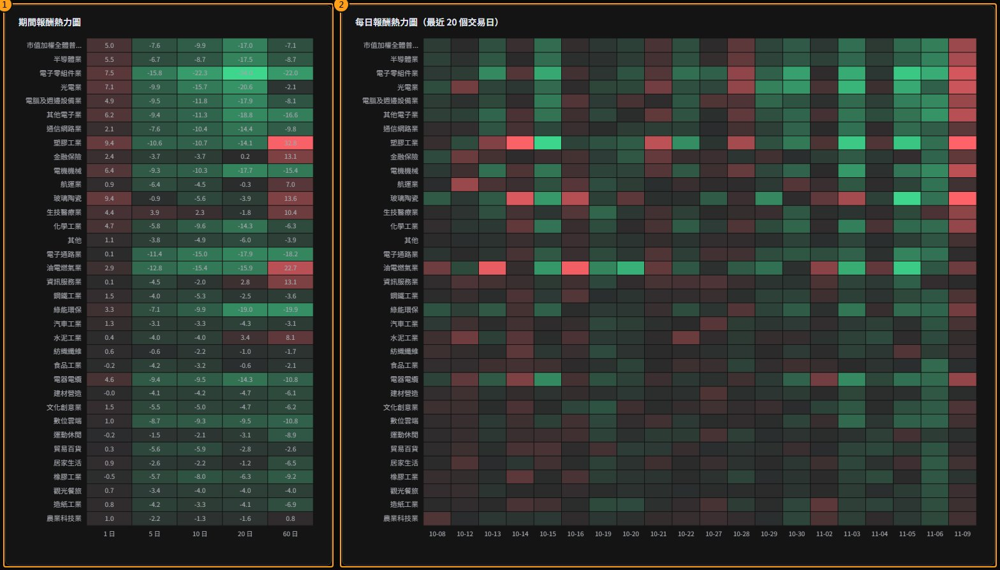
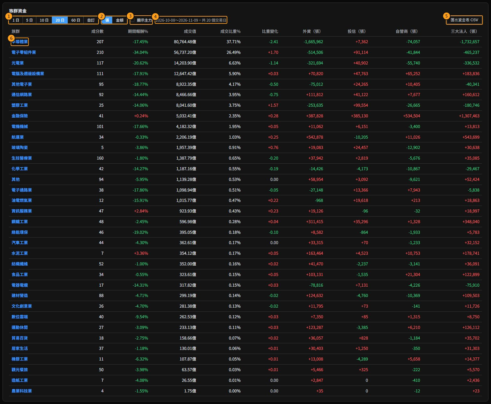
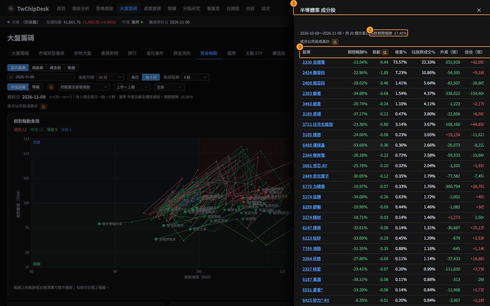

<!-- routes: /market?tab=rotation -->
# 大盤籌碼｜資金輪動

> 位置：頂部選單「大盤籌碼」→「資金輪動」分頁（網址 `/market?tab=rotation`）
> 資料更新（交易日）：13:40 收盤快照後先有「暫定」結果，17:35 全市場日 K 寫入後定版；加權報酬指數約 17:40；外資、投信、自營商 20:05 後；主力在分點資料（18:10 起）與個股三大法人都到齊後。伺服器快取 10 分鐘（暫定時 1 分鐘）

## 這個功能可以做什麼
以族群為單位，比較各族群相對大盤的強弱變化：

- 「相對輪動象限」：每個族群的相對強度與相對動能，畫成一段軌跡，看最近幾週的位置怎麼移動。
- 「期間報酬熱力圖」「每日報酬熱力圖（最近 20 個交易日）」：各族群 1、5、10、20、60 日報酬，與最近 20 個交易日每天的報酬。
- 「族群資金」：期間成交值、成交比重與比重變化、外資、投信、自營商、三大法人（可加主力）買賣超。
- 族群成分股：每一檔的期間報酬、對族群報酬的貢獻（估）、權重與法人買賣超。

象限圖只是一種計算方式的呈現（類似相對輪動圖 RRG 的算法，公式見下方），描述的是過去一段期間的相對變化，不是訊號，也不代表之後的走勢。

## 工具列

| 編號 | 名稱 | 說明 |
|---|---|---|
| 1 | 族群分類 | 「官方產業」「細產業」「概念股」「集團」；族群分類外掛沒有啟用時為「官方產業」「產業鏈」並註明「族群分類外掛未啟用，顯示 FinMind 產業鏈」 |
| 2 | 結束日 | 空白為「最新」；可選過去的日子（不能選未來） |
| 3 | 「強度均線」 | 相對強度的均線天數 n：「10 日」「20 日」（預設）「60 日」 |
| 4 | 取點 | 軌跡每幾個交易日取一點：「每日」或「每 5 日」（預設） |
| 5 | 「軌跡點數」 | 軌跡顯示幾個點（4～20，預設 8 點） |
| 6 | 「權重」 | 族群指數的權重：「市值加權」（預設，旁邊標「估」）或「等權」 |
| 7 | 「基準」 | 「同範圍全部普通股」（預設）或「加權報酬指數（含息）」 |
| 8 | 「市場」 | 「上市＋上櫃」（預設）「上市」「上櫃」 |
| 9 | 「顯示」 | 依成交值取前幾個族群：「前 10 個」「前 30 個」「前 50 個」「全部」；官方產業、產業鏈預設「全部」，細產業、概念股、集團預設「前 30 個」 |
| 10 | 「資料日」 | 實際使用的結束日 |
| 11 | 參數 | 例如「n＝20、m＝5｜每 5 個交易日一點、8 點」；m（相對動能的回看天數）固定為 5 |
| 12 | 基準報酬 | 例如「基準 市值加權全體普通股，期間報酬 −1.23%」（最近 n 日） |
| 13 | 「匯出 CSV」「複製分享連結」「還原預設」 | 下載象限資料（檔名「資金輪動_分類_日期.csv」，估計欄標「（估）」）；複製含全部條件的網址；全部條件回到預設 |
| 14 | 「成分以目前成員計」 | 族群沒有成員歷史，過去每一天都以目前的成員計算，所以標「估」 |

基準選「加權報酬指數（含息）」時，族群與指數的範圍只在「官方產業」＋「上市」時一致，其他組合會顯示提示：加權指數只含上市股票，口徑不一致時僅供參考。

全部條件都寫在網址上，重新整理或分享後還原。

## 相對輪動象限

| 編號 | 名稱 | 說明 |
|---|---|---|
| 1 | 象限家數 | 「領先」「轉弱」「落後」「改善」各有幾個族群（依結束日的位置） |
| 2 | 象限圖 | 橫軸「相對強度（RSR）」、縱軸「相對動能（RSM）」，以 100 為界分成四個象限。每個族群一條軌跡，由舊到新，最後一點（結束日）較大並標示名稱；滑過看日期、相對強度、相對動能、n 日報酬與象限 |
| 3 | 「搜尋族群」 | 只篩右側清單，上方顯示「圖上 N／M 個」 |
| 4 | 族群清單 | 勾選框：取消勾選在圖上隱藏（「全部顯示」恢復）；點名稱：在圖上標示這個族群（「取消標示」恢復）；另列象限、「相對強度／相對動能」數值、n 日報酬 |
| 5 | 成分數 | 「N 檔」，點一下開啟族群成分股 |

在圖上點一條軌跡也可以標示族群。

**計算方式**（全部由伺服器計算；畫面底部「計算方式」可展開）：
1. 族群指數：成分股每日報酬 ＝ 收盤 ÷ 開盤參考價 − 1（除權息、減資等事件日用事件參考價）。「市值加權」以「開盤參考價 × 目前發行股數」為權重（發行股數用最新資料，所以是估計；沒有發行股數的股票不進市值加權），「等權」為簡單平均。族群指數 ＝ 100 × 每日（1 ＋ 報酬）連乘。
2. 覆蓋率：某天有報酬的成分股少於當天應有成分股的 90% 時，族群那天不計（指數持平）；當天沒有成交的股票報酬以 0 計。基準沒有資料的日子，族群那天也不計。
3. 基準：「同範圍全部普通股」用與族群相同的算法與權重；「加權報酬指數（含息）」在結束日還沒有報酬指數時，整段期間改用加權指數（不含息），「資料說明」寫「結束日還沒有加權報酬指數，整段期間的基準改用加權指數（不含息）」。
4. 相對強度 RSR ＝ 100 × RS ÷ RS 的 n 日平均，RS ＝ 族群指數 ÷ 基準指數。
5. 相對動能 RSM ＝ 100 × RSR ÷ m 個交易日前的 RSR（m ＝ 5）。
6. 象限依結束日的 RSR、RSM 與 100 比較：「領先」（RSR ≥ 100、RSM ≥ 100）、「轉弱」（RSR ≥ 100、RSM < 100）、「落後」（皆 < 100）、「改善」（RSR < 100、RSM ≥ 100）。
7. 需要的資料天數約 n ＋ m ＋ 取點 ×（點數 − 1）個交易日；不夠時軌跡較短，並在「資料說明」註明。

象限名稱只描述 RSR、RSM 相對 100 的位置。

## 報酬熱力圖

| 編號 | 名稱 | 說明 |
|---|---|---|
| 1 | 「期間報酬熱力圖」 | 每個族群 1、5、10、20、60 日的期間報酬（%）；第一列為基準（同範圍全部普通股，同權重方式） |
| 2 | 「每日報酬熱力圖（最近 20 個交易日）」 | 每個族群最近 20 個交易日每天的報酬（%），覆蓋率不足而不計的日子為空白；滑過看數值 |

族群依最近 20 日成交值排序。熱力圖跟著工具列的結束日、「權重」「市場」「顯示」變動；「強度均線」、取點、「軌跡點數」與「基準」不影響熱力圖。族群很多時圖內可捲動（「族群較多，可拖曳右側捲軸檢視其他族群。」）。

## 族群資金

| 編號 | 名稱 | 說明 |
|---|---|---|
| 1 | 「期間」 | 「1 日」「5 日」「10 日」「20 日」（預設）「60 日」或「自訂」（選「起日」「迄日」，「最長 250 個交易日」）；以工具列的結束日往前算 |
| 2 | 單位 | 法人買賣超的單位：「張」或「金額」（金額為每日買賣超股數 × 當日成交均價後加總，標「估」） |
| 3 | 「顯示主力」 | 多顯示「主力」欄（估） |
| 4 | 實際期間 | 「起日～迄日，共 N 個交易日」 |
| 5 | 「匯出資金表 CSV」 | 下載目前資金表（檔名「族群資金_分類_起日_迄日.csv」） |
| 6 | 族群名稱 | 點一下開啟族群成分股 |

### 表格欄位
| 欄位 | 說明 |
|---|---|
| 「族群」「成分數」 | 族群名稱與成分股數（範圍內、期間內有報酬的普通股） |
| 「期間報酬%」 | 期間的族群指數報酬（同上方計算方式） |
| 「成交值」 | 期間成分股成交值合計 |
| 「成交比重%」 | 族群成交值 ÷ 範圍內全部普通股成交值；一檔股票可以屬於多個族群，比重加總不一定是 100% |
| 「比重變化」 | 與前一個同長度期間的比重差（百分點） |
| 「外資」「投信」「自營商」「三大法人」「主力」 | 期間買賣超合計；外資含外資自營商，自營商含自行買賣與避險；單位依「張」或「金額」 |

點欄名可以排序。

## 族群成分股（點成分數或族群名稱）

從右側打開；電腦上可拖曳左緣調整寬度，瀏覽器會記住（見[側邊抽屜的寬度](../getting-started.md#側邊抽屜的寬度)）。

| 編號 | 名稱 | 說明 |
|---|---|---|
| 1 | 族群 | 「族群名稱 成分股」 |
| 2 | 期間與族群報酬 | 與「族群資金」同一個期間，例如「2026-10-08～2026-11-09，共 20 個交易日」「族群期間報酬 −1.23%」 |
| 3 | 欄位 | 「股票」（點一下開啟個股頁 K 線籌碼圖；有缺資料的日子標「缺 N 日」）、「期間報酬%」、「貢獻」（估）、「權重%」、「佔族群成交%」、「外資」、「投信」、「三大法人」 |

- **貢獻**（估）：每天（前一日族群指數 ÷ 100）× 權重占比 × 個股報酬的合計，全部成分股加總約等於族群期間報酬（單位為百分點）。
- **權重%**：期間最後一個有效日的權重；「市值加權」為市值占比（估），「等權」為 1 ÷ 有報酬的成分數。

## 操作步驟
1. 選族群分類與市場，按需要調整「強度均線」「取點」「軌跡點數」。
2. 在象限圖或右側清單點一個族群標示它的軌跡；不想看的族群取消勾選。
3. 往下看熱力圖比較不同期間的報酬，再到「族群資金」切換期間與單位，看成交比重與法人買賣超。
4. 點族群名稱或成分數，查看是哪些成分股帶動族群報酬。

## 資料來源與更新時間
- 價量：全市場日 K（13:40 收盤快照為暫定值，17:35 定版）；結束日用的是暫定日 K 時畫面顯示「暫定：結束日的日 K 是收盤快照的暫定值，數值為估計，盤後資料入庫後會更新。」
- 加權報酬指數、加權指數：約 17:40 後。
- 外資、投信、自營商：個股三大法人，20:05 後；主力：分點資料與三大法人都到齊後計算。
- 族群成員：細產業、概念股、集團每週六 08:00 更新（族群分類外掛，資料來源玉山證券）；產業鏈每週日 08:00 更新；官方產業來自股票基本資料。
- 範圍為上市＋上櫃普通股，ETF 即使是族群成員也不計；成分少於 3 檔的族群不列入。

## 注意事項與限制
- 族群成分以目前成員計（估）：成員曾經變動的族群，過去的數值與當時的實際成分不同。
- 市值權重用最新的發行股數（估）；法人「金額」為股數 × 當日均價（估）。
- 結束日還沒有日 K 時改用最近有日 K 的交易日；最新一天的日 K 只入庫一部分時改用前一個交易日（「最新一天的資料只入庫一部分，已改用前一個資料日；入庫完成後會自動更新。」）。
- 「資料說明」可能出現的說明：結束日改用最近有日 K 的交易日、資料天數不夠、部分族群有覆蓋率低於 90% 而不計的交易日、結束日還沒有加權報酬指數時整段基準改用加權指數（不含息）、沒有加權指數資料時基準改用同範圍全部普通股、所選區間沒有交易日。
- 選「細產業」「概念股」「集團」但族群分類外掛未啟用或沒有成員資料時，顯示「族群分類外掛未啟用或沒有成員資料，這個分類沒有族群可以計算」。
- 圖表只呈現歷史資料的相對變化，不構成任何投資判斷。

## 常見問題
- **為什麼族群的成交比重加總超過 100%？** 一檔股票可以屬於多個族群（例如同時屬於兩個概念股），每個族群都會算進它的成交值。
- **為什麼軌跡比設定的點數短？** 資料天數不夠（例如剛上市的族群成員或較早的結束日），前面的點會省略。
- **象限名稱是什麼意思？** 只表示結束日 RSR、RSM 相對 100 的位置，見上方「計算方式」第 6 點。

## 相關功能
- [資金流向](flow.md)：單一交易日的族群成交金額、佔大盤比與法人買賣超。
- [產業即時](sectors.md)：盤中的族群強弱。
- [族群頁](group.md)：單一族群的完整資料。
- [排行](rankings.md)：個股的報酬、成交值與法人排行。
