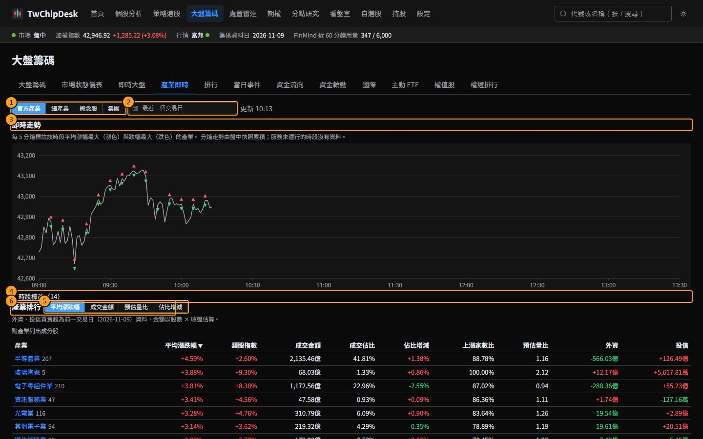
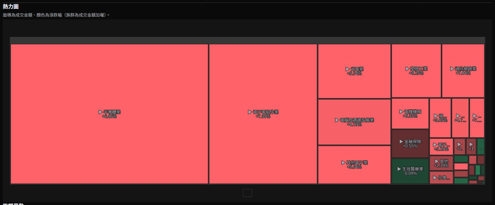
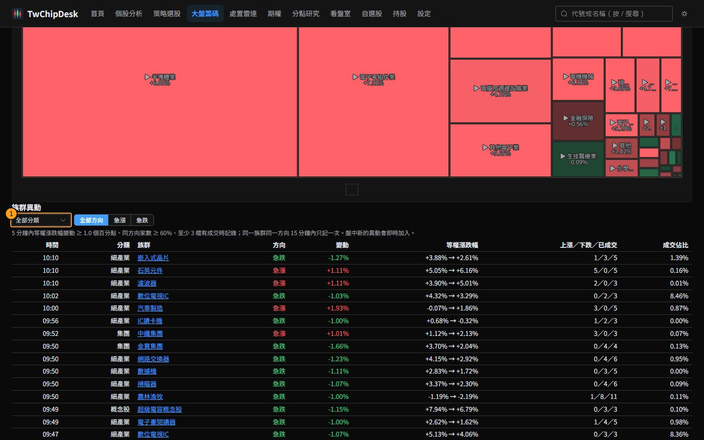

<!-- routes: /market?tab=sectors -->
# 大盤籌碼｜產業即時

> 位置：頂部選單「大盤籌碼」→「產業即時」分頁（網址 `/market?tab=sectors`）
> 資料更新：交易日盤中每 15 秒重新查詢，族群異動以推播即時加入；外資、投信欄為前一交易日的資料（個股三大法人 20:05 後入庫）；細產業、概念股、集團的成員每週六 08:00 更新

## 這個功能可以做什麼
盤中看哪些族群強、哪些弱：加權指數當日走勢上每 5 分鐘標出平均漲幅最大與跌幅最大的族群；族群排行列出每個族群的平均漲跌幅、成交金額與佔大盤比例、預估量比與前一交易日法人買賣超；熱力圖用面積表示成交金額、顏色表示漲跌；族群異動記錄盤中短時間急漲、急跌的族群。點族群可以看成分股，或開啟[族群頁](group.md)。

## 畫面說明

> 這張圖在非交易時段拍攝，顯示最近一個交易日的收盤狀態；盤中標題列會顯示「更新 時:分:秒」，並多出預估量比等盤中數字。

| 編號 | 名稱 | 說明 |
|---|---|---|
| 1 | 族群分類 | 「官方產業」「細產業」「概念股」「集團」。族群分類外掛沒有啟用時改為「官方產業」「產業鏈」，並註明「族群分類外掛未啟用，顯示 FinMind 產業鏈」；選細產業、概念股、集團時註明「族群分類：玉山證券」 |
| 2 | 日期 | 預設「最近一個交易日」；可選過去的日期回看（分鐘走勢只保留最近幾個交易日）。右邊顯示更新時間，收盤後顯示「某日 收盤」 |
| 3 | 即時走勢與時段標註 | 加權指數當日走勢；每 5 分鐘在線上標出該時段平均漲幅最大（漲色▲）與跌幅最大（跌色▼）的族群，滑過標記看名稱 |
| 4 | 時段標註清單 | 點「時段標註（n）」展開，列出每個時段結束時間、最強產業與最弱產業 |
| 5 | 排序捷徑 | 「平均漲跌幅」「成交金額」「預估量比」「佔比增減」，與表頭排序同步 |
| 6 | 族群排行表 | 每個族群一列；點族群名稱列出成分股 |

### 族群排行的欄位
| 欄位 | 說明 |
|---|---|
| 「產業」（外掛分類為「族群」） | 族群名稱與成員檔數；點擊展開成分股（盤中為即時報價），展開區有族群頁的連結；產業鏈可再展開子產業 |
| 「平均漲跌幅」 | 等權漲跌幅：當日已成交成員漲跌幅的簡單平均 |
| 「類股指數」 | 對應類股指數的漲跌幅（只有官方產業有） |
| 「成交金額」 | 今日累計成交金額 |
| 「成交佔比」「佔比增減」 | 今日累計成交金額佔大盤（普通股）比例，與前一交易日全日佔比相比的增減 |
| 「上漲家數比」 | 上漲家數 ÷ 已成交家數 |
| 「預估量比」 | 預估成交金額 ÷ 前一交易日成交金額（估） |
| 「外資」「投信」 | 前一交易日的買賣超金額，以股數 × 收盤估算；表格上方註明是哪一天 |

點欄名可排序（再點一次反向、第三次恢復預設：平均漲跌幅由大到小），排序記在瀏覽器。盤中重新查詢後會依目前排序重排，但滑鼠或鍵盤焦點在表格內時暫停重排，方便點選。

### 熱力圖

只在看「最近一個交易日」時顯示。每個色塊是一個族群，面積為成交金額、顏色為漲跌幅（官方產業為成交金額加權，外掛分類為等權漲跌幅）。官方產業可直接點色塊往下一層看個股（產業鏈依序為產業鏈 → 子產業 → 個股）。細產業、概念股、集團只有族群層級的色塊，點族群色塊會改顯示「某族群的成分股」（面積為成交金額、顏色為個股漲跌幅），點「返回全部族群」回上一層。

### 族群異動

記錄盤中短時間內等權漲跌幅急漲、急跌的族群，由新到舊：

| 欄位 | 說明 |
|---|---|
| 「時間」 | 偵測到的時間 |
| 「分類」「族群」 | 族群的分類與名稱；點名稱開族群頁 |
| 「方向」 | 「急漲」或「急跌」 |
| 「變動」 | 視窗內等權漲跌幅變動的百分點 |
| 「等權漲跌幅」 | 視窗開始 → 結束時的等權漲跌幅 |
| 「上漲／下跌／已成交」 | 視窗內上漲、下跌的成員數與已成交成員數 |
| 「成交佔比」 | 這個族群的成交佔比 |

上方可用「全部分類」選單與「全部方向／急漲／急跌」篩選；點一列展開「n 分鐘內變動最大的成員」與成分股。說明列寫出目前的記錄條件，預設為：5 分鐘內等權漲跌幅變動 ≥ 1.0 個百分點、同方向家數 ≥ 60%、至少 3 檔有成交時記錄；同一族群同一方向 15 分鐘內只記一次；09:05 起才開始偵測（開盤集合競價的跳動不算）。盤中新的異動會即時加入。

產業排行標題列的「匯出 CSV」把排行目前的列與順序存成 CSV 檔（不含展開的子產業與成分股）；檔名為「產業_分類_日期.csv」，盤中匯出的是按下當下的快照，檔名後面加上時間（例如 `_1032`）。預估量比與法人買賣超金額的欄名加「（估）」。數值不加千分位、不加 % 符號（百分比欄的欄名註明「（%）」），沒有資料的格子空白，估計值的欄名加「（估）」；沒有資料列時按鈕無法按。

## 操作步驟
1. 選族群分類（例如「概念股」）。
2. 看走勢圖上的標註了解各時段的強弱族群，或展開「時段標註」看清單。
3. 在族群排行點排序捷徑（例如「成交金額」），找出資金集中的族群。
4. 點族群名稱展開成分股；要看完整資料時點展開區的族群頁連結。
5. 往下看熱力圖與族群異動。

## 欄位與名詞
- **等權漲跌幅**：族群內當日已成交成員漲跌幅的簡單平均，每檔權重相同。
- **一檔股票可以屬於多個族群**：各族群的成交佔比加總不是 100%。
- **小族群**：成員少於 3 檔的族群照常列出，但不列入強弱排名與族群異動。
- **預估成交金額**：以各股目前累計成交金額與日內輪廓估算全日成交金額（估）。

## 資料來源與更新時間
- 盤中：個股即時報價彙總，每 15 秒重新查詢；分鐘走勢由盤中快照累積，服務未運行的時段沒有資料。
- 族群成員：官方產業依股票主檔；細產業、概念股、集團由族群分類外掛（資料來源玉山證券）每週六 08:00 更新；產業鏈來自 FinMind，每週日 08:00 更新。
- 外資、投信：前一交易日的個股三大法人。

## 注意事項與限制
- 歷史日期的分鐘走勢只保留最近 10 個交易日（設定頁可調整保留天數）。
- 記錄條件與標註間隔可在設定頁調整，畫面的說明文字會跟著改變。
- 這裡只呈現盤中發生了什麼，不做任何判斷。

## 相關功能
- [族群頁](group.md)：單一族群的今日表現、走勢、異動、成分股與近 20 日強弱
- [資金流向](flow.md)：盤後的族群成交金額與法人買賣超
- [首頁](../home.md)：產業強弱與族群異動的精簡版
