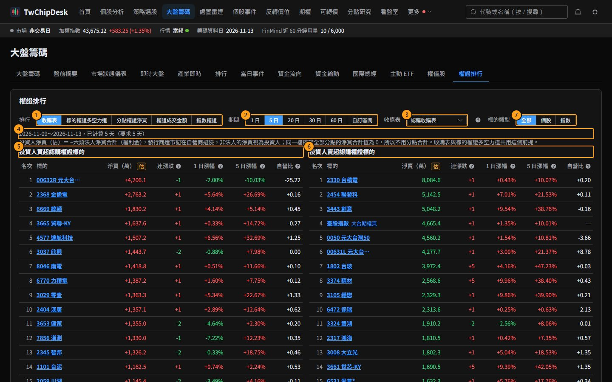
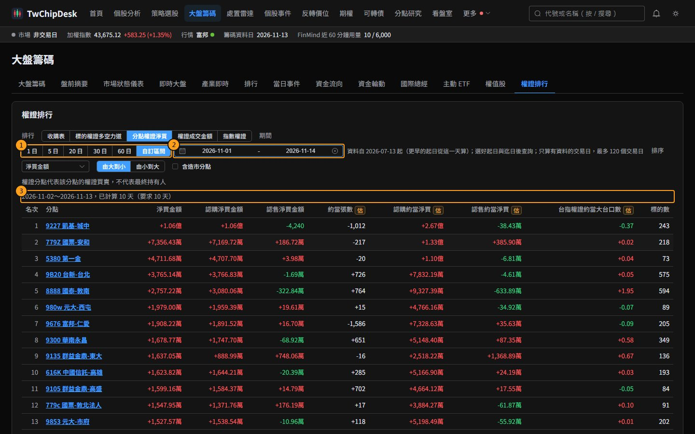
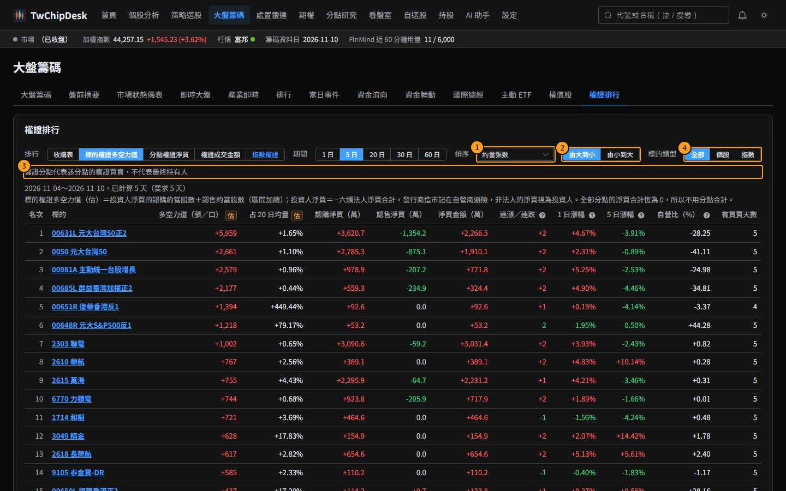
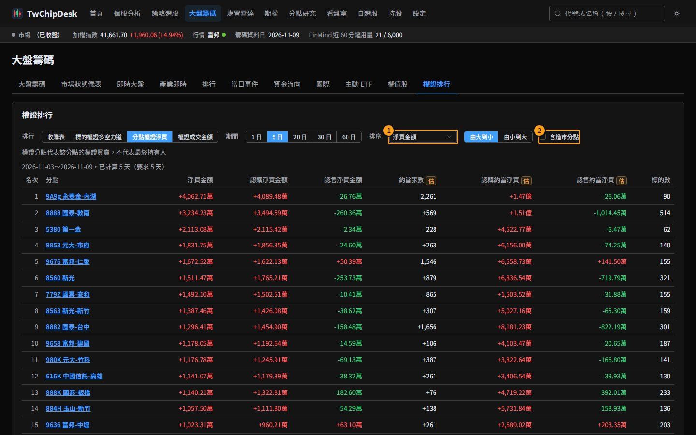
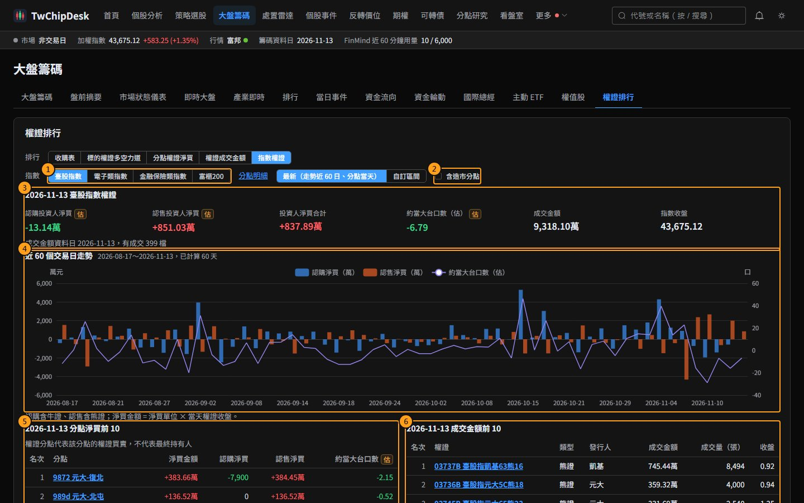
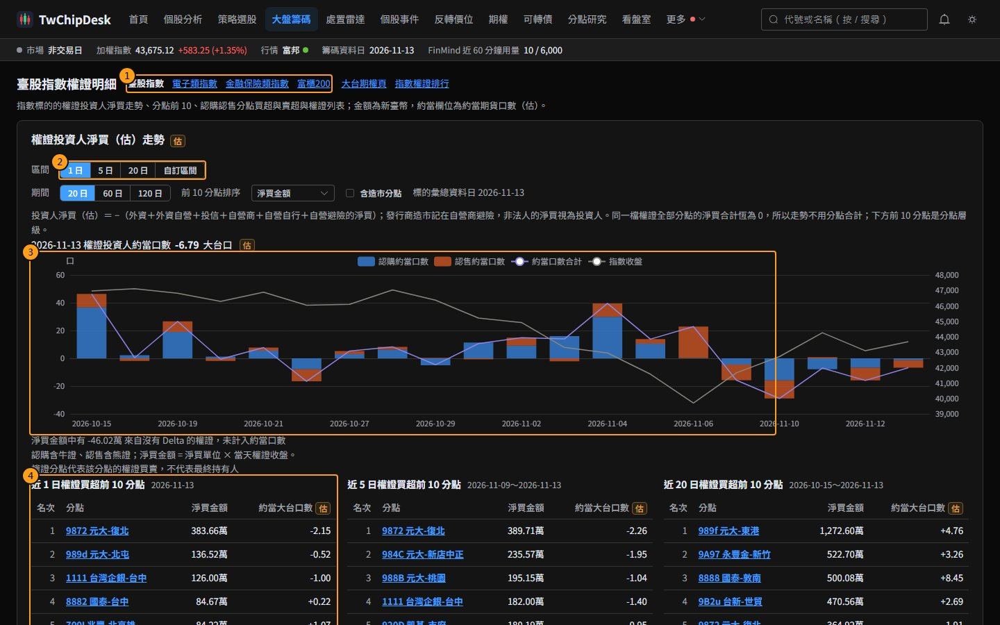
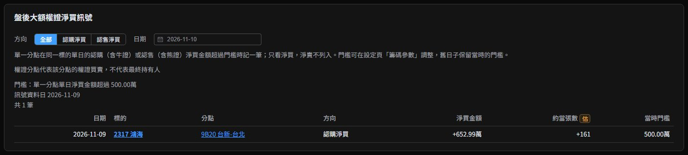
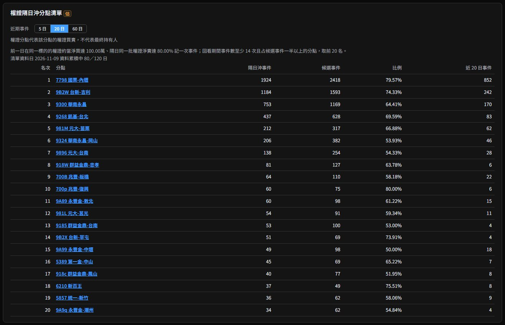

<!-- routes: /market?tab=warrants, /warrants/index/:id -->
# 大盤籌碼｜權證排行

> 位置：頂部選單「大盤籌碼」→「權證排行」分頁（網址 `/market?tab=warrants`）
> 資料更新（交易日）：權證日行情與分析值（Delta 等）17:35 全市場日 K 後；權證投資人淨買在個股三大法人（20:05 起）入庫後計算；分點權證淨買、大額權證淨買訊號與權證隔日沖分點在權證分點（20:30 起，依分點逐一抓取）核對完成後計算

## 這個功能可以做什麼
從權證的資金看標的股：哪些股票的認購（或認售）權證被投資人淨買、淨賣最多（收購表），標的的權證多空力道換算成標的股的約當張數是多少，哪些分點在權證上的淨買金額最大，哪些權證成交金額最大。下方另有單一分點單日大額權證淨買的訊號清單，以及權證隔日沖分點清單。

標的除了股票與 ETF，也包含 4 個指數的權證：臺股指數、電子類指數、金融保險類指數、富櫃200（見下方「指數權證」）。外國標的與其他指數的權證不列入。

排行只依數值大小排序，「估」的欄位都是推算值。權證分點代表該分點的權證買賣，不代表最終持有人。

點指數標的（例如「臺股指數」）開啟[指數權證明細頁](#指數權證明細頁)，可以像個股一樣看這個指數的權證分點明細。

## 畫面說明

| 編號 | 名稱 | 說明 |
|---|---|---|
| 1 | 排行種類 | 「收購表」（預設）、「標的權證多空力道」「分點權證淨買」「權證成交金額」「指數權證」 |
| 2 | 期間 | 「1 日」「5 日」（預設）「20 日」「30 日」「60 日」或「自訂區間」（見下方「自訂區間」） |
| 3 | 收購表方向 | 「認購收購表」（預設）或「認售收購表」；旁邊的「?」說明「投資人淨買（估）依標的加總，認購或認售權證分開計算」 |
| 4 | 計算區間 | 例如「2026-11-03～2026-11-09，已計算 5 天（要求 5 天）」；下方一行說明投資人淨買的計算前提 |
| 5 | 投資人買超表 | 「投資人買超認購（認售）權證標的」：投資人淨買金額最大的標的，前 50 名 |
| 6 | 投資人賣超表 | 「投資人賣超認購（認售）權證標的」：投資人淨賣金額最大的標的，前 50 名 |
| 7 | 標的類型 | 「全部」（預設）「個股」「指數」；選「指數」只列臺股指數等指數標的 |

### 收購表的欄位
| 欄位 | 說明 |
|---|---|
| 「名次」「標的」 | 點標的開啟個股頁；指數標的（例如「臺股指數」）開啟指數權證明細頁，名稱旁的小連結（例如「大台期權頁」）開啟期權頁的對應期貨商品 |
| 「淨買（萬）」／「淨賣（萬）」（估） | 區間內投資人在這個標的的認購（或認售）權證淨買金額（權利金），單位萬元 |
| 「連漲跌」 | 標的股由資料日往前連續上漲（+n）或下跌（−n）的天數；平盤或沒有成交中斷，最多數 60 天 |
| 「1 日漲幅」「5 日漲幅」 | 標的股的漲跌幅（以開盤參考價計，除權息日不會顯示成大跌）；指數標的用指數收盤計，富櫃200 沒有指數資料，顯示「—」 |
| 「自營比」 | 自營商避險淨買量 ÷ 成交股數 × 100（%，帶正負號），以排行期間的交易日計 |

欄名旁的「?」可看完整定義。

### 自訂區間

| 編號 | 名稱 | 說明 |
|---|---|---|
| 1 | 「自訂區間」 | 在期間選「自訂區間」後出現日期選擇；選好起日與迄日才重新查詢，之前沿用原本的天數 |
| 2 | 起日、迄日 | 早於資料起日與晚於今天的日子不能選；選了起日後，使起迄（含頭尾）超過 24 週（168 天）的日子也不能選；旁邊註明「資料自 YYYY-MM-DD 起」與「最多 120 個交易日」 |
| 3 | 計算區間 | 實際使用的起迄：起日與迄日對齊到區間內有資料的交易日（例如起日選星期六，從下一個有資料的交易日算起） |

- 每一種排行都可以用自訂區間：收購表與多空力道看權證投資人淨買的資料，分點權證淨買看權證分點的資料，權證成交金額看權證日行情。
- 排行的自訂區間最多 120 個交易日（四種排行都是全市場加總，上限比個股頁的權證分頁短）。
- 起日早於資料起日時從資料起日算起，「計算區間」顯示實際使用的起迄；換排行種類時，已選的區間會夾到該種類的資料起日，整段都早於資料起日時回到「5 日」。
- 區間超過上限或區間內沒有已完成的資料時，日期選擇旁顯示「日期區間不正確：」與原因，排行保留上一次的結果。
- 清除日期或改選「1 日」等天數就回到原本的期間。

### 標的權證多空力道

| 編號 | 名稱 | 說明 |
|---|---|---|
| 1 | 排序 | 「約當張數」「占 20 日均量」「淨買金額」 |
| 2 | 方向 | 「由大到小」或「由小到大」（看偏空的標的時選由小到大） |
| 3 | 分點說明 | 「權證分點代表該分點的權證買賣，不代表最終持有人」 |
| 4 | 標的類型 | 「全部」（預設）「個股」「指數」；依約當張數排序時指數標的排在最後，選「指數」只列指數標的 |

欄位為「多空力道（張／口）」（估：投資人淨買的認購約當張數＋認售約當張數，認售為負；指數標的顯示約當期貨口數，數字後標商品，例如「+1,930.55大台口」）、「占 20 日均量」（多空力道 ÷ 標的 20 日均量；指數標的為約當口數 ÷ 約當期貨所有月份合計日成交量的 20 日平均）、「認購淨買（萬）」「認售淨買（萬）」「淨買金額（萬）」、連漲跌、1 日與 5 日漲幅、自營比、「有買賣天數」。

### 分點權證淨買

| 編號 | 名稱 | 說明 |
|---|---|---|
| 1 | 排序 | 「淨買金額」「約當張數」「認購淨買金額」「認售淨買金額」「認購約當淨買（估）」「認售約當淨買（估）」「台指權證約當大台口數（估）」 |
| 2 | 含造市分點 | 預設不含發行商造市分點（設定「權證造市分點」的清單）；勾選後納入。排除時表格下方註明「已排除發行商造市分點（設定：權證造市分點）」 |

欄位為「分點」「淨買金額」「認購淨買金額」「認售淨買金額」「約當張數」（估）「認購約當淨買」「認售約當淨買」「台指權證約當大台口數」（估）「標的數」，以全部標的加總。淨買金額與標的數含指數權證；約當張數、認購與認售約當淨買只算股票標的；「台指權證約當大台口數」只算臺股指數權證。

### 權證成交金額
列出區間成交金額最大的權證：「權證」「標的」「類型」「發行人」「成交金額」「成交量（張）」「成交天數」。排序可選「成交金額」或「成交量」，只由大到小。指數權證的標的顯示對照名稱（例如「臺股指數」），點標的開啟指數權證明細頁。

### 指數權證

| 編號 | 名稱 | 說明 |
|---|---|---|
| 1 | 指數 | 「臺股指數」（預設）「電子類指數」「金融保險類指數」「富櫃200」；旁邊的「分點明細」開啟這個指數的指數權證明細頁 |
| 2 | 含造市分點 | 分點淨買前 10 預設不含發行商造市分點；勾選後納入 |
| 3 | 摘要 | 最新一天（自訂區間時為區間的最後一天）的「認購投資人淨買」「認售投資人淨買」「投資人淨買合計」（估）、「約當大台口數（估）」（電子類為小型電子期、金融保險類為小型金融期）、「成交金額」與「指數收盤」；下方註明成交金額的資料日與有成交的檔數 |
| 4 | 走勢 | 近 60 個交易日：認購、認售淨買金額（萬元）柱狀，約當口數（估）折線在右軸；指數權證還沒計算的日子圖上留空，並註明「有 n 天的指數權證尚未計算，圖上留空」，已計算但這個指數當天沒有淨買的日子畫 0 |
| 5 | 分點淨買前 10 | 當天這個指數權證淨買金額最大的 10 個分點：「淨買金額」「認購淨買」「認售淨買」「約當大台口數」（估）；點分點開啟分點頁的權證進出 |
| 6 | 成交金額前 10 | 當天這個指數成交金額最大的 10 檔權證：「權證」「類型」「發行人」「成交金額」「成交量（張）」「收盤」 |

期間可選「最新（走勢近 60 日、分點當天）」（預設）或「自訂區間」：自訂區間時走勢改為區間內的日子、分點淨買前 10 改為區間加總（標題寫出起迄），摘要與成交金額前 10 為區間的最後一天；可選的最早一天是權證投資人淨買與權證分點都有資料的第一天（畫面註明「資料自 YYYY-MM-DD 起」），最多為權證分點保留的交易日數。區間內沒有已完成的資料時，日期選擇旁顯示「日期區間不正確：」與原因，面板保留上一次的結果。

期權頁台指期（TX）商品頁的「台指權證（估）」小卡點「看「指數權證」排行」也會開到這裡（臺股指數）。富櫃200 沒有指數資料，約當口數顯示「—」，只列淨買金額。

### 指數權證明細頁

> 位置：權證排行點指數標的、「指數權證」的「分點明細」或分點 × 指數頁上方的連結（網址 `/warrants/index/IX0001`）

和[個股頁「權證」分頁](../stock/warrants.md)相同的區塊，標的換成指數：

| 編號 | 名稱 | 說明 |
|---|---|---|
| 1 | 指數切換 | 「臺股指數」「電子類指數」「金融保險類指數」「富櫃200」；旁邊有約當期貨的期權頁（例如「大台期權頁」）與「指數權證排行」的連結 |
| 2 | 區間 | 「1 日」（預設）「5 日」「20 日」或「自訂區間」，帶動認購、認售分點清單；自訂區間時走勢與第四張前 10 分點表也依區間 |
| 3 | 權證投資人淨買（估）走勢 | 認購、認售約當口數（柱）、約當口數合計（線）與指數收盤（右軸）；上方列出最近一日的「權證投資人約當口數」 |
| 4 | 前 10 分點 | 「近 1 日」「近 5 日」「近 20 日」（與自訂區間）的權證買超前 10 分點，約當欄為「約當大台口數」等（估）；點分點開啟分點 × 指數頁 |
| 5 | 認購、認售分點買超與賣超 | 依「淨買金額」或「約當口數（估）」排序，列出買超與賣超前 15 分點 |
| 6 | 權證清單 | 這個指數的全部權證，欄位與篩選同個股頁；點代號開啟權證個別頁 |

- 金額一律為新臺幣；個股頁的「約當張數」在這裡是約當期貨口數（估），算法見下方「約當口數（估）」。
- 富櫃200 沒有指數資料：約當口數欄顯示「—」，走勢改畫淨買金額，依約當口數排序的清單顯示「富櫃200 沒有指數資料：沒有 Delta，約當口數不計算，只列淨買金額。」
- 這一頁沒有盤中區塊（盤中監控不含指數權證），也沒有占 20 日均量。

### 盤後大額權證淨買訊號

單一分點在同一標的單日的認購（含牛證）或認售（含熊證）淨買金額超過門檻時記一筆；只看淨買，淨賣不列入。可選「方向」（「全部」「認購淨買」「認售淨買」）與「日期」（預設最新），上方列出目前的門檻（例如「門檻：單一分點單日淨買金額超過 500.00萬」）、訊號資料日與筆數；欄位為日期、標的、分點、方向、淨買金額、約當張數／口數（估；指數標的顯示約當期貨口數並標商品）、當時門檻。門檻可在設定頁「籌碼參數」調整，舊日子保留當時的門檻。筆數很多時只列出淨買金額最大的前幾筆並註明總筆數。

### 權證隔日沖分點清單

前一日在同一標的的權證約當淨買達門檻、隔日同一批權證淨賣達比例時記一次事件；回看期間事件數夠多且占候選事件一半以上的分點，取前 20 名。「近期事件」可選「5 日」「20 日」（預設）「60 日」，決定最後一欄「近 n 日事件」的天數。欄位為名次、分點、隔日沖事件、候選事件、比例、近 n 日事件。說明列寫出目前的門檻（例如約當淨買達 100.00萬、隔日淨賣達 80.00%、事件數至少 14 次）與清單資料日；資料還沒累積滿回看天數時註明「資料累積中 n／120 日」，事件數門檻依累積天數等比例縮放。清單為推算結果（標「估」），不含發行商造市分點。

## 操作步驟
1. 預設打開為「收購表」的「認購收購表」、期間 5 日。
2. 切「認售收購表」看認售權證的投資人淨買。
3. 切「標的權證多空力道」並把排序換成「占 20 日均量」，看權證約當部位相對標的成交量較大的股票。
4. 切「分點權證淨買」看哪些分點的權證淨買金額最大；需要時勾「含造市分點」，或把排序換成「台指權證約當大台口數（估）」。
5. 切「指數權證」看臺股指數權證最新一天的投資人淨買、近 60 日走勢與當天分點前 10；可改選電子類、金融保險類或富櫃200，或按「分點明細」看這個指數的完整分點明細。
6. 要看特定一段日子時，期間選「自訂區間」再選起日與迄日。
7. 往下看大額權證淨買訊號與權證隔日沖分點清單。

## 欄位與名詞
- **投資人淨買（估）**：＝ −（外資＋外資自營＋投信＋自營商＋自營自行＋自營避險的淨買）。前提是發行商造市的成交記在自營商避險，非法人的淨買視為投資人。同一檔權證全部分點的淨買合計恆為 0，所以不用分點合計。
- **約當張數（估）**：權證淨買單位 × 當天行使比例 × Delta ÷ 1,000；認售淨買的約當張數為負，代表偏空的約當部位。只用當天有收盤價與 Delta 的權證，排除外國標的；指數標的不換算成張數，改用約當口數。
- **約當口數（估）**：指數權證的行使比例是每 1 單位每 1 點的金額（元），Σ（淨買單位 × 行使比例 × Delta）的單位是「元／點」；約當口數＝元／點 ÷ 約當期貨的每點金額：臺股指數對大台（每點 200 元）、電子類指數對小型電子期（每點 500 元）、金融保險類指數對小型金融期（每點 250 元）。富櫃200 沒有指數資料（沒有 Delta），只計淨買金額。Delta 以指數收盤推算，與股票權證同一個模型，標「估」。
- **占 20 日均量**：多空力道（認購＋認售約當股數）÷ 標的 20 日均量（含當天往前 20 個交易日的平均成交股數）。指數標的為約當口數 ÷ 約當期貨所有月份合計日成交量（口）的 20 日平均，資料不足 20 天時顯示「—」。
- **自營比**：Σ（自營商避險買量 − 避險賣量）÷ Σ 成交股數 × 100，正為避險買超；自營商避險部位多來自權證等商品的發行避險，但資料不區分來源。

## 資料來源與更新時間
| 內容 | 更新時間（交易日） |
|---|---|
| 權證日行情與分析值（Delta、行使比例） | 17:35 全市場日 K 寫入後計算 |
| 權證投資人淨買（收購表、多空力道） | 20:05 個股三大法人入庫後計算 |
| 權證分點（分點權證淨買、訊號、隔日沖清單） | 20:30 起依分點逐一抓取，全部核對完成後計算，通常較晚 |

區間只有部分日子已計算時，畫面註明「區間內只有 n 天已計算，其餘 m 天尚未計算，不列入加總」；資料還沒計算時說「尚未計算」。

## 注意事項與限制
- 權證功能可在設定頁「籌碼參數」關閉，關閉時顯示「權證功能目前關閉，可在設定頁「籌碼參數」開啟。」
- 官方資料外掛關閉時沒有 Delta：約當張數、多空力道與占 20 日均量顯示「需要官方資料」，淨買金額照常。
- 權證資料僅供研究參考；成交量以張計（1 張 = 1,000 單位）。
- 指數標的的連結開指數權證明細頁，不是個股頁。只有「收購表」與「標的權證多空力道」的指數列在名稱旁另有小連結（例如「大台期權頁」），開期權頁的對應期貨商品（TX、ZEF、ZFF、G2F）；「權證成交金額」、盤後大額權證淨買訊號與分點頁「權證進出」的指數列沒有這個小連結，期權頁從指數權證明細頁上方的連結開。分點頁「權證進出」的「進出走勢」可開分點 × 指數頁（主連結「指數權證明細」，第二個連結「期權頁約當期貨」），該頁不畫 K 線，只畫這個分點的認購、認售買賣超金額。
- 自訂區間只能從資料起日選起；排行最多 120 個交易日，指數權證面板、個股頁與指數權證明細頁的權證分頁最多為權證分點保留的交易日數。目前權證分點與標的彙總約從 2026-07-13 起，權證投資人淨買約從 2026-05-14 起。
- 各區塊依自己讀的資料對齊到已完成的日子（收購表、多空力道與指數走勢看權證投資人淨買；分點淨買、前 10 分點與認購認售清單看權證分點；成交金額看權證日行情），所以同一個要求區間在不同區塊的實際起迄可能差一天，以畫面上的「計算區間」「實際區間」為準。

## 相關功能
- [個股分析](../stock/README.md)：個股的「權證」分頁與權證個別頁
- [分點研究](../brokers/README.md)
- [設定](../settings.md)：「籌碼參數」的權證開關、訊號門檻、權證造市分點
- [期貨](../derivatives/futures.md)：台指期（TX）商品頁的「台指權證（估）」小卡
