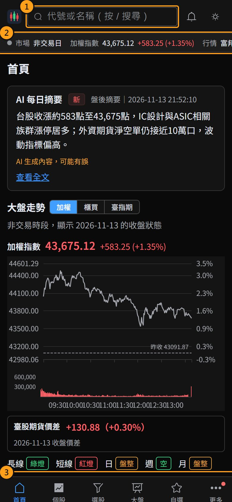
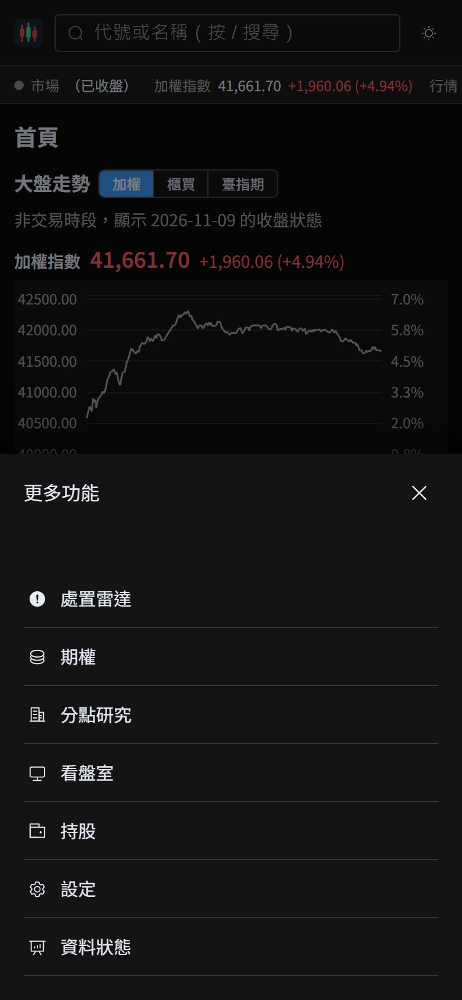
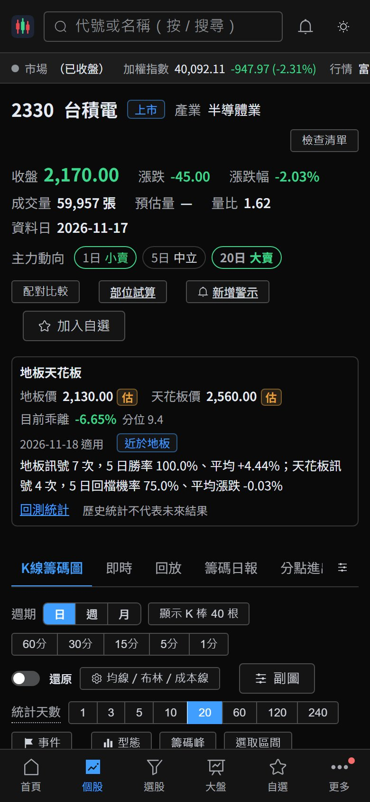
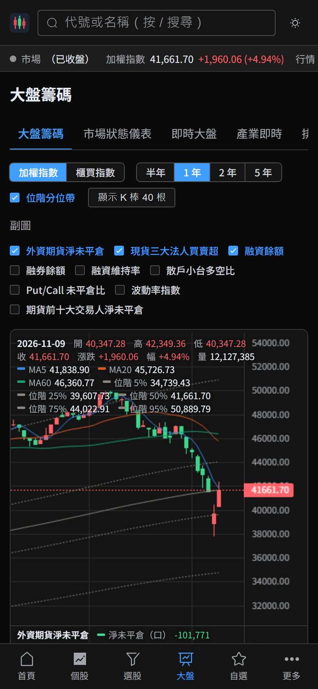

<!-- routes: / -->
# 手機版

> 位置：手機瀏覽器開啟電腦上 TwChipDesk 的手機連線網址（經 Tailscale，網址由使用者自行設定，見下方「開啟方式」）
> 資料更新：與電腦相同

## 這個功能可以做什麼
在手機上用同一套系統看盤、查個股、看自選股。手機版和電腦版是同一個網站，資料、自選股、持股、設定都相同；畫面寬度小於 768 像素時自動改成手機版面。依擁有者的決定，手機上可以做的操作與電腦相同（包括修改自選、持股與設定）。

## 開啟方式
1. 電腦要開機，TwChipDesk 服務要在執行中。
2. 手機與電腦都連上同一個 Tailscale 網路（只有允許的 Tailscale 帳號能連線）。
3. 在手機瀏覽器開啟手機連線網址（`https://<電腦的 Tailscale 名稱>:8443/`；實際名稱與允許的帳號在設定頁填寫，手冊不記錄）。
4. iPhone 可在 Safari 按「分享」→「加入主畫面」，之後從主畫面圖示以全螢幕開啟。系統不使用離線快取，所以每次開啟都是最新版。

連不上時畫面會顯示「無法連到電腦上的服務，請確認電腦開機、服務執行中、Tailscale 已連線。」被拒絕時顯示「手機連線被拒絕」與原因。

## 畫面說明

| 編號 | 名稱 | 說明 |
|---|---|---|
| 1 | 搜尋 | 頂部只留圖示、搜尋框與主題切換；頂部選單改到底部。 |
| 2 | 狀態列 | 與電腦相同的市場狀態列，內容較多時可左右滑動。 |
| 3 | 底部分頁列 | 「首頁」「個股」「選股」「大盤」「自選」「更多」。 |

首頁第一屏是「[我的今日清單](home.md#我的今日清單)」（截圖未包含這張卡片，因為內容是自選股與持股）：預設 5 列，每列兩行（第一行股票與「持股」「自選」標記，第二行事實與日期），整列可點；資料日小籤可左右滑動；「AI 每日摘要」卡片排在今日清單下方。

### 更多

點底部「更多」打開「更多功能」：「處置雷達」「個股事件」「反轉價位」「期權」「可轉債」「分點研究」「看盤室」「盤中監控」（設定頁開啟後才出現）「當沖監控」「持股」「AI 助手」「AI 每日摘要」「設定」「資料狀態」。當沖監控的燈號表在手機上以卡片顯示，流水牆可以照常使用與語音播報。

### 個股與大盤

- 個股頁的報價、主力動向、「加入自選」與分頁都在上方，分頁列可左右滑動。
- 個股頁的風險旗標列最多顯示兩行，放不下的以「＋n」表示；點任何一顆或「檢查清單」，清單由下往上打開（高度約八成五），可以上下捲動，點右上角的關閉鈕或按返回關閉。手機沒有滑鼠提示，說明都寫在清單裡。
- K 線圖：上下滑動捲動頁面，左右拖曳移動圖表。
- 大盤籌碼等頁面的分頁列同樣可以左右滑動。
- 個股事件的「重大訊息」與個股頁的「公告」：篩選收成一顆「篩選」按鈕（重大訊息），點了從底部打開篩選條件；類別籤與各市場資料日可以左右滑動；清單改成卡片（第一行時間與股票、第二行類別與標記、第三行主旨）；點一則改成全螢幕，左上角「返回清單」或手機的返回鍵回到清單，篩選條件不變。

### 自選

手機不顯示左側自選欄，請用底部「自選」開啟自選股頁。（截圖中的群組名稱與股票代號、名稱已模糊處理。）

## 手機上的操作差異
- **提示文字**：電腦上滑鼠移上去才出現的說明（例如狀態列的行情燈號、停用分頁的原因、「估」的估算方式、被截斷的名稱），手機上改為點一下顯示，再點一下、點其他地方、捲動或 4 秒後收起。
- **表格排序**：表頭常被捲到畫面外，表格上方有「排序」列可選欄位、切換遞增遞減，按 × 回到預設順序。
- **輸入框**：手機上輸入框字級較大，點選時不會自動放大畫面；仍可用雙指縮放。
- **背景與恢復**：在手機上切到其他 App 或鎖定螢幕超過 60 秒，系統會暫停即時連線以節省流量與電量；回到畫面時自動重新連線並更新目前頁面的資料。
- **左側自選欄**：不顯示（畫面寬度不到 1024 像素）。
- **排程儀表板（Hangfire）**：手機無法開啟。
- 部分寬表格在手機上需要左右滑動查看。

## 注意事項與限制
- 手機版只透過 Tailscale 連線，不對網際網路公開。手機遺失時，在 Tailscale 管理台移除該裝置即可立即斷開。
- 電腦關機或服務停止時，手機無法使用。
- 行動網路下，即時資料與圖表會使用流量。

## 常見問題
- **手機上看到的是舊畫面？** 系統更新後換頁會自動載入新版；仍有問題時下拉重新整理。
- **手機上改的自選股，電腦上看得到嗎？** 看得到，資料存在電腦上的服務。

## 相關功能
- [快速入門](getting-started.md)
- [首頁](home.md)
- [自選股](watchlist.md)
- [個股事件｜重大訊息](events/material.md)
