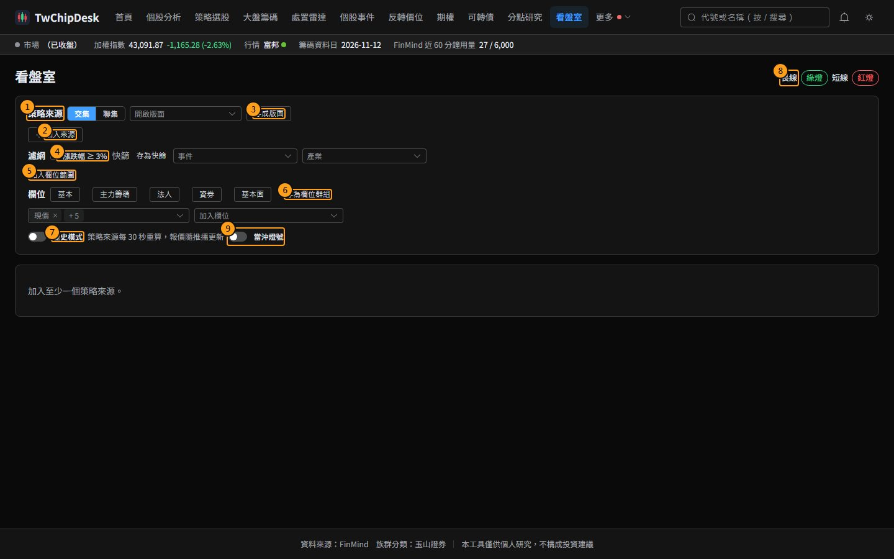

<!-- routes: /monitor -->
# 看盤室

> 位置：頂部選單「看盤室」（網址 `/monitor`）；手機在底部「更多」裡
> 資料更新：盤中報價隨即時推播更新，策略來源每 30 秒重新計算；盤後欄位（主力、法人、資券、基本面）取自每晚計算的選股特徵

## 這個功能可以做什麼
把多個「策略來源」（自選股群組、策略、即時訊號、當日事件、產業）合併成一張即時報價表，再用濾網與欄位範圍縮小名單，盤中一個畫面盯住關心的股票。版面可以存起來，下次一鍵開啟。也可以切到「歷史模式」，看某一天盤中或盤後的狀態。

## 畫面說明

（截圖為還沒加入來源的初始畫面。）

| 編號 | 名稱 | 說明 |
|---|---|---|
| 1 | 策略來源與合併方式 | 已加入的來源會列在這裡，每個來源顯示檔數，可個別移除。多個來源用「交集」（同時出現在每個來源）或「聯集」（任一來源）合併。 |
| 2 | 加入來源 | 選擇來源種類後加入，見下方「策略來源」。 |
| 3 | 版面 | 「開啟版面」選擇已存的版面；「存成版面」把目前的來源、合併方式、濾網與欄位存成一個版面，可在選單中刪除。 |
| 4 | 濾網 | 「漲跌幅 ≥ 3%」一鍵過濾；「快篩」是存成按鈕的濾網組合（「存為快篩」新增）；「事件」「產業」下拉選單過濾當天有事件或屬於指定產業的股票。 |
| 5 | 欄位漏斗 | 「加入欄位範圍」：任選一個欄位，設定下限、上限，只留下範圍內的股票。 |
| 6 | 欄位 | 預設欄位群組「基本」「主力籌碼」「法人」「資券」「基本面」，或從「加入欄位」挑任一欄位；欄位可左右移動、移除，「存為欄位群組」存成自己的群組。 |
| 7 | 歷史模式 | 開啟後選「日期」與「情境」（「盤中」「盤後」），以那一天的資料重算表格。關閉時為「盤中即時」。 |
| 8 | 長短線燈號 | 大盤的「長線」「短線」燈號（與首頁相同）。 |
| 9 | 「當沖燈號」 | 在「歷史模式」同一列右邊；打開後表格多一欄「當沖燈號與策略」，見下方「當沖燈號」。歷史模式開啟時不能切換。 |

### 策略來源
| 來源種類 | 說明 |
|---|---|
| 自選股 | 選擇一個自選股群組。 |
| 策略 | 選擇策略選股的內建策略或自己的策略，以策略選出的名單為來源。「盤中即時」時以盤中模式選股（見下方「策略來源的型態條件」）。 |
| 即時訊號 | 選擇訊號種類（不選為全部），以當天出現該訊號的股票為來源。 |
| 當日事件 | 選擇事件類別（不選為全部），以當天有事件的股票為來源。 |
| 產業 | 選擇一個或多個產業。 |

即時訊號的種類：「開盤強勢」「短線急拉」「短線急殺」「創新高」「創新低」「爆量」「長上影線」「長下影線」「漲停」「跌停」「漲跌停打開」「站上均價線」「跌破均價線」「大單敲進」。訊號在盤中每 10 秒以快照偵測；同一股票同一訊號 30 分鐘內不重複，創新高、創新低與開盤強勢一天只發一次。訊號本身的列表與通知在 [策略選股｜訊號](screener/README.md)。

### 策略來源的型態條件
「盤中即時」時，策略來源用盤中模式比對：「型態」條件以今天到目前為止的 K 棒判斷（暫定，與[策略選股的盤中型態](screener/screener.md#盤中型態)相同，伺服器最快每 60 秒重算一次），其他非盤中條件用前一交易日的盤後值。表格上方的說明列會標示：
- 「策略來源的型態條件以今天到目前為止的 K 棒計算（暫定）」：已套用盤中 K 棒。
- 「策略來源的型態條件暫不套用盤中 K 棒，以欄位資料日的日 K 計算」：盤中型態準備中、計算暫時失敗或前一交易日的特徵尚未完成（此時欄位資料日早於前一交易日）；欄位資料日即說明列「價格 …・欄位 …」的欄位日期。有任一個策略來源沒有套用時就顯示這一句。

歷史模式不套用盤中 K 棒。

### 即時欄位
「現價」「漲跌幅」「成交量（張）」「預估量比」「均價」「最高」「最低」「開盤漲幅」「買價」「賣價」「內外盤比」。其餘欄位（主力、法人、資券、基本面）為前一個籌碼資料日的盤後資料。

### 當沖燈號
打開「當沖燈號」開關，表格在股票欄後面多一欄「當沖燈號與策略」：
- 燈號：與[當沖監控｜燈號表](daytrade/board.md)相同的 10 個燈號與 2 個複合燈，亮著的燈有顏色，滑過可看亮起時間與規則。
- 策略：今天符合過的當沖策略，例如「S1 開盤強勢 09:10」（同一策略只列第一次符合的時間）。
- 沒有當沖資料的股票顯示「—」。點欄名可依「亮著的燈數＋符合的策略數」排序。

只查看盤室來源順序的前 300 檔（超過時說明列會寫出）；收到當沖推送時更新。非交易日或盤前顯示最後一個交易日收盤時的狀態，說明列會註明。歷史模式不顯示這一欄。開關記在瀏覽器。

### 明細抽屜
點任一列，右側打開「明細」：主力動向、買超前 5 名分點、近 60 日收盤小圖，以及「開啟個股頁」。

## 操作步驟
**盤中看盤**
1. 按「加入來源」，例如選「自選股」的一個群組，再加一個「即時訊號」來源。
2. 合併方式選「聯集」看全部，或「交集」只看兩邊都有的股票。
3. 勾「漲跌幅 ≥ 3%」或用「加入欄位範圍」再縮小名單。
4. 選欄位群組（例如「主力籌碼」），點表頭排序。
5. 按「存成版面」取名保存，下次從「開啟版面」直接載入。

**盤後檢討**
1. 開啟「歷史模式」，選日期與「盤後」情境。
2. 表格依那一天收盤後的資料重新計算；選「盤中」情境則看那一天盤中的狀態。

## 欄位與名詞
- **預估量比**：預估成交量 ÷ 前 5 個交易日平均成交量（估）。
- **內外盤比**：外盤成交量與內盤成交量的比例。
- 其他名詞見 [名詞解釋](reference/glossary.md)。

## 資料來源與更新時間
- 報價：券商即時行情（富邦或玉山）推播；沒有券商行情時用 FinMind 盤中快照。
- 盤後欄位：選股特徵每晚在分點、法人、資券等資料入庫後計算（約 23:50 以後完成），見 [資料來源與更新時間](reference/data-sources.md)。

## 注意事項與限制
- 即時推播有檔數上限（單一連線的上限，畫面會寫出上限）；超過的股票每 30 秒隨來源重算更新。
- 結果超過 1,000 檔時只列前 1,000 檔。
- 依即時欄位排序時，推播不會移動列；順序變了會提示「重新排序」。依盤後欄位排序時，每 30 秒重算後重排。排序記在瀏覽器。
- 沒有加入任何來源時顯示「加入至少一個策略來源。」
- 歷史模式必須選日期才會計算。
- 當沖燈號欄只是盤中狀態的提示，不提供任何操作意見；燈號規則見[當沖監控](daytrade/README.md)。

## 常見問題
- **版面存在哪裡？** 存在後端資料庫，換瀏覽器也看得到；設定頁「資料維護」的匯出會一起匯出。
- **為什麼有些股票的報價不是即時跳動？** 超過即時推播上限的部分每 30 秒更新一次。

## 相關功能
- [盤中監控](live.md)：焦點股的逐筆大額成交與合併事件（估）
- [當沖監控](daytrade/README.md)：燈號表、流水牆也可以選「看盤室」範圍
- [自選股](watchlist.md)
- [策略選股](screener/README.md)
- [大盤籌碼](market/README.md)
