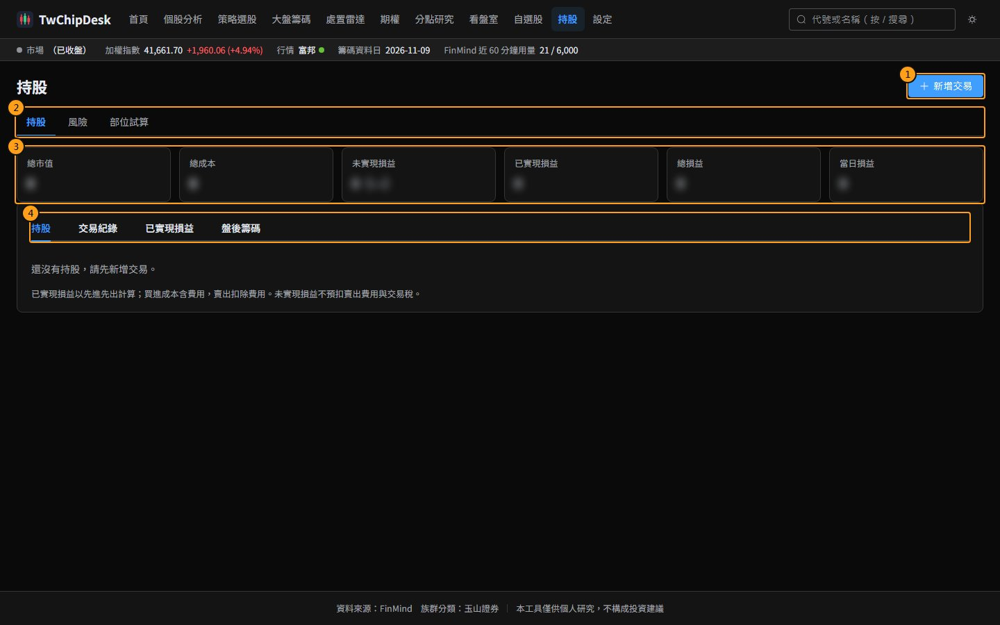
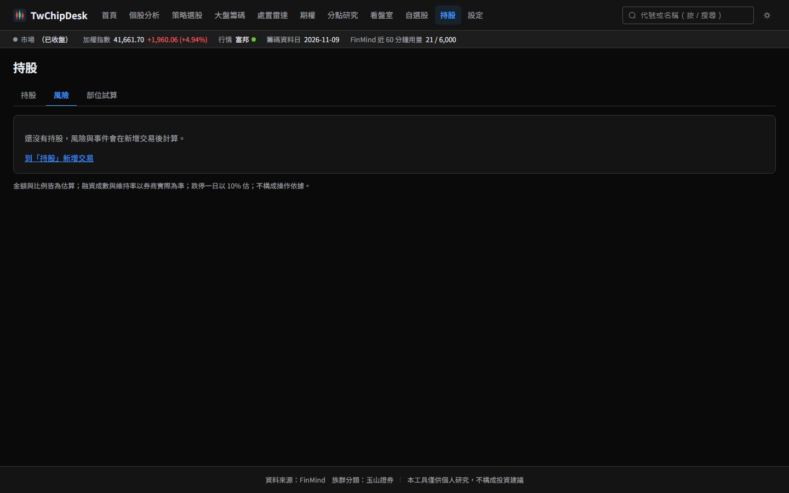
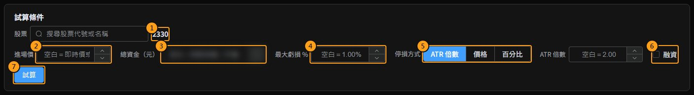

<!-- routes: /portfolio, /portfolio?tab=holdings, /portfolio?tab=risk, /portfolio?tab=sizing -->
# 持股

> 位置：頂部選單「持股」（網址 `/portfolio`）；手機在底部「更多」裡。分頁：「持股」（`?tab=holdings`，預設）、「風險」（`?tab=risk`）、「部位試算」（`?tab=sizing`，可加 `&stock=2330` 直接帶入股票）
> 資料更新：盤中現價即時更新；收盤後以最新收盤價計算；風險分頁的 ATR、均量與處置預測取自每晚計算的選股特徵

## 這個功能可以做什麼
手動記錄自己的交易（不連券商），系統以先進先出計算持有股數、平均成本、未實現與已實現損益，並整理產業分布、盤後籌碼。「風險」分頁估算部位集中度、停損損失、融資追繳距離與近期事件；「部位試算」依可承擔的虧損計算一筆新部位可以買幾張。

> 截圖中的金額、股數、成本與損益已模糊處理。

## 畫面說明

| 編號 | 名稱 | 說明 |
|---|---|---|
| 1 | 新增交易 | 開啟交易視窗：日期、股票、買賣別、股數、成交價、費用（手續費＋交易稅）、備註。 |
| 2 | 頁面分頁 | 「持股」「風險」「部位試算」。 |
| 3 | 資產概覽 | 「總市值」「總成本」「未實現損益」「已實現損益」「總損益」「當日損益」。下方標示「盤中即時」與時間，或價格日。 |
| 4 | 持股內的分頁 | 「持股」「交易紀錄」「已實現損益」「盤後籌碼」。 |

### 持股內的分頁
| 分頁 | 內容 |
|---|---|
| 持股 | 每檔的股票、產業、股數、平均成本、現價、漲跌幅、市值、未實現損益、報酬率、當日損益、已實現。下方「產業分布」長條圖。 |
| 交易紀錄 | 每筆交易的日期、股票、買賣別、股數、成交價、費用、備註，可「修改」或「刪除」（刪除前確認）。 |
| 已實現損益 | 每次賣的日期、股票、股數、淨額、成本、損益、報酬率。 |
| 盤後籌碼 | 持有股票的「主力籌碼」「三大法人」「當沖」「融資券」欄位（與自選股相同），另加健檢分數（短線／波段／長線）。 |

## 風險分頁

（截圖時沒有持股，顯示的是空狀態與「到「持股」新增交易」的連結。）

有持股時顯示：
- **整體**：「總市值」「總資金」「最大單檔權重」「前三大權重」「最大產業權重」「觸及停損損失合計」「全部跌停一日損失」「融資最低距追繳」「警示」項數。總資金取設定的總資金；沒有設定時以持股市值計，有融資部位時以持股淨值（市值 − 融資）計。
- **警示**：依嚴重度（高、中）列出「單檔權重」「產業權重」「流動性」「處置」「追繳」「近期事件」「跌破停損」。
- **每檔風險**：「權重」「ATR%」「停損價」「停損損失」「出清天數」「處置」「距追繳」「最近事件」，每列「設定」可標記融資、融資成數與自訂停損價（空白＝依 ATR 計算），也可「清除設定」。
- **產業權重**：長條圖，標示上限。
- **未來 N 個交易日事件**：除權息、減資、分割、暫停交易、暫停融券、處置、月營收公布期限、財報申報期限等。月營收與財報期限是依規則推算；股東會日期沒有資料來源，未列入。

權重上限、停損 ATR 倍數、融資追繳維持率、預設融資成數、事件天數等在 [設定](settings.md) 的「持股風險」區塊調整。

## 部位試算分頁

| 編號 | 名稱 | 說明 |
|---|---|---|
| 1 | 股票 | 搜尋股票代號或名稱。從個股頁的「部位試算」連結進來會自動帶入。 |
| 2 | 進場價 | 空白＝盤中即時價或最新收盤。 |
| 3 | 總資金（元） | 空白＝設定的總資金，沒有設定時用持股淨值。 |
| 4 | 最大虧損 % | 這筆部位觸及停損時，最多可接受虧損占總資金的比例。 |
| 5 | 停損方式 | 「ATR 倍數」「價格」「百分比」三選一，依選擇輸入 ATR 倍數、停損價或停損 %。 |
| 6 | 融資 | 勾選後輸入融資成數 %（空白＝這檔設定或預設成數）。 |
| 7 | 試算 | 計算結果（不寫入任何資料）。 |

試算結果：
- **張數**：取「可承擔張數」（受最大虧損限制）與「權重上限張數」（受單檔權重上限限制）較小者，並寫出受哪一項限制。
- **各項數字（估）**：可承擔虧損、ATR14、停損價、停損距離、每股風險（含成本）、部位市值、進場手續費、所需資金、融資金額、追繳價、權重、觸及停損損失、跌停一日損失、下一日跌停價、20 日均量與張數占 20 日均量。
- **計算方式**：逐行列出公式與代入的數字，例如「可承擔虧損 ＝ 總資金 × 最大虧損」「每股風險 ＝ 進場價 − 停損價 ＋ 進出場成本」「張數 ＝ min（可承擔張數，權重上限張數）」。
- **注意**：停損價低於下一日跌停價（單日無法觸及，可能跳空）、所需資金超過總資金、張數占 20 日均量過高（出場可能需要多日）。

## 操作步驟
1. 在「持股」分頁按「新增交易」，輸入日期、股票、買賣別、股數、成交價與費用後儲存。
2. 持股表與資產概覽自動更新；要更正時到「交易紀錄」按「修改」。
3. 到「風險」分頁看警示；在每檔的「設定」標記融資或自訂停損價。
4. 想加一筆新部位時，到「部位試算」輸入條件按「試算」。

## 欄位與名詞
- **已實現損益**：以先進先出計算；買的成本含費用，賣的金額扣除費用。
- **未實現損益**：市值 − 持有成本，不預扣賣的費用與交易稅。
- **ATR**：平均真實區間，衡量每日波動幅度；ATR% ＝ ATR ÷ 價格。
- **出清天數**：以每日可成交量占 20 日均量的設定比例，估計賣完這個部位需要的天數。
- **距追繳**：目前價格離融資追繳價的距離。

## 資料來源與更新時間
- 交易紀錄是手動輸入，存在後端資料庫；設定頁「資料維護」的匯出會一起匯出。
- 現價：盤中即時，收盤後為最新收盤價。
- ATR、均量、處置預測：每晚的選股特徵；事件：除權息、減資等每個交易日 19:00 更新。

## 注意事項與限制
- 風險與部位試算的金額與比例皆為估算；融資成數與維持率以券商實際為準；跌停一日以 10% 估；不構成操作依據。
- 手續費與證交稅沿用設定頁「期現套利」區塊的股票成本設定。
- 賣的股數超過持有股數時，畫面會提示，超過的部分不計入損益。
- 興櫃股票不可融資。

## 常見問題
- **能不能自動匯入券商對帳單？** 不能，交易紀錄只能手動輸入。
- **換電腦後持股會不見嗎？** 持股存在服務的資料庫；換電腦時用設定頁「資料維護」的匯出、匯入搬移。

## 相關功能
- [設定](settings.md)（持股風險、期現套利成本）
- [自選股](watchlist.md)
- [處置雷達](disposition/README.md)
