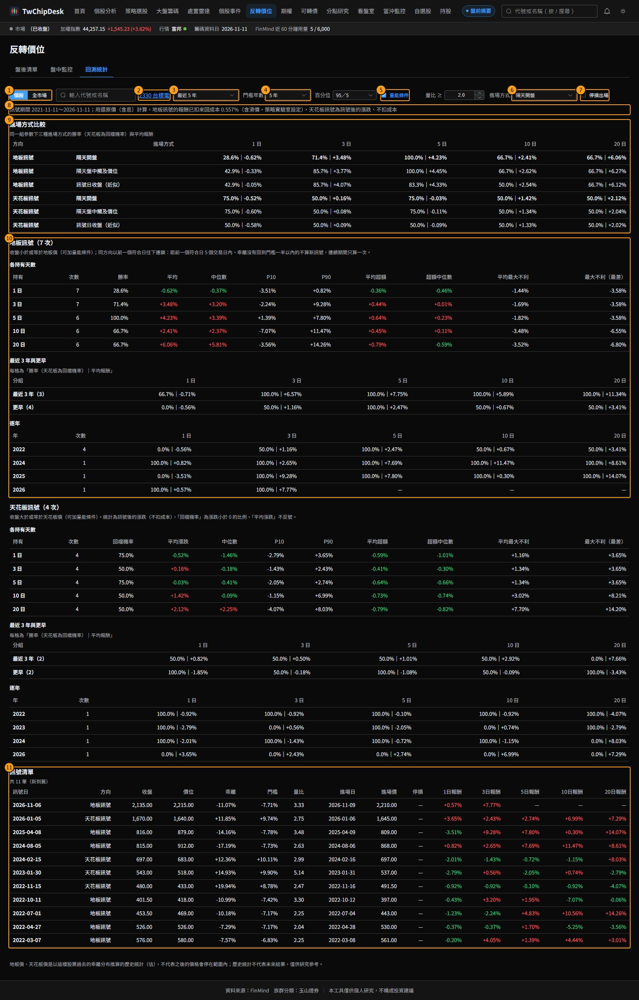

<!-- routes: /reversal/backtest -->
# 反轉價位｜回測統計

> 位置：頂部選單「反轉價位」→「回測統計」分頁（網址 `/reversal/backtest`）；個股頁地板天花板小卡的「回測統計」也會開到這裡並帶入股票（`/reversal/backtest?stockId=2330`）
> 資料更新：預設參數的全市場結果在每日計算後預先算好；其他參數即時計算

## 這個功能可以做什麼
統計過去出現地板訊號、天花板訊號之後 1、3、5、10、20 個交易日的漲跌：次數、勝率、平均、中位數、P10／P90、相對大盤的超額報酬與持有期間最不利的變動，並分最近 3 年與更早、逐年、市值分組比較。可選個股或全市場，以及不同的門檻參數與進場方式。名詞見[反轉價位](README.md)。

## 畫面說明

| 編號 | 名稱 | 說明 |
|---|---|---|
| 1 | 範圍 | 「個股」或「全市場」；網址沒有股票時預設為全市場 |
| 2 | 股票 | 個股範圍時輸入代號或名稱選股票 |
| 3 | 期間 | 「最近 5 年」（預設）或「2010 年起全部」 |
| 4 | 「門檻年數」「百分位」 | 門檻用幾年的乖離分布（3、5、10 年）與百分位（90／10、95／5、97.5／2.5） |
| 5 | 「量能條件」「量比 ≥」 | 訊號是否要求量比達到倍數（預設勾選、2 倍） |
| 6 | 「進場方式」 | 「隔天開盤」（預設）、「隔天盤中觸及價位」（隔天盤中碰到當天的地板價或天花板價才計入）、「訊號日收盤（近似）」 |
| 7 | 「停損出場」 | 地板訊號收盤跌破訊號日最低價、天花板訊號收盤突破訊號日最高價時，隔天開盤出場 |
| 8 | 摘要 | 訊號期間與地板訊號扣除的來回成本（含滑價，沿用策略實驗室的設定）；預設參數的全市場結果標「預先算好的結果」 |
| 9 | 「進場方式比較」 | 個股才有：三種進場方式 × 五種持有天數的勝率與平均 |
| 10 | 「地板訊號」「天花板訊號」 | 各持有天數、最近 3 年與更早、逐年，全市場另有市值分組 |
| 11 | 「訊號清單」 | 個股才有：每次訊號的日期、收盤、價位、乖離、門檻、量比、進場日、進場價與各持有天數的報酬（新到舊，最多 500 筆） |

全市場使用非預設參數時在背景計算，畫面顯示「全市場回測計算中（N%）」與進度條，完成後自動顯示結果；工作保留 30 分鐘，過期時按「重新查詢」。同一時間只能計算一組自訂參數的全市場回測；另一組正在計算時，畫面顯示「另一組全市場回測正在計算中」，等它完成後按「重新查詢」。「2010 年起全部」從 2010-01-01 起算；個股回測的訊號期間到該股最後一根日 K。

### 統計欄位
| 欄位 | 說明 |
|---|---|
| 「次數」 | 有進場的訊號數 |
| 「勝率」 | 地板訊號：報酬大於 0 的比例 |
| 「回檔機率」 | 天花板訊號：報酬小於 0 的比例 |
| 「平均」「平均漲跌」「中位數」「P10」「P90」 | 報酬的平均、中位數與第 10、90 百分位（%）；地板訊號已扣來回成本，天花板訊號為訊號後的漲跌（不扣成本、不反號） |
| 「平均超額」「超額中位數」 | 報酬減去同期加權報酬指數（含息）的報酬 |
| 「平均最大不利」「最大不利（最差）」 | 持有期間最不利的變動：地板為期間最低價相對進場價，天花板為期間最高價相對進場價 |

「最近 3 年與更早」「逐年」「市值分組」每格為「勝率｜平均」（天花板為「回檔機率｜平均漲跌」）。市值分組：大型（≥ 500 億元）、中型（100～500 億元）、小型（< 100 億元）、沒有市值資料，市值取訊號日。

### 訊號怎麼算一次
- 收盤符合條件（地板訊號：收盤 ≤ 地板價；天花板訊號：收盤 ≥ 天花板價；量能條件開啟時還要量比達到倍數）的日子稱為「符合日」。
- 同方向的符合日以前一個符合日往下連鎖：一個符合日距離前一個符合日在 5 個交易日以內，而且這段期間乖離沒有回到門檻的一半以內，就視為同一段，不算新訊號。所以連續好幾天都在地板價以下，只算第一天一次。
- 乖離回到門檻一半以內、或超過 5 個交易日沒有符合日之後，再出現的符合日才是新訊號。

## 操作步驟
1. 點「反轉價位」→「回測統計」；或在個股頁的地板天花板小卡點「回測統計」。
2. 選「個股」並輸入股票，或選「全市場」。
3. 依需要改期間、門檻參數、量能條件、進場方式與停損；條件改變後自動重新計算。
4. 比較「最近 3 年」與「更早」、逐年的結果，留意統計是否只集中在少數年份。

## 注意事項與限制
- 報酬用還原價（含息）計算；地板訊號扣除策略實驗室設定的來回成本（含滑價），天花板訊號只是訊號後的漲跌，不扣成本。
- 「訊號日收盤（近似）」假設以訊號日收盤價計算，實際上要收盤後才知道有訊號，只作參考。
- 全額交割股目前沒有資料來源，回測沒有排除。
- 樣本數少時統計波動大；歷史統計不代表未來結果。

## 相關功能
- [盤後清單](list.md)
- [策略選股｜策略實驗室](../screener/README.md)：來回成本的設定。
