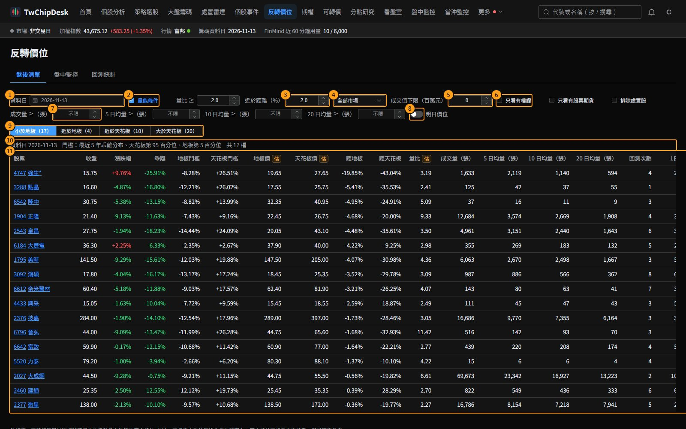

<!-- routes: /reversal -->
# 反轉價位｜盤後清單

> 位置：頂部選單「反轉價位」→「盤後清單」分頁（網址 `/reversal`）
> 資料更新：每個交易日 14:10 收盤資料入庫後

## 這個功能可以做什麼
收盤後列出收盤價在地板價附近或以下、天花板價附近或以上的股票，並附上每檔股票過去 5 年同方向訊號之後 1、3、5 日的統計。可切換「明日價位」看下一個交易日的地板價、天花板價，盤前就能先看。名詞見[反轉價位](README.md)。

## 畫面說明

| 編號 | 名稱 | 說明 |
|---|---|---|
| 1 | 「資料日」 | 空白為最近一個已計算的交易日；可選過去的日子（非交易日會顯示錯誤） |
| 2 | 「量能條件」「量比 ≥」 | 預設勾選、2 倍：只列當天成交量至少為前 20 日均量 2 倍的股票（0.5～20 倍，每次加減 0.5） |
| 3 | 「近於距離（%）」 | 「近於地板」「近於天花板」的距離，預設 2%（0.5～10） |
| 4 | 「市場」 | 「全部市場」「上市」「上櫃」 |
| 5 | 「成交值下限（百萬元）」 | 當天成交值下限，預設 0 |
| 6 | 「只看有權證」「只看有股票期貨」「排除處置股」 | 只列有流通中權證、有股票期貨的股票；排除當天為處置股的股票（不勾選時只在名稱旁標「處置」） |
| 7 | 「成交量 ≥（張）」「5 日均量 ≥（張）」「10 日均量 ≥（張）」「20 日均量 ≥（張）」 | 四個下限，空白或 0 為不限（預設），只接受整數張數。設了下限時，該欄低於下限或天數不足（顯示「—」）的股票不列出；分類括號內的檔數也一起套用 |
| 8 | 「明日價位」 | 開啟後「地板價」「天花板價」兩欄改為「明日地板價」「明日天花板價」（下一個交易日的價位）。隔天有除權息、減資等參考價事件時，價位依隔天的參考價換算，名稱旁標「已依參考價調整」；隔天的漲跌停表（官方參考價）還沒入庫時，表格上方註明「明日價位未含參考價調整」，之後可能變動 |
| 9 | 分類 | 「小於地板」「近於地板」「近於天花板」「大於天花板」，括號內是同一組篩選下的檔數 |
| 10 | 摘要 | 資料日、門檻參數（最近 5 年、第 95／5 百分位）、檔數 |
| 11 | 表格 | 欄位見下方；「地板價」「天花板價」「量比」標「估」 |

改過篩選條件後會出現「恢復預設條件」。全部條件都寫在網址，重新整理或分享後還原。

### 表格欄位
| 欄位 | 說明 |
|---|---|
| 「股票」 | 代號與名稱；點一下開啟個股頁 K 線籌碼圖 |
| 「收盤」「漲跌幅」 | 資料日的收盤與漲跌幅 |
| 「乖離」 | (收盤 − 20 日均線) ÷ 20 日均線 |
| 「地板門檻」「天花板門檻」 | 這檔股票的負乖離第 5 百分位、正乖離第 95 百分位 |
| 「地板價」「天花板價」（估） | 資料日的價位；「明日價位」開啟時為下一個交易日的價位 |
| 「距地板」「距天花板」 | (收盤 − 價位) ÷ 價位，可正可負 |
| 「量比」（估） | 當天成交量 ÷ 前 20 個交易日的平均成交量（不含當天） |
| 「成交量（張）」 | 資料日的成交量 |
| 「5 日均量（張）」「10 日均量（張）」「20 日均量（張）」 | 含資料日在內、最近 5、10、20 個有成交交易日的平均成交量（四捨五入到整數張）；有成交的日子不足時為「—」。量比的基準是前 20 個交易日（不含當天），20 日均量則含當天，所以「成交量 ÷ 20 日均量」不等於量比 |
| 「回測次數」 | 這檔股票最近 5 年同方向訊號的次數（隔天開盤計算、含量能條件） |
| 「1日勝率」「3日勝率」「5日勝率」與「1日平均」等 | 地板類分頁：訊號後 N 個交易日報酬大於 0 的比例與平均報酬（已扣成本） |
| 「1日回檔機率」「1日平均漲跌」等 | 天花板類分頁：訊號後 N 個交易日漲跌小於 0 的比例與平均漲跌（不扣成本） |
| 「權證數」 | 這檔股票為標的、流通中的權證檔數 |
| 「產業」 | 產業類別 |

預設順序：地板類依「距地板」由小到大，天花板類依「距天花板」由大到小。點欄名可改排序（數值欄第一次由大到小，「距地板」第一次由小到大），點第三次回到預設順序。

## 操作步驟
1. 點頂部選單「反轉價位」，預設開啟「盤後清單」與「小於地板」。
2. 點上方分類切換「近於地板」「近於天花板」「大於天花板」。
3. 依需要調整量能條件、距離、市場、成交值下限、成交量與均量下限與勾選條件。
4. 盤前想看今天的價位時，開啟「明日價位」。
5. 點股票名稱開個股頁；在「事件」選單開啟「地板天花板」圖層看三條線與歷史訊號。

## 注意事項與限制
- 清單只用預設參數（5 年、第 95／5 百分位）；其他參數請到「回測統計」。
- 回測欄在每日計算完成前可能顯示「—」。
- 地板價、天花板價是歷史統計的估計；歷史統計不代表未來結果。

## 相關功能
- [盤中監控](live.md)
- [回測統計](backtest.md)
