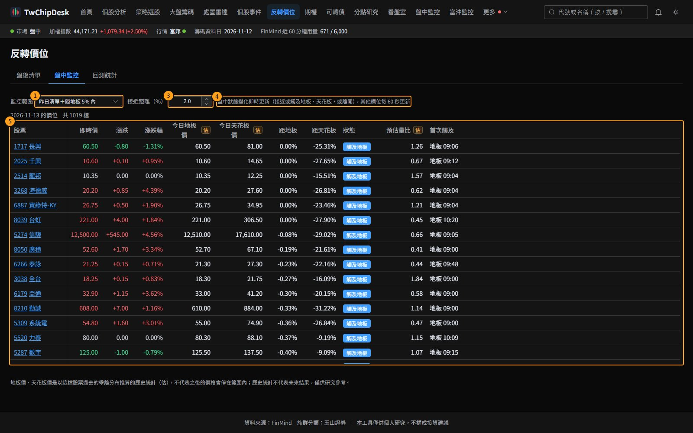

<!-- routes: /reversal/live -->
# 反轉價位｜盤中監控

> 位置：頂部選單「反轉價位」→「盤中監控」分頁（網址 `/reversal/live`）
> 資料更新：盤中股票的狀態一改變（接近或觸及地板、天花板，或離開）就即時更新該列，其他欄位每 60 秒更新（改了接近距離時每 15 秒）；今日的地板價、天花板價在前一個交易日 14:10 後算好

## 這個功能可以做什麼
盤中比對即時價與今日的地板價、天花板價，列出每檔股票離兩個價位多遠，並標出「觸及地板」「接近地板」「觸及天花板」「接近天花板」與當天第一次觸及的時間。名詞見[反轉價位](README.md)。

## 畫面說明

| 編號 | 名稱 | 說明 |
|---|---|---|
| 1 | 「監控範圍」 | 「昨日清單＋距地板 5% 內」（預設）、「自選群組」、「持股」、「全部」 |
| 2 | 自選群組 | 範圍為「自選群組」時出現，可選多個群組；沒有選群組時不查詢 |
| 3 | 「接近距離（%）」 | 「接近地板」「接近天花板」的距離，預設 2%（0.5～10） |
| 4 | 成交量與均量下限 | 「當日累計量 ≥（張）」「5 日均量 ≥（張）」「10 日均量 ≥（張）」「20 日均量 ≥（張）」四個下限，只列出達到下限的股票；空白或 0 為不限，只接受整數張數。設了下限時，該欄為「—」的股票不列出（例如沒有即時報價時的當日累計量），表格上方顯示「篩選後 n 檔（共 m 檔）」 |
| 5 | 自動更新 | 盤中（含盤前與收盤集合競價）顯示「盤中狀態變化即時更新…，其他欄位每 60 秒更新」；接近距離不是 2% 時顯示「盤中每 15 秒自動更新」 |
| 6 | 表格 | 欄位見下方；「今日地板價」「今日天花板價」「預估量比」標「估」 |

### 表格欄位
| 欄位 | 說明 |
|---|---|
| 「即時價」「漲跌」「漲跌幅」 | 即時報價；沒有即時報價時為「—」 |
| 「今日地板價」「今日天花板價」（估） | 今天適用的價位 |
| 「距地板」「距天花板」 | (即時價 − 價位) ÷ 價位 |
| 「狀態」 | 「觸及地板」：即時價 ≤ 地板價；「接近地板」：在地板價上方接近距離以內；「觸及天花板」：即時價 ≥ 天花板價；「接近天花板」：在天花板價下方接近距離以內 |
| 「預估量比」（估） | 預估全日成交量 ÷ 前 20 日均量；沒有預估量時用目前累計量 |
| 「當日累計量（張）」 | 即時報價到目前為止的當日累計成交量（不是全日量）；沒有即時報價時為「—」 |
| 「5 日均量（張）」「10 日均量（張）」「20 日均量（張）」 | 前一個交易日（含）以前最近 5、10、20 個有成交的交易日平均成交量，與[盤後清單](list.md)同一定義；每天載入今日價位時算好，盤中不變；有成交的日子不足時為「—」 |
| 「首次觸及」 | 當天第一次觸及地板價、天花板價的時間，例如「地板 10:12」 |

預設依狀態排列（觸及地板、接近地板、觸及天花板、接近天花板、其他），同狀態依距離由近到遠；點欄名可改排序。

## 操作步驟
1. 點「反轉價位」→「盤中監控」。
2. 選「監控範圍」；選「自選群組」時再選要看的群組。
3. 視需要調整「接近距離（%）」，或填成交量、均量下限濾掉成交清淡的股票。頁面會自動更新，不必重新整理：股票的狀態一改變，該列的即時價、距離、狀態與首次觸及時間立即更新。

## 注意事項與限制
- 只有 09:00～13:36 有今天的即時報價時才算盤中（13:36 前涵蓋延緩收盤股票約 13:33～13:35 完成的收盤撮合，收盤撮合才觸及的也會記錄）；其他時間或報價服務未連線時，畫面註明「目前沒有即時報價」，只顯示今日的價位。
- 今日的價位要等前一個交易日的盤後計算完成才有；還沒算好（或今天不是交易日）時，畫面顯示「今日的地板價、天花板價還沒算好」。
- 狀態的即時更新以接近距離 2% 判斷；接近距離改成其他值時，狀態改由每 15 秒的自動更新重算，即時更新收到的價格仍會套用。
- 只有狀態改變的股票會即時更新，狀態沒變的股票的即時價、漲跌、預估量比與當日累計量隨自動更新（每 60 秒）變動；狀態即時更新時，當日累計量與下限篩選仍用上一次自動更新的值。
- 預估量比在收盤前都是估計。
- 本頁只顯示距離與狀態，不提供任何操作意見；歷史統計不代表未來結果。
- 想在觸及時收到提示：到[警示中心](../alerts/README.md)新增「觸及地板價／天花板價」規則（範圍可為指定股票、自選、持股，或全市場加昨日盤後分類）；提示的時刻與本頁「首次觸及時間」相同，每檔每邊每天一次。

## 相關功能
- [警示中心](../alerts/README.md)：觸及地板價／天花板價的提示
- [盤後清單](list.md)
- [盤中監控（成交動態）](../live.md)
