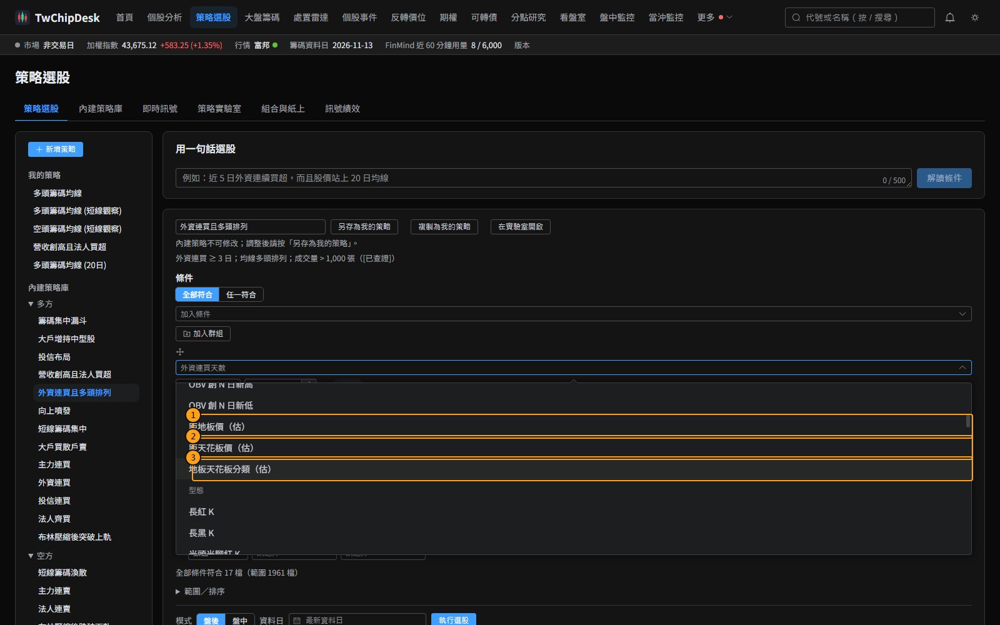
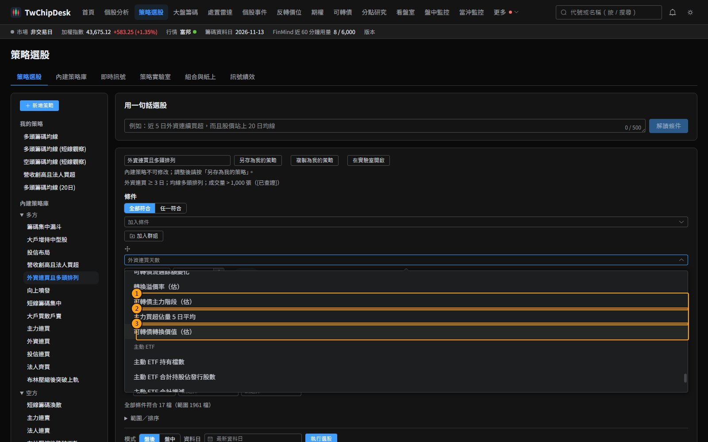
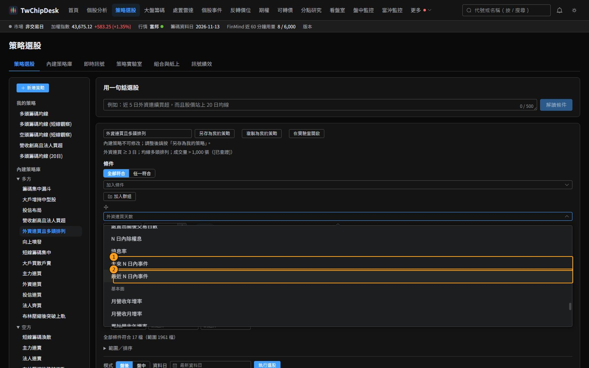

<!-- routes: /screener -->
# 策略選股｜條件總表

> 位置：頂部選單「策略選股」→「策略選股」分頁，條件列的「加入條件」或條件選單（網址 `/screener`）
> 資料更新：盤後條件來自每晚計算的選股特徵（交易日晚上分點與三大法人資料完成後先算一次，23:50 分點研究完成後再以當晚全部資料重算）；盤中條件即時計算

## 這個功能可以做什麼
列出策略選股目前可用的全部 336 條條件，依條件選單的分類排列。每一條寫出名稱（與畫面相同）、可選的參數、數值的單位與一句話說明。在條件選單中把滑鼠移到條件上，也會顯示完整的定義。

## 怎麼看這張表
- **參數**：條件名稱旁的下拉選單可以選的值，例如「籌碼集中度」可選 1～240 日。表格中的「N 日」就是這個參數。沒有參數的寫「—」。
- **單位**：門檻輸入框旁顯示的單位。「成立／不成立」表示這條條件只能選「成立」或「不成立」；「選項」表示要從清單中勾選（例如主力動向的大買、小買）。
- **百分點**：兩個百分比相減的差，例如 3.2% 變成 4.0% 是增加 0.8 個百分點。
- **張**：1 張＝1,000 股。
- **（估）**：名稱帶「估」的是估計值；例如權證投資人淨買（估）是以法人淨買反推（投資人淨買＝ 六類法人淨買合計的相反數）。
- **資料不足時不成立**：條件的資料還沒有、資料起日之前、或天數不夠時，這條條件的值是空的，股票不會被選出。這代表「無法判斷」而不是「不符合」。回溯時這類情形會在結果上方註明涵蓋的起日。
- 任何數值條件都可以再加「時間修飾」「與自身歷史比較」「排名」「族群統計」，或改成和另一個欄位比較，見[選股主頁的條件說明](screener.md#條件列)。

## 價量（29 條）

價格、成交量、成交金額、市值、K 棒形狀、指數權重、盤後定價與相對報酬。

| 條件 | 參數 | 單位 | 說明 |
|---|---|---|---|
| 收盤價 | — | 元 | 當天收盤價 |
| 漲跌幅 | 1、3、5、10、20、60 日 | % | N 日累計漲跌幅 |
| 成交量 | — | 張 | 當天成交量 |
| 均量 | 5、20、60 日 | 張 | N 日平均成交量 |
| 量比 | 5、10、20 日 | 倍 | 當日量 ÷ 前 N 日均量（不含當日） |
| 成交金額 | — | 元 | 當天成交金額 |
| 市值 | — | 億元 | 當天市值 |
| 股本 | — | 億元 | 發行股數 × 10 ÷ 1 億（以面額 10 元估算） |
| 創 N 日新高 | 5、10、20、60、120、240 日 | 成立／不成立 | 以收盤價判斷 |
| 創 N 日新低 | 5、10、20、60、120、240 日 | 成立／不成立 | 以收盤價判斷 |
| 距 N 日最高價乖離 | 20、60、90、120、240 日 | % | （收盤 − N 日最高價）÷ N 日最高價，N 日含當日（≤ 0） |
| 漲停 | — | 成立／不成立 | 收盤等於漲停價 |
| 跌停 | — | 成立／不成立 | 收盤等於跌停價 |
| 跳空幅度 | — | % | （開盤 − 昨收）÷ 昨收 |
| 實體幅度 | — | % | （收盤 − 開盤）÷ 昨收 |
| 上影線幅度 | — | % | （最高 − max(開盤, 收盤)）÷ 昨收 |
| 下影線幅度 | — | % | （min(開盤, 收盤) − 最低）÷ 昨收 |
| 處置中 | — | 成立／不成立 | 當日在處置期間內 |
| 指數權重 | — | % | 所屬市場指數的官方權重（資料日不晚於資料日的最近一次快照：上市為月底、上櫃為每日） |
| 指數權重排名 | — | 名 | 同一次官方快照中的權重排名 |
| 盤後定價未成交買量 | — | 張 | 資料日盤後定價的未成交買張數（當天已載入但沒有這檔為 0） |
| 相對大盤報酬差 | 1、5、20、60、120、240 日 | 百分點 | 個股 N 日還原報酬 − 所屬市場含息報酬指數同期報酬 |
| N 日區間位置 | 14、20、60、120、240 日 | % | （收盤 − N 日最低價）÷（N 日最高價 − N 日最低價），N 日含當日 |
| 均量比 | 5／20、5／60、20／60 日 | 倍 | 短天期均量 ÷ 長天期均量（都含當日） |
| 連漲天數 | — | 日 | 由資料日往前連續收盤高於開盤參考價的天數（停牌日不計入也不中斷） |
| 連跌天數 | — | 日 | 由資料日往前連續收盤低於開盤參考價的天數（停牌日不計入也不中斷） |
| 均成交金額 | 5、20、60 日 | 億元 | N 日平均成交金額 |
| N 日內有未回補的向上跳空 | 5、10、20、60 日 | 成立／不成立 | N 日內（含當日）有最低價高於前一日最高價的跳空，且至今每天的最低價都高於缺口下緣（除權息、減資換算到同一基準） |
| 相對同產業報酬差 | 5、20、60 日 | 百分點 | 個股 N 日還原報酬 − 同產業其他普通股 N 日還原報酬的中位數（產業以目前的官方產業為準） |

## 技術（40 條）

均線、KD、MACD、RSI、布林、DMI、波動度與 OBV。全部以日 K 計算（週 KD 以截至資料日的週 K 計算）。

| 條件 | 參數 | 單位 | 說明 |
|---|---|---|---|
| 乖離率 | 5、10、20、60、120、240 日 | % | （收盤 − N 日均線）÷ N 日均線 |
| 收盤在均線之上 | 5、10、20、60、120、240 日 | 成立／不成立 | 收盤價高於 N 日均線 |
| 突破均線 | 5、10、20、60、120、240 日 | 成立／不成立 | 昨收 ≤ 均線且今收 > 均線 |
| 均線多頭排列 | — | 成立／不成立 | MA5 > MA10 > MA20 > MA60 |
| 均線空頭排列 | — | 成立／不成立 | MA5 < MA10 < MA20 < MA60 |
| 均線黃金交叉 | 5／20、10／20、20／60 日 | 成立／不成立 | 當日發生 |
| 均線死亡交叉 | 5／20、10／20、20／60 日 | 成立／不成立 | 當日發生 |
| 均線糾結度 | — | % | MA5、MA10、MA20 的最大值與最小值之差 ÷ 收盤 |
| K 值 | — | — | 日 KD（9、3、3）的 K 值 |
| D 值 | — | — | 日 KD（9、3、3）的 D 值 |
| KD 黃金交叉 | — | 成立／不成立 | 當日發生 |
| KD 死亡交叉 | — | 成立／不成立 | 當日發生 |
| MACD 柱狀值 | — | — | MACD（12、26、9）的柱狀值 |
| MACD 柱狀值由負轉正 | — | 成立／不成立 | 當日發生 |
| MACD 柱狀值由正轉負 | — | 成立／不成立 | 當日發生 |
| RSI | 6、10、12、50 日 | — | N 日 RSI（Wilder 平滑法） |
| RSI 黃金交叉 | 6／12、10／50 日 | 成立／不成立 | 短天期 RSI 由下往上穿越長天期 RSI（當日發生） |
| 布林通道位置 | — | % | （收盤 − 下軌）÷（上軌 − 下軌） |
| 布林位階 | — | 級 | 布林（20、2σ）的位階：中軌以上為 1～10 級、以下為 −1～−10 級，刻度為上（下）軌與中軌距離的十分之一 |
| 均線乖離差 | 10／20、5／20 日 | 百分點 | 長天期乖離 − 短天期乖離（例如 10-20 為 20 日乖離 − 10 日乖離） |
| 均線斜率 | 10、20、60 日 | % | （今日 N 日均線 ÷ 昨日 N 日均線 − 1）× 100 |
| ADX | — | — | DMI（14）的 ADX，數值越大代表趨勢越明顯 |
| 均線值 | 5、10、20、60、120、240 日 | 元 | N 日收盤均線（供欄位互比，例如收盤 > 60 日均線） |
| 週 K 值 | — | — | 週 K 線（截至資料日的未完成週）的 KD（9、3、3） |
| 週 D 值 | — | — | 週 K 線（截至資料日的未完成週）的 KD（9、3、3） |
| 週 KD 黃金交叉 | — | 成立／不成立 | 上一週 K ≤ D，本週截至資料日 K > D |
| 週 KD 死亡交叉 | — | 成立／不成立 | 上一週 K ≥ D，本週截至資料日 K < D |
| 布林帶寬 | — | % | （上軌 − 下軌）÷ 中軌，布林（20、2σ） |
| 布林帶寬百分位 | 60、120、240 日 | % | 最近 N 日（含當日）的布林帶寬中低於今日的比例，0 表示 N 日內最窄 |
| 收盤相對均線扣抵價 | 5、10、20、60 日 | % | （收盤 − 扣抵價）÷ 扣抵價；扣抵價為明天會移出 N 日均線的那根收盤，大於 0 表示明天收平盤均線就上揚 |
| ATR 百分比 | — | % | 真實區間（以開盤參考價計）的 Wilder 平滑（14）÷ 收盤 |
| 歷史波動率 | 20、60 日 | % | 最近 N 日日報酬 ln（收盤 ÷ 開盤參考價）的樣本標準差 × √252 |
| DMI 方向差 | — | — | +DI − −DI（DMI 14，Wilder 平滑） |
| +DI 上穿 −DI | — | 成立／不成立 | 昨日 +DI ≤ −DI 且今日 +DI > −DI（當日發生） |
| +DI 下穿 −DI | — | 成立／不成立 | 昨日 +DI ≥ −DI 且今日 +DI < −DI（當日發生） |
| OBV 創 N 日新高 | 20、60 日 | 成立／不成立 | 今日 OBV 高於前 N − 1 根日 K 的最高值（OBV 依漲跌方向累計成交量） |
| OBV 創 N 日新低 | 20、60 日 | 成立／不成立 | 今日 OBV 低於前 N − 1 根日 K 的最低值 |
| 距地板價（估） | — | % | （收盤 − 下一個交易日地板價）÷ 地板價，負值表示收盤已低於地板價；地板價見[反轉價位](../reversal/README.md) |
| 距天花板價（估） | — | % | （收盤 − 下一個交易日天花板價）÷ 天花板價，正值表示收盤已高於天花板價 |
| 地板天花板分類（估） | — | 選項 | 小於地板、近於地板、中間、近於天花板、大於天花板（收盤相對當天的地板價、天花板價，近於為 2% 以內），可多選 |

地板天花板三條取自每天算好的反轉價位（預設參數：過去 5 年乖離的第 5、95 百分位）；上市未滿約 250 個交易日（資料不足）或當天沒有反轉價位時不成立。

條件選單「技術」分類的最後三條（編號 1～3）就是「距地板價（估）」「距天花板價（估）」「地板天花板分類（估）」，下一個分類是「型態」。

## 主力與分點（29 條）

需要分點資料：只有當天有分點資料的股票算得出值；N 日條件要在該股分點資料起點後滿 N 個交易日才有值，之前的日子不成立（不代表不符合）。八大行庫、鉅額交易、籌碼峰三類不需要分點資料。籌碼峰三條是每晚算好的估計值，只有算過的日子有值；回溯結果會標出「籌碼峰資料從 某日 起」，之前的日子不成立。

籌碼峰三條（估）來自每晚計算的籌碼成本分布：依每日換手（成交股數 ÷ 流通股數）推算的模型，回看 500 根日 K、價格以開盤參考價還原，不是實際持股。當天沒有籌碼峰資料（還沒算到、沒有流通股數）時不成立。

| 條件 | 參數 | 單位 | 說明 |
|---|---|---|---|
| 主力買賣超 | 1、3、5、10、20、40、60、120、240 日 | 張 | N 日主力買賣超（買超前段分點的淨買合計 − 賣超前段分點的淨賣合計） |
| 籌碼集中度 | 1、3、5、10、20、40、60、120、240 日 | % | N 日主力買賣超 ÷ 同期成交量 |
| 佔股本比重 | 1、3、5、10、20、60、120、240 日 | % | N 日主力買賣超 ÷ 發行股數 |
| 區間週轉率 | 1、3、5、10、20、60、120、240 日 | % | N 日成交量 ÷ 發行股數 |
| 主力動向 | 1、3、5、10、20、60、120、240 日 | 選項 | N 日主力動向：大買、小買、中立、小賣、大賣（與 K 線籌碼圖相同的分級） |
| 主力連買天數 | — | 日 | 主力（每日主力買賣超）連續買超的天數 |
| 主力連賣天數 | — | 日 | 主力連續賣超的天數 |
| 買賣家數差 | — | 家 | 當天買超分點家數 − 賣超分點家數 |
| 家數差連續為負天數 | — | 日 | 買賣家數差連續為負的天數 |
| 收盤相對主力成本線乖離 | — | % | （收盤 − 主力成本線）÷ 主力成本線 |
| 第一名買超分點佔成交量 | 1、3、5、10、20 日 | % | N 日買超第一名分點的買超 ÷ 同期成交量 |
| 有買超異常分點 | 1、3、5、10、20 日 | 成立／不成立 | N 日內有買超異常分點（與「分點研究｜異常分點」相同的判斷） |
| 有賣超異常分點 | 1、3、5、10、20 日 | 成立／不成立 | N 日內有賣超異常分點 |
| 隔日沖買超占比 | — | % | 隔日沖清單內分點當天的淨買 ÷ 當天成交量 |
| 買超前 15 名中的贏家數 | 1、5、20 日 | 家 | N 日買超前 15 名分點中，被標為贏家的家數 |
| 買超前 15 名中的輸家數 | 1、5、20 日 | 家 | N 日買超前 15 名分點中，被標為輸家的家數 |
| 賣超前 15 名中的贏家數 | 1、5、20 日 | 家 | N 日賣超前 15 名分點中，被標為贏家的家數 |
| 賣超前 15 名中的輸家數 | 1、5、20 日 | 家 | N 日賣超前 15 名分點中，被標為輸家的家數 |
| 地緣分點買賣超 | 5、20、60 日 | 張 | N 日地緣分點（與公司所在地相近的分點）買賣超合計（需要地緣分點資料） |
| 八大行庫買賣超 | 1、5、20 日 | 張 | N 日八大行庫買賣超合計 |
| 散戶買賣超（估） | 1、5、20 日 | 張 | N 日散戶（估）買賣超 |
| 中實戶買賣超 | 1、5、20 日 | 張 | N 日中實戶買賣超 |
| 關鍵分點買賣超 | 1、3、5、10、20 日 | 張 | 該股自訂關鍵分點最近 N 日的買賣超合計 |
| 關鍵分點買賣超佔成交量 | 1、3、5、10、20 日 | % | 關鍵分點最近 N 日買賣超合計 ÷ 同期成交量 |
| 鉅額交易天數 | 1、5、20 日 | 天 | 最近 N 個交易日中有鉅額交易的天數 |
| 鉅額量佔成交量 | 1、5、20 日 | % | 最近 N 個交易日的鉅額成交股數合計 ÷ 成交量合計（成交量含鉅額） |
| 籌碼峰獲利比例（估） | — | % | 籌碼峰（依每日換手推算的成本分布模型，不是實際持股）中成本不大於當日收盤的籌碼占比 |
| 籌碼峰集中度 90%（估） | — | % | （P95 − P5）÷（P95 ＋ P5）× 100，越小越集中；P5、P95 為籌碼峰由低到高第 5%、第 95% 的價位 |
| 收盤相對籌碼峰平均成本（估） | — | % | （收盤 − 平均成本）÷ 平均成本 × 100 |

## 法人（23 條）

三大法人買賣超、連買連賣、持股比例與自營商避險。

| 條件 | 參數 | 單位 | 說明 |
|---|---|---|---|
| 外資買賣超 | 1、3、5、10、20、60 日 | 張 | N 日外資買賣超合計 |
| 投信買賣超 | 1、3、5、10、20、60 日 | 張 | N 日投信買賣超合計 |
| 自營商買賣超 | 1、3、5、10、20、60 日 | 張 | N 日自營商買賣超合計 |
| 三大法人買賣超 | 1、3、5、10、20、60 日 | 張 | N 日三大法人買賣超合計 |
| 外資連買天數 | — | 日 | 外資連續買超天數 |
| 外資連賣天數 | — | 日 | 外資連續賣超天數 |
| 投信連買天數 | — | 日 | 投信連續買超天數 |
| 投信連賣天數 | — | 日 | 投信連續賣超天數 |
| 外資 N 日內買超天數 | 5、10、20 日 | 日 | 近 N 個交易日中外資買超的天數（不必連續） |
| 投信 N 日內買超天數 | 5、10、20 日 | 日 | 近 N 個交易日中投信買超的天數（不必連續） |
| 外資買賣超佔股本比 | 1、3、5、10、20、60 日 | % | N 日外資買賣超 ÷ 發行股數 |
| 投信買賣超佔股本比 | 1、3、5、10、20、60 日 | % | N 日投信買賣超 ÷ 發行股數 |
| 外資持股比例 | — | % | 外資持股比例 |
| 外資持股比例變化 | 5、20、60 日 | 百分點 | 外資持股比例與 N 日前的差 |
| 三大法人同步買超 | — | 成立／不成立 | 當天外資、投信、自營商都買超 |
| 收盤相對外資成本線乖離 | — | % | （收盤 − 外資成本線）÷ 外資成本線 |
| 收盤相對投信成本線乖離 | — | % | （收盤 − 投信成本線）÷ 投信成本線 |
| 外資買賣超佔成交量 | 1、5、10、20 日 | % | 最近 N 日外資買賣超合計 ÷ 同期成交量 |
| 投信買賣超佔成交量 | 1、5、10、20 日 | % | 最近 N 日投信買賣超合計 ÷ 同期成交量 |
| 三大法人買賣超佔成交量 | 1、5、10、20 日 | % | 最近 N 日三大法人買賣超合計 ÷ 同期成交量 |
| 所屬產業法人買賣超佔成交量 | 1、5、20 日 | % | 同產業普通股最近 N 日三大法人買賣超合計 ÷ 同期成交量合計 |
| 自營避險比 | 1、5、20 日 | % | N 日（自營商避險買量 + 避險賣量）÷（2 × 成交股數）；避險部位多來自權證等商品的發行避險，資料不區分來源 |
| 自營避險淨買占比 | 1、5、20 日 | % | N 日（自營商避險買量 − 避險賣量）÷ 成交股數 |

## 資券（21 條）

融資融券、借券、當沖、不限用途借貸。資料起日之前的日子為空值、不會被選出。

| 條件 | 參數 | 單位 | 說明 |
|---|---|---|---|
| 融資餘額 | — | 張 | 融資餘額 |
| 融資增減 | 1、5、20 日 | 張 | N 日融資餘額增減 |
| 融資增減比例 | 1、5、20 日 | % | N 日融資餘額增減比例 |
| 融資使用率 | — | % | 餘額 ÷ 限額 |
| 融資維持率 | — | % | 融資維持率（FinMind 估算值） |
| 收盤相對融資成本線乖離 | — | % | （收盤 − 融資成本線）÷ 融資成本線 |
| 融券餘額 | — | 張 | 融券餘額 |
| 融券增減 | 1、5、20 日 | 張 | N 日融券餘額增減 |
| 券資比 | — | % | 融券餘額 ÷ 融資餘額 |
| 「借券賣出餘額」 | — | 張 | 借券賣餘額 |
| 「借券賣出餘額增減」 | 1、5、20 日 | 張 | N 日借券賣餘額增減 |
| 借券賣量佔成交量 | 1、5、20 日 | % | 最近 N 日借券賣量合計 ÷ 同期成交量 |
| 借券賣餘額佔股本 | — | % | 借券賣餘額 ÷ 發行股數（回溯也用目前股數） |
| 券資比變化 | 1、5、20 日 | 百分點 | 今日券資比 − N 個交易日前券資比 |
| 融資餘額佔股本 | — | % | 融資餘額 ÷ 發行股數（回溯也用目前股數） |
| 當沖比 | — | % | 當沖量 ÷ 成交量 |
| 借券成交張數 | 1、5、20 日 | 張 | 最近 N 個交易日的借券成交張數合計 |
| 借券費率 | 1、5、20 日 | % | 最近 N 個交易日以成交張數加權的平均費率 |
| 不限用途借貸餘額 | — | 張 | 資料日的不限用途借貸今日餘額（該股所屬市場當天已載入但沒有這檔為 0） |
| 不限用途借貸增減 | 1、5、20 日 | 張 | 最近 N 個交易日每天（今日餘額 − 前日餘額）的合計，窗內中間沒有載入的日子當作沒有增減 |
| 當沖券差借券費率 | — | % | 資料日的當沖券差借券費率（同一天有多個費率級距時以股數加權平均） |

## 大戶（8 條）

以每週的股權分散資料計算，「週」是指期數；非公布日沿用最近一期。

| 條件 | 參數 | 單位 | 說明 |
|---|---|---|---|
| 大戶持股比例 | 400、1000 張 | % | 持股超過所選張數（400 或 1,000 張）的股東持股比例（每週股權分散資料） |
| 大戶持股比例變化 | 400、1000 張；1、2、3、4 週 | 百分點 | 大戶持股比例：最近一期 − 往前第 N 週 |
| 散戶持股比例 | 50、100 張 | % | 持股不超過所選張數（50 或 100 張）的股東持股比例 |
| 散戶持股比例變化 | 50、100 張；1、2、3、4 週 | 百分點 | 散戶持股比例：最近一期 − 往前第 N 週 |
| 總股東人數變化 | 1、2、3、4 週 | % | 總股東人數與 N 週前比較的變化率 |
| 大戶人數變化 | 400、1000 張；1、2、3、4 週 | 人 | 大戶人數與 N 週前的差 |
| 大戶持股連續增加週數 | 400、1000 張 | 週 | 由最新一期往前，大戶持股比例連續增加的期數（最多 12） |
| 散戶持股連續減少週數 | 50、100 張 | 週 | 由最新一期往前，散戶持股比例連續減少的期數（最多 12） |

## 基本面（30 條）

月營收、財報、評價與可轉債。月營收與財報只用當時已公布的資料，採保守的可用日。

| 條件 | 參數 | 單位 | 說明 |
|---|---|---|---|
| 月營收年增率 | — | % | 最新已公布月營收的年增率 |
| 月營收月增率 | — | % | 最新已公布月營收的月增率 |
| 累計營收年增率 | — | % | 今年累計營收年增率 |
| 營收創幾個月新高 | — | 月 | 最新月營收是過去幾個月的最高值 |
| 年增率連續為正月數 | — | 月 | 月營收年增率連續為正的月數 |
| 最近一季每股盈餘 | — | 元 | 最近一季每股盈餘 |
| 近四季每股盈餘 | — | 元 | 近四季每股盈餘合計 |
| 單季每股盈餘年增率 | — | % | 最近一季每股盈餘與去年同季比較 |
| 毛利率 | — | % | 最近一季 |
| 營業利益率 | — | % | 最近一季 |
| 稅後淨利率 | — | % | 最近一季 |
| 毛利率季變化 | — | 百分點 | 最近一季毛利率 − 上一季毛利率 |
| 股東權益報酬率 | — | % | 近四季 |
| 負債比率 | — | % | 最近一季負債比率 |
| 本益比 | — | 倍 | 本益比 |
| 股價淨值比 | — | 倍 | 股價淨值比 |
| 殖利率 | — | % | 殖利率 |
| 本益比近五年百分位 | — | % | 目前本益比在近五年本益比中的百分位 |
| 營收年增率加速度 | 1、3 個月 | 百分點 | 1 個月：最新月年增率 − 前一月年增率；3 個月：近三月合計年增率 − 前一期（往前一個月）的近三月合計年增率 |
| 近三月營收年增率 | — | % | 最近三個月營收合計 ÷ 去年同期三個月合計 − 1 |
| 三率三升 | 季比、年比 | 成立／不成立 | 毛利率、營業利益率、稅後淨利率都高於比較季（季比為上一季、年比為去年同季） |
| PEG 本益成長比 | — | 倍 | 本益比 ÷ 近四季每股盈餘年增率 |
| 近四季每股盈餘年增率 | — | % | （近四季每股盈餘 − 一年前的近四季每股盈餘）÷ 一年前數值的絕對值 |
| 單季每股盈餘季增率 | — | % | （最近一季每股盈餘 − 上一季）÷ 上一季數值的絕對值 |
| 可轉債潛在稀釋（估） | — | % | 資料日當天（或之前最近一個總覽日）該股發行中可轉債的潛在股數（流通餘額 ÷ 轉換價）合計 ÷ 發行股數 |
| 可轉債流通餘額變化 | 1、5、20 日 | % | （資料日流通餘額合計 − N 個交易日前合計）÷ N 個交易日前合計 |
| 轉換溢價率（估） | — | % | 資料日有成交的可轉債，以流通餘額加權的平均溢價率（可轉債收盤 ÷ 轉換價值 − 1） |
| 可轉債主力階段（估） | — | 選項 | 0 都不符合、1 低檔發債、2 主力買超、3 高檔融券增、4 現券償還增，可多選；同一股票有多檔可轉債時取數字最大的階段 |
| 主力買超佔量 5 日平均 | — | % | 每天（主力買超 ÷ 成交量）× 100 的 5 日平均，主力為前 15 大買超與前 15 大賣超分點 |
| 可轉債轉換價值（估） | — | — | 100 × 收盤 ÷ 轉換價（每百元面額）；同一股票有多檔可轉債時取最大值 |

可轉債主力三條取自[可轉債主力動態](../cb/mainforce.md)每天的快照（2024-07-12 起），範圍是有流通餘額的可轉換公司債的標的股；沒有流通可轉債、資料起日之前或當天資料還沒算好時不成立。

條件選單「基本面」分類的最後三條（編號 1～3）就是「可轉債主力階段（估）」「主力買超佔量 5 日平均」「可轉債轉換價值（估）」，下一個分類是「主動 ETF」。

## 主動 ETF（6 條）

主動式 ETF 每日持股；持股資料自 2025-05-05 起，之前的日子為空值。

| 條件 | 參數 | 單位 | 說明 |
|---|---|---|---|
| 主動 ETF 持有檔數 | — | 檔 | 資料日持有該股（股數大於 0）的主動 ETF 檔數 |
| 主動 ETF 合計持股佔發行股數 | — | % | 全部主動 ETF 合計持股 ÷ 發行股數 |
| 主動 ETF 合計增減 | 1、5、20 日 | 張 | 最近 N 個持股資料日全部主動 ETF 的增減股數合計（ETF 缺資料的日子併入下一個資料日） |
| 主動 ETF 扣除申贖增減（估） | 1、5、20 日 | 張 | 同主動 ETF 合計增減，改用扣除申贖（估） |
| 主動 ETF 連續增持天數 | — | 天 | 連續幾個持股資料日全部主動 ETF 合計增減 ≥ 1 張（最多 60） |
| 主動 ETF 連續增持天數（扣除申贖，估） | — | 天 | 同主動 ETF 連續增持天數，改用扣除申贖（估）合計 |

## 事件（8 條）

處置雷達、注意股、處置出關與除權息。

| 條件 | 參數 | 單位 | 說明 |
|---|---|---|---|
| 處置距離 | — | 日 | 處置雷達的注意日數距離：今晚公布處置為 0，3 代表 3 以上 |
| 明日公布處置機率（估） | — | % | 處置雷達估計明天公布處置的機率 |
| N 日內注意次數 | 1、5、10、30 日 | 日 | 最近 N 個交易日被列為注意（計入處置次數的款）的天數 |
| 處置出關後交易日數 | — | 日 | 處置期間內為 0，出關第一天為 1 |
| N 日內除權息 | 1、3、5 日 | 成立／不成立 | 已公告（公告日不晚於資料日）的除息或除權交易日落在資料日之後 N 個交易日內 |
| 填息率 | — | % | （收盤 − 除權息參考價）÷（除權息前收盤 − 參考價），以最近 60 個交易日內最新一次除權息計，100 以上為已填息 |
| 未來 N 日內事件 | 1、3、5、10、20 日 | 選項 | 資料日之後 N 個交易日內（不含資料日）有勾選的任一種事件；只用資料日當天已知的事件 |
| 最近 N 日內事件 | 1、3、5、10、20 日 | 選項 | 資料日往前 N 個交易日內（含資料日）有勾選的任一種事件 |

「未來 N 日內事件」「最近 N 日內事件」的種類與[個股事件](../events/README.md)相同（除息、除權、權息同日、ETF 除息、減資恢復買賣、月營收公布、財報公布（估）、處置開始、處置結束、列為注意股、停止融券、暫停當沖、暫停交易後恢復），勾選多種時只要有其中一種就成立。未來事件不用資料日之後才公布的消息：除權息要公告日不晚於資料日（來源沒有公告日時，除權息交易日在 5 個交易日內才算），處置與注意股看公告日；減資、停止融券、暫停當沖、暫停交易後恢復沒有可靠的公告日，只算在「最近 N 日內事件」。月營收公布（估）以每月 10 日（遇休市順延）的下一個交易日推算，那個月的營收入庫後就不再算未來事件；財報公布（估）以法定申報期限的下一個交易日推算。結果表的值列出當天符合的事件種類。

條件選單「事件」分類的最後兩條：「未來 N 日內事件」（編號 1）與「最近 N 日內事件」（編號 2）；兩條都是選項類條件，比較為「屬於」，再從清單勾選事件種類。

## 權證（6 條）

以該股為標的的權證分點與權證投資人淨買；權證分點只保留最近一段期間，起日會往後移。

| 條件 | 參數 | 單位 | 說明 |
|---|---|---|---|
| 認購權證前 5 大買超分點淨買占均成交值 | 1、5、20 日 | % | 最近 N 日認購權證淨買金額為正的前 5 個分點合計 ÷ 該股 20 日平均成交金額 |
| 認售權證前 5 大買超分點淨買占均成交值 | 1、5、20 日 | % | 最近 N 日認售權證淨買金額為正的前 5 個分點合計 ÷ 該股 20 日平均成交金額 |
| 認購權證買超分點數 | 1、5、20 日 | 個 | 最近 N 日認購權證（含牛證）淨買金額合計為正的分點數 |
| 認售權證買超分點數 | 1、5、20 日 | 個 | 最近 N 日認售權證（含熊證）淨買金額合計為正的分點數 |
| 權證投資人認購淨買占比（估） | 1、5、20 日 | % | 最近 N 日權證投資人認購淨買金額 ÷ 該股 20 日平均成交金額 |
| 權證投資人認售淨買占比（估） | 1、5、20 日 | % | 最近 N 日權證投資人認售淨買金額 ÷ 該股 20 日平均成交金額 |

## 型態（122 條）

K 線型態、缺口與島狀反轉、圖形型態與指標背離，以還原日 K 判斷（與 K 線籌碼圖的型態標記同一套規則），只能選「成立」或「不成立」。日 K 不足以判斷（停牌、當天沒有成交、日 K 太少）時不成立。盤中模式以今天到目前為止的 K 棒判斷（暫定），見[策略選股｜盤中型態](screener.md#盤中型態)。

圖形型態以轉折點（價格從高點或低點反轉至少 4%，波動大的股票為 2 倍 ATR(14)）判斷，每個型態最多看最近 260 根日 K；多數圖形型態分成「形成中」「向上突破」「向下跌破」幾個條件：形成中在型態成立、收盤仍在型態內的每一天都成立；突破只在收盤第一次越過那一天成立，之後型態就結束。突破後 20 根內收盤又回到型態內時，K 線籌碼圖會標「突破失敗」，選股沒有對應的條件。要找「最近幾天內突破」可以加時間修飾（例如 5 日內曾成立）。指標背離在第二個轉折點確認的那一天成立。

| 條件 | 參數 | 單位 | 說明 |
|---|---|---|---|
| 長紅 K | — | 成立／不成立 | 紅 K 的實體（收盤與開盤之差）至少是前 10 根平均實體的 3 倍，且至少為前一日收盤的 3% |
| 長黑 K | — | 成立／不成立 | 黑 K 的實體（開盤與收盤之差）至少是前 10 根平均實體的 3 倍，且至少為前一日收盤的 3% |
| 光頭光腳紅 K | — | 成立／不成立 | 長實體紅 K，上下影線都極短 |
| 光頭光腳黑 K | — | 成立／不成立 | 長實體黑 K，上下影線都極短 |
| 錘子線 | — | 成立／不成立 | 下跌後出現短實體、長下影線、幾乎沒有上影線，實體在前一根低點附近 |
| 吊人線 | — | 成立／不成立 | 上漲後出現與錘子線相同的形狀，實體在前一根高點附近 |
| 倒狀錘子 | — | 成立／不成立 | 下跌後向下跳空，短實體、長上影線、幾乎沒有下影線 |
| 流星線 | — | 成立／不成立 | 上漲後向上跳空，短實體、長上影線、幾乎沒有下影線（避雷針） |
| 十字線 | — | 成立／不成立 | 開盤與收盤幾乎相同，多空暫時平衡 |
| 長腳十字 | — | 成立／不成立 | 十字線且上影線或下影線很長，盤中波動大 |
| 蜻蜓十字 | — | 成立／不成立 | 下跌後出現十字、幾乎沒有上影線而下影線長（T 字線） |
| 墓碑十字 | — | 成立／不成立 | 上漲後出現十字、幾乎沒有下影線而上影線長（倒 T 字線） |
| 一字漲停 | — | 成立／不成立 | 開高低收相同且收在漲停價 |
| 一字跌停 | — | 成立／不成立 | 開高低收相同且收在跌停價 |
| 多頭吞噬 | — | 成立／不成立 | 下跌後紅 K 實體完全包住前一根黑 K 實體 |
| 空頭吞噬 | — | 成立／不成立 | 上漲後黑 K 實體完全包住前一根紅 K 實體 |
| 多頭母子 | — | 成立／不成立 | 下跌後長黑 K 之後出現實體在其內的短實體 |
| 空頭母子 | — | 成立／不成立 | 上漲後長紅 K 之後出現實體在其內的短實體 |
| 十字母子（多） | — | 成立／不成立 | 下跌後長黑 K 之後出現在其實體內的十字線 |
| 十字母子（空） | — | 成立／不成立 | 上漲後長紅 K 之後出現在其實體內的十字線 |
| 貫穿線 | — | 成立／不成立 | 下跌後長黑 K，次日開低卻收在黑 K 實體中點之上（曙光初現） |
| 烏雲罩頂 | — | 成立／不成立 | 上漲後長紅 K，次日開高卻收在紅 K 實體中點之下 |
| 鑷底 | — | 成立／不成立 | 下跌後兩根 K 線低點幾乎相同，第一根為長實體 |
| 鑷頂 | — | 成立／不成立 | 上漲後兩根 K 線高點幾乎相同，第一根為長實體 |
| 多頭反撲 | — | 成立／不成立 | 光頭光腳黑 K 後向上跳空出現光頭光腳紅 K |
| 空頭反撲 | — | 成立／不成立 | 光頭光腳紅 K 後向下跳空出現光頭光腳黑 K |
| 晨星 | — | 成立／不成立 | 下跌後長黑、跳空短實體，再由長紅收進第一根實體超過 30% |
| 夜星 | — | 成立／不成立 | 上漲後長紅、跳空短實體，再由長黑收進第一根實體超過 30% |
| 十字晨星 | — | 成立／不成立 | 同晨星，中間一根為十字線 |
| 十字夜星 | — | 成立／不成立 | 同夜星，中間一根為十字線 |
| 紅三兵 | — | 成立／不成立 | 連續三根紅 K，收盤逐日墊高、開在前一根實體內、上影線短 |
| 黑三兵 | — | 成立／不成立 | 連續三根黑 K，收盤逐日走低、開在前一根實體內、下影線短 |
| 三內升 | — | 成立／不成立 | 多頭母子之後第三根紅 K 收在第一根開盤之上 |
| 三內降 | — | 成立／不成立 | 空頭母子之後第三根黑 K 收在第一根開盤之下 |
| 三外升 | — | 成立／不成立 | 多頭吞噬之後第三根收盤再走高 |
| 三外降 | — | 成立／不成立 | 空頭吞噬之後第三根收盤再走低 |
| 棄嬰（多） | — | 成立／不成立 | 下跌後中間的十字線與前後兩根都有跳空缺口，第三根為紅 K |
| 棄嬰（空） | — | 成立／不成立 | 上漲後中間的十字線與前後兩根都有跳空缺口，第三根為黑 K |
| 上升三法 | — | 成立／不成立 | 上漲後出現長紅，三根小 K 在其範圍內整理，第五根長紅創新高 |
| 下降三法 | — | 成立／不成立 | 下跌後出現長黑，三根小 K 在其範圍內整理，第五根長黑創新低 |
| 向上跳空缺口 | — | 成立／不成立 | 當日最低高於前一日最高，缺口至少 0.1% |
| 向下跳空缺口 | — | 成立／不成立 | 當日最高低於前一日最低，缺口至少 0.1% |
| 突破缺口（上） | — | 成立／不成立 | 整理後帶量向上跳空，收盤突破前 20 日最高 |
| 突破缺口（下） | — | 成立／不成立 | 整理後帶量向下跳空，收盤跌破前 20 日最低 |
| 中繼缺口（上） | — | 成立／不成立 | 上漲途中（前 10 日漲幅至少 10%）出現的向上缺口 |
| 中繼缺口（下） | — | 成立／不成立 | 下跌途中（前 10 日跌幅至少 10%）出現的向下缺口 |
| 竭盡缺口（上） | — | 成立／不成立 | 大漲後的向上缺口在 5 根內被完全回補，於回補日確認 |
| 竭盡缺口（下） | — | 成立／不成立 | 大跌後的向下缺口在 5 根內被完全回補，於回補日確認 |
| 向上缺口被回補 | — | 成立／不成立 | 先前未回補的向上缺口在今天被完全回補 |
| 向下缺口被回補 | — | 成立／不成立 | 先前未回補的向下缺口在今天被完全回補 |
| 有未回補的向上缺口 | — | 成立／不成立 | 60 根內有向上缺口且至今未完全回補 |
| 有未回補的向下缺口 | — | 成立／不成立 | 60 根內有向下缺口且至今未完全回補 |
| 島狀反轉（頂） | — | 成立／不成立 | 向上跳空後 1 到 20 根內向下跳空，島上 K 棒沒有回補任何一個缺口，孤立在上方 |
| 島狀反轉（底） | — | 成立／不成立 | 向下跳空後 1 到 20 根內向上跳空，島上 K 棒沒有回補任何一個缺口，孤立在下方 |
| 三角收斂（形成中） | — | 成立／不成立 | 上緣連接遞降的高點、下緣連接遞升的低點，兩線收斂，長度 15 到 120 根（對稱三角形）。型態成立且收盤仍在型態內，形成期間每天都成立 |
| 三角收斂（向上突破） | — | 成立／不成立 | 同上；收盤第一次高於上緣（頸線、杯緣）至少 1% 與半個 ATR(14) 中較大者，只有突破那一天成立 |
| 三角收斂（向下跌破） | — | 成立／不成立 | 同上；收盤第一次低於下緣（頸線、左緣）至少 1% 與半個 ATR(14) 中較大者，只有跌破那一天成立 |
| 上升三角形（形成中） | — | 成立／不成立 | 上緣接近水平（高點相差 1.5% 以內）、下緣連接遞升的低點，兩線收斂。型態成立且收盤仍在型態內，形成期間每天都成立 |
| 上升三角形（向上突破） | — | 成立／不成立 | 同上；收盤第一次高於上緣（頸線、杯緣）至少 1% 與半個 ATR(14) 中較大者，只有突破那一天成立 |
| 上升三角形（向下跌破） | — | 成立／不成立 | 同上；收盤第一次低於下緣（頸線、左緣）至少 1% 與半個 ATR(14) 中較大者，只有跌破那一天成立 |
| 下降三角形（形成中） | — | 成立／不成立 | 下緣接近水平（低點相差 1.5% 以內）、上緣連接遞降的高點，兩線收斂。型態成立且收盤仍在型態內，形成期間每天都成立 |
| 下降三角形（向上突破） | — | 成立／不成立 | 同上；收盤第一次高於上緣（頸線、杯緣）至少 1% 與半個 ATR(14) 中較大者，只有突破那一天成立 |
| 下降三角形（向下跌破） | — | 成立／不成立 | 同上；收盤第一次低於下緣（頸線、左緣）至少 1% 與半個 ATR(14) 中較大者，只有跌破那一天成立 |
| 擴張三角形（形成中） | — | 成立／不成立 | 高點遞升、低點遞降，兩線向外擴張（喇叭形）。型態成立且收盤仍在型態內，形成期間每天都成立 |
| 擴張三角形（向上突破） | — | 成立／不成立 | 同上；收盤第一次高於上緣（頸線、杯緣）至少 1% 與半個 ATR(14) 中較大者，只有突破那一天成立 |
| 擴張三角形（向下跌破） | — | 成立／不成立 | 同上；收盤第一次低於下緣（頸線、左緣）至少 1% 與半個 ATR(14) 中較大者，只有跌破那一天成立 |
| 上升楔形（形成中） | — | 成立／不成立 | 上下緣都向上且收斂，下緣較陡。型態成立且收盤仍在型態內，形成期間每天都成立 |
| 上升楔形（向上突破） | — | 成立／不成立 | 同上；收盤第一次高於上緣（頸線、杯緣）至少 1% 與半個 ATR(14) 中較大者，只有突破那一天成立 |
| 上升楔形（向下跌破） | — | 成立／不成立 | 同上；收盤第一次低於下緣（頸線、左緣）至少 1% 與半個 ATR(14) 中較大者，只有跌破那一天成立 |
| 下降楔形（形成中） | — | 成立／不成立 | 上下緣都向下且收斂，上緣較陡。型態成立且收盤仍在型態內，形成期間每天都成立 |
| 下降楔形（向上突破） | — | 成立／不成立 | 同上；收盤第一次高於上緣（頸線、杯緣）至少 1% 與半個 ATR(14) 中較大者，只有突破那一天成立 |
| 下降楔形（向下跌破） | — | 成立／不成立 | 同上；收盤第一次低於下緣（頸線、左緣）至少 1% 與半個 ATR(14) 中較大者，只有跌破那一天成立 |
| 矩形整理（形成中） | — | 成立／不成立 | 上下緣都接近水平（各相差 2% 以內），箱高至少 5%，長度 15 到 120 根（箱型）。型態成立且收盤仍在型態內，形成期間每天都成立 |
| 矩形整理（向上突破） | — | 成立／不成立 | 同上；收盤第一次高於上緣（頸線、杯緣）至少 1% 與半個 ATR(14) 中較大者，只有突破那一天成立 |
| 矩形整理（向下跌破） | — | 成立／不成立 | 同上；收盤第一次低於下緣（頸線、左緣）至少 1% 與半個 ATR(14) 中較大者，只有跌破那一天成立 |
| 上升通道（形成中） | — | 成立／不成立 | 上下緣都向上且近似平行（斜率相差 20% 以內）。型態成立且收盤仍在型態內，形成期間每天都成立 |
| 上升通道（向上突破） | — | 成立／不成立 | 同上；收盤第一次高於上緣（頸線、杯緣）至少 1% 與半個 ATR(14) 中較大者，只有突破那一天成立 |
| 上升通道（向下跌破） | — | 成立／不成立 | 同上；收盤第一次低於下緣（頸線、左緣）至少 1% 與半個 ATR(14) 中較大者，只有跌破那一天成立 |
| 下降通道（形成中） | — | 成立／不成立 | 上下緣都向下且近似平行（斜率相差 20% 以內）。型態成立且收盤仍在型態內，形成期間每天都成立 |
| 下降通道（向上突破） | — | 成立／不成立 | 同上；收盤第一次高於上緣（頸線、杯緣）至少 1% 與半個 ATR(14) 中較大者，只有突破那一天成立 |
| 下降通道（向下跌破） | — | 成立／不成立 | 同上；收盤第一次低於下緣（頸線、左緣）至少 1% 與半個 ATR(14) 中較大者，只有跌破那一天成立 |
| 三角旗形（形成中） | — | 成立／不成立 | 15 根內漲跌至少 15% 的旗桿之後，出現 5 到 20 根的小型收斂三角。型態成立且收盤仍在型態內，形成期間每天都成立 |
| 三角旗形（向上突破） | — | 成立／不成立 | 同上；收盤第一次高於上緣（頸線、杯緣）至少 1% 與半個 ATR(14) 中較大者，只有突破那一天成立 |
| 三角旗形（向下跌破） | — | 成立／不成立 | 同上；收盤第一次低於下緣（頸線、左緣）至少 1% 與半個 ATR(14) 中較大者，只有跌破那一天成立 |
| 多頭旗形（形成中） | — | 成立／不成立 | 15 根內上漲至少 15% 的旗桿之後，出現 5 到 20 根水平或向下的整理旗面，回檔不超過旗桿的一半。型態成立且收盤仍在型態內，形成期間每天都成立 |
| 多頭旗形（向上突破） | — | 成立／不成立 | 同上；收盤第一次高於上緣（頸線、杯緣）至少 1% 與半個 ATR(14) 中較大者，只有突破那一天成立 |
| 空頭旗形（形成中） | — | 成立／不成立 | 15 根內下跌至少 15% 的旗桿之後，出現 5 到 20 根水平或向上的整理旗面，反彈不超過旗桿的一半。型態成立且收盤仍在型態內，形成期間每天都成立 |
| 空頭旗形（向下跌破） | — | 成立／不成立 | 同上；收盤第一次低於下緣（頸線、左緣）至少 1% 與半個 ATR(14) 中較大者，只有跌破那一天成立 |
| 雙重底（W 底）（形成中） | — | 成立／不成立 | 兩個低點相差 3% 以內、間隔 10 到 120 根，中間反彈至少 5%；頸線為中間的高點。型態成立且收盤仍在型態內，形成期間每天都成立 |
| 雙重底（W 底）（向上突破） | — | 成立／不成立 | 同上；收盤第一次高於上緣（頸線、杯緣）至少 1% 與半個 ATR(14) 中較大者，只有突破那一天成立 |
| 雙重頂（M 頭）（形成中） | — | 成立／不成立 | 兩個高點相差 3% 以內、間隔 10 到 120 根，中間回檔至少 5%；頸線為中間的低點。型態成立且收盤仍在型態內，形成期間每天都成立 |
| 雙重頂（M 頭）（向下跌破） | — | 成立／不成立 | 同上；收盤第一次低於下緣（頸線、左緣）至少 1% 與半個 ATR(14) 中較大者，只有跌破那一天成立 |
| 三重底（形成中） | — | 成立／不成立 | 三個低點相差 3% 以內，中間反彈至少 5%；頸線連接兩個中間的高點。型態成立且收盤仍在型態內，形成期間每天都成立 |
| 三重底（向上突破） | — | 成立／不成立 | 同上；收盤第一次高於上緣（頸線、杯緣）至少 1% 與半個 ATR(14) 中較大者，只有突破那一天成立 |
| 三重頂（形成中） | — | 成立／不成立 | 三個高點相差 3% 以內，中間回檔至少 5%；頸線連接兩個中間的低點。型態成立且收盤仍在型態內，形成期間每天都成立 |
| 三重頂（向下跌破） | — | 成立／不成立 | 同上；收盤第一次低於下緣（頸線、左緣）至少 1% 與半個 ATR(14) 中較大者，只有跌破那一天成立 |
| 頭肩底（形成中） | — | 成立／不成立 | 三個低點中間最低（比兩肩低至少 3%）、兩肩高度接近；頸線連接兩個中間的高點。型態成立且收盤仍在型態內，形成期間每天都成立 |
| 頭肩底（向上突破） | — | 成立／不成立 | 同上；收盤第一次高於上緣（頸線、杯緣）至少 1% 與半個 ATR(14) 中較大者，只有突破那一天成立 |
| 頭肩頂（形成中） | — | 成立／不成立 | 三個高點中間最高（比兩肩高至少 3%）、兩肩高度接近；頸線連接兩個中間的低點。型態成立且收盤仍在型態內，形成期間每天都成立 |
| 頭肩頂（向下跌破） | — | 成立／不成立 | 同上；收盤第一次低於下緣（頸線、左緣）至少 1% 與半個 ATR(14) 中較大者，只有跌破那一天成立 |
| 圓弧底（形成中） | — | 成立／不成立 | 40 到 150 根的收盤呈碗狀（二次曲線擬合 R² 至少 0.8、最低點在中間三分之一、深度至少 10%），以左緣高點為突破價位。型態成立且收盤仍在型態內，形成期間每天都成立 |
| 圓弧底（向上突破） | — | 成立／不成立 | 同上；收盤第一次高於上緣（頸線、杯緣）至少 1% 與半個 ATR(14) 中較大者，只有突破那一天成立 |
| 圓弧頂（形成中） | — | 成立／不成立 | 40 到 150 根的收盤呈倒碗狀（二次曲線擬合 R² 至少 0.8、最高點在中間三分之一、高度至少 10%），以左緣低點為跌破價位。型態成立且收盤仍在型態內，形成期間每天都成立 |
| 圓弧頂（向下跌破） | — | 成立／不成立 | 同上；收盤第一次低於下緣（頸線、左緣）至少 1% 與半個 ATR(14) 中較大者，只有跌破那一天成立 |
| 杯柄（形成中） | — | 成立／不成立 | 30 到 150 根的圓弧杯身（左右杯緣相差 5% 以內、深度 12% 到 35%），之後 5 到 20 根的杯柄回檔留在杯的上半部。型態成立且收盤仍在型態內，形成期間每天都成立 |
| 杯柄（向上突破） | — | 成立／不成立 | 同上；收盤第一次高於上緣（頸線、杯緣）至少 1% 與半個 ATR(14) 中較大者，只有突破那一天成立 |
| V 型反轉 | — | 成立／不成立 | 15 根內下跌至少 15%，接著在 1.5 倍的根數內回升至少跌幅的 60%；只在確認那一天成立 |
| 倒 V 反轉 | — | 成立／不成立 | 15 根內上漲至少 15%，接著在 1.5 倍的根數內回落至少漲幅的 60%；只在確認那一天成立 |
| N 字型（多） | — | 成立／不成立 | 轉折低點 A、高點 B、較高的低點 C（回檔 30% 到 70%）之後，收盤突破 B；只在確認那一天成立 |
| N 字型（空） | — | 成立／不成立 | 轉折高點 A、低點 B、較低的高點 C（反彈 30% 到 70%）之後，收盤跌破 B；只在確認那一天成立 |
| 突破下降趨勢線 | — | 成立／不成立 | 連接最近兩個遞降高點（相隔至少 15 根）的下降趨勢線，收盤第一次突破；只在確認那一天成立 |
| 跌破上升趨勢線 | — | 成立／不成立 | 連接最近兩個遞升低點（相隔至少 15 根）的上升趨勢線，收盤第一次跌破；只在確認那一天成立 |
| 突破壓力 | — | 成立／不成立 | 近 120 根內至少兩個轉折高點相差 1.5% 以內形成的水平壓力，收盤第一次高出至少 1%；只在確認那一天成立 |
| 跌破支撐 | — | 成立／不成立 | 近 120 根內至少兩個轉折低點相差 1.5% 以內形成的水平支撐，收盤第一次低於至少 1%；只在確認那一天成立 |
| MACD 底背離 | — | 成立／不成立 | 最近兩個轉折低點的價格一低於一，對應的 MACD 柱狀值（12, 26, 9）卻一高於一；只在確認那一天成立 |
| MACD 頂背離 | — | 成立／不成立 | 最近兩個轉折高點的價格一高於一，對應的 MACD 柱狀值（12, 26, 9）卻一低於一；只在確認那一天成立 |
| RSI 底背離 | — | 成立／不成立 | 最近兩個轉折低點的價格一低於一，RSI(14) 卻一高於一，且第一個低點的 RSI 在 35 以下；只在確認那一天成立 |
| RSI 頂背離 | — | 成立／不成立 | 最近兩個轉折高點的價格一高於一，RSI(14) 卻一低於一，且第一個高點的 RSI 在 65 以上；只在確認那一天成立 |
| KD 底背離 | — | 成立／不成立 | 最近兩個轉折低點的價格一低於一，K 值（9, 3, 3）卻一高於一，且第一個低點的 K 值在 25 以下；只在確認那一天成立 |
| KD 頂背離 | — | 成立／不成立 | 最近兩個轉折高點的價格一高於一，K 值（9, 3, 3）卻一低於一，且第一個高點的 K 值在 75 以上；只在確認那一天成立 |
| 量價背離（OBV 底） | — | 成立／不成立 | 最近兩個轉折低點的價格一低於一，OBV 卻沒有創低（第二個低點的 OBV 較高）；只在確認那一天成立 |
| 量價背離（OBV 頂） | — | 成立／不成立 | 最近兩個轉折高點的價格一高於一，OBV 卻沒有創高（第二個高點的 OBV 較低）；只在確認那一天成立 |

## 大盤（5 條）

市場狀態儀表的數值，同一天每一檔的值都相同，用來限制「只在某種市場狀態下才選股」。所有數值為估算值，過去統計不代表未來。不能加時間修飾、與自身歷史比較、排名或族群統計。

| 條件 | 參數 | 單位 | 說明 |
|---|---|---|---|
| 市場狀態 | — | 選項 | 強勢、中性、弱勢：7 個大盤成分 250 日百分位的平均分數 ≥ 60 為強勢、≤ 40 為弱勢 |
| 市場狀態分數 | — | 分 | 7 個大盤成分（趨勢、站上 20 日均線比例、漲跌家數、新高新低、外資期貨、小台散戶、外資現貨）250 日百分位的平均，0～100 |
| 波動狀態 | — | 選項 | 高波動、一般、低波動：臺指 VIX 的 250 日百分位 ≥ 80 為高波動、≤ 20 為低波動（VIX 缺值時用臺指選擇權 IV 百分位） |
| 站上 20 日均線比例 | — | % | 全市場普通股收盤高於 20 日均線的比例，0～100 |
| VIX 百分位 | — | 百分位 | 臺指 VIX 的 250 日百分位，0～100 |

## 盤中（9 條）

只在盤中模式可用，用盤中即時快照計算；不能加時間修飾、與自身歷史比較或族群統計；含盤中條件的策略不能回溯、不能統計區間。

| 條件 | 參數 | 單位 | 說明 |
|---|---|---|---|
| 即時漲跌幅 | — | % | 盤中現價相對昨收的漲跌幅 |
| 開盤漲跌幅 | — | % | 今天開盤價相對昨收的漲跌幅 |
| 即時成交量 | — | 張 | 盤中累計成交量 |
| 預估量比 | — | 倍 | 盤中預估全日成交量 ÷ 前 5 日均量 |
| 即時創 N 日新高 | 5、10、20、60 日 | 成立／不成立 | 盤中現價高於前 N 個交易日的最高價 |
| 即時創 N 日新低 | 5、10、20、60 日 | 成立／不成立 | 盤中現價低於前 N 個交易日的最低價 |
| 現價在均價線之上 | — | 成立／不成立 | 現價高於當天的均價線 |
| 近 N 分鐘漲跌幅 | 1、5 分鐘 | % | 最近 1 或 5 分鐘的漲跌幅 |
| 振幅 | — | % | （最高 − 最低）÷ 昨收 |

## 注意事項與限制
- 盤後條件的值都是收盤後計算的；在盤中模式中，「型態」分類的條件改用今天到目前為止的 K 棒判斷（暫定，量以預估全日量計，估；見[策略選股｜盤中型態](screener.md#盤中型態)），其他非「盤中」分類的條件一律用前一交易日的盤後值。
- 同產業類條件（相對同產業報酬差、所屬產業法人買賣超佔成交量）與族群相關設定都以**目前**的產業分類計算，回溯過去的日子時有前視偏誤，結果會註明。
- 關鍵分點兩條條件使用你在「分點研究」設定的關鍵分點清單；清單改了之後，過去的日子也會用新的清單重算。
- 資料起日：主動 ETF、指數權重、鉅額交易、盤後定價、借券成交、信用延伸、可轉債、權證、處置雷達等來源各有起日；回溯時結果上方會列出策略用到的來源與起日。

## 相關功能
- [策略選股｜選股](screener.md)
- [策略選股｜內建策略庫](library.md)
- [K線籌碼圖](../stock/kline.md)
- [名詞解釋](../reference/glossary.md)
