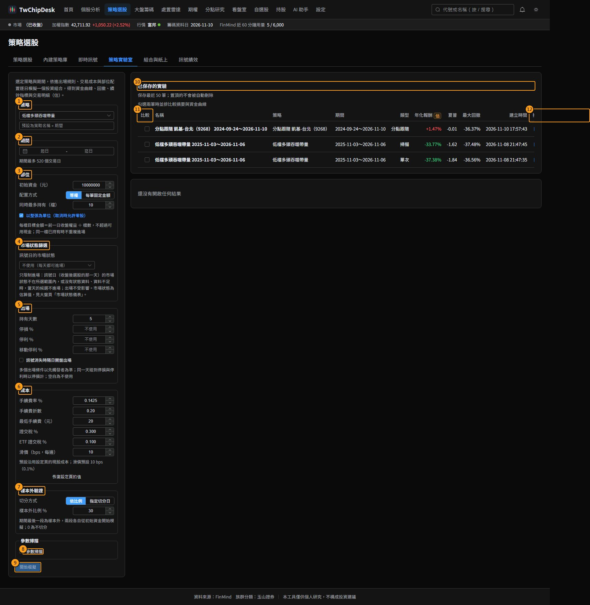
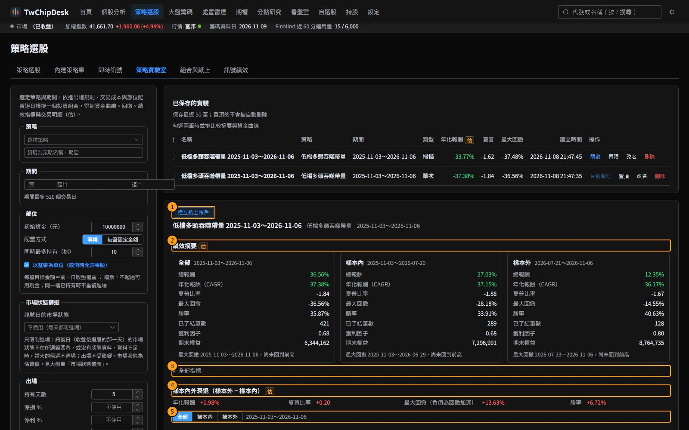
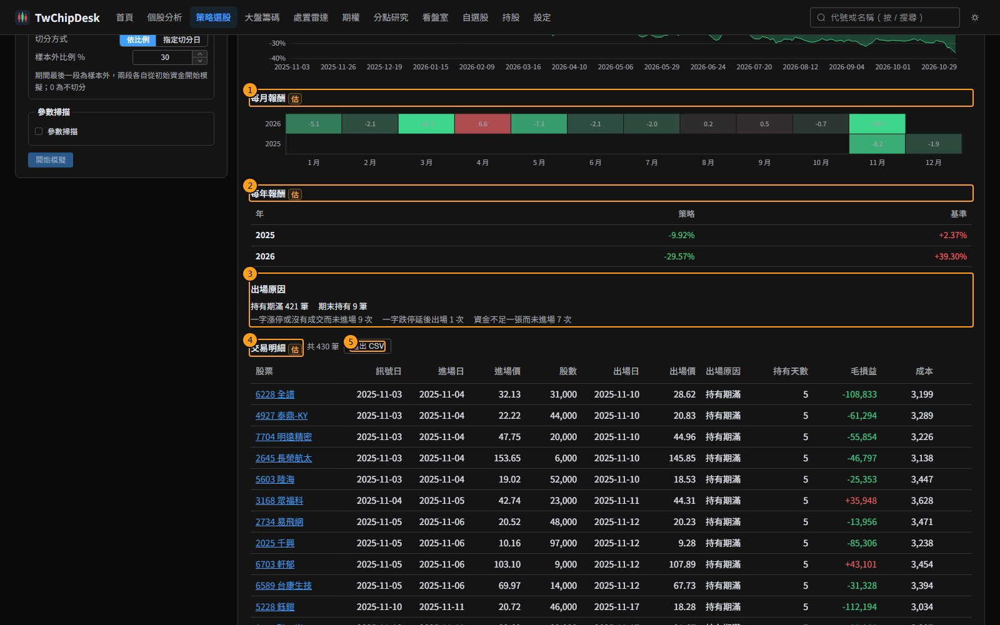

<!-- routes: /screener/lab -->
# 策略選股｜策略實驗室

> 位置：頂部選單「策略選股」→「策略實驗室」分頁（網址 `/screener/lab`；指定策略時 `/screener/lab?strategyId=策略編號`）。也可以從選股頁或內建策略庫按「在實驗室開啟」進入
> 資料更新：使用歷史日 K 與選股特徵，按「開始模擬」時計算；所有數字皆為估算值

## 這個功能可以做什麼
選一個策略與一段期間，依你設定的部位配置、出場規則與交易成本，逐日模擬一個投資組合：每天收盤後依策略選股、隔一個交易日開盤進場、依規則出場，得到資金曲線、回撤、績效指標與交易明細（估）。另外可以切出樣本外期間檢查結果是否穩定、一次掃描多組參數，並保存、並排比較過去的實驗。

和選股頁的「回溯」不同：回溯看的是每檔股票各自持有 N 日的平均報酬；實驗室模擬的是有資金上限、檔數上限、交易成本的一個帳戶。

## 畫面說明

| 編號 | 名稱 | 說明 |
|---|---|---|
| 1 | 「策略」 | 選內建策略或我的策略；從選股頁帶來時會有「目前編輯中：策略名稱」（可能是還沒儲存的條件）。下方「實驗名稱」空白時預設為策略名稱＋期間。 |
| 2 | 「期間」 | 「起日」「迄日」，最多 520 個交易日。期間內還沒有選股特徵的日子會先補算；超過一次即時補算的上限時改排入背景計算，完成前無法模擬。 |
| 3 | 「部位」 | 「初始資金（元）」（預設 10,000,000）、「配置方式」（「等權」：每檔目標金額＝前一日收盤權益 ÷ 檔數；「每筆固定金額」）、「同時最多持有（檔）」（1～50，預設 10）、「以整張為單位（取消時允許零股）」。同一檔已持有時不重複進場。 |
| 4 | 「市場狀態篩選」 | 「訊號日的市場狀態」可多選強勢、中性、弱勢；訊號日的狀態不在所選範圍內或沒有資料時，當天的候選不進場。只限制進場，出場不受影響；空白為不使用。 |
| 5 | 「出場」 | 「持有天數」（1～250，或不限）、「停損 %」「停利 %」「移動停利 %」（空白為不使用）、「訊號消失時隔日開盤出場」。多個出場條件以先觸發者為準；同一天碰到停損與停利時以停損計。 |
| 6 | 「成本」 | 「手續費率 %」「手續費折數」「最低手續費（元）」「證交稅 %」「ETF 證交稅 %」「滑價（bps，每邊）」。預設沿用設定頁的現股成本，滑價預設 10 bps（0.1%）；「恢復設定頁的值」可還原。 |
| 7 | 「樣本外驗證」 | 「切分方式」：「依比例」（「樣本外比例 %」，預設 30，0 為不切分）或「指定切分日」。期間最後一段為樣本外，兩段各自從初始資金開始模擬。 |
| 8 | 「參數掃描」 | 勾選後最多選 2 個參數（持有天數、停損 %、停利 %、移動停利 %、最多持有檔數、策略條件門檻），每個參數最多 7 個值（以逗號分隔，「-」代表不使用），共最多 49 組；並選「排名指標」（夏普比率、年化報酬、卡瑪比率、最大回撤、勝率）。 |
| 9 | 「開始模擬」 | 開始計算，進度依序為「補算歷史特徵」「逐日選股」「模擬中」，可取消。同一時間只能有一個實驗在執行。 |
| 10 | 「已保存的實驗」 | 完成的實驗自動保存，保存最近 50 筆；置頂的不會被自動刪除。欄位有名稱、策略、期間、類型（單次、掃描、組合、分點跟隨）、年化報酬、夏普、最大回撤、建立時間。類型「分點跟隨」是[分點跟隨回測](../brokers/broker-page.md#跟隨回測)的結果，按「開啟」會到分點頁的「跟隨回測」分頁（群組的到分點跟隨回測頁）並帶回當時的條件。 |
| 11 | 「比較」 | 勾選兩筆時，在上方並排比較兩者的摘要與累計報酬曲線。 |
| 12 | 「操作」 | 「開啟」：在下方顯示結果；「置頂」／「取消置頂」、「改名」、「刪除」。 |

### 模擬結果
在「已保存的實驗」按「開啟」，或模擬完成後，下方顯示結果：

| 編號 | 名稱 | 說明 |
|---|---|---|
| 1 | 「建立紙上帳戶」 | 以這個實驗的策略與設定建立[紙上帳戶](portfolio.md#紙上帳戶)，之後每晚自動更新。使用編輯中（未儲存）策略的結果不能建立，需先儲存策略。 |
| 2 | 「績效摘要」 | 「全部」「樣本內」「樣本外」三張卡片：總報酬、年化報酬（CAGR）、夏普比率、最大回撤、勝率、已了結筆數、獲利因子、期末權益，以及最大回撤期間與是否回到前高。已了結交易少於 30 筆時提示樣本不足。 |
| 3 | 「全部指標」 | 展開完整指標：年化波動、索提諾比率、最大回撤金額、最長回撤天數、卡瑪比率、平均獲利、平均虧損、期望值（每筆）、平均持有天數、最大單筆獲利／虧損、最長連續虧損、周轉率、平均曝險、基準總報酬、基準年化報酬、超額年化報酬、beta、單筆報酬 t 值。 |
| 4 | 「樣本內外衰退（樣本外 − 樣本內）」 | 年化報酬、夏普比率、最大回撤、勝率在樣本外與樣本內的差。 |
| 5 | 期間切換 | 「全部」「樣本內」「樣本外」：切換下方圖表與明細的期間。 |

期間切換下方依序是「資金曲線與基準」（策略權益與基準，即同期報酬指數的走勢）與「回撤」（權益相對前高的回撤百分比）兩張圖。

| 編號 | 名稱 | 說明 |
|---|---|---|
| 1 | 「每月報酬」 | 每月報酬熱力圖（年 × 月）。 |
| 2 | 「每年報酬」 | 每年策略與基準的報酬。 |
| 3 | 「出場原因」 | 各出場原因的筆數（持有期滿、停損、停利、移動停利、訊號消失、事件前了結、下市了結、期末持有），以及一字漲停或沒有成交而未進場、一字跌停延後出場、資金不足一張而未進場的次數。 |
| 4 | 「交易明細」 | 每筆交易的股票、訊號日、進場日、進場價、股數、出場日、出場價、出場原因、持有天數、毛損益、成本、股利、淨損益、淨報酬 %。超過 5,000 筆時只列前 5,000 筆。 |
| 5 | 「匯出 CSV」 | 下載交易明細。 |

交易明細下方的「註記」列出這次模擬的資料註記（例如缺漲跌停價時的推估方式、基準的說明），最後是「模擬限制」。

做參數掃描時另有「參數掃描」區：熱力圖（可切換指標與「樣本內」／「樣本外」）、樣本內最佳組合與它在樣本外的名次，以及各組合指標表。

## 操作步驟
1. 在「策略」選擇策略，設定「期間」。
2. 依需要調整「部位」「出場」「成本」；想檢查穩定度時保留「樣本外驗證」的比例。
3. 按「開始模擬」，等待進度完成，結果顯示在右側下方並自動保存。
4. 想比較兩次實驗時，在「已保存的實驗」勾選兩筆「比較」。
5. 想持續追蹤時，在結果上方按「建立紙上帳戶」。

## 模擬規則與限制
畫面下方「模擬限制」列出全部規則：
- 假設開盤價與收盤價都能成交；滑價為估計值。
- 一字漲停（開盤即漲停且全日一價）或沒有成交時不進場；一字跌停時延到下一個可成交日開盤出場。
- 持有期間遇除權、分割、減資、面額變更時，在事件前一交易日收盤了結。
- 現金股利於除息日計入現金；出場釋出的現金當天即可使用，未模擬 T+2 交割。
- 同日進出以一般證交稅 0.3% 計，未套用當沖減半，也不檢查當沖資格。
- 迄日以最後有日 K 的交易日為準。
- 過去的模擬結果不代表未來表現；本頁只提供歷史資料的計算，不構成任何操作依據，所有數字皆為估算值。

## 資料來源與更新時間
- 價格：歷史日 K（開盤價與收盤價）。
- 選股：與選股頁相同的選股特徵與條件引擎。
- 基準：同期含息報酬指數。
- 成本預設：設定頁的現股交易成本。

## 常見問題
- **為什麼按了開始卻顯示「已有實驗在執行中」？** 同一時間只能執行一個實驗（包含組合回測），可在頁面上查看進度或取消。
- **服務重新啟動後進度不見了？** 執行中的工作在服務重啟後會清除（「找不到這個模擬工作」），請重新開始；已完成的實驗已保存，不受影響。

## 相關功能
- [策略選股｜選股](screener.md)（單日回溯與區間回測）
- [策略選股｜組合回測與紙上帳戶](portfolio.md)
- [策略選股｜訊號績效](signal-stats.md)
- [大盤籌碼｜市場狀態儀表](../market/README.md)
- [設定](../settings.md)（交易成本）
