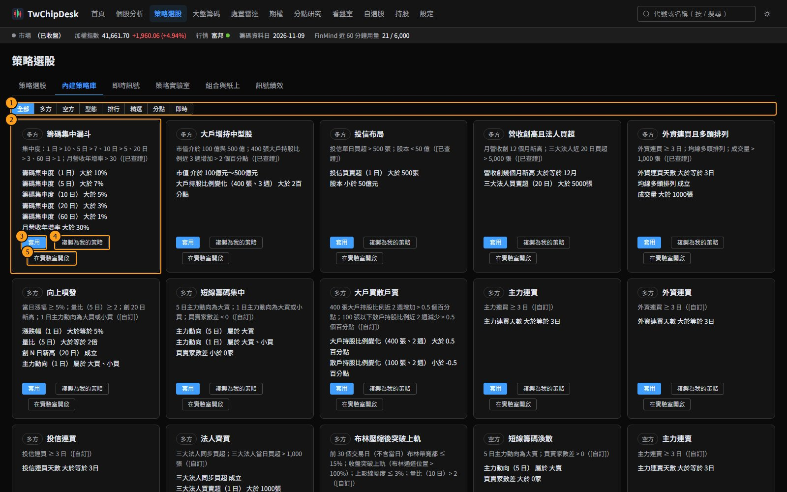

<!-- routes: /screener/library -->
# 策略選股｜內建策略庫

> 位置：頂部選單「策略選股」→「內建策略庫」分頁（網址 `/screener/library`）
> 資料更新：策略內容隨系統版本提供；套用後的選股結果用最新的選股特徵

## 這個功能可以做什麼
以卡片列出系統內建的選股策略（目前 58 個），每張卡片寫出策略說明、完整條件與範圍設定。可以直接套用到選股頁執行、複製成自己的策略再修改，或帶到策略實驗室做投資組合模擬。內建策略本身不能修改。

## 畫面說明

| 編號 | 名稱 | 說明 |
|---|---|---|
| 1 | 分類 | 「全部」「多方」「空方」「型態」「排行」「精選」「分點」「即時」，只顯示該分類的策略。左邊的搜尋框（「搜尋策略名稱或條件」）依策略名稱、說明或卡片上的條件文字篩選目前分類的卡片，不分大小寫；沒有符合時顯示說明。 |
| 2 | 策略卡片 | 左上角為分類，接著是策略名稱、說明與逐條條件（例如「籌碼集中度（1 日）大於 10%」）；有範圍設定（只看產業、股價區間等）時另列在條件下方。 |
| 3 | 「套用」 | 開啟[選股](screener.md)分頁並載入這個策略，立即以最新資料日執行選股。 |
| 4 | 「複製為我的策略」 | 複製一份到「我的策略」，之後可以自由修改、儲存。 |
| 5 | 「在實驗室開啟」 | 開啟[策略實驗室](lab.md)並選好這個策略。 |

## 操作步驟
1. 點上方分類縮小範圍，或在搜尋框輸入名稱、條件的關鍵字（例如「集中度」），閱讀卡片上的條件。
2. 想看今天的結果，按「套用」。
3. 想調整門檻，按「複製為我的策略」，再到「策略選股」分頁左側的「我的策略」選它修改；或在選股頁套用後調整，按「另存為我的策略」。

## 分類說明
- **多方**、**空方**：以籌碼、法人、技術條件組成的多方或空方條件組合。
- **型態**：以 K 線型態條件（例如多頭吞噬、晨星、島狀反轉）與圖形型態、指標背離條件（例如三角收斂向上突破、W 底突破頸線、MACD 底背離）搭配量比等條件。
- **排行**：只用排序與取前幾名（例如依殖利率取前 50 名）。
- **精選**：其他常用的篩選，例如均線附近、創新高、體質條件。
- **分點**：贏家分點、地緣分點、隔日沖分點等分點相關條件。
- **即時**：含盤中條件，只在盤中模式有結果，不能回溯或統計區間。

## 注意事項與限制
- 內建策略不可修改；在選股頁調整後只能「另存為我的策略」。
- 內建策略的條件只是資料篩選的範例組合，不構成任何投資意見。
- 卡片說明最後括號內的「已查證」「自訂」是策略門檻的出處標記：「已查證」表示門檻與原始參考資料核對過，「自訂」表示本系統自行訂定的門檻。

## 相關功能
- [策略選股｜選股](screener.md)
- [策略選股｜條件總表](conditions.md)
- [策略選股｜策略實驗室](lab.md)
- [策略選股｜訊號績效](signal-stats.md)
