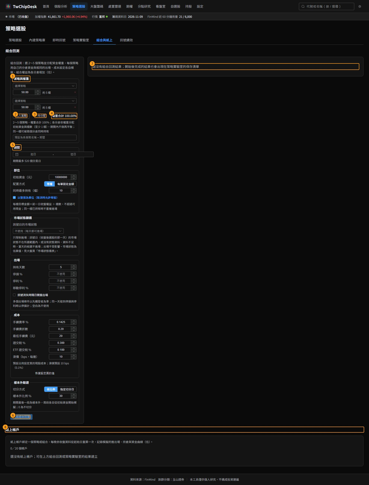

<!-- routes: /screener/portfolio -->
# 策略選股｜組合回測與紙上帳戶

> 位置：頂部選單「策略選股」→「組合與紙上」分頁（網址 `/screener/portfolio`；開啟保存的組合結果 `?savedId=編號`、開啟紙上帳戶 `?paperId=編號`）
> 資料更新：組合回測在按「開始組合回測」時計算；紙上帳戶每個交易日晚上選股特徵算完後自動重算（交易日 08:15～14:00 不重算）；所有數字皆為估算值

## 這個功能可以做什麼
- **組合回測**：選 2～5 個策略並分配資金權重，每個策略用自己的分倉資金、相同的出場與成本設定各自模擬，組合權益為各分倉相加（估）。可以看各分倉的報酬貢獻、分倉之間的日報酬相關係數，以及同一檔被多個分倉同時持有的情形。
- **紙上帳戶**：把一個策略或組合綁成一個帳戶，每晚依收盤資料從起始日重算一次，記錄模擬的進出場、目前持倉、下一個交易日預計進場的股票與資金曲線（估），用來持續追蹤策略在之後的表現。

## 畫面說明

| 編號 | 名稱 | 說明 |
|---|---|---|
| 1 | 「策略與權重」 | 每列選一個策略（內建策略或我的策略）並輸入「權重 %」，旁邊顯示依權重分到的約略檔數；按 × 移除。2～5 個策略、不可重複，權重合計需為 100%。下方「組合名稱」空白時預設為各策略名稱＋期間。 |
| 2 | 「加入策略」 | 加入一列策略（最多 5 個）。 |
| 3 | 「平均分配」 | 把權重平均分給目前的策略。 |
| 4 | 「權重合計」 | 目前權重的合計，需為 100%。 |
| 5 | 期間與其他設定 | 「期間」「部位」「市場狀態篩選」「出場」「成本」「樣本外驗證」，意義與[策略實驗室](lab.md#畫面說明)相同；初始資金與檔數上限依權重分給各分倉（每個分倉至少 1 檔）。 |
| 6 | 「開始組合回測」 | 開始計算。與策略實驗室共用一個執行名額，已有實驗在執行時要等它完成或取消。 |
| 7 | 結果區 | 組合回測的結果；完成的結果也會出現在策略實驗室的「已保存的實驗」（類型「組合」）。 |
| 8 | 「紙上帳戶」 | 紙上帳戶清單（最多 20 個），見下方[紙上帳戶](#紙上帳戶)。 |

### 組合回測結果
除了與策略實驗室相同的績效摘要、資金曲線、回撤、每月與每年報酬、出場原因、交易明細之外，另有：
- 「各分倉」：每個分倉的「權重」「分倉資金（元）」「檔數上限」「分倉報酬」「組合報酬貢獻」「最大回撤」「已了結筆數」。
- 「組合與分倉資金曲線」：組合權益、基準（報酬指數）與各分倉的權益。
- 「各分倉報酬貢獻」與「分倉日報酬相關係數」矩陣。
- 重疊持股：「有 N 個交易日出現同一檔被兩個以上分倉同時持有」，並列出重疊最多的股票。
- 交易明細可用「分倉」選單只看某一個分倉。
- 「以這個組合建立紙上帳戶」：以這個組合與設定建立紙上帳戶。

## 紙上帳戶
紙上帳戶可以從兩個地方建立：組合回測結果的「以這個組合建立紙上帳戶」，或策略實驗室結果的「建立紙上帳戶」。建立時要填：
- 「名稱」：1～100 字。
- 「起始日」：「下一個交易日」（從建立後的下一個交易日開始記錄，當晚收盤資料進來後才有第一筆），或「指定日期（回溯）」：可回溯到最近 60 個交易日內，建立後立即以歷史資料計算，清單上標示「回溯」。
- 部位、出場與成本沿用建立當時的設定；策略的自選群組範圍以建立當時的成員為準。

清單欄位：「名稱」「策略」「起始日」「權益」「報酬」「最大回撤」「今日持倉」「最後更新」「操作」。帳戶狀態可能是「已停用」「尚未計算」或「上次計算失敗」。

「操作」：
- 「開啟」：在下方顯示詳情：資金曲線與基準、「目前持倉」（股票、分倉、進場日、進場價、股數、最新收盤、市值、未實現損益、未實現報酬、已持有天數），以及「下一個交易日預計進場」（依最新選股結果、排序與空位推算的股票、順位、收盤價、預估金額）。
- 「啟用」／「停用」：停用的帳戶每晚不重算。
- 「立即重算」：排入重算（所有帳戶共用一個計算名額，可能需要排隊）。
- 「改名」「刪除」：刪除後無法復原。

## 操作步驟
1. 在「策略與權重」選 2～5 個策略，輸入權重或按「平均分配」，確認「權重合計 100.00%」。
2. 設定期間、部位、出場與成本，按「開始組合回測」。
3. 檢視結果；想持續追蹤時按「以這個組合建立紙上帳戶」，選起始日後「建立」。
4. 之後每個交易日晚上帳戶會自動更新，回到本頁在「紙上帳戶」按「開啟」查看。

## 注意事項與限制
- 組合不做再平衡：各分倉從初始分配的資金各自累積；同一檔可被兩個分倉同時持有。
- 紙上帳戶每晚依收盤資料重算，盤中不更新。
- 紙上帳戶只是依歷史規則的模擬紀錄，不是實際下單，也不構成操作依據。
- 模擬規則（成交價、一字漲跌停、除權息、交易成本等）與[策略實驗室](lab.md#模擬規則與限制)相同。

## 相關功能
- [策略選股｜策略實驗室](lab.md)
- [策略選股｜選股](screener.md)
- [持股](../portfolio.md)（實際持股的紀錄）
