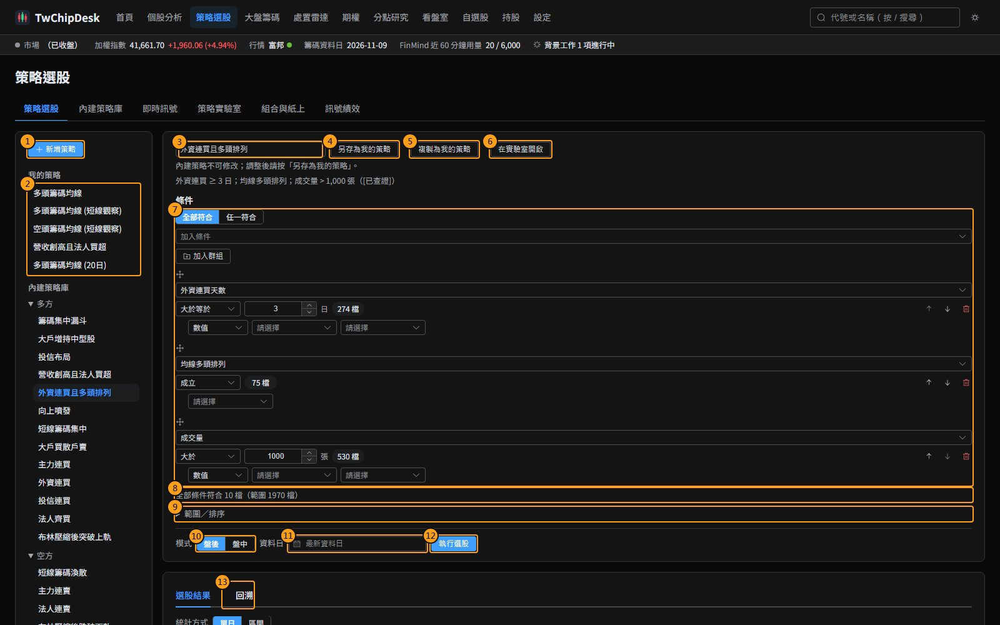
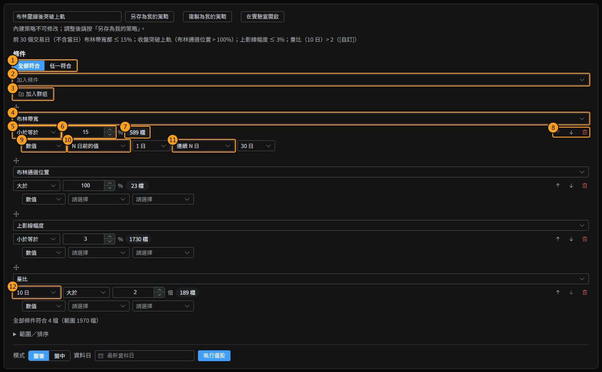
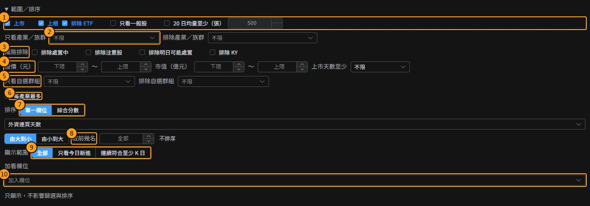
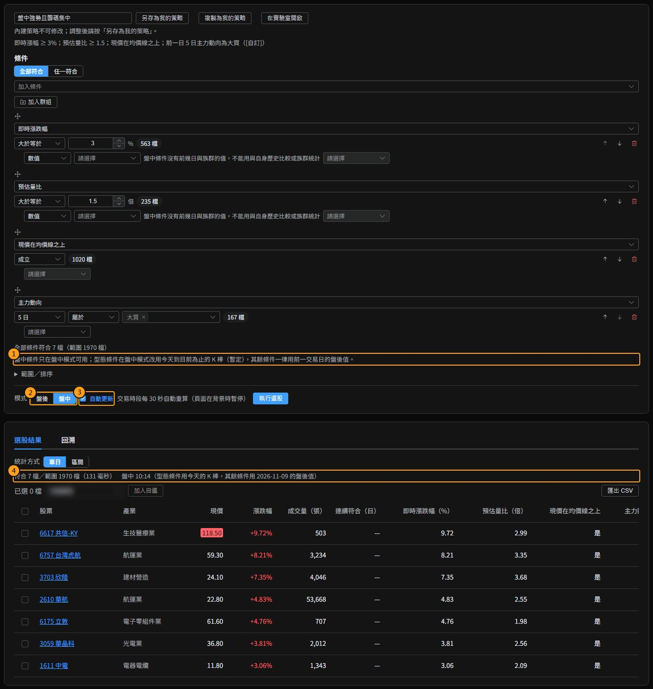
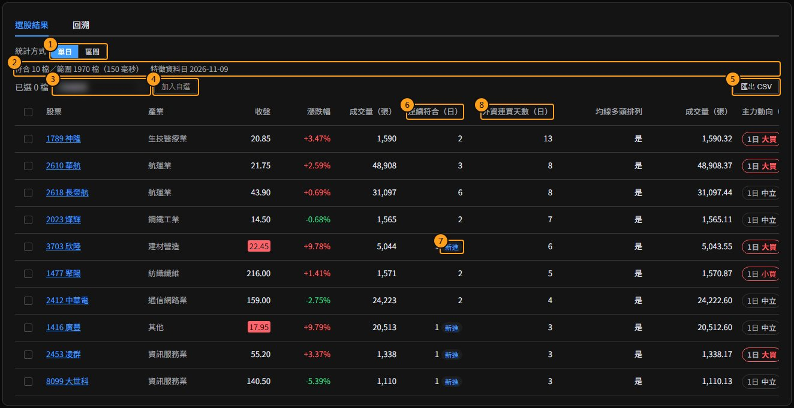
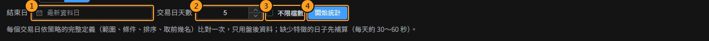

<!-- routes: /screener -->
# 策略選股｜選股

> 位置：頂部選單「策略選股」→「策略選股」分頁（網址 `/screener`；指定策略時 `/screener?strategy=策略編號`）
> 資料更新：盤後條件用每晚計算的選股特徵（交易日晚上分點與三大法人資料完成後先算一次，23:50 分點研究完成後再以當晚全部資料重算）；盤中模式在交易時段每 30 秒重算一次（策略含型態條件時每 60 秒，盤中型態在伺服器最快每 60 秒重算一次）

## 這個功能可以做什麼
用條件組出自己的選股策略，從上市櫃股票中找出符合的股票。條件可以分群組、設定「全部符合／任一符合／至少 M 項」，也可以加上時間修飾（例如「連續 5 日」）、與自身歷史比較、排名或族群統計。結果可以排序、取前幾名、加入自選股或匯出 CSV；同一個策略也可以統計一段期間每天的結果，或回溯過去的報酬。

適合的情境：
- 收盤後依籌碼、技術、基本面條件整理觀察名單。
- 盤中以即時漲跌幅、預估量比等盤中條件，以及依今天盤中 K 棒判斷的型態條件（暫定），搭配前一交易日的籌碼條件篩選。
- 檢查某個條件組合在過去一段期間每天選出哪些股票、集中在哪些族群。

## 畫面說明

| 編號 | 名稱 | 說明 |
|---|---|---|
| 1 | 「新增策略」 | 清空編輯區，從空白開始建立新策略。 |
| 2 | 策略清單 | 上半部是「我的策略」（自己儲存的），下半部是「內建策略庫」依分類（多方、空方、型態、排行、精選、分點、即時）排列。點一下載入到右邊並立即執行選股。 |
| 3 | 策略名稱 | 儲存時使用的名稱，最多 100 字。 |
| 4 | 「另存為我的策略」 | 把目前的條件存成一個新的「我的策略」。編輯自己的策略時另有「儲存」（覆寫原策略）與「刪除」按鈕。 |
| 5 | 「複製為我的策略」 | 只在選取內建策略時出現：把內建策略複製一份到我的策略。內建策略不可修改，調整後請用「另存為我的策略」。 |
| 6 | 「在實驗室開啟」 | 把目前編輯中的策略（即使還沒儲存）帶到[策略實驗室](lab.md)做投資組合模擬。 |
| 7 | 條件 | 條件群組與條件列，見下方[條件列](#條件列)。 |
| 8 | 全部條件符合檔數 | 「全部條件符合 N 檔（範圍 M 檔）」：以目前的條件與範圍即時試算。 |
| 9 | 「範圍／排序」 | 點開可設定股票範圍、排序、取前幾名、顯示範圍與加看欄位，見[範圍／排序](#範圍排序)。 |
| 10 | 「模式」 | 「盤後」或「盤中」，見[盤後與盤中模式](#盤後與盤中模式)。 |
| 11 | 「資料日」 | 盤後模式才有。空白為「最新資料日」；可選過去任一天（不能選未來）。 |
| 12 | 「執行選股」 | 以目前的條件執行選股。條件沒填完整時不能按，旁邊顯示「條件尚未填完整」。 |
| 13 | 「選股結果」／「回溯」 | 下方面板的兩個分頁：選股結果（單日或區間）與回溯（單日回溯、區間回測）。 |

### 條件列

| 編號 | 名稱 | 說明 |
|---|---|---|
| 1 | 群組邏輯 | 「全部符合」（AND）、「任一符合」（OR）、「至少 M 項」（群組內至少 M 條成立）。子群組另有「排除符合者」：群組成立的股票從結果排除，並可選「資料缺漏者保留」或「資料缺漏者也排除」。 |
| 2 | 「加入條件」 | 從分類選單選一條條件加入這個群組；選單可輸入文字搜尋，滑鼠停在條件上會顯示定義。全部條件見[條件總表](conditions.md)。 |
| 3 | 「加入群組」 | 在目前群組中加入子群組，群組最多 3 層、整個策略最多 50 條條件。 |
| 4 | 條件 | 這一列使用的條件，可以直接改選另一條。 |
| 5 | 比較 | 「大於」「大於等於」「小於」「小於等於」「等於」「介於」；成立／不成立類條件為「成立」「不成立」；選項類條件（主力動向、市場狀態等）為「屬於」。 |
| 6 | 門檻 | 比較的數值，右邊是單位。選「介於」時有下限與上限兩格。 |
| 7 | 符合檔數 | 只看這一條條件時，範圍內符合的檔數（停止編輯約 0.6 秒後更新）。 |
| 8 | 上移、下移、移除 | 調整順序或刪除這一列；也可以拖曳左上角的十字圖示排序（同一群組內）。 |
| 9 | 「比較對象」 | 「數值」：和門檻比較；「另一欄位」：和同單位的另一個條件比較，例如「收盤價 > 均線值（60 日）× 1.05」。倍數範圍 −100～100、不可為 0，還可以加減一個常數。 |
| 10 | 「數值轉換」 | 「原值」或改用轉換後的值比較，分三組：**排名**（全範圍／同產業／同細產業的百分位或名次，可選大到小或小到大；比較對象少於 5 檔時不成立）、**與自身歷史比較**（與 N 日前差、N 日變化率、N 日前的值、創 N 日新高、創 N 日新低、N 日內百分位）、**族群統計**（所屬產業、細產業、概念的中位數、平均或正值比例；細產業與概念需要族群資料）。圖中「N 日前的值」搭配右邊的「1 日」，表示用前一個交易日的值。 |
| 11 | 「時間」（時間修飾） | 「當日」（預設）、「N 日內曾經」「連續 N 日」「N 日內至少 M 日」，N 可選 2、3、5、10、20、30、60 日。加了時間修飾後，條件的值改為成立天數。群組也可以加時間修飾。 |
| 12 | 參數 | 條件本身的參數，例如量比的 5、10、20 日。 |

條件列的限制：
- 時間修飾每個策略最多 10 個、不可巢狀（外層群組有時間修飾時，群組內的條件不能再加）；排除群組不能加時間修飾。
- 與自身歷史比較每個策略最多 10 條（不佔時間修飾的名額）。
- 盤中條件不能加時間修飾、與自身歷史比較或族群統計；大盤條件不能加時間修飾、與自身歷史比較、排名或族群統計，也不能放在有時間修飾的群組內。
- 回看的日子沒有選股特徵（例如資料起點附近）時，時間修飾與歷史比較在那些日子算不成立，結果上方會註明。

### 範圍／排序

| 編號 | 名稱 | 說明 |
|---|---|---|
| 1 | 市場與基本範圍 | 「上市」「上櫃」「排除 ETF」「只看一般股」（只留普通股，代號為 4 位數字且不以 0 開頭）、「20 日均量至少（張）」（勾選才套用，預設 500 張）。 |
| 2 | 「只看產業／族群」「排除產業／族群」 | 可多選官方產業、產業鏈、細產業、概念股、集團（後三種需要族群資料外掛）。成員以目前的分類為準，概念股是事後歸類，回溯結果可能偏樂觀。 |
| 3 | 「風險排除」 | 「排除處置中」「排除注意股」「排除明日可能處置」「排除 KY」。名單還沒取得或早於資料起點的日子不排除，結果會註明。 |
| 4 | 股價、市值、上市天數 | 「股價（元）」與「市值（億元）」的上下限；「上市天數至少」可選 20、60、120、240 個交易日。 |
| 5 | 「只看自選群組」「排除自選群組」 | 以目前的自選群組成員為準；回溯時有事後挑選的偏誤。 |
| 6 | 「每產業最多」 | 勾選後依排序取股票，同一官方產業（或細產業）取滿 K 檔（1～10）就略過。 |
| 7 | 排序方式 | 「單一欄位」：選一個數值條件與參數，「由大到小」或「由小到大」。「綜合分數」：最多 5 項，每項依當天範圍內的百分位（0～100）乘上權重（0～10）後平均，結果多一欄「綜合分數」。 |
| 8 | 「取前幾名」 | 依排序取前幾檔（最多 2,000），空白為全部；「不排序」清除排序設定。 |
| 9 | 「顯示範圍」 | 「全部」「只看今日新進」（今天符合、前一交易日不符合）「連續符合至少 K 日」（K 可選 2、3、5、10）。套用順序：條件成立 → 顯示範圍 → 排序 → 取前幾名。盤中模式不能使用。 |
| 10 | 「加看欄位」 | 在結果表多顯示最多 10 個欄位（任一條件與參數），只顯示、不影響篩選與排序。盤中欄位只在盤中模式顯示。 |

## 用一句話選股（AI 助手）
條件編輯器上方的「用一句話選股」：輸入一句話（例如「近 5 日投信連續買超」），按「解讀條件」，AI 只用條件目錄裡的條件把句子轉成條件，先列出「解讀出的條件」與「沒有採用的部分」。按「確認並執行」把條件放進編輯器並執行選股，或按「放進編輯器修改」自己調整後再執行；之後可以「另存為我的策略」。畫面固定標示「AI 生成內容，可能有誤」；未設定金鑰或本月費用（估）已達上限時輸入框停用。詳見 [AI 助手](../assistant/README.md#用一句話選股策略選股頁)。

## 操作步驟

### 建立並執行一個策略
1. 按「新增策略」，在「策略名稱」輸入名稱。
2. 按「加入條件」選條件，設定參數、比較方式與門檻。重複加入其他條件；需要「或」的關係時按「加入群組」，把群組邏輯改成「任一符合」。
3. 需要時點開「範圍／排序」，設定市場、均量下限、排除項目與排序。
4. 「模式」選「盤後」，「資料日」留空（最新資料日）或選一天，按「執行選股」。
5. 結果出現在下方「選股結果」。滿意時按「另存為我的策略」儲存。

### 使用內建策略
1. 在左側「內建策略庫」點一個策略，條件會載入並立即執行選股。
2. 內建策略可以直接調整條件後執行，但不能覆寫；要保留調整請按「另存為我的策略」或「複製為我的策略」。

### 看過去某一天的結果
1. 「模式」選「盤後」，在「資料日」選那一天，按「執行選股」。
2. 如果那一天的選股特徵還沒算過，畫面會顯示「這一天的特徵尚未計算，正在補算並保存（約 30～60 秒）…」，完成後自動顯示結果。

## 盤後與盤中模式
- **盤後**：所有條件用「資料日」那天收盤後算好的選股特徵。結果摘要顯示「特徵資料日 YYYY-MM-DD」。
- **盤中**：「盤中」分類的條件（即時漲跌幅、預估量比、現價在均價線之上等）用盤中即時快照計算；「型態」分類的條件改用**今天到目前為止的 K 棒**判斷（暫定，見下方[盤中型態](#盤中型態)）；**其他條件（技術指標、法人、主力、資券、基本面等）一律用前一交易日的盤後值**。
- 自動更新：盤中模式有「自動更新」勾選框（預設勾選），顯示「交易時段每 30 秒自動重算（頁面在背景時暫停）」；策略含型態條件時改為每 60 秒。只在台北時間週一至週五 09:00～13:35、頁面在前景時重算；取消勾選就不自動重算。
- 選取含盤中條件的策略時，模式會自動切到「盤中」；在盤後模式中，盤中條件不成立。
- 盤中沒有即時報價（非交易時間或即時行情未連線）時，摘要顯示「目前沒有即時報價，盤中條件不成立（其餘條件用 YYYY-MM-DD 的盤後值）」。

| 編號 | 名稱 | 說明 |
|---|---|---|
| 1 | 盤中提示 | 策略含盤中條件時顯示「盤中條件只在盤中模式可用；型態條件在盤中模式改用今天到目前為止的 K 棒（暫定），其餘條件一律用前一交易日的盤後值。」（見[盤中型態](#盤中型態)）。 |
| 2 | 「模式」 | 切到「盤中」後資料日選單消失。 |
| 3 | 「自動更新」 | 勾選時（預設）旁邊顯示「交易時段每 30 秒自動重算（頁面在背景時暫停）」；策略含型態條件時為每 60 秒。 |
| 4 | 盤中摘要 | 有即時報價時顯示「盤中 HH:MM:SS（型態條件用今天的 K 棒，其餘條件用 YYYY-MM-DD 的盤後值）」；截圖為收盤後拍攝，所以顯示沒有即時報價。 |

### 盤中型態
在盤中模式，「型態」分類的條件（K 線型態、缺口、島狀反轉）不再讀前一交易日的結果，而是把今天到目前為止的行情當成一根日 K，與歷史日 K 一起用和夜間相同的規則判斷。條件、互比、排序、綜合分數與「加看欄位」用到型態條件時都一樣。

- **今天的 K 棒**：開＝開盤價、高＝最高價、低＝最低價、收＝目前成交價；漲跌以當日參考價計算（除權息、減資等事件日用當日參考價）。
- **量（估）**：用預估全日成交量（沒有預估時用目前累計量，且不低於累計量），再依前 5 日「日 K 成交量 ÷ 整股成交量」的比例換成日 K 的基準（日 K 含零股與鉅額交易），讓量和歷史日 K 可以比較。因為是預估量，結果註明「量以預估全日量計（估）」。
- **計算時間**：每次盤中快照輪詢後在伺服器背景重算全市場的型態，最快每 60 秒一次；選股只讀最近一次的計算結果。交易日 08:45 之後第一次快照時先載入歷史日 K。
- **尚未成交**：今天還沒有成交（或沒有當日參考價）的股票不判斷，型態條件不成立；結果註明「今天尚未成交的 N 檔不判斷型態」。
- **暫定標示**：結果上方顯示「型態以盤中 K 棒計算（暫定，HH:MM:SS 快照）」；快照的最後成交時間在 13:30 以後時為「型態以盤中 K 棒計算（收盤暫定，HH:MM:SS 快照）」。之所以是暫定，是因為 K 棒還沒走完、量是預估值，收盤後當晚的選股特徵才是定版的結果。
- **沒有套用盤中 K 棒時**：型態條件改以前一交易日的日 K 判斷，結果下方的註記說明原因：
  - 「盤中型態準備中，型態條件暫以 YYYY-MM-DD 的日 K 計算」：今天第一次計算還沒完成。
  - 「盤中型態計算暫時失敗，型態條件以 YYYY-MM-DD 的日 K 計算」：今天還沒有任何一次成功的計算（已經成功過時沿用最近一次成功的結果）。
  - 「前一交易日的特徵尚未完成，型態條件以 YYYY-MM-DD 的日 K 計算（不套用盤中 K 棒）」：前一個交易日的選股特徵還沒算好。
- **條件選單**：盤中模式時，條件選單的「型態」分類名稱與每條型態條件的說明後面加上「盤中以目前 K 棒計算（暫定）」。

### 新符合與不再符合（盤中）
盤中模式每次重算後，和同一個策略上一次的結果比較：
- 這次符合、上次不符合的股票，在「股票」欄加「新符合」標記，並勾選「新符合排在前面」（預設）時排在最前面；頁面內出現「新符合 N 檔」提示（同一頁最多每 60 秒一次，不會發出瀏覽器或外部通知）。
- 上次符合、這次不符合的股票列在結果下方「不再符合」，例如「2330 台積電（3 分鐘前）」，最多 50 檔；之後再次符合時從清單移除。
- 換策略、切回盤後模式，或盤中型態從有套用變成沒有套用（或反過來）時，重新開始比較。

## 選股結果（單日）

| 編號 | 名稱 | 說明 |
|---|---|---|
| 1 | 「統計方式」 | 「單日」：看一天的結果；「區間」：統計一段期間每天的結果，見[區間統計](#區間統計)。 |
| 2 | 摘要 | 「符合 N 檔／範圍 M 檔（耗時）」與資料日；有取前幾名或每產業上限時另外註明。下方可能出現灰色的結果註記，例如族群資料缺、回看日子不足、以目前分類計算的前視偏誤。 |
| 3 | 選擇群組 | 勾選股票後，選要加入的自選股群組（截圖已模糊處理）。 |
| 4 | 「加入自選」 | 把勾選的股票加入選擇的群組。還沒有自選群組時會提示先到自選股頁建立。 |
| 5 | 「匯出 CSV」 | 下載目前結果（檔名「選股結果_日期.csv」）。 |
| 6 | 「連續符合（日）」 | 這一檔到資料日為止連續符合策略的天數，最多顯示「20+」。 |
| 7 | 「新進」 | 今天符合、前一交易日不符合的股票。 |
| 8 | 條件值欄 | 每條條件各一欄，顯示這一檔的實際值（單位在標題括號內）；有時間修飾時是成立天數、有排名時是百分位或名次。 |

其他欄位：「股票」（點代號開啟 K 線籌碼圖）、「產業」、「收盤」（盤中模式為「現價」）、「漲跌幅」、「成交量（張）」、「主力動向（1／5／20 日）」。點欄位標題可以排序。

盤後模式的結果每一列最後有「說明」按鈕：開啟對話框，先列出這一檔每個條件的實際值與門檻（選股引擎直接計算），再由 AI 用文字描述這些數字（標示「AI 生成內容，可能有誤」）。詳見 [AI 助手](../assistant/README.md#說明選出原因選股結果的說明)。

## 區間統計

| 編號 | 名稱 | 說明 |
|---|---|---|
| 1 | 「結束日」 | 統計的最後一天，空白為最新資料日。 |
| 2 | 「交易日天數」 | 往前統計幾個交易日（預設 5，最多 60）。 |
| 3 | 「不限檔數」 | 勾選後每天列出全部符合的股票，不套用取前幾名與每產業上限；不勾選時每天的結果與當天的單日選股相同。 |
| 4 | 「開始統計」 | 開始逐日比對；過程顯示「補算歷史特徵」「逐日比對」的進度，可按「取消」。 |

完成後顯示：
- 摘要：「起日～迄日（N 個交易日，其中 K 天無資料）：X 檔至少符合一次／範圍 Y 檔」。
- 「每日符合檔數」長條圖：點一根長條或用「只看某一天」選單，下方只列那一天符合的股票；再點一次或按 ✕ 取消。無資料的日子以斜線標示，不算不符合。
- 「個股命中」分頁：每檔的「符合次數」、每天是否符合的方格條、「最近符合日」、收盤與漲跌幅，以及集團、產業、概念股；條件值為各股最近一次符合當天的值。可「匯出 CSV」。
- 「族群統計」分頁：依官方產業、產業鏈、產業、概念股、集團統計「成員數」「範圍內」「命中檔數」「命中次數」「命中率」「佔比」「相對倍數」，並畫出命中次數前 15 名。相對倍數＝（族群命中次數 ÷ 成員數）÷（全部命中次數 ÷ 股票範圍檔數），大於 1 表示這個策略在這個族群符合得比平均多。範圍內成員少於 3 檔的族群預設隱藏。點族群名稱可看成分股。

注意：區間統計只用盤後資料；含盤中條件的策略不能統計區間。缺少特徵的日子會先補算（每天約 30～60 秒）。服務重新啟動後進行中的工作會清除，需要重新開始。

## 回溯

| 編號 | 名稱 | 說明 |
|---|---|---|
| 1 | 回溯類型 | 「單日回溯」：看某一個訊號日選出的股票之後的報酬；「區間回測」：在一段期間（「起日」「迄日」，最多 520 個交易日）依「取樣」（「每日」或「每週」）逐次選股並彙總報酬。 |
| 2 | 「訊號日」 | 單日回溯要看的日子（區間回測為起日、迄日與取樣）。 |
| 3 | 「開始回溯」 | 開始計算，進度顯示「補算歷史特徵」「回溯中」，可取消。 |

計算方式：訊號日為 T，以 T+1 的開盤價進場、T+N 的收盤價計算報酬（N 預設為 1、3、5、10、20 日），不含交易成本；持有期間除息加回現金股利，遇除權、減資、分割、面額變更的樣本剔除；持有期間下市的以下市前最後收盤計算。歷史特徵只用當時已公布的資料，月營收與財報採保守的可用日。

結果包含：每個持有天數的「樣本數」「上漲機率」「平均報酬」「中位數報酬」「最大報酬」「最小報酬」，以及「同期加權指數」與「同期加權報酬指數（估）」「超額報酬（含息基準，估）」；區間回測另有「彙總與分布」「個股命中」「族群統計」三個分頁、每個取樣日的符合檔數與報酬分布圖。

回溯前會顯示涵蓋提示：取樣日中還沒有選股特徵的天數（超過一次即時補算的上限時改排入背景計算）、主力與分點條件有資料的天數、主動 ETF、指數權重、鉅額與借券、權證、處置雷達等來源的資料起日。資料起日之前的日子這些條件為空值、不會被選出。含盤中條件的策略不能回溯。

## 欄位與名詞
- **選股特徵**：每個交易日收盤後，為每一檔股票預先算好的全部盤後條件值。選股、回溯都讀這份資料，執行時不連外部資料來源。
- **範圍**：通過「範圍／排序」設定（市場、ETF、均量、族群、風險排除等）的股票，是條件比對的母體。
- **連續符合**：以交易日計算，資料起點之前的日子沒有特徵時，連續天數只算到那之後（結果會註明實際可能更長）。

## 資料來源與更新時間
- 選股特徵：每個交易日晚上計算兩次（分點與三大法人資料完成後一次、23:50 分點研究完成後以當晚全部資料重算一次）。融資券、當沖、市值等較晚發布的資料在第二次才會完整。
- 盤中條件：盤中即時行情快照。
- 族群分類：族群資料外掛（官方產業與產業鏈不需要外掛）。
- 各條件的資料來源見[條件總表](conditions.md)與[資料來源與更新時間](../reference/data-sources.md)。

## 注意事項與限制
- 群組最多 3 層、條件最多 50 條、取前幾名最多 2,000、加看欄位最多 10 欄、綜合分數最多 5 項。
- 盤中模式的型態條件是依盤中 K 棒算出的暫定結果，收盤前可能出現或消失；收盤定版的型態要等當晚選股特徵算好後，用盤後模式查看。
- 族群、自選群組、同產業排名、產業類條件與每產業最多 K 檔都以目前的分類與成員為準；回溯過去的日子時有前視偏誤。
- 條件結果只是資料篩選，不構成任何投資意見。

## 常見問題
- **為什麼「執行選股」不能按？** 有條件沒選完參數或門檻；旁邊會顯示「條件尚未填完整」。在盤中模式設定「顯示範圍」時也不能執行。
- **某條條件顯示 0 檔，但我認為應該有？** 先確認資料日：主力與分點、主動 ETF、權證等條件在資料起日之前或當天資料還沒到時為空值，不會被選出。
- **盤中型態選出的股票，收盤後用盤後模式查卻沒有？** 盤中是依還沒走完的 K 棒與預估量判斷的暫定結果；收盤後的價格與實際成交量可能讓型態不成立。盤後模式要等當晚選股特徵算好後才是那一天的定版結果。
- **晚上 21 點選股，融資條件的結果和隔天早上不一樣？** 融資券等資料較晚發布，23:50 之後的重算才會用到完整資料。

## 相關功能
- [策略選股｜條件總表](conditions.md)
- [策略選股｜內建策略庫](library.md)
- [策略選股｜策略實驗室](lab.md)
- [策略選股｜即時訊號](signals.md)
- [自選股](../watchlist.md)
- [K線籌碼圖](../stock/kline.md)
