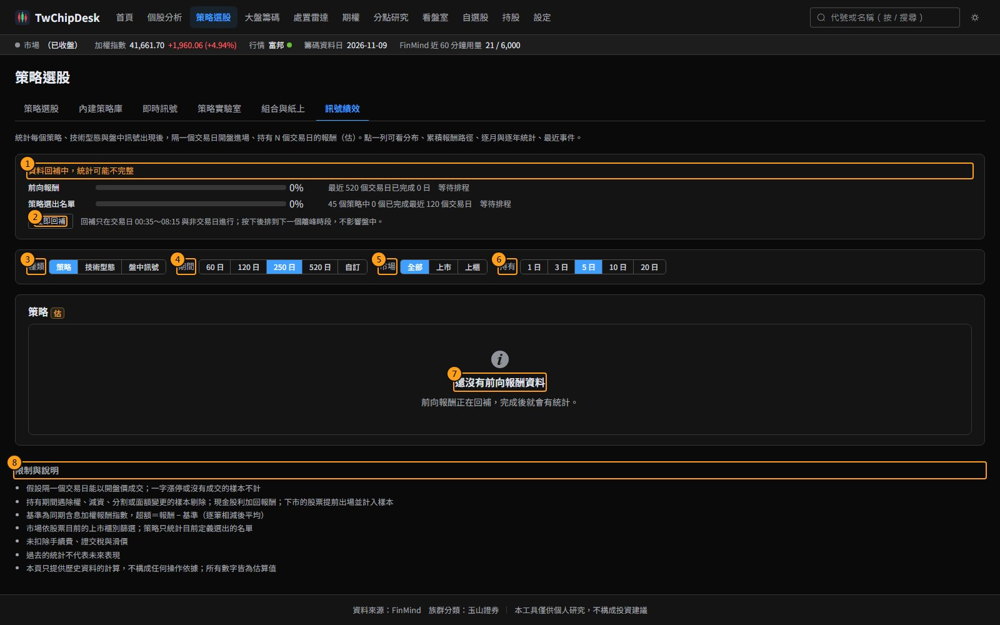

<!-- routes: /screener/signal-stats -->
# 策略選股｜訊號績效

> 位置：頂部選單「策略選股」→「訊號績效」分頁（網址 `/screener/signal-stats`；條件會寫在網址上，例如 `?kind=pattern&days=120&market=twse&n=10`）
> 資料更新：前向報酬在每天日 K 寫入後重算最近 25 個交易日；策略選出名單在每晚選股特徵算完後更新。歷史資料的回補只在交易日 00:35～08:15 與非交易日進行；所有數字皆為估算值

## 這個功能可以做什麼
統計每個策略、技術型態與盤中訊號出現之後，隔一個交易日開盤進場、持有 N 個交易日的報酬（估），一次比較它們過去的勝率、平均報酬與相對大盤的超額報酬。點一列可以看報酬分布、平均累積報酬路徑、逐月與逐年統計，以及最近的事件。

## 畫面說明

| 編號 | 名稱 | 說明 |
|---|---|---|
| 1 | 回補狀態 | 資料還在回補時顯示「資料回補中，統計可能不完整」，下方兩條進度：「前向報酬」（最近 520 個交易日已完成幾日）與「策略選出名單」（幾個策略已完成最近 120 個交易日）。完成後這一區不顯示。 |
| 2 | 「立即回補」 | 把回補排到下一個離峰時段（交易日 00:35～08:15 與非交易日），不影響盤中。排程服務沒有執行時會提示無法排入。 |
| 3 | 「種類」 | 「策略」（內建策略與我的策略，含盤中條件的除外）、「技術型態」（K 線型態、缺口、島狀，另標偏多、偏空、中性）、「盤中訊號」（即時訊號頁的各種訊號）。 |
| 4 | 「期間」 | 最近 60、120、250（預設）、520 個交易日，或「自訂」起迄日（最多 520 個交易日）。 |
| 5 | 「市場」 | 「全部」「上市」「上櫃」（依股票目前的上市櫃別）。 |
| 6 | 「持有」 | 持有 1、3、5（預設）、10、20 個交易日。 |
| 7 | 統計列表 | 每個策略、型態或訊號一列：「名稱」「筆數」「勝率」「平均」「中位數」「平均超額」「t 值」，點標題可排序。樣本少於 30 筆的列標「樣本不足」。截圖時前向報酬還在回補，所以顯示「還沒有前向報酬資料」。 |
| 8 | 「限制與說明」 | 計算規則與限制，見下方。 |

### 詳情
在列表點一列，開啟「名稱的詳情」（網址加上 `key=`，可分享）：
- 「摘要」與「各持有天數」：「筆數」「事件數」「勝率」「平均」「中位數」「標準差」「t 值」「平均超額」「超額勝率」「基準平均」「P10」「P25」「P75」「P90」；並說明事件數、樣本數、尚未到期與無資料的筆數，以及剔除的筆數與原因（持有期間有除權、減資等事件；隔一個交易日一字漲停；隔一個交易日沒有成交）。詳情可另外切換持有天數。
- 「報酬分布」：每格 2 個百分點，低於 −20% 與高於 +20% 併入兩端。
- 「平均累積報酬路徑」：進場後 1、3、5、10、20 個交易日的平均報酬、平均超額與基準平均（每個持有天數各自用自己的樣本）。
- 「逐月統計」「逐年統計」：每期的事件數、筆數、勝率、平均、平均超額。
- 「最近事件」：股票、訊號日、名次（策略）或時間（盤中訊號）、進場價、報酬、超額、狀態（已計入、尚未到期、事件剔除、一字漲停、沒有成交、資料不足）。

## 計算方式
- 訊號日收盤後選出（盤中訊號以發生當天為訊號日，同一股票同一天同一種訊號只算第一次），隔一個交易日開盤進場，第 N 個交易日收盤計算報酬並加回現金股利。
- 持有期間遇除權、減資、分割或面額變更的樣本剔除；隔一個交易日一字漲停或沒有成交的樣本不計；尚未到期的事件不列入。持有期間下市的股票提前出場並計入樣本。
- 超額＝報酬 − 同期含息加權報酬指數的報酬（逐筆相減後平均）。
- 策略只統計**目前**定義選出的名單（依策略自己的排序與取前幾名）；策略修改後會重新回補。
- 未扣除手續費、證交稅與滑價。

## 操作步驟
1. 選「種類」「期間」「市場」「持有」。
2. 在列表點標題排序，例如依「平均超額」由大到小。
3. 點一列看詳情，切換持有天數、查看分布與最近事件。

## 資料來源與更新時間
- 前向報酬：日 K 寫入後（交易日 17:35 起）重算最近 25 個交易日；交易日 08:15～14:00 不執行。缺少的歷史資料（最近 520 個交易日）在離峰時段回補。
- 策略選出名單：每晚選股特徵算完後寫入當天名單，並在離峰時段回補最近 120 個交易日。選股特徵只重算一部分股票時（例如新增或刪除[關鍵分點](../brokers/key.md)後重算那幾檔），那幾天的名單會作廢並自動排入回補，不必等當晚的選股特徵；回補同樣只在離峰時段執行，完成前上方的回補狀態區會顯示進度。
- 技術型態、盤中訊號：分別來自型態判斷與即時訊號的保存紀錄。

## 注意事項與限制
- 假設隔一個交易日能以開盤價成交；過去的統計不代表未來表現。
- 本頁只提供歷史資料的計算，不構成任何操作依據；所有數字皆為估算值。
- 資料還在回補時統計可能不完整；某個來源的資料起日晚於所選期間時，該列會標「自 YYYY-MM-DD 起」。

## 常見問題
- **為什麼整頁顯示「還沒有前向報酬資料」？** 前向報酬還沒回補完成。回補只在離峰時段進行，可以按「立即回補」排到下一個離峰時段，完成後就會有統計。

## 相關功能
- [策略選股｜即時訊號](signals.md)
- [策略選股｜內建策略庫](library.md)
- [策略選股｜策略實驗室](lab.md)
- [K線籌碼圖](../stock/kline.md)（技術型態標記）
