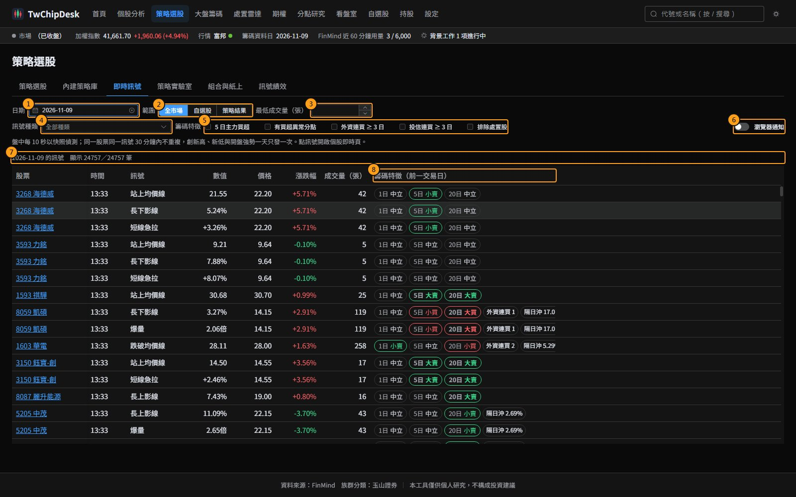
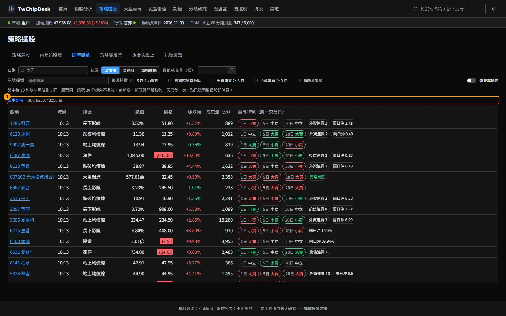

<!-- routes: /screener/signals -->
# 策略選股｜即時訊號

> 位置：頂部選單「策略選股」→「即時訊號」分頁（網址 `/screener/signals`）
> 資料更新：盤中每 10 秒以即時快照偵測；過去日期顯示當天保存的訊號；籌碼特徵為前一交易日的盤後資料

## 這個功能可以做什麼
盤中自動偵測全市場股票的價量變化，例如開盤強勢、短線急拉、創新高、爆量、漲停打開、大單敲進，依時間列出。可以只看自選股或某個策略選出的股票，再用前一交易日的籌碼特徵（主力動向、異常分點、法人連買）篩選。過去的日期可以回看當天發生過的訊號。

## 畫面說明

| 編號 | 名稱 | 說明 |
|---|---|---|
| 1 | 「日期」 | 空白為「今天」（盤中即時更新）；選過去的日期看當天的訊號。 |
| 2 | 「範圍」 | 「全市場」「自選股」「策略結果」。選「策略結果」時右邊出現「選擇策略」：今天以盤中模式的選股結果判斷，過去的日期以前一交易日的盤後結果判斷；含盤中條件的策略只能篩選今天。 |
| 3 | 「最低成交量（張）」 | 只列累計成交量至少這個張數的訊號，空白為不限。 |
| 4 | 「訊號種類」 | 可多選，空白為「全部種類」。 |
| 5 | 「籌碼特徵」 | 「5 日主力買超」「有買超異常分點」「外資連買 ≥ 3 日」「投信連買 ≥ 3 日」「排除處置股」，可複選。 |
| 6 | 「瀏覽器通知」 | 開啟後，新的訊號會以瀏覽器通知提示（只通知開啟之後的新訊號，一次最多 5 則）。瀏覽器封鎖通知時會提示到瀏覽器設定中允許。 |
| 7 | 資料說明與筆數 | 今天盤中顯示「盤中即時」，過去日期顯示「YYYY-MM-DD 的訊號」；「顯示 N／M 筆」為篩選後與全部的筆數。 |
| 8 | 「籌碼特徵（前一交易日）」 | 每筆訊號的股票在前一交易日的 1／5／20 日主力動向、異常買超／賣超、外資或投信連買天數、隔日沖比例、處置標記。 |

其他欄位：「股票」（點一下開啟個股即時頁；過去日期會開啟那一天）、「時間」、「訊號」、「數值」（漲幅、倍數等，依訊號而定）、「價格」（等於漲停或跌停價時加底色）、「漲跌幅」、「成交量（張）」。篩選條件會記在這台電腦的瀏覽器中，下次開啟沿用。

盤中畫面（今天）：

| 編號 | 名稱 | 說明 |
|---|---|---|
| 1 | 「盤中即時」 | 今天的訊號隨盤中偵測持續增加。截圖若在非交易時間拍攝，會顯示目前沒有符合的訊號或最近一個交易日的狀態。 |

## 訊號種類
門檻為預設值，可在「設定」頁的即時行情相關設定中調整。

| 訊號 | 判斷方式（預設門檻） |
|---|---|
| 開盤強勢 | 09:00～09:05 之間，開盤價相對昨收漲幅 ≥ 2%（一天只發一次）。 |
| 短線急拉、短線急殺 | 最近 1 分鐘漲跌幅達 ±1.5%。 |
| 創新高、創新低 | 現價突破前 10 個交易日的最高（最低）價（一天只發一次）。 |
| 爆量 | 09:10 以後，預估全日成交量 ≥ 前 5 日均量的 2 倍。 |
| 長上影線、長下影線 | （最高 − 現價）÷ 昨收、（現價 − 最低）÷ 昨收 ≥ 3%。 |
| 漲停、跌停 | 現價等於漲停價或跌停價（當日有除權息、減資等事件而沒有漲跌停價的股票不發）。 |
| 漲跌停打開 | 先前觸及漲停或跌停，現價離開。 |
| 站上均價線、跌破均價線 | 現價由下往上（由上往下）穿越當天的均價線。 |
| 大單敲進 | 快照觀察到單筆金額 ≥ 大單金額門檻的 3 倍（依個股分布的大單規則時，單筆張數也要達到該股大單張數的 3 倍）。 |

同一股票同一訊號在 30 分鐘內不重複發出；創新高、新低與開盤強勢一天只發一次。

## 操作步驟
1. 盤中開啟本頁，「日期」留空即為今天的即時訊號。
2. 需要時把「範圍」改成「自選股」或「策略結果」並選擇策略。
3. 用「訊號種類」與「籌碼特徵」縮小範圍；想被提醒時打開「瀏覽器通知」。
4. 點股票代號開啟個股即時頁查看走勢與明細。

## 資料來源與更新時間
- 盤中訊號：即時行情快照，每 10 秒偵測一次。
- 籌碼特徵：前一交易日的選股特徵。

## 注意事項與限制
- 訊號以快照偵測，不是逐筆，短暫觸及的價位可能沒有被偵測到。
- 即時行情未連線時沒有新的訊號。
- 訊號只是價量變化的紀錄，不構成任何投資意見。

## 相關功能
- [策略選股｜訊號績效](signal-stats.md)（盤中訊號出現後的歷史報酬統計）
- [策略選股｜選股](screener.md)
- [個股分析｜即時](../stock/intraday.md)
- [看盤室](../monitor.md)
