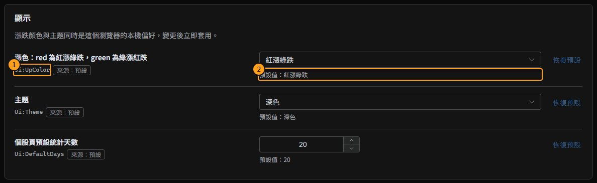
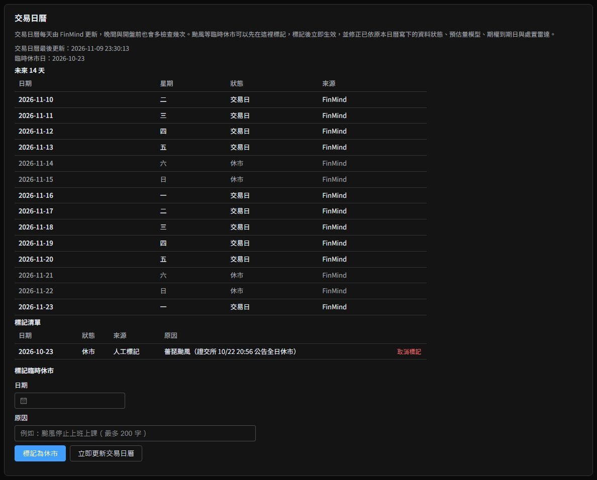
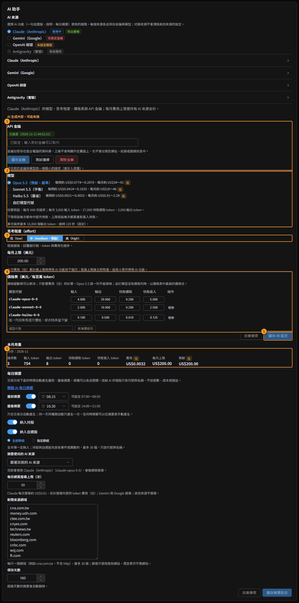
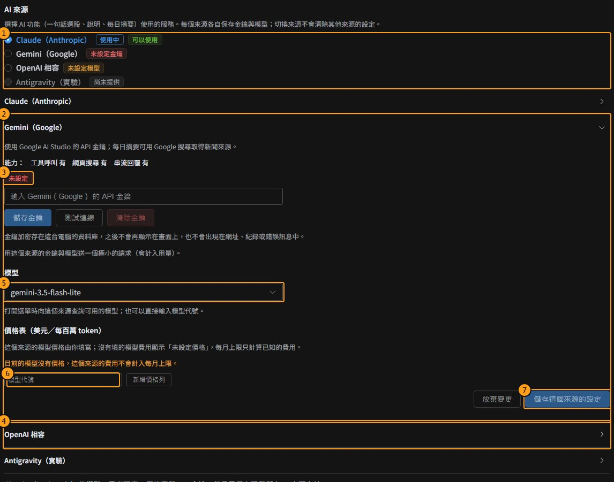
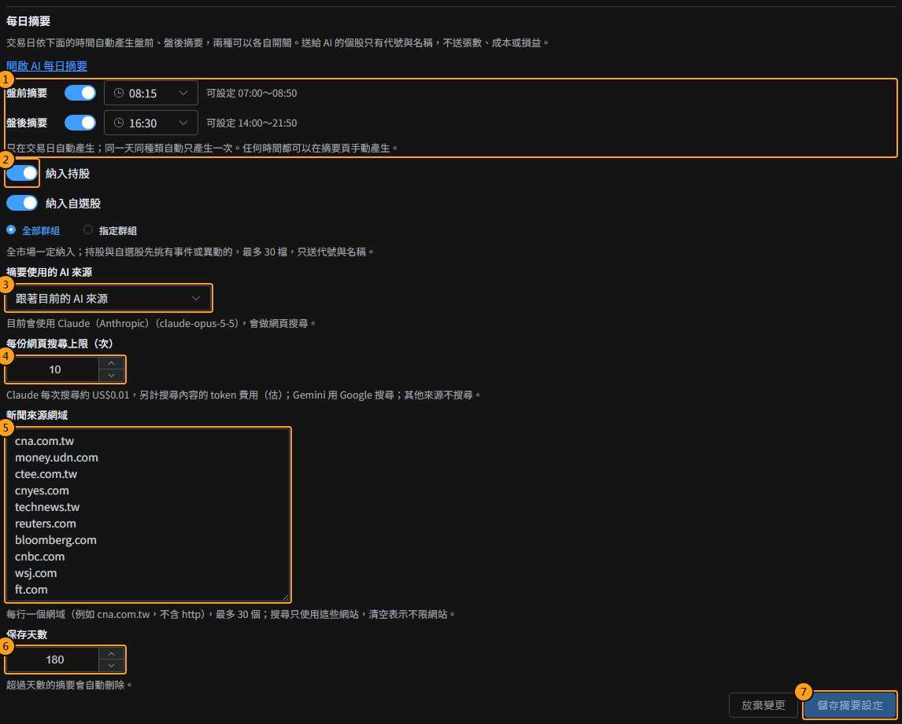
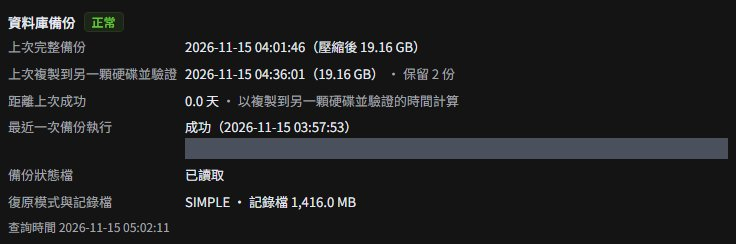

<!-- routes: /settings -->
# 設定

> 位置：頂部選單「設定」（網址 `/settings`）；手機在底部「更多」裡
> 資料更新：設定值在按「儲存變更」後生效（標示「需重新啟動」的項目要重新啟動服務）；交易日曆、特殊日、商品對照表等清單的新增、修改、刪除立即生效

## 這個功能可以做什麼
調整系統的所有參數：FinMind 請求配額、回補範圍、即時行情與券商連線、各功能的計算門檻、持股風險、顯示偏好與資料維護。每個欄位都寫出說明、預設值與目前值的來源，可以單獨「恢復預設」。

## 畫面說明
左邊是區塊目錄，點一下捲到該區塊；右邊是各區塊的欄位；畫面下方固定一列「儲存變更」。

### 一個欄位的樣子

| 編號 | 名稱 | 說明 |
|---|---|---|
| 1 | 設定鍵與來源 | 欄位名稱下方是設定鍵（例如 `Ui:UpColor`）與「來源：」標籤：「資料庫」（在本頁改過）、「環境變數」、「設定檔」或「預設」。有「需重新啟動」標籤的項目，儲存後要重新啟動服務才生效。 |
| 2 | 預設值 | 欄位下方顯示預設值。來源是環境變數或設定檔時，在本頁修改會存入資料庫並優先生效。 |
| 3 | 恢復預設 | 改回預設值（儲存後生效）；改過但還沒儲存的欄位標示「已修改」。 |

### 儲存列

- 顯示「N 項變更尚未儲存」或「沒有未儲存的變更」。
- 「儲存變更」只送出改過的欄位；「放棄變更」回到目前的值。
- 有欄位格式不正確時無法儲存，欄位下方會寫出原因（例如「請輸入整數」「數值不得大於 …」）。
- 有未儲存的變更時離開頁面，會詢問是否離開。

## 各區塊用途
| 區塊 | 用途 |
|---|---|
| FinMind | 輸入、驗證、清除 FinMind token（輸入後只顯示「已設定」，不會再顯示內容），以及方案配額、自我限制比例、各請求通道的每小時用量上限、重試間隔、逾時與重試預算（FinMind 持續出錯時，一段時間內的重試次數最多為請求數的固定比例，避免重試放大請求量；改了要重新啟動服務才生效）。 |
| 交易日曆 | 未來 14 天每天是交易日或休市與來源；「標記臨時休市」（例如颱風停市，按「標記為休市」）與「取消標記」；「立即更新交易日曆」重抓 FinMind 交易日曆。FinMind 日曆與已記錄的資料不一致時會持續提示，可在這裡確認。這個區塊的操作立即生效。 |
| 回補 | 初次回補的起始年份、是否納入興櫃與 ETF、分點回補的交易日數與範圍；下方有與資料狀態頁相同的回補進度。 |
| 即時 | 盤中快照輪詢間隔（股票預設 10 秒、期貨 30 秒）、大單與特大單的判定方式與門檻、族群異動的偵測參數；[警示中心](alerts/README.md)的每分鐘最多提示則數（`Alerts:MaxPerMinute`，預設 10）、預設冷卻分鐘（`Alerts:DefaultCooldownMinutes`，預設 10）與觸發紀錄保存天數（`Alerts:LogKeepDays`，預設 30，1～365 日曆日；每個交易日 15:55 刪除超過天數的紀錄）。 |
| 預估成交量 | 預估量模型的參數，以及「特殊日清單」：只需維護資料來源沒有提供的指數成分調整日（結算日、長假前後、除權息、處置、新上市會自動判定）。 |
| 行情來源 | 即時行情要用富邦、玉山或兩者（策略）、兩家同時使用時的待命方式、故障轉移與移回的秒數、每分鐘搬移上限、平衡容忍度，以及指數由哪個來源接收；顯示實際使用的來源、不一致警告、合併容量表與最近的搬移紀錄，見下方 [行情來源](#行情來源)。 |
| 富邦行情 | 富邦行情的開關、連線狀態、連線數與用量；連線所需的憑證可在此上傳，認證失敗時可「重新嘗試連線」（不會自動重試）；「測試連線」可當場確認設定是否正確，見下方 [富邦行情的測試連線](#富邦行情的測試連線)。 |
| 玉山行情 | 玉山行情的開關、方案（與有效方案、方案提醒）、自動降級、認證資料是否已設定（只顯示已設定或未設定與憑證到期日）、連線狀態、容量與用量、各用途的請求保留比例，見下方 [玉山行情方案與自動降級](#玉山行情方案與自動降級)；「測試連線」見 [玉山行情的測試連線](#玉山行情的測試連線)。 |
| 盤中監控 | [盤中監控](live.md)的開關與參數，預設全部關閉。區塊開頭說明三個開關的關係：`Tape:Enabled` 是總開關（開啟時以富邦股票連線的第 2 條起接收焦點股的逐筆成交；關閉時不接收、不另開連線）；`Tape:Focus:WarrantsEnabled` 開啟焦點權證（約當金額、盤中權證力道與涵蓋率，估）；`Tape:Flow:Enabled` 只開啟現股與股期大額的分鐘與每日彙總與焦點以外股票的快照推估（估），不需要焦點權證。總開關關閉時另外兩個開關都不生效。其他項目：焦點股上限（預設 300 檔）與開盤前先接收的檔數、大額與合併門檻、釘選的標的（`Tape:Focus:PinnedStocks`）、熱門標的數（預設 60）、每個標的的焦點權證數（預設 40）與上限（預設 3,000）、活躍權證探測（預設關閉）、事件與彙總的保留天數。 |
| 期權 | 期權模組總開關、資料保留天數、焦點合約、夜盤即時資料等參數，以及商品對照表的新增、修改、刪除。 |
| 期現套利（成本與稅率，估） | 現股手續費率與折數、證交稅、期貨手續費、期交稅、融券與借券費用等成本設定（持股風險與可轉債套利也沿用這裡的股票成本）。 |
| 可轉債套利（成本，估） | 可轉債手續費率（%，取得可轉債那一邊；折數沿用現股手續費折數，預設 0.1425%）、轉換手續費（元／張，預設 0）、申請轉換到撥入股票的交易日數（預設 4，只用於顯示與年化欄；年化的持有天數另加 2 個交割日）、「成交稀少」的門檻張數（預設 5）。區塊上方註明成本與價差皆為估算，股票手續費、手續費折數、證交稅與融券手續費沿用「期現套利」區塊的設定，並有「查看可轉債套利」連結（開啟「可轉債」頁的「套利」分頁）。 |
| 可轉債主力 | [可轉債](cb/README.md)頁的階段與訊號條件：低檔發債的天數與股價位置、主力買超佔量、高檔融券增的轉換價值與融券增幅、現券償還比例、券償暴增與融券暴增的倍數與門檻、CBAS 試算的預設折現率（2.0%／年）與手續費（0.3）、融券接近限額的比例（預設 90%）。階段與訊號的條件改了以後，每晚的計算只重算最近 30 個交易日，更早的歷史要另外指定期間重算才會套用。 |
| 籌碼參數 | 主力定義的分點名次、預先計算的統計天數、主力動向的大買小買門檻、分點標籤（囤、出、作）的回看天數與名次。也有主動式 ETF 持股（`ActiveEtf:Enabled`，預設開啟）與 [ETF 成分股](stock/etf-holdings.md)（`EtfHoldings:Enabled`，預設開啟；關閉時不送出請求，成分股頁顯示此功能已關閉）的開關，以及 ETF 成分股每次排程最多抓幾檔（`EtfHoldings:MaxPerRun`，預設 120，1～1,000）。 |
| 分點清單 | 分點規模分類、隔日沖自動清單的條件，以及「隔日沖清單」：可手動加入、排除分點，立即生效。 |
| 補充來源 | 公司基本資料（地址、座標）外掛與族群分類外掛的開關與進度；可下載或匯入公司地址、手動補座標；「官方開放資料事件來源」的開關、每日抓取時間、被限流時暫停分鐘數與公告內文保留天數，見下方 [官方開放資料事件來源](#官方開放資料事件來源)。「原始檔每日存檔」（預設開啟，官方開放資料事件來源也開啟時才執行）在官方開放資料每一輪抓完後，把證交所、櫃買中心開放資料的原始內容另外存到資料目錄的 `official-raw` 資料夾，留作之後的功能使用；關閉後不再存，已存的檔不會刪除。 |
| 處置雷達 | 處置雷達總開關、官方公告抓取時間與頻率、明日處置機率的分級門檻等。 |
| 處置配對 | 處置配對的開關、族群範圍、相似度計算期間、偏離門檻等。 |
| 選股 | 選股條件的參數（例如量門檻的均量天數）。 |
| 持股風險 | 總資金、單筆最大虧損 %、停損 ATR 倍數、單檔與產業權重上限、流動性比例、融資追繳維持率、預設融資成數、事件日曆天數。 |
| 檢查清單 | 個股頁[檢查清單](stock/README.md#檢查清單)的近期事件天數與資券、流動性的門檻，見下方 [檢查清單](#檢查清單)。 |
| 清單 | 台灣 50 成分股代號、國際行情每天抓取的代號清單（從清單移除的代號之後不再更新，見下表）；盤前摘要的 ADR 對照（`Preopen:AdrMap`，格式「ADR 代號:台股代號:每 ADR 股數」，預設 `TSM:2330:5`、`UMC:2303:5`、`ASX:3711:2`），用來算 ADR 溢價（估）。 |
| 顯示 | 「紅漲綠跌」或「綠漲紅跌」、「深色」或「淺色」主題、個股頁預設統計天數。漲跌色與主題同時是這個瀏覽器的本機偏好，變更後立即套用。 |
| AI 助手 | 「AI 來源」（Claude、Gemini、OpenAI 相容、Antigravity（實驗））與各來源的金鑰、模型、價格表；[AI 助手](assistant/README.md)的模型、思考程度、每月費用上限（所有來源合計）、價格表、Anthropic API 金鑰（只能輸入，不會再顯示）、「測試連線」與本月用量；「每日摘要」的開關、時間與範圍。各段有自己的儲存按鈕，見下方 [AI 助手](#ai-助手)、[AI 來源](#ai-來源)、[每日摘要](#每日摘要)。 |
| 資料維護 | 各類暫存資料的保留天數、資料庫大小與最大的資料表、資料庫備份狀態（見下方）與它的兩個警告門檻、「清除快取」；以及「匯出與匯入」：匯出設定頁改過的設定、自選股、我的策略、看盤室版面、持股、持股風險設定與自選分點組合（含 AI 助手的模型、上限與價格表；不含 FinMind token 與 AI 金鑰），匯入時檔案中有的類別會整批取代目前的資料。 |

「清單」區塊裡和國際行情、盤前摘要有關的項目：

| 項目 | 預設 | 用途 |
|---|---|---|
| 「國際頁的匯率幣別」（`Global:Currencies`） | FinMind 的 19 種全部 | 每天抓取的匯率幣別（[國際總經](market/global.md)） |
| 「國際頁的美國公債殖利率」（`Global:Bonds`） | 12 種期限全部（1 個月～30 年） | 每天抓取的公債期限 |
| 「國際頁的央行政策利率」（`Global:PolicyRateBanks`） | 12 家（沒有台灣央行） | 每天抓取的央行利率 |
| 「盤前摘要匯率幣別」（`Preopen:Currencies`） | 美元、日圓、歐元、人民幣、港幣、韓元 | [盤前摘要](market/preopen.md)「匯率與商品」顯示與早上 08:15、08:35 補抓的幣別（須在國際頁的匯率幣別內），不隨國際總經擴充 |
| 「盤前摘要公債」（`Preopen:Bonds`） | 2、10、30 年期 | 盤前摘要早上補抓的公債期限（須在國際頁的公債清單內） |

「顯示」區塊裡和首頁[我的今日清單](home.md#我的今日清單)有關的項目：

| 項目 | 預設 | 用途 |
|---|---|---|
| 「首頁顯示「我的今日清單」」（`Today:Enabled`） | 開啟 | 關閉後首頁不顯示今日清單，也不查詢清單資料 |
| 「今日清單的事件往後看幾個交易日」（`Today:LookaheadTradingDays`） | 3 | 0～5。事件列的範圍是今天（是交易日時）加後面這麼多個交易日；今天休市時從下一個交易日起算 |
| 「今日清單在桌面預設顯示的列數」（`Today:MaxRows`） | 10 | 5～30。超過時出現「顯示全部 N 列」；手機固定 5 列 |
| 「今日清單：外資或投信單日買賣超占成交量達這個百分比時列出」（`Today:InstNetVolumePct`） | 10 | 1～100（%）。外資或投信當天買賣超張數的絕對值 ÷ 當天成交量 × 100 達到這個值（含）時列出 |
| 「今日清單列出可轉債訊號（券償暴增、融券暴增、扣成本價差）」（`Today:ShowCb`） | 開啟 | 關閉後沒有「可轉債」區段 |
| 「今日清單列出配對比值偏高、偏低（我的配對與入榜的處置配對）」（`Today:ShowPairs`） | 開啟 | 關閉後沒有「配對」區段；處置雷達或處置配對關閉時也沒有 |
| 「今日清單列出策略名單的新進股票」（`Today:ShowStrategies`） | 開啟 | 關閉後沒有「策略」區段 |
| 「今日清單列出紙上帳戶下一個交易日預計進場的股票（估）」（`Today:ShowPaper`） | 開啟 | 關閉後沒有「紙上帳戶」區段 |
| 「今日清單的策略新進名單看哪些策略」（`Today:StrategyScope`） | `custom` | `custom`：只看我的策略；`customFeatured`：再加上內建的「精選」分類；`all`：全部內建與我的策略 |
| 「今日清單：可轉債扣成本價差（%，估）低於或等於這個值時列出」（`Today:CbSpreadPct`） | −1 | −20～0（%）。每個標的取扣成本價差最低的一檔，低於或等於這個值（含）時列出 |

改了這些設定後，下一次開啟首頁或按「重新整理」就會用新的設定，不用等快取。

## 檢查清單
個股頁頁首的風險旗標列與[檢查清單](stock/README.md#檢查清單)用的設定。門檻都是估計的預設值，沒有官方依據；改了儲存後，下一次打開個股頁就用新的門檻（伺服器的結果最多保留 10 分鐘，改設定後立即重算）。

| 項目 | 預設 | 範圍 | 說明 |
|---|---|---|---|
| `StockFlags:LookaheadDays` | 5 | 1～20 | 近期事件（除權息、減資、法說會、股東會、停券預告、月營收與財報期限）往後看的交易日數。 |
| `StockFlags:MarginUsagePct` | 50 | 1～100 | 融資使用率門檻（%），達到時列為成立。 |
| `StockFlags:ShortUsagePct` | 50 | 1～100 | 融券使用率門檻（%），達到時列為成立。 |
| `StockFlags:ShortRatioPct` | 30 | 1～100 | 券資比門檻（%），達到時列為成立。 |
| `StockFlags:MaintenancePct` | 140 | 100～200 | 融資維持率（估）門檻（%），不高於時列為成立。 |
| `StockFlags:SblPctOfShares` | 5 | 0.1～50 | 借券賣餘額佔發行股數門檻（%），達到時列為成立。 |
| `StockFlags:MinAvgVolumeLots` | 300 | 0～100,000 | 20 日均量門檻（張），低於時列為成立；0 表示不判。 |

## 官方開放資料事件來源
「補充來源」區塊裡的四個項目，控制[個股事件](events/README.md)的法說會、股東會、庫藏股決議，以及月營收、財報公布時間的官方來源（證交所與櫃買中心的官方開放資料，不需要金鑰、不收費）：

| 項目 | 預設 | 說明 |
|---|---|---|
| 「官方開放資料事件來源」（`Plugins:Mops:Enabled`） | 關閉 | 開啟後每天在抓取時間向官方開放資料抓取每日重大訊息、股東會資料與月營收彙總表。**關閉時不向來源發送任何請求**，三種新事件沒有新資料，月營收與財報維持原本的公布日規則。 |
| 「每日抓取時間」（`Plugins:Mops:FetchTimes`） | 08:00,16:00,22:00 | 台北時間，格式 HH:mm，以逗號分隔，1 到 12 個、不可重複（例如 `07:30,16:00,22:00`）。每天（含假日）在這些時間各抓一次；格式不對時欄位下方顯示原因，無法儲存。服務啟動時若今天已過了某個時間而那一輪沒有跑過，會補跑最近一輪。 |
| 「被限流時暫停分鐘數」（`Plugins:Mops:PauseMinutes`） | 60 | 5～1440。來源回應限流或拒絕時，該主機暫停這麼多分鐘再抓。 |
| 「公告內文保留天數」（`Plugins:Mops:BodyRetentionDays`） | 730 | 30～3650。重大訊息的內文保留天數，超過後只留主旨。全部公告都保存內文（[個股事件｜重大訊息](events/material.md)的說明原文）。 |

資料從開啟那天起累積，沒有更早的歷史。各來源最後抓取的時間、資料日、暫停到何時與錯誤，到[系統（資料狀態）](system.md)的「官方開放資料事件來源」查看。

## 行情來源
即時行情（個股五檔、期貨選擇權、加權與櫃買指數）由哪一家券商提供。富邦與玉山的額度各自獨立，兩家都啟用時可以同時使用，一家中斷時把它接收的項目移到另一家。

**策略**（「使用哪個券商行情來源」，單選）：

| 選項 | 說明 |
|---|---|
| 「只用富邦（Fubon）」 | 只用富邦。 |
| 「只用玉山（Esun）」 | 只用玉山。 |
| 「富邦為主（PreferFubon）」（預設） | 接收項目先放富邦，放不下才放玉山；富邦中斷時移到玉山，恢復正常一段時間後移回。 |
| 「玉山為主（PreferEsun）」 | 與上一列相反：玉山為主、富邦擴充與備援。 |
| 「平衡（Balanced）」 | 依兩家剩餘容量分配，使用率相差超過平衡容忍度才搬移；一家中斷時移到另一家。 |

實際使用的來源是「策略選到的來源」中已啟用的那些：只啟用一家時就只用那一家；策略選到的來源都沒有啟用時，即時行情改用 FinMind，區塊內顯示「策略與啟用的來源不一致」。

**兩家同時使用時的設定**（只在兩家都使用時有作用）：

| 欄位 | 預設 | 範圍 | 說明 |
|---|---|---|---|
| 待命方式（`MarketData:Standby`） | 「一律待命（Always）」 | 一律待命、需要時才連線 | 一律待命：主要來源連線時另一家也連線待命，可以立即分擔 HTTP 請求，故障轉移只需改接收項目；每個交易日另一家多 1 次連線。需要時才連線（OnDemand）：另一家只在分到接收項目時才連線，省下連線次數，但故障轉移要多等連線（約 5～10 秒，估）。 |
| 故障轉移秒數（`MarketData:FailoverAfterSeconds`） | 10 秒 | 5～60 | 來源中斷多久後把它的接收項目移到另一個來源。 |
| 移回秒數（`MarketData:FailbackAfterSeconds`） | 300 秒 | 60～3,600 | 偏好的來源恢復正常多久後開始移回。停用後重新啟用的來源也一樣（例如富邦的啟用由關閉改回開啟）：這段期間已在接收的項目留在另一個來源，時間到才先接好偏好的來源、再停掉另一個來源；這段期間才開始接收的項目（例如新加入的合約）會直接由偏好的來源接收；指定由重新啟用的來源接收的項目（例如指數接收來源設為它）也直接回到它。 |
| 每分鐘搬移上限（`MarketData:MaxMovesPerMinute`） | 200 項 | 20～2,000 | 移回與平衡每分鐘最多搬移的項目數；故障轉移不受這個限制。 |
| 平衡容忍度（`MarketData:BalanceTolerancePct`） | 20% | 5～50 | 平衡模式兩個來源使用率相差超過多少才搬移。 |
| 搬移逾時（`MarketData:TransferTimeoutSeconds`） | 15 秒 | 5～60 | 搬移時等新來源開始接收的時間；逾時就取消這次搬移，原來的來源仍可用時留在原處。 |
| 指數接收來源（`MarketData:Indices:Provider`） | 「依策略（Auto）」 | 依策略、富邦、玉山 | 加權、櫃買指數同一時間只由一個來源接收；依策略時「為主」的一家接收（平衡模式用富邦），那一家中斷時移到另一家。 |

**成交流（盤中監控接收的逐筆成交）**：只用一個來源時與原本相同，整份成交流由那一家接收。兩家同時使用時，成交流以每一檔為單位各自分配（同一檔的成交流與五檔可能在不同來源）：

- 股票：依上面的策略分配，例如「富邦為主」時先放富邦、放不下才放玉山。
- 權證：玉山的成交流容量達到門檻（「玉山行情」區塊的 `Esun:Ws:MinUsefulSubscriptions`，預設 300 項，範圍 0～6,000）時，權證優先放玉山。未達門檻時權證依上面的策略分配：「富邦為主」時玉山只當備援，只接收富邦放不下的項目，富邦中斷時改由玉山承接，富邦恢復正常後依移回秒數移回；「玉山為主」時權證仍先放玉山；「平衡」不看偏好，依兩家剩餘容量的比例分配。門檻設為 0 時一律權證優先放玉山。
- 故障轉移秒數、移回秒數與每分鐘搬移上限與五檔、期權共用同一組設定。
- 玉山開發者方案的成交流只有 1 條連線，容量約 243 項（估，每條 270 項扣掉盤中重排保留的 10%），低於預設門檻，這時權證不優先放玉山。
- 只剩一家時（例如關閉富邦），那一家只接收清單最前面、容量內的項目（焦點股票在前），放不下的權證暫停接收；盤中監控的每分鐘流向照常記錄這段期間收到的現股、股期大額（這段期間權證欄位為 0）。
- 偏好的一家恢復後依優先序移回：它的名額若已被優先序較低的項目（例如恢復時才重新接收的權證）占滿，就由其中優先序最低的項目讓出位置、改由另一家接收，與要移回的項目交換。交換時兩家都先接好新的項目、再停掉舊的，每次交換算 2 項、受每分鐘搬移上限限制，每一輪交換的數量也受每條連線保留給盤中重排的餘裕限制（玉山開發者方案每輪約 27 組）；換完之後不會再換回來。

**區塊內的狀態**（每 15 秒更新）：

- 「實際使用的來源」：例如「富邦、玉山（富邦為主）」；平衡模式顯示「（平衡分配）」；沒有券商來源時顯示「沒有券商來源（改用 FinMind）」。
- 「待命方式」：目前的待命方式；只用一個來源時註明「只用一個來源時不適用」。
- 「各來源」：每家的健康（正常、部分異常、無法使用、未啟用）、是否「使用中」與股票、期權接收中的項目數。
- 「合併容量與用量」：表格列出 HTTP 各類別最近一分鐘的用量（富邦、玉山與「合計」的用量／上限），以及股票接收、期權接收（各家接收中／容量與合計）；成交流一列是各家分到的成交流項目數／容量與合計。兩家額度各自獨立，合計是兩家相加。
- 「分配」：每家分到的股票、期權、指數項目數與容量；來源中斷時標示「目前無法使用」與中斷時間，偏好的來源恢復後顯示「約 N 秒後開始移回（估）」。下方是「超過容量未接收」與「搬移中」的項目數。
- 「最近的搬移（最多 50 筆）」：時間、項目數、從、到、原因（「故障轉移」「移回」「平衡」「容量不足改放」「依優先序讓出」）與市場（「股票」「指數」「期權」「成交流」），由新到舊。
- 只用一個來源時，以上三項改為一句「尚未啟用合併使用：目前只用一個來源，沒有合併容量、分配統計與搬移紀錄。」

## 玉山行情方案與自動降級
- 「玉山行情方案」（`Esun:Plan`）是單選：「基本用戶（Basic）」「開發者（Developer）」「進階用戶（Advanced）」。區塊上方同時顯示「行情方案」（設定的方案）與「有效方案」（目前實際依據的上限）。
- 玉山回應的額度明顯低於設定的方案時（例如低用量就被限流），系統判定方案不符。「玉山回應的額度低於設定的方案時，當天自動改用較低方案的額度」（`Esun:Plan:AutoDowngrade`，預設開啟）開啟時，當天改用低一級方案的額度，下一個交易日回到設定的方案再重新判定；區塊上方顯示「今天已自動降級」與「方案提醒：」說明，狀態列的「行情」也會變色並在提示中寫出同一段說明。
- 關閉自動降級時只顯示提醒，仍依原本的上限。

## 富邦行情的測試連線
平常只有需要時（日盤有人開啟個股即時頁、期貨行情自動連線、夜盤有人開著期權頁面）才會連上富邦，所以在休息時段（週末、05:00～08:30、13:45～15:00）改完設定無法知道對不對。「富邦行情」區塊的「測試連線」（在「重新嘗試連線」旁邊）會**立刻向富邦認證一次**，成功後再查一筆台積電（2330）的日內報價，當場顯示結果。

**什麼時候用**：上傳新憑證、修改連線資料、或按過「重新嘗試連線」之後，想確認設定是否正確時。

**按下後的確認視窗有三點提醒**：
1. 會立刻向富邦認證一次，並計入今日連線次數（休息時段的測試算在日盤那一格）。
2. 認證資料有誤時會被富邦記一次失敗；測試失敗後系統不會自動連線，確認資料後要按「重新嘗試連線」。
3. 休息時段富邦可能在維護，這時測試失敗不代表資料有誤。

**不能按的時候**：按鈕旁會寫出原因——「先啟用外掛並儲存」（外掛未啟用）、「這個執行個體不執行行情連線」、「測試進行中」、「其他操作進行中」。

**系統會先檢查，不符合就不送出認證**（結果為「未送出」，不計入次數）：距離上一次測試不到 60 秒、外掛未啟用、有尚未清除的認證失敗（先按「重新嘗試連線」）、連線資料不完整、這個時段剩下的連線次數不到 2 次（保留最後一次給自動連線；富邦每個時段最多 3 次）、還在稍後再試的等待時間內。目前已連線時不另外認證，只查詢一筆行情。

**結果怎麼看**：按鈕下方的「最近一次測試連線」——

| 項目 | 說明 |
|---|---|
| 測試時間 | 測試結束的時間。 |
| 結果 | 「成功」「失敗」或「未送出」（沒有送出認證）。 |
| 認證 | 成功時顯示耗時（毫秒）；失敗或未送出時寫出說明，下一行「原因：」是富邦或系統回報的原因（身分證字號、金鑰等內容已遮蔽）。 |
| 行情查詢 | 認證後查一筆行情的結果：「成功」「失敗」或「略過」（沒有送出認證，或當下額度暫停）。行情查詢失敗時結果仍算成功，代表認證沒有問題。 |
| 測試後 | 「保持連線」或「沒有保持連線」。日盤或夜盤時段、行情來源有使用富邦、當天有開盤時，測試成功後保持連線，之後照平常的規則運作，不會再多認證一次；其他時候測試完立刻中斷。 |

結果為認證失敗時，下方會提示「確認連線資料後按『重新嘗試連線』。」——和一般的認證失敗相同，之後不會自動連線，直到按「重新嘗試連線」、換憑證或關閉再開啟外掛。結果是「未送出」但已記為認證失敗（例如上傳的憑證無法開啟、連線資料不完整）時也會出現這個提示。休息時段「富邦連線」的狀態顯示「休息時段」，這時下方會另外列出「認證失敗原因」，「重新嘗試連線」按鈕照樣出現。

**其他提醒**：
- 行情來源同時使用富邦與玉山時，測試其中一家只會向那一家認證，另一家不會因為這次測試跟著連線。
- 08:30、15:00 開盤前一兩分鐘測試，測試完會先中斷，開盤後若有需要會再自動連線一次，等於這個時段多用一次連線次數。

等待時按鈕旁顯示「測試進行中，等待結果…」，通常幾秒內就有結果；久等仍沒有結果時改為說明結果出來後會顯示在下方（畫面每 10 秒更新一次狀態）。結果只保存在服務的記憶體，服務重新啟動後就不再顯示。

## 玉山行情的測試連線
「玉山行情」區塊的「測試連線」（在「重新查詢」「重新嘗試連線」旁邊）和 [富邦行情的測試連線](#富邦行情的測試連線) 的做法、確認視窗的三點提醒、不能按的原因與結果的看法都相同，差別如下：

- 認證照舊由玉山行情閘道執行；按下時先向閘道查一次認證資料狀態（和「重新查詢」相同，不認證），再送出一次認證。
- 玉山每個時段的連線次數上限是 100 次，同樣在剩下不到 2 次時不測試。
- 結果「未送出」、說明「閘道沒有把認證送到券商，不計入連線次數」：閘道的安全檢查擋下了這次認證（例如認證資料缺少某一項），原因寫在下一行，處理後再測試。
- 玉山外掛未啟用時不連閘道，也不能測試。
- 「玉山連線」的狀態：連不上的原因是閘道本身時，顯示「閘道無法連線」「閘道尚未設定」或「等待閘道回報狀態」（原因寫在上面「閘道」那一列），只有閘道回報認證資料缺少某一項時才顯示「連線資料不完整」與缺少的項目。

## AI 助手

| 編號 | 名稱 | 說明 |
|---|---|---|
| 1 | 「API 金鑰」 | 顯示「已設定（設定時間）」或「未設定」。輸入框只能輸入、不會顯示內容；按「儲存金鑰」後輸入框立即清空。「測試連線」用目前的金鑰與模型送一個極小的請求（會計入用量），顯示成功或錯誤原因（例如「AI 金鑰無效或已撤銷」）；「清除金鑰」確認後刪除金鑰，AI 功能停用。 |
| 2 | 「模型」 | 「Opus 5.5（預設，最準）」「Sonnet 5.5（平衡）」「Haiku 5.5（最省）」「Fable 5.2（最強，費用最高）」或「自訂模型代號」；每個選項旁顯示「每問約 US$a～b、每月約 US$c～d」（估；下限假設每次都命中提示快取、上限假設每次都要寫入快取，依下方價格表與畫面列出的估算假設計算，改價格表時即時重算）。自訂代號只能用小寫英文、數字、點與連字號；價格表沒有這個代號時提示「自訂模型沒有價格列，費用以價格表中最高的價格估」。 |
| 3 | 「思考程度（effort）」與「每月上限（美元）」 | effort 可選低、中（預設）、高。每月上限預設 10，範圍 0～10,000；本月費用（估）達上限時 AI 功能停用到下個月，設為 0 表示停用。 |
| 4 | 「價格表（美元／每百萬 token）」 | 各模型的輸入、輸出、快取讀取、快取寫入價格，價格變動時可以修改（輸入與輸出要大於 0；欄位清空時保留原值）；可「新增價格列」或「移除」（Opus 5.5 那一列不能移除）。價格表沒有某個內建模型那一列時（例如之前儲存的表沒有新加入的 Fable 5.2，或移除了那一列），這個模型的費用（估）以它的預設價格計算；移除的列不會自動加回價格表。只影響費用（估）的計算。 |
| 5 | 「儲存 AI 設定」 | 這個區塊有自己的儲存按鈕（不用頁面下方的「儲存變更」）；「放棄變更」回到目前的值。 |
| 6 | 「本月用量」 | 請求數、輸入／輸出／快取 token、費用（估）、每月上限與剩餘（估）；有中途停止或中斷（用量為推估）、以最高價格估的請求時另外註明次數。 |

金鑰只在這裡輸入；加密存在這台電腦的資料庫，不會出現在網址、紀錄、錯誤訊息或「資料維護」的匯出檔中。

### AI 來源

「AI 助手」區塊最上方的「AI 來源」選擇 AI 功能（一句話選股、說明、每日摘要）使用的服務。上面「AI 助手」表格說明的金鑰、模型、思考程度與價格表是 Claude（Anthropic）的設定；「每月上限（美元）」是所有來源合計。

| 編號 | 名稱 | 說明 |
|---|---|---|
| 1 | 來源單選 | 「Claude（Anthropic）」「Gemini（Google）」「OpenAI 相容」「Antigravity（實驗）」，旁邊標「使用中」與狀態（「可以使用」「未設定金鑰」「未設定模型」「尚未提供」）。選了就立即切換，不用按儲存。「Antigravity（實驗）」需要先在這台電腦安裝 agy 並完成一次帳號驗證，目前尚未提供，不能選。 |
| 2 | 各來源的設定（展開） | 每個來源的說明與「能力」（工具呼叫、網頁搜尋、串流回覆）。Gemini 與 OpenAI 相容展開後有下列欄位。 |
| 3 | 金鑰 | 顯示「已設定（末 4 碼 xxxx）」或「未設定」（OpenAI 相容的本機端點顯示「本機端點，不需要金鑰」）。輸入框只能輸入、不會顯示內容；按「儲存金鑰」後立即清空。「測試連線」用這個來源的金鑰與模型送一個極小的請求（會計入用量）；「清除金鑰」確認後刪除。 |
| 4 | 「端點網址（BaseUrl）」與「使用工具呼叫」 | 只有 OpenAI 相容有。預設 `https://api.openai.com/v1`；OpenRouter 或本機的 Ollama、LM Studio 填各自的網址（必須是 http:// 或 https:// 開頭）。本機端點的金鑰可以留空，費用記為 0。本機小模型不支援工具呼叫時關閉「使用工具呼叫」，一句話選股改用文字格式解讀。 |
| 5 | 「模型」 | 打開選單時才向這個來源查詢可用的模型；查不到時說明原因，也可以直接輸入模型代號（英數、點、底線、冒號、斜線與連字號，最多 100 字）。 |
| 6 | 「價格表（美元／每百萬 token）」 | 這個來源各模型的輸入、輸出、快取讀取（空白＝同輸入）價格；Gemini 另有「每千次搜尋」。預設是空白表，要自己填。目前的模型不在表裡時提示「目前的模型沒有價格，這個來源的費用不會計入每月上限。」，費用顯示「未設定價格」。 |
| 7 | 「儲存這個來源的設定」 | 每個來源有自己的儲存按鈕（模型、端點、工具開關、價格表），只送出改過的欄位；「放棄變更」回到目前的值。 |

### 每日摘要

「AI 助手」區塊最下方的「每日摘要」設定 [AI 每日摘要](assistant/briefing.md) 的自動產生與範圍。

| 編號 | 名稱 | 說明 |
|---|---|---|
| 1 | 「盤前摘要」／「盤後摘要」 | 各自的「自動產生」開關與時間。盤前可設定 07:00～08:50（預設 08:15），盤後 14:00～21:50（預設 16:30），以 5 分鐘為單位。只在交易日自動產生，同一天同種類自動只產生一次；兩個都關閉時只能手動產生。 |
| 2 | 「納入持股」／「納入自選股」 | 持股與自選股是否放進「你的股票」一段。自選股可選「全部群組」或「指定群組」再勾選群組。送給 AI 的個股資料是代號、名稱、當天價量與今日清單的事項，不送張數、成本或損益；先挑今日清單有事項的，再挑當天價量有異動的，最後補其餘持股，最多 30 檔。下方「送出的個股資料」逐項列出會送與不送的內容。 |
| 3 | 「摘要使用的 AI 來源」 | 「跟著目前的 AI 來源」（預設）或指定 Claude、Gemini、OpenAI 相容；下方說明目前實際會使用的來源、模型，以及會不會做網頁搜尋。 |
| 4 | 「每份網頁搜尋上限（次）」 | 1～20（預設 10）。只有 Claude 與 Gemini 會搜尋。 |
| 5 | 「新聞來源網域」 | 每行一個網域（例如 `cna.com.tw`，不含 http），最多 30 個；搜尋只使用這些網站，清空表示不限網站。apnews.com、ft.com、reuters.com、wsj.com 這四個網站不能被 Claude 的網頁搜尋查詢：清單裡有它們時，摘要會自動拿掉這幾個再查其他網站，也可以直接從「新聞來源網域」刪掉。 |
| 6 | 「保存天數」 | 超過天數的摘要自動刪除（7～3,650，預設 180）。 |
| 7 | 「儲存摘要設定」 | 這一段有自己的儲存按鈕，只送出改過的欄位；「放棄變更」回到目前的值。 |
| 8 | 「引用重大訊息」 | 預設開啟（`Assistant:Briefing:IncludeMaterial`）。開啟時摘要多一段「重大訊息」：範圍內自選股與持股從上一個交易日起到今天的公告，每則只送日期、代號、名稱、類別與主旨（最多 80 字），不送內文；每份最多 30 則、每檔 3 則。關閉後不送這一段。 |

## 操作步驟
**修改一般設定**
1. 在左側目錄點區塊名稱，或往下捲動找到欄位。
2. 修改數值；改過的欄位標示「已修改」，下方儲存列顯示待儲存的數量。
3. 按「儲存變更」。看到「設定已儲存」即完成；有「需重新啟動」的項目時，要重新啟動服務才生效。

**標記臨時休市（例如颱風停市）**
1. 到「交易日曆」區塊的「標記臨時休市」，輸入日期與原因，按「標記為休市」。
2. 確認畫面會列出將被修正的資料，確認後立即生效。

**開始使用 AI 助手**
1. 到「AI 助手」區塊，在「API 金鑰」輸入 Anthropic API 金鑰，按「儲存金鑰」。
2. 按「測試連線」，看到「連線成功」即可使用。
3. 視需要調整「模型」「思考程度（effort）」「每月上限（美元）」，按「儲存 AI 設定」。

**搬移或備份個人資料**
1. 到「資料維護」區塊按「匯出」，下載檔案。
2. 在另一台電腦的設定頁按「匯入」選擇檔案；匯入會取代目前的自選股、策略、看盤室版面、持股、持股風險設定、自選分點組合與個股關鍵分點。

「匯出」只包含上面列出的個人資料，不含行情、籌碼與計算結果。整個資料庫的備份是另一回事：在執行服務的電腦上另外設定每週排程（排在週日凌晨；錯過時，電腦開機後會盡快補做；碰到不能開始的時段時，等之後每天的補做時段），有設定時才會進行，畫面上沒有排程的設定，說明見 [系統（資料狀態）](system.md#資料庫備份)。兩種備份可以並用：資料庫備份能整個還原，匯出檔適合搬移個人資料或補回資料庫備份之後的修改。

**資料庫備份狀態**

「資料維護」的資料庫大小下方顯示「資料庫備份」，內容和資料狀態頁的「資料庫備份」區塊相同：上次完整備份的時間與大小、上次複製到另一顆硬碟並驗證的時間、最近一次執行的狀態與原因、警告。各項目與警告的意思見 [系統（資料狀態）](system.md#資料庫備份區塊)。沒有設定每週資料庫備份時只顯示一段說明。

同一區塊的兩個設定只影響這裡的警告，不會改變備份本身：

| 設定 | 預設 | 範圍 | 說明 |
|---|---|---|---|
| 資料庫備份狀態：距離上次成功備份超過幾天 | 8 | 1～60 | 超過時標成「需要注意」。每週備份一次，預設多留 1 天。 |
| 資料庫備份狀態：交易記錄檔超過多少 MB | 8,192 | 1,024～1,048,576 | 超過時標成「需要注意」。 |

## 注意事項與限制
- 帳號、密碼、憑證、金鑰等欄位只能輸入或上傳，畫面不會再顯示內容；請勿把這些資料截圖或貼到其他地方。
- 部分券商連線資料只能寫在服務的環境設定檔，畫面只顯示「已設定／未設定」。
- 「清除快取」會清掉依需求載入的原始逐筆與分點價位明細，之後開啟時會重新向 FinMind 載入（消耗配額）；也會讓族群頁與國際總經的快取失效並在背景重新暖機（族群頁在交易日 08:25～13:46 改在 13:50 暖機）。
- 關閉功能總開關（期權、處置雷達、處置配對、外掛）後，相關排程不執行、頁面顯示「此功能已關閉」或不顯示。各頁的「前往設定」會直接捲到設定頁對應的區塊（設定載入完成後才捲動）。

## 常見問題
- **改了設定沒有反應？** 確認已按「儲存變更」；有「需重新啟動」標籤的項目要重新啟動服務。
- **想回到原本的值？** 按欄位右邊的「恢復預設」，再按「儲存變更」。

## 相關功能
- [系統（資料狀態）](system.md)
- [持股](portfolio.md)
- [快速入門](getting-started.md)
