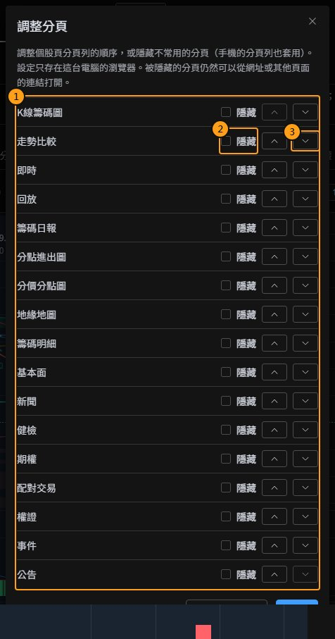
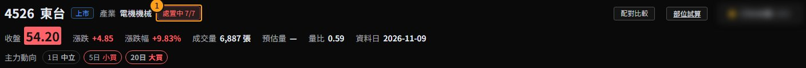
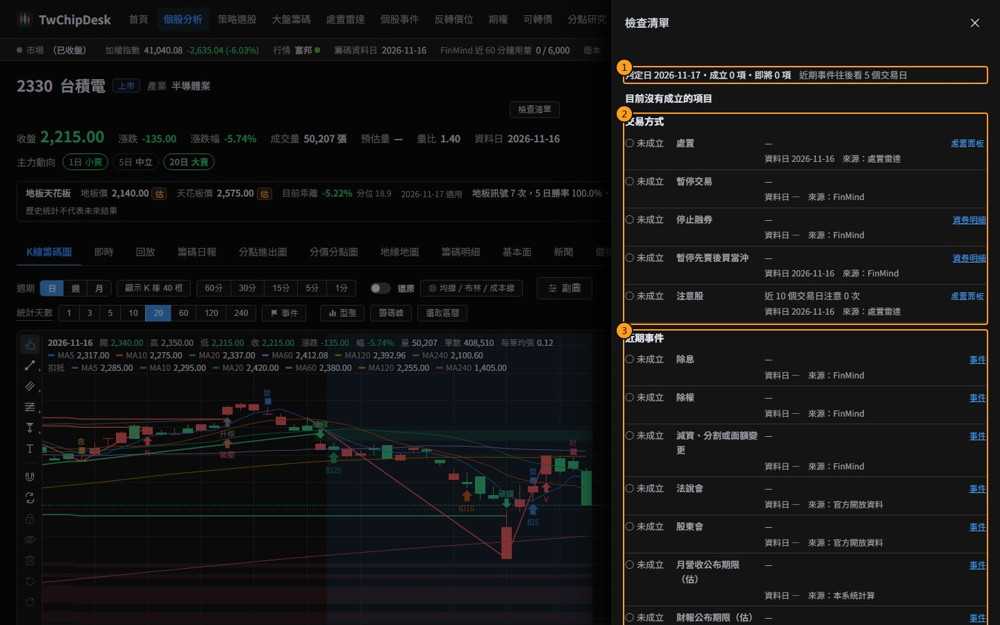

<!-- routes: /stock/:stockId -->
# 個股分析

> 位置：頂部選單「個股分析」，或在右上角搜尋框輸入代號、名稱（網址 `/stock/2330`）
> 資料更新：頁首的收盤價、成交量每個交易日 17:35 後由正式日 K 更新（13:40 先寫入收盤快照的暫定日 K）；盤中改顯示即時報價；主力動向在分點資料（18:10 起）與個股三大法人（20:05 起）都到齊後計算；處置徽章 14:40 先出盤後初版、22:10 定版；檢查清單各項的更新時間見下方[檢查清單](#檢查清單)

## 這個功能可以做什麼
個股分析把一檔股票的價量、籌碼、基本面、新聞、公告與衍生商品集中在同一頁。上方是固定的頁首（代號、報價、主力動向與常用按鈕），下方用分頁切換不同的分析畫面。切換股票時會停在同一個分頁，只換資料，方便一檔一檔比較。

## 畫面說明

| 編號 | 名稱 | 說明 |
|---|---|---|
| 1 | 搜尋框 | 輸入股票或分點的代號、名稱，下拉清單分「股票」「分點」兩組。按 `/` 可直接把游標移到搜尋框；上下鍵選擇、Enter 進入、Esc 關閉。還沒輸入文字時列出「最近看過」的股票（最多 10 檔，新的在前），最後一列「清除紀錄」。全部快捷鍵見[快捷鍵](../shortcuts.md)。 |
| 2 | 代號與名稱 | 目前的股票。已下市的股票另外標「已下市（日期）」或「已下市或停止交易」。 |
| 3 | 市場 | 「上市」「上櫃」「興櫃」；ETF 等非普通股另外標類型。 |
| 4 | 產業 | 官方產業分類。 |
| 5 | 報價列 | 「收盤」（盤中為「現價」）、「漲跌」「漲跌幅」「成交量」（張）、「預估量」、「量比」與「資料日」。價格等於當天漲停價或跌停價時加上底色；當天曾碰到漲跌停時，價格右邊另有「漲停」「曾漲停」「跌停」「曾跌停」或「曾漲跌停」小標記。詳見下方「報價列」。 |
| 6 | 主力動向 | 1 日、5 日、20 日的主力動向徽章：「大買」「小買」「中立」「小賣」「大賣」。 |
| 7 | 配對比較 | 選一檔配對股，開啟兩檔的配對比較頁（目前的股票 ÷ 配對股）。只有普通股顯示。 |
| 8 | 部位試算 | 開啟「持股」頁的部位試算並帶入這檔代號，試算可承擔的張數與停損損失（估）。股票與 ETF 顯示。 |
| 9 | 加入自選 | 把這檔加入自選股群組。已在群組中時顯示實心星號與「已在自選（N）」。 |
| 10 | 分頁列 | 切換各分析畫面，見下方「分頁一覽」。也可以按鍵盤的 `[`、`]` 切到前一個、下一個分頁。最右邊的「調整分頁」可以改順序、隱藏分頁，見下方[調整分頁](#調整分頁)。 |
| 11 | 新增警示 | 開啟[警示中心](../alerts/README.md)的新增規則表單，範圍為這檔股票。 |
| 12 | 風險旗標列 | 標題列下方一列小標籤，只列目前成立或即將發生的項目，例如「停止融券 11/18～11/21」「除息 3 日後」「融券使用率 91%」；最右邊是「檢查清單」按鈕。上市櫃的普通股與 ETF 才顯示，「回放」分頁不顯示。詳見下方[檢查清單](#檢查清單)。 |

## 操作步驟

### 搜尋與切換個股
1. 點右上角搜尋框（或按 `/`），輸入代號或名稱，例如「2330」或「台積」。
2. 用上下鍵選擇，按 Enter 進入；也可以直接點選結果。
3. 已經在個股頁時，選另一檔股票會留在目前的分頁（例如在「籌碼日報」換股票，仍顯示新股票的籌碼日報）。例外是只有 ETF 才有的「成分股」分頁：從這裡換股票時進入預設分頁（左側自選欄為「即時」，其他為 K線籌碼圖），見[成分股](etf-holdings.md)。
4. 搜尋結果還沒出現時按 Enter：輸入的是合法的股票代號（4～6 碼，例如 2330、00632R）就直接進入。

其他進入方式：
- 點頂部選單「個股分析」會開啟最後瀏覽的那一檔。
- 點搜尋框但先不輸入文字，會列出「最近看過」的股票（最多 10 檔），點選或用上下鍵加 Enter 進入；紀錄只存在這台電腦的瀏覽器，手機和電腦各自記錄，選最後一列「清除紀錄」可以清空。
- 各頁的股票代號或名稱大多可以點，點了會進入個股頁。
- 左側自選欄點股票，同樣保留目前的分頁。

### 用自選股群組逐檔瀏覽
目前的股票在「自選股」頁選取的群組中時，頁首右側會出現「自選『群組名稱』第 N／M 檔」與「上一檔」「下一檔」按鈕，也可以按鍵盤的上、下方向鍵切換（游標在輸入框時不作用）。全部快捷鍵見[快捷鍵](../shortcuts.md)。

### 用鍵盤切換分頁
按 `]` 切到下一個分頁、`[` 切到前一個分頁，順序與分頁列目前顯示的相同（含「調整分頁」改過的順序），隱藏與停用的分頁會跳過；到最後一個再按 `]` 回到第一個，到第一個再按 `[` 接到最後一個。切換時留在同一檔股票。游標在輸入框、選單或對話框內時不作用。

### 調整分頁

| 編號 | 名稱 | 說明 |
|---|---|---|
| 1 | 分頁清單 | 每個分頁一列，由上到下就是分頁列由左到右的順序。 |
| 2 | 「隱藏」 | 勾選後從分頁列拿掉這個分頁。 |
| 3 | 上移、下移 | 調整這個分頁的位置。 |

面板最下方另有「恢復預設順序」（回到預設順序並顯示全部分頁）與「完成」（關閉面板）。

1. 點分頁列最右邊的「調整分頁」（手機只顯示圖示），打開「調整分頁」面板，每個分頁一列。
2. 用每列的上移、下移按鈕調整順序（也可以用 Tab 移到按鈕後按 Enter 或空白鍵），改動立即套用到分頁列。
3. 勾選「隱藏」把不常用的分頁從分頁列拿掉；取消勾選就再顯示。最後一個顯示中的分頁不能隱藏，面板會說明「至少要顯示一個分頁，最後一個顯示中的分頁不能隱藏。」
4. 「恢復預設順序」回到原本的順序並顯示全部分頁；「完成」關閉面板。

- 設定只存在這台電腦的瀏覽器，重新整理後仍保留；手機的分頁列套用同一台裝置上的設定（手機和電腦各自記錄）。
- 被隱藏的分頁仍然可以用網址或其他頁面的連結打開（例如書籤），這時分頁列會暫時顯示它，名稱後面標「已隱藏」；切到別的分頁後恢復隱藏。網址與分頁名稱都不變。
- 進入個股頁（網址 `/stock/代號`）時照舊開啟 K線籌碼圖，即使 K線籌碼圖被隱藏也一樣（這個網址就是 K線籌碼圖分頁）。
- 「期權」在期權模組關閉時不列在面板上。
- 「成分股」只有 ETF 才列出（分頁列與面板都是）；用網址直接打開其他股票的這個分頁時暫時列出，內容說明不是 ETF。

### 加入自選股
1. 點「加入自選」。
2. 在彈出清單點群組那一列即可加入；再點一次同一列移除。可以連續點多個群組。
3. 清單下方可以輸入名稱建立新群組，建立後這檔會一起加入。

### 處置徽章
股票正在處置、即將處置或可能被處置時，產業旁邊會出現處置徽章，例如「處置中 7/7」（第 7 天，共 7 天）、「明天起處置」「今晚處置」「明日處置 x% 估」或「注意 n 次」。沒有任何狀態時不顯示。點徽章會從右側打開處置面板，列出注意與處置的計數、觸發價與歷次紀錄（說明見[處置雷達](../disposition/README.md)）；面板最下方的「這檔的處置統計」開啟[處置統計](../disposition/stats.md)的個股模式。

### 地板天花板小卡
普通股的頁首下方有一張小卡，列出今天適用的「地板價」「天花板價」（估，卡上註明適用的日期）、「目前乖離」與分位、目前分類（例如「近於地板」），以及這檔股票最近 5 年地板訊號的 5 日勝率與平均、天花板訊號的 5 日回檔機率與平均漲跌。點「回測統計」開啟[反轉價位｜回測統計](../reversal/backtest.md)並帶入這檔股票。歷史資料不足的股票只顯示說明；反轉價位資料還在建立中時不顯示小卡；「回放」分頁不顯示。名詞見[反轉價位](../reversal/README.md)。

## 檢查清單
個股頁頁首的風險旗標列與「檢查清單」把這檔股票目前的交易方式狀態、近期事件與資券、流動性數字集中列出。只整理公開資料的狀態與數字，不判斷能不能交易；實際交易規定以交易所與券商公告為準。

| 編號 | 名稱 | 說明 |
|---|---|---|
| 1 | 判定日與項數 | 判定日（台北的今天）、成立與即將的項數，以及近期事件往後看幾個交易日。 |
| 2 | 交易方式 | 處置、暫停交易、停止融券、暫停先賣後買當沖、注意股。 |
| 3 | 近期事件 | 除息、除權、減資（分割、反分割、面額變更）、法說會、股東會，以及月營收與財報的公布期限（估）。 |
| 4 | 資券與流動性 | 融資使用率、融券使用率、券資比、融資維持率（估）、借券賣餘額佔發行股數、20 日均量。 |
| 5 | 說明與來源 | 底部固定的說明「本清單只整理公開資料的狀態與數字，實際交易規定以交易所與券商公告為準。」與各來源的資料日。 |

### 旗標列
- 只列成立或即將的項目：交易方式受限的項目（處置以外）用紅底實心標籤，要留意的項目用外框標籤；即將發生的在後面寫「n 日後」（事件落在休市日、和今天之間沒有交易日時改寫日期，例如「股東常會 11/22」）。估計值後面加「估」，例如「融資維持率 138% 估」；資券類資料較舊時後面加「資料較舊」。標籤上的百分比最多 1 位小數，四捨五入後剛好等於門檻時多顯示一位。
- 處置與注意不在旗標列重複，仍由產業旁邊的[處置徽章](#處置徽章)顯示。月營收與財報的公布期限只列在清單裡。
- 「檢查清單」按鈕的數字是成立與即將的項數（含處置、注意與期限）。沒有任何成立的項目時只剩按鈕。
- 標籤放不下時最多兩行，最後一顆改成「＋n」（還有 n 項）。點任何一顆標籤、「＋n」或「檢查清單」都打開同一份清單。
- 讀取失敗時只顯示「檢查清單」按鈕，打開後顯示錯誤與「重試」。

### 清單的每一列
每一列依序是狀態、名稱、內容、資料日與來源，右側是明細連結：

| 狀態 | 意思 |
|---|---|
| ●「成立」 | 今天在期間內、事件就是今天，或數字達到門檻。 |
| ◐「即將」 | 在往後的交易日數內開始或發生（預設 5 個交易日，設定頁可改）。 |
| ○「未成立」 | 目前不成立，整列用淡色。 |
| –「沒有資料」 | 這檔股票沒有這項資料（例如沒有融資融券、沒有發行股數），不是「未成立」。 |
| ⊘「來源未開啟」 | 法說會與股東會需要設定頁「補充來源」區塊的「官方開放資料事件來源」，關閉時這兩項寫「官方開放資料來源未開啟，可在設定頁的『補充來源』開啟」。處置雷達關閉時，處置與注意兩項也是「來源未開啟」。 |

- **內容**：期間或事件日、「n 日後」；資券與流動性類同時列出數值（百分比與「資券」子分頁同樣兩位小數）、固定門檻與「近一年分位」（這個數字在這檔股票近一年每天的數字中排第幾百分位；不足 20 天寫「資料不足」）。是否成立只看固定門檻（設定頁「檢查清單」區塊可改），分位只是參考。停券原因、法說會地點等官方原文照原樣列出。股東會另列官方公告的「停止過戶 MM/DD～MM/DD」與「電子投票：」原文（來源沒有時不列；頁首標籤不列，只在清單裡）。
- **資料日**：這一項資料所屬的日期，不會晚於判定日；事件日寫在內容裡。FinMind 的暫停交易、停券、除權息、減資類沒有抓取日，資料日寫「—」；法說會、股東會是公告日。資券類的資料日比預期舊時標「資料較舊」；處置雷達的資料停在更早的交易日時，處置與注意也標「資料較舊」，沒有成立的紀錄時寫「沒有資料」而不是「未成立」。
- **來源**：「處置雷達」「FinMind」「官方開放資料」「本系統計算」。
- **連結**：處置與注意打開處置面板；停止融券、暫停先賣後買當沖與資券類開啟[籌碼明細](detail.md)的「資券」子分頁；事件類開啟[事件](events.md)分頁；20 日均量開啟 [K線籌碼圖](kline.md)。

### 資料更新時間
| 項目 | 更新 |
|---|---|
| 處置、注意 | 與處置徽章相同：14:40 盤後初版、22:10 定版。連續處置時，新處置生效當天在 14:40 前就列為成立（處置徽章在 14:40 新資料出來前仍依前一個交易日的資料顯示）。注意次數算處置雷達資料日往前 10 個交易日，處置徽章的「注意 n 次」看的範圍不同，兩處數字可能不一樣 |
| 暫停交易、除權息、減資類 | FinMind 每日資料 |
| 停止融券、融資融券、借券賣 | 每個交易日 21:05 起 |
| 暫停先賣後買當沖 | 每個交易日 21:35 起 |
| 融資維持率（估） | 每個交易日 22:35 起 |
| 法說會、股東會 | 官方開放資料每天的抓取時間（預設 08:00、16:00、22:00） |
| 20 日均量 | 選股特徵每晚計算；沒有特徵時用日 K 計算 |
| 月營收、財報期限（估） | 查詢時依規則推算 |

打開個股頁時才計算，伺服器保留 10 分鐘；設定頁改了門檻或天數會立即重算。

### 限制
- 只適用上市櫃的普通股與 ETF。ETF 沒有處置與注意兩項；興櫃、指數與其他證券不顯示旗標列。
- 第一期還沒有變更交易（含全額交割）、分盤交易、管理股票、停止融資、官方的停資停券預告等項目，這些官方名單之後才會加入。
- 門檻的預設值是估計的，沒有官方依據；「成立」只代表數字達到你設定的門檻。
- 手機上清單由下往上打開，見[手機版](../mobile.md)。電腦上清單從右側打開，可拖曳左緣調整寬度，瀏覽器會記住（見[側邊抽屜的寬度](../getting-started.md#側邊抽屜的寬度)）；處置面板同樣可以調整。

## 欄位與名詞
- **收盤／現價**：收盤後為最新日 K 的收盤價；盤中（以及收盤後到正式日 K 寫入前）改用即時報價，標題顯示「現價」，資料日後面加「即時 時間」。
- **漲跌停小標記**：用同一筆報價的最高價、最低價判斷當天是否碰過漲停價、跌停價（盤中看即時報價，收盤後看日 K 資料日，不混用兩天）。「漲停」「跌停」為價格停在漲跌停價（實心），「曾漲停」「曾跌停」為碰過後已打開（外框），「曾漲跌停」為兩邊都碰過；滑鼠停在標記上會顯示日期、漲跌停價與目前（或收盤）價格。沒有漲跌幅限制或沒有漲跌停價資料時不標示。
- **預估量（估）**：盤中推估的全天成交量，滑鼠移到「估」可看算法；收盤後沒有預估量，顯示「—」。
- **量比**：盤中為「預估量 ÷ 前 5 個交易日平均成交量」，與「即時」分頁相同；收盤後為「當日成交量 ÷ 前 5 個交易日平均成交量」。收盤快照階段只含整股成交量，正式日 K 入庫前量比可能顯示「—」。
- **資料日**：報價所屬的交易日。不是最新交易日時（例如暫停交易）以不同顏色標示，滑鼠移上去會說明。
- **主力動向**：以該期間的籌碼集中度（主力買賣超 ÷ 區間成交量；主力為買超前 15 名減賣超前 15 名分點）對照各天數的門檻，分成五級。分點資料還沒補齊時滑鼠移到徽章上會說明，開啟 K線籌碼圖會自動補齊最近的交易日。
- 在「回放」分頁時，頁首不顯示最新收盤、成交量與主力動向，避免先看到結果。

## 分頁一覽
下表是預設順序；可以用[調整分頁](#調整分頁)改順序或隱藏。

| 分頁 | 說明 |
|---|---|
| [K線籌碼圖](kline.md) | 預設分頁。日、週、月 K 與分 K，均線、布林、成本線、技術指標與 30 多種副圖，右側主力面板列出前 15 名分點。 |
| [走勢比較](compare.md) | 這檔與市場指數、類股指數、族群、其他個股或 ETF、國際指數以區間起點 0% 疊圖比較，期間可自訂日期或天數；附多期報酬、相對強弱、統計對照，以及籌碼、基本面子分頁。 |
| [即時](intraday.md) | 當日走勢、大戶散戶買賣超、報價面板、分價量、分時明細與大單；也可查歷史日期。 |
| [回放](replay.md) | 重播過去某個交易日的分時走勢、分 K 與逐筆成交。 |
| [籌碼日報](report.md) | 指定結束日與天數的籌碼整頁彙總：主力、前 15 名分點、提示區、法人、八大行庫、資券與鉅額交易。 |
| [分點進出圖](broker.md) | 最多 5 個分點在這檔股票的每日買賣超、累計買賣超與買入均價。 |
| [分價分點圖](bubble.md) | 單日各分點在各價位的買入、售出泡泡圖，或多日的分點買賣超橫條圖。 |
| [地緣地圖](map.md) | 公司附近的分點在地圖上的買賣超。需要啟用公司基本資料外掛。 |
| [籌碼明細](detail.md) | 主力、法人、資券、大戶、八大行庫、主動 ETF、盤後定價的每日明細與匯出；槓桿總覽把融資、融券、借券賣、當沖、股票期貨、權證與券源的最新數字放在同一頁。 |
| [基本面](fundamental.md) | 月營收、營收比較、財報、財務比率、股利與除權息、估值、可轉債與公司資訊。 |
| [新聞](news.md) | 最近的個股新聞標題，點擊開啟原文。 |
| [健檢](health.md) | 綜合評語、短線／波段／長線分數、多空因素與估值位階。 |
| [期權](derivatives.md) | 以這檔為標的的股票期貨、股票選擇權與價差。沒有期權商品時分頁停用。 |
| [配對交易](pairs.md) | 以這檔為準，列出同族群、走勢相似的配對股與比值偏離。 |
| [權證](warrants.md) | 以這檔為標的的權證清單、權證投資人淨買走勢與權證分點。 |
| [事件](events.md) | 這檔過去與未來的事件時間軸、每種事件的歷史統計（上漲機率、平均報酬、逐日表、平均路徑）與歷年除權息明細（估）。 |
| [公告](material.md) | 這檔最近的重大訊息（公司公告原文），可依類別篩選、點一則看說明；預設近 90 天，最多 400 天。 |
| [成分股](etf-holdings.md) | 只有 ETF 才有。發行商揭露的成分股、權重與持股增減；盤中加上各成分股的即時報價與成分股加權漲跌（估）。 |
| [權證個別頁](warrant-page.md) | 單一權證的基本資料、分析值、日 K、日行情與分點排行（網址 `/warrant/代號`）。 |

## 資料來源與更新時間
- 股票清單：每天 06:00 更新。剛上市或剛開始回補時可能還找不到這檔股票。
- 日 K：每個交易日 13:40 寫入收盤快照的暫定日 K，17:35 後以正式日 K 取代。
- 盤中報價：依設定頁啟用的行情來源（狀態列「行情」燈號）。
- 主力動向：分點資料每個交易日 18:10 起抓取；個股三大法人 20:05 起抓取，兩者到齊後計算當日主力資料。

## 注意事項與限制
- 股票代號必須是 4～6 碼，格式不對或找不到時頁面會顯示說明，不顯示分頁。
- 「期權」分頁只在這檔有掛牌中的期貨或選擇權時可以點；期權模組關閉時不列出。
- 預估量、部分籌碼數字是估計值，畫面上以「估」標示。

## 相關功能
- [自選股（含左側自選欄）](../watchlist.md)
- [持股｜部位試算](../portfolio.md)
- [處置雷達](../disposition/README.md)
