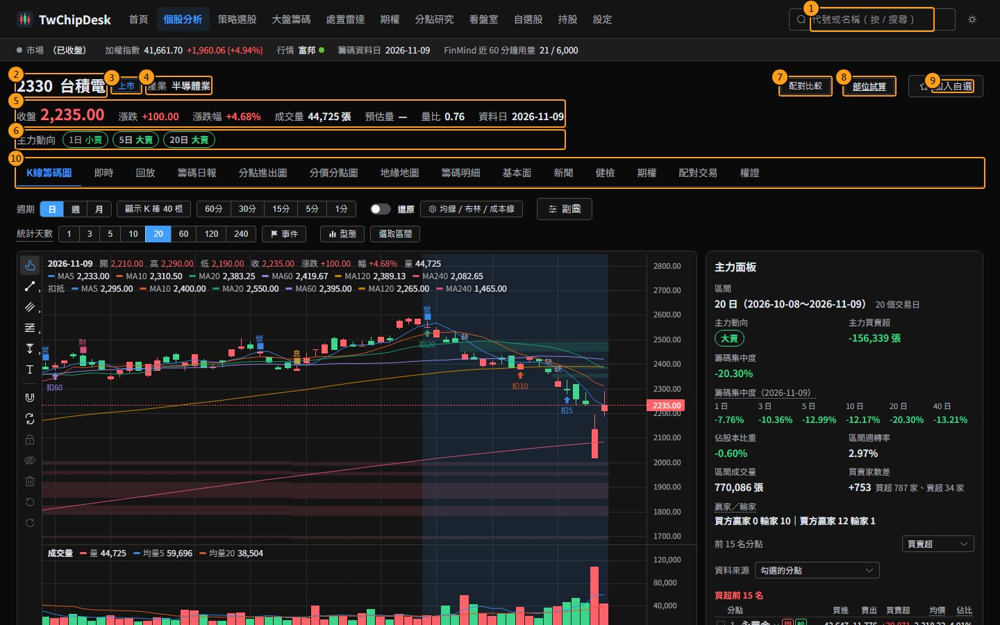

<!-- routes: /stock/:stockId -->
# 個股分析

> 位置：頂部選單「個股分析」，或在右上角搜尋框輸入代號、名稱（網址 `/stock/2330`）
> 資料更新：頁首的收盤價、成交量每個交易日 17:35 後由正式日 K 更新（13:40 先寫入收盤快照的暫定日 K）；盤中改顯示即時報價；主力動向在分點資料（18:10 起）與個股三大法人（20:05 起）都到齊後計算；處置徽章 14:40 先出盤後初版、22:10 定版

## 這個功能可以做什麼
個股分析把一檔股票的價量、籌碼、基本面、新聞與衍生商品集中在同一頁。上方是固定的頁首（代號、報價、主力動向與常用按鈕），下方用分頁切換不同的分析畫面。切換股票時會停在同一個分頁，只換資料，方便一檔一檔比較。

## 畫面說明

| 編號 | 名稱 | 說明 |
|---|---|---|
| 1 | 搜尋框 | 輸入股票或分點的代號、名稱，下拉清單分「股票」「分點」兩組。按 `/` 可直接把游標移到搜尋框；上下鍵選擇、Enter 進入、Esc 關閉。 |
| 2 | 代號與名稱 | 目前的股票。已下市的股票另外標「已下市（日期）」或「已下市或停止交易」。 |
| 3 | 市場 | 「上市」「上櫃」「興櫃」；ETF 等非普通股另外標類型。 |
| 4 | 產業 | 官方產業分類。 |
| 5 | 報價列 | 「收盤」（盤中為「現價」）、「漲跌」「漲跌幅」「成交量」（張）、「預估量」、「量比」與「資料日」。價格等於當天漲停價或跌停價時加上底色。詳見下方「報價列」。 |
| 6 | 主力動向 | 1 日、5 日、20 日的主力動向徽章：「大買」「小買」「中立」「小賣」「大賣」。 |
| 7 | 配對比較 | 選一檔配對股，開啟兩檔的配對比較頁（目前的股票 ÷ 配對股）。只有普通股顯示。 |
| 8 | 部位試算 | 開啟「持股」頁的部位試算並帶入這檔代號，試算可承擔的張數與停損損失（估）。股票與 ETF 顯示。 |
| 9 | 加入自選 | 把這檔加入自選股群組。已在群組中時顯示實心星號與「已在自選（N）」。 |
| 10 | 分頁列 | 切換各分析畫面，見下方「分頁一覽」。 |
| 11 | 新增警示 | 開啟[警示中心](../alerts/README.md)的新增規則表單，範圍為這檔股票。 |

## 操作步驟

### 搜尋與切換個股
1. 點右上角搜尋框（或按 `/`），輸入代號或名稱，例如「2330」或「台積」。
2. 用上下鍵選擇，按 Enter 進入；也可以直接點選結果。
3. 已經在個股頁時，選另一檔股票會留在目前的分頁（例如在「籌碼日報」換股票，仍顯示新股票的籌碼日報）。
4. 搜尋結果還沒出現時按 Enter：輸入的是合法的股票代號（4～6 碼，例如 2330、00632R）就直接進入。

其他進入方式：
- 點頂部選單「個股分析」會開啟最後瀏覽的那一檔。
- 各頁的股票代號或名稱大多可以點，點了會進入個股頁。
- 左側自選欄點股票，同樣保留目前的分頁。

### 用自選股群組逐檔瀏覽
目前的股票在「自選股」頁選取的群組中時，頁首右側會出現「自選『群組名稱』第 N／M 檔」與「上一檔」「下一檔」按鈕，也可以按鍵盤的上、下方向鍵切換（游標在輸入框時不作用）。

### 加入自選股
1. 點「加入自選」。
2. 在彈出清單點群組那一列即可加入；再點一次同一列移除。可以連續點多個群組。
3. 清單下方可以輸入名稱建立新群組，建立後這檔會一起加入。

### 處置徽章
股票正在處置、即將處置或可能被處置時，產業旁邊會出現處置徽章，例如「處置中 7/7」（第 7 天，共 7 天）、「明天起處置」「今晚處置」「明日處置 x% 估」或「注意 n 次」。沒有任何狀態時不顯示。點徽章會從右側打開處置面板，列出注意與處置的計數、觸發價與歷次紀錄（說明見[處置雷達](../disposition/README.md)）。

### 地板天花板小卡
普通股的頁首下方有一張小卡，列出今天適用的「地板價」「天花板價」（估，卡上註明適用的日期）、「目前乖離」與分位、目前分類（例如「近於地板」），以及這檔股票最近 5 年地板訊號的 5 日勝率與平均、天花板訊號的 5 日回檔機率與平均漲跌。點「回測統計」開啟[反轉價位｜回測統計](../reversal/backtest.md)並帶入這檔股票。歷史資料不足的股票只顯示說明；反轉價位資料還在建立中時不顯示小卡；「回放」分頁不顯示。名詞見[反轉價位](../reversal/README.md)。

## 欄位與名詞
- **收盤／現價**：收盤後為最新日 K 的收盤價；盤中（以及收盤後到正式日 K 寫入前）改用即時報價，標題顯示「現價」，資料日後面加「即時 時間」。
- **預估量（估）**：盤中推估的全天成交量，滑鼠移到「估」可看算法；收盤後沒有預估量，顯示「—」。
- **量比**：盤中為「預估量 ÷ 前 5 個交易日平均成交量」，與「即時」分頁相同；收盤後為「當日成交量 ÷ 前 5 個交易日平均成交量」。收盤快照階段只含整股成交量，正式日 K 入庫前量比可能顯示「—」。
- **資料日**：報價所屬的交易日。不是最新交易日時（例如暫停交易）以不同顏色標示，滑鼠移上去會說明。
- **主力動向**：以該期間的籌碼集中度（主力買賣超 ÷ 區間成交量；主力為買超前 15 名減賣超前 15 名分點）對照各天數的門檻，分成五級。分點資料還沒補齊時滑鼠移到徽章上會說明，開啟 K線籌碼圖會自動補齊最近的交易日。
- 在「回放」分頁時，頁首不顯示最新收盤、成交量與主力動向，避免先看到結果。

## 分頁一覽
| 分頁 | 說明 |
|---|---|
| [K線籌碼圖](kline.md) | 預設分頁。日、週、月 K 與分 K，均線、布林、成本線、技術指標與 30 多種副圖，右側主力面板列出前 15 名分點。 |
| [即時](intraday.md) | 當日走勢、大戶散戶買賣超、報價面板、分價量、分時明細與大單；也可查歷史日期。 |
| [回放](replay.md) | 重播過去某個交易日的分時走勢、分 K 與逐筆成交。 |
| [籌碼日報](report.md) | 指定結束日與天數的籌碼整頁彙總：主力、前 15 名分點、提示區、法人、八大行庫、資券與鉅額交易。 |
| [分點進出圖](broker.md) | 最多 5 個分點在這檔股票的每日買賣超、累計買賣超與買入均價。 |
| [分價分點圖](bubble.md) | 單日各分點在各價位的買入、售出泡泡圖，或多日的分點買賣超橫條圖。 |
| [地緣地圖](map.md) | 公司附近的分點在地圖上的買賣超。需要啟用公司基本資料外掛。 |
| [籌碼明細](detail.md) | 主力、法人、資券、大戶、八大行庫、主動 ETF、盤後定價的每日明細與匯出。 |
| [基本面](fundamental.md) | 月營收、營收比較、財報、財務比率、股利與除權息、估值、可轉債與公司資訊。 |
| [新聞](news.md) | 最近的個股新聞標題，點擊開啟原文。 |
| [健檢](health.md) | 綜合評語、短線／波段／長線分數、多空因素與估值位階。 |
| [期權](derivatives.md) | 以這檔為標的的股票期貨、股票選擇權與價差。沒有期權商品時分頁停用。 |
| [配對交易](pairs.md) | 以這檔為準，列出同族群、走勢相似的配對股與比值偏離。 |
| [權證](warrants.md) | 以這檔為標的的權證清單、權證投資人淨買走勢與權證分點。 |
| [事件](events.md) | 這檔過去與未來的事件時間軸、每種事件的歷史統計（上漲機率、平均報酬、逐日表、平均路徑）與歷年除權息明細（估）。 |
| [權證個別頁](warrant-page.md) | 單一權證的基本資料、分析值、日 K、日行情與分點排行（網址 `/warrant/代號`）。 |

## 資料來源與更新時間
- 股票清單：每天 06:00 更新。剛上市或剛開始回補時可能還找不到這檔股票。
- 日 K：每個交易日 13:40 寫入收盤快照的暫定日 K，17:35 後以正式日 K 取代。
- 盤中報價：依設定頁啟用的行情來源（狀態列「行情」燈號）。
- 主力動向：分點資料每個交易日 18:10 起抓取；個股三大法人 20:05 起抓取，兩者到齊後計算當日主力資料。

## 注意事項與限制
- 股票代號必須是 4～6 碼，格式不對或找不到時頁面會顯示說明，不顯示分頁。
- 「期權」分頁只在這檔有掛牌中的期貨或選擇權時可以點；期權模組關閉時不列出。
- 預估量、部分籌碼數字是估計值，畫面上以「估」標示。

## 相關功能
- [自選股（含左側自選欄）](../watchlist.md)
- [持股｜部位試算](../portfolio.md)
- [處置雷達](../disposition/README.md)
