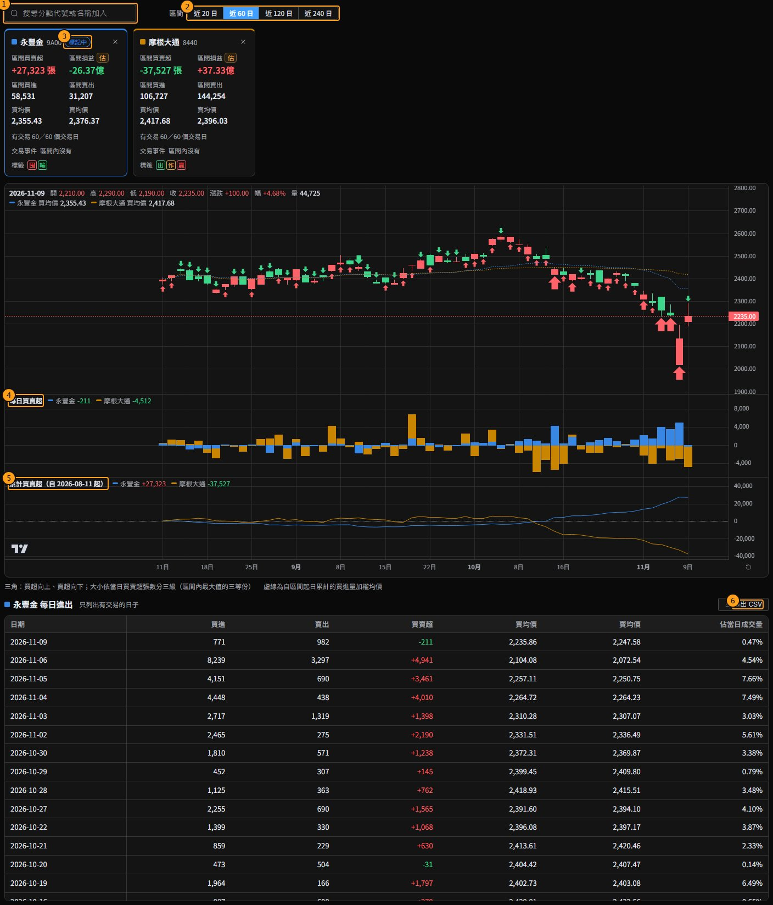

<!-- routes: /stock/:stockId/broker -->
# 個股分析｜分點進出圖

> 位置：個股頁「分點進出圖」分頁（網址 `/stock/2330/broker?brokers=9A00,8440&days=60`）
> 資料更新：分點資料交易日 18:10 起；交易事件與標籤每晚分點研究計算（23:50）後更新

## 這個功能可以做什麼
選 1～5 個分點，看它們在這檔股票的每日買賣超、累計買賣超與累計買入均價，K 線上以三角形標出買超、賣超的日子。適合追蹤特定分點的進出節奏與成本。

## 畫面說明

| 編號 | 名稱 | 說明 |
|---|---|---|
| 1 | 搜尋分點 | 輸入分點代號或名稱加入，最多同時比較 5 個分點。 |
| 2 | 區間 | 「近 20 日」「近 60 日」「近 120 日」「近 240 日」。 |
| 3 | 摘要卡 | 每個分點一張：「區間買賣超」「區間損益（估）」、區間買入與售出張數、「買均價」「賣均價」、有交易的天數、「交易事件」與「標籤」。標「標記中」的那一張決定主圖三角形與下方表格；點其他卡片切換，按 × 移除。 |
| 4 | 每日買賣超 | 各分點每天的買賣超柱，多個分點時以各自的顏色堆疊。 |
| 5 | 累計買賣超 | 各分點自區間起日累計的買賣超線。 |
| 6 | 匯出 CSV | 匯出標記中分點的每日進出。 |

主圖 K 線上：標記中分點買超的日子在 K 線下方畫向上的漲色三角，賣超在上方畫向下的跌色三角，大小依當日買賣超張數分三級（區間內最大值的三等份）。滑鼠停在三角上（手機點一下）會出現小浮框，寫出日期、分點名稱與當天的買超或賣超張數。各分點的累計買入均價以虛線疊在主圖。

圖表下方的表格是標記中分點的每日買入張數、售出張數、「買賣超」「買均價」「賣均價」「佔當日成交量」，只列出有交易的日子，由新到舊。

## 操作步驟
1. 加入分點，任選一種方式：
   - 上方搜尋框輸入分點代號或名稱。
   - 還沒選分點時，畫面列出目前統計視窗的「買超前 5 名」「賣超前 5 名」，點一下加入。
   - 在 K線籌碼圖的主力面板或籌碼日報點分點名稱，選「開啟分點進出圖」。
2. 選「區間」。圖表把整個區間放進畫面，最左側就是累計的起算日。
3. 點摘要卡切換要標記的分點。
4. 所選分點與區間記在網址，重新整理或加書籤後仍會保留。

## 欄位與名詞
- **區間損益（估）**：依分點在區間內的買賣與收盤價推算的損益，是估計值。
- **交易事件**：進場日在區間內的交易事件（淨買達門檻時開啟、累計售出達進場量的一定比例時結束）與勝率，由每晚的分點研究計算。
- **買均價**（虛線）：自區間起日累計的買入量加權均價。
- **標籤**：「囤」「出」「作」「地」「贏」「輸」「隔」，定義見 [K線籌碼圖](kline.md#主力面板)。

## 注意事項與限制
- 分點資料只涵蓋一段期間；區間起日早於分點資料起日時會註明，更早的日子不畫標記與線。
- 第一次查看的股票分點資料不齊全時，系統自動補抓並顯示進度。

## 相關功能
- [K線籌碼圖](kline.md)
- [分點研究｜分點個別頁](../brokers/README.md)
