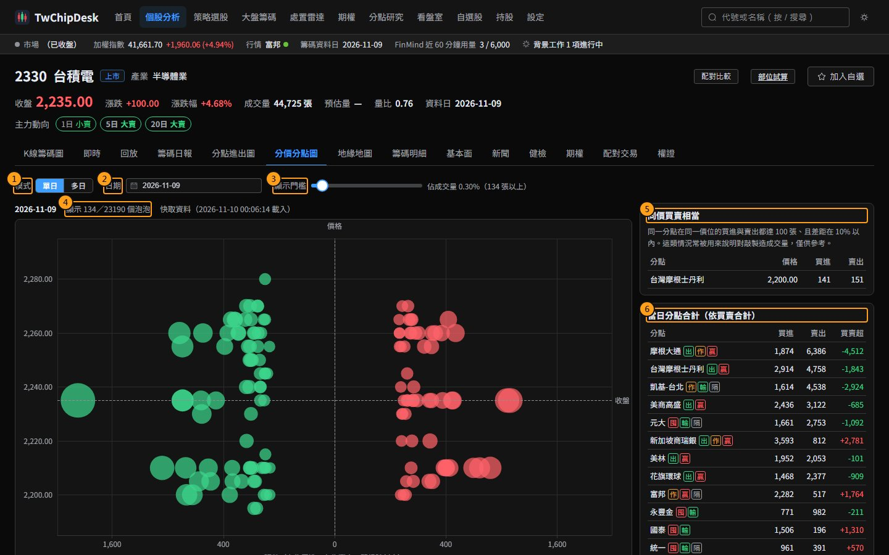
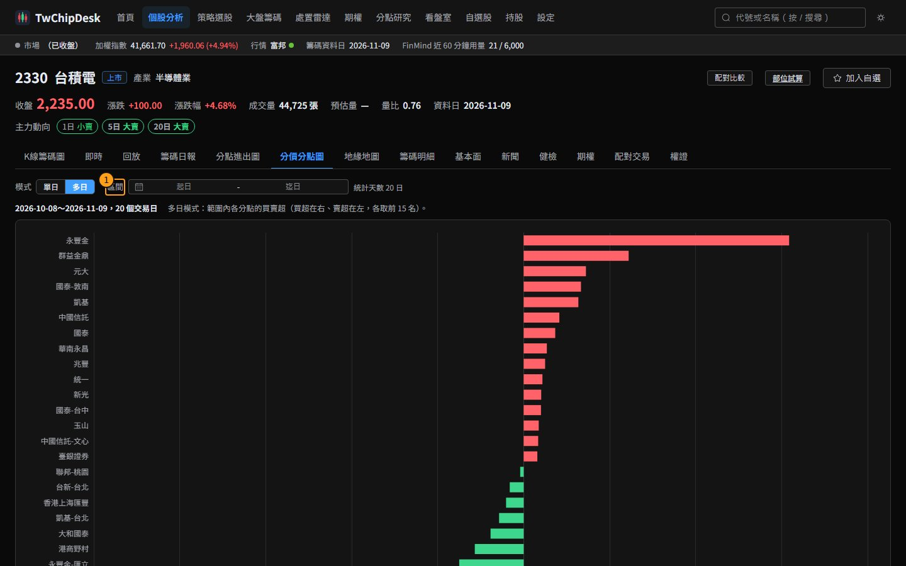

<!-- routes: /stock/:stockId/bubble -->
# 個股分析｜分價分點圖

> 位置：個股頁「分價分點圖」分頁（網址 `/stock/2330/bubble?date=2026-11-09`；多日模式 `?mode=range`）
> 資料更新：分點資料交易日 18:10 起；某一天第一次查看時向 FinMind 載入並寫入快取

## 這個功能可以做什麼
看某一天每個分點在每個價位買了多少、賣了多少：泡泡越大張數越多，買在右、賣在左。可以看出大量買賣集中在哪些價位、哪些分點在同一價位又買又賣。多日模式則列出一段期間各分點的買賣超排名。

## 畫面說明

| 編號 | 名稱 | 說明 |
|---|---|---|
| 1 | 模式 | 「單日」或「多日」。 |
| 2 | 日期 | 單日模式的日期，留空為最新交易日。 |
| 3 | 顯示門檻 | 只畫張數達當日成交量某個比例的泡泡，預設 0.3%，右側顯示換算的張數。 |
| 4 | 泡泡數 | 「顯示 N／M 個泡泡」，以及資料是剛從 FinMind 載入或來自快取。 |
| 5 | 同價買賣相當 | 同一分點在同一價位的買入與售出都達 100 張、且差距在 10% 以內的組合。 |
| 6 | 當日分點合計（依買賣合計） | 當天各分點的買入、售出、買賣超與標籤，依買賣合計排序。 |

泡泡圖：縱軸為價格，橫軸為張數（右為買入、左為售出，開根號刻度），泡泡面積正比於張數；虛線為收盤價。滑鼠移到泡泡上顯示分點、價格、方向、張數與當日合計。

## 操作步驟

### 單日模式
1. 選「日期」。第一次查看某一天時畫面顯示「正在向 FinMind 載入 … 的分點明細」，需要數秒。
2. 拖曳「顯示門檻」滑桿調整要畫的泡泡；「恢復預設」回到 0.3%。
3. 點泡泡或右側清單的分點名稱：只顯示該分點全部價位的泡泡（不套用門檻、滑桿停用），右側卡片列出該分點的當日合計、均價與分價明細。
4. 再點一次、點空白處或按「顯示全部分點」回到全部分點。

也可以在 K線籌碼圖的日 K 主圖對一根 K 棒按右鍵，選「分價分點圖（日期）」直接開啟那一天。

### 多日模式

| 編號 | 名稱 | 說明 |
|---|---|---|
| 1 | 區間 | 起日、迄日；留空時沿用 K線籌碼圖的統計天數（畫面顯示「統計天數 N 日」）。 |

範圍內各分點的買賣超橫條圖，買超在右、賣超在左，各取前 15 名。

## 欄位與名詞
- **泡泡**：一個分點在一個價位的買入或售出合計，不是單筆交易（FinMind 提供的是「分點 × 價位」彙總）。同一天的分點買入合計與售出合計可能不相等，來源資料如此。
- **同價買賣相當**：這類情況常被用來說明對敲製造成交量，僅供參考。

## 注意事項與限制
- 模式、日期與自訂範圍記在網址，可以加書籤。
- 鉅額交易不在分點明細內。

## 相關功能
- [K線籌碼圖](kline.md)
- [分點進出圖](broker.md)
