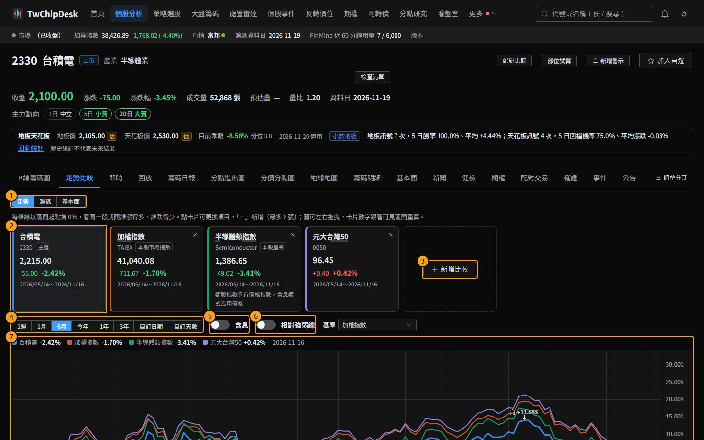
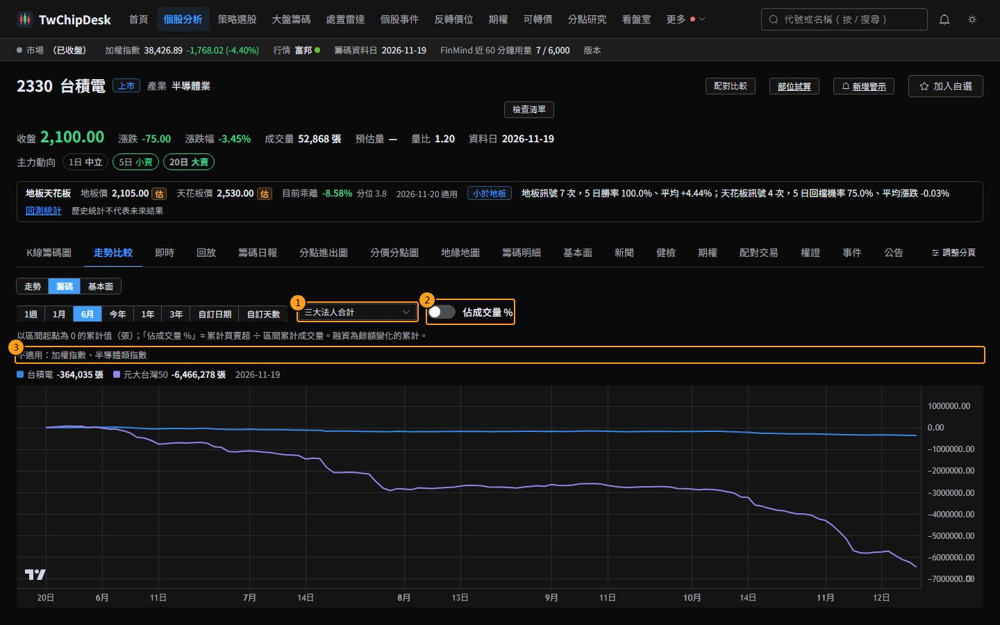
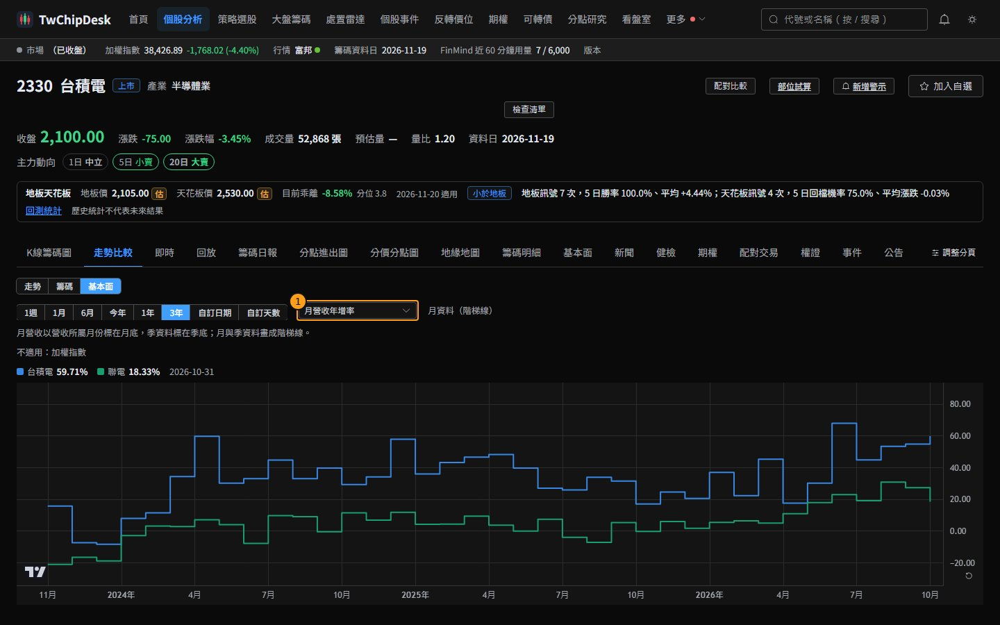

<!-- routes: /stock/:stockId/compare -->
# 個股分析｜走勢比較

> 位置：個股頁「走勢比較」分頁，緊接在「K線籌碼圖」之後（網址 `/stock/2330/compare`，可加 `?p=6M&tr=1&cmp=@market,@industry,s:2317&sub=chips`）
> 資料更新：日資料與 K 線相同（收盤快照 13:40、正式日 K 17:35 後）；交易時段內個股、ETF、加權、櫃買每分鐘加上今天的即時點（卡片標「盤中」）；族群停在前一個交易日；國際指數依各市場資料日；籌碼、基本面與各自的資料表相同

## 這個功能可以做什麼
把這檔股票和市場指數、官方類股指數、族群、其他個股或 ETF、國際指數放在同一張圖上，全部以區間起點為 0%，一眼看出同一段期間誰漲得多、誰跌得少。卡片可以自己換、加、刪（最多 6 張），期間可以選固定期間，也可以自訂起訖日期或最近幾個交易日。另外有多期報酬表、相對強弱線、統計對照表，以及「籌碼」「基本面」兩個子分頁，比較同一份清單裡各檔的累計買賣超與基本面數字。只呈現數值的比較。

## 畫面說明

| 編號 | 名稱 | 說明 |
|---|---|---|
| 1 | 子分頁 | 「走勢」「籌碼」「基本面」。 |
| 2 | 卡片列 | 第一張是這檔股票（標「主體」，不能更換或移除）。每張卡片有名稱、代號、最新價、區間漲跌（點數或元）、區間漲跌幅與起迄日；點名稱可更換、右上角 × 移除。手機寬時卡片列可以左右滑動。 |
| 3 | 新增比較 | 打開挑選視窗加入一個項目；滿 6 張時停用。 |
| 4 | 期間 | 「1週」「1月」「6月」「今年」「1年」「3年」，以及「自訂日期」「自訂天數」，見下方[期間](#期間)。 |
| 5 | 含息 | 打開後以含息報酬比較，見下方[欄位與名詞](#欄位與名詞)的「含息」。 |
| 6 | 相對強弱線與基準 | 「相對強弱線」顯示本股 ÷ 基準的線；「基準」選相對強弱線與統計對照表的比較對象（預設第二張卡片）。 |
| 7 | 走勢圖 | 每條線以可見區間的第一天為 0%，標出最高、最低點。可以左右拖曳；十字線移到哪一天，上方圖例就列出各線在那一天的漲跌幅。 |
| 8 | 重設視圖 | 回到所選期間的最新一段，也可以按 `Alt` + `R`。 |
| 9 | 多期報酬 | 每個項目的 1 週～3 年漲跌幅；自訂期間時多一欄「自訂區間」。 |
| 10 | 統計對照 | 以目前可見區間計算的區間報酬、超額報酬、相關係數、Beta、年化波動度、最大回撤與回撤起訖。 |

## 操作步驟

### 新增、更換、移除比較項目
1. 點「新增比較」，或點某張卡片的名稱（更換那一張）。
2. 挑選視窗分成「個股／ETF」「指數」「產業」「概念／族群」「國際」：
   - 「個股／ETF」：輸入代號或名稱搜尋，下方另列常用 ETF。
   - 「指數」：「本股市場指數」（上市股為加權指數、上櫃股為櫃買指數，換股票時自動換）、加權指數、櫃買指數。
   - 「產業」：「本股產業」（上市股換成這檔所屬的官方類股指數；對應不到或上櫃股時用本站的產業族群）、官方類股指數（例如塑膠類、半導體類），以及本站的產業族群（等權、含息）。
   - 「概念／族群」：依分類列出族群，可輸入名稱篩選。
   - 「國際」：美股指數、ADR、原物料等國際行情（依台股交易日對齊；匯率不在清單內）。
3. 點一個項目就加入（或取代原本那一張）。已經在比較中的項目不能再選；族群最多 3 個。卡片已滿 6 張（或族群已達上限）時不會加入，畫面上方會出現提示，請先移除一張。
4. 點卡片右上角的 × 移除。

比較清單只存在這台電腦的瀏覽器，而且全部個股共用一份：清單裡有「本股市場指數」「本股產業」時，換股票會自動換成那一檔的市場與產業。網址會帶著目前的清單（`cmp`）、期間（`p`）與含息（`tr`），複製網址給別人或加書籤，打開時會用網址上的設定。

### 期間
- 「1週」「1月」「6月」「1年」「3年」：從最新交易日往回推這段日曆期間，以那一天（或之前最近的交易日）的收盤為 0%。預設「6月」。
- 「今年」：以去年最後一個交易日的收盤為 0%。
- 「自訂日期」：選起日與迄日（起日最早 2010-01-01，迄日最晚今天），以起日（或之前最近的交易日）的收盤為 0%。超過 3 年的期間會自動分段載入。網址帶的迄日晚於今天時，以最新交易日為迄日。
- 「自訂天數」：輸入 2～2,000，按「套用」，看最近 N 個交易日（第一天為 0%）。
- 選了自訂期間時，多期報酬表多一欄「自訂區間」，數字與卡片相同。多期報酬表的六個固定期間以最新交易日為迄日；自訂日期的迄日較早時，改以那一天為迄日（表格下方的說明會寫出迄日）。

### 左右移動
- 在圖上按住拖曳可以往前、往後看，視窗長度維持所選的期間；卡片、高低點、相對強弱線與統計對照表都會跟著可見區間重算。
- 拖到最左邊時自動載入更早的一段（最早到 2010-01-01），載入中顯示「載入更早的資料…」。載入失敗時顯示「更早的資料載入失敗，圖上只有已載入的範圍」，按旁邊的「重試」再載入一次。
- 「重設視圖」或 `Alt` + `R` 回到最新。

### 籌碼子分頁

1. 點子分頁「籌碼」。比較清單與期間與「走勢」相同（要換項目請回「走勢」）。
2. 選指標：「外資」「投信」「自營商」「三大法人合計」「主力」「融資餘額變化」。
3. 圖上是以區間起點為 0 的累計值（張）；打開「佔成交量 %」改成累計買賣超 ÷ 區間累計成交量。起點與「走勢」相同（起日不是交易日時取之前最近的交易日，從下一個交易日開始累計）；資料不足所選期間時，圖上方標出實際起算日。某一檔的這項資料比區間起點晚才開始（例如主力、融資），圖上方另列「名稱：自 日期 起」。「佔成交量 %」的分母只加總有買賣超資料的日子，分子與分母是同一組日子；整段都沒有買賣超資料的項目顯示「無資料」。
4. 只有個股與 ETF 有籌碼資料；清單裡的指數、族群、國際項目列在圖上方的「不適用」。最長 3 年，超過時取最近 3 年。

### 基本面子分頁

1. 點子分頁「基本面」。
2. 選指標：「月營收年增率」「本益比」「股價淨值比」「殖利率」「毛利率」。
3. 月營收標在營收所屬月份的月底，季資料標在季底；月與季資料畫成階梯線。區間起點用起點以前最近一筆的數值，所以「1週」「1月」等短期間也從起點就有線。沒有資料的項目列在「資料缺口」。

## 欄位與名詞
- **區間漲跌**：最新價減基準日收盤，單位與價格相同（指數為點數）。不含息。
- **區間漲跌幅**：以基準日為 0% 的漲跌幅，隨「含息」切換；含息時旁邊標「含息」。
- **含息**：個股與 ETF 用參考價計算每天的報酬再連乘，所以除權息、減資那天不會出現假的跌幅；加權、櫃買用報酬指數。族群指數本身就是含息計算（不論是否打開「含息」，卡片都標「含息」）；官方類股指數與國際指數沒有含息版本，含息模式時沿用價格並標「價格」。
- **主體**：第一張卡片（這檔股票、大盤頁的指數或族群頁的族群），不能更換或移除。
- **盤中**：最後一點是今天的即時值。
- **自 YYYY/MM/DD 起**：這個項目在期間起點時還沒有資料（例如上市較晚），以它第一筆資料為 0%。
- **至 MM/DD**：這個項目最後一筆資料早於期間的最後一天（例如族群停在前一個交易日、暫停交易）。
- **依台股交易日對齊**：國際行情以台股交易日為準，取那一天或之前最近一筆收盤。
- **停牌**：沒有成交的日子線條中斷；基準日剛好停牌時用之前最近的收盤當基準；含息模式那幾天報酬視為 0。
- **無資料、找不到這個代號、暫時無法載入**：卡片上的原因。「暫時無法載入」表示這個項目讀取時出錯，其他卡片照常顯示，稍後重新整理即可。
- **相對強弱線**：100 ×（1 + 本股漲跌幅）÷（1 + 基準漲跌幅），區間起點為 100；線往上代表本股相對基準較強。
- **相關係數**：本股與基準日報酬的相關係數（−1～1），只用兩邊同一天都有報酬的日子。
- **Beta**：本股日報酬對基準日報酬的斜率（共變異數 ÷ 基準變異數）。
- **年化波動度**：日報酬的樣本標準差 × √252。
- **最大回撤**：期間內從之前最高點往下的最大跌幅，「回撤起訖」為那個最高點與最低點的日期。
- **超額報酬**：本股區間報酬減基準的區間報酬。

## 資料來源與更新時間
- 個股、ETF：日 K（未還原的收盤與參考價），不使用還原價。
- 加權、櫃買、官方類股指數：指數日資料與報酬指數。
- 族群：本站以目前成分股等權計算的指數（含息）。
- 國際：國際行情資料表，各代號的起日不同。
- 籌碼：三大法人、主力、融資融券的每日資料；基本面：月營收、本益比、股價淨值比、殖利率與財報。

## 注意事項與限制
- 族群指數用「目前」的成分股往回算，會有倖存者偏差（卡片註明以目前成分股幾檔回推）。
- 族群最多 3 個；卡片最多 6 張。
- 個股含息報酬以參考價計算，與其他網站的還原價可能有很小的差異。
- 國際行情資料不足所選期間時，從第一筆資料開始並註明。
- 籌碼與基本面子分頁只比較個股與 ETF。

## 相關功能
- [個股分析總覽](README.md)
- [大盤籌碼](../market/chips.md)：下方嵌入同一個走勢比較（以加權或櫃買指數為主體）。
- [族群頁](../market/group.md)：嵌入同一個走勢比較（以這個族群為主體）。
