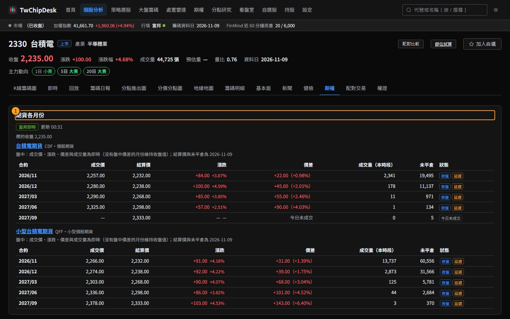
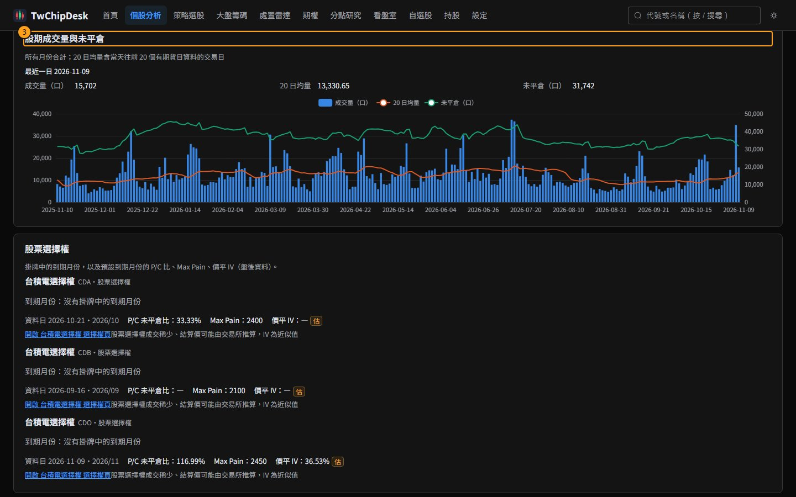
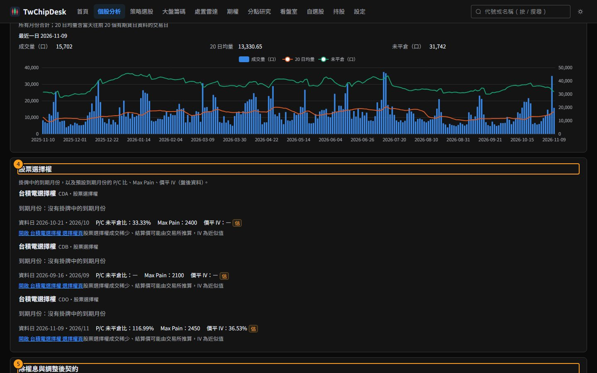

<!-- routes: /stock/:stockId/derivatives -->
# 個股分析｜期權

> 位置：個股頁「期權」分頁（網址 `/stock/2330/derivatives`）。只在這檔股票（或 ETF）有掛牌中的期貨或選擇權時可以點；期權模組關閉時不列出
> 資料更新：期貨、選擇權日資料交易日 15:20 起抓取，18:10 晚間補抓；每日收盤價差 19:00 計算；盤中（含夜盤）期貨報價即時更新

## 這個功能可以做什麼
集中看以這檔股票為標的的股票期貨與股票選擇權：各月份合約的價格、結算價與期現價差，近月價差的歷史走勢，股期的成交量與未平倉，以及股票選擇權的 P/C 比、Max Pain、價平 IV。

## 畫面說明

| 編號 | 名稱 | 說明 |
|---|---|---|
| 1 | 期貨各月份 | 每個期貨商品（例如個股期貨、小型個股期貨）一張表：合約、成交價（收盤後為收盤）、結算價、漲跌、價差、成交量、未平倉與狀態。點商品名稱開啟期貨頁。 |

| 編號 | 名稱 | 說明 |
|---|---|---|
| 2 | 近月價差歷史 | 主要期貨的近月每日收盤價差%，直線為除息日（只涵蓋已公布的除權息）。 |
| 3 | 股期成交量與未平倉 | 所有月份合計的成交量（口）、20 日均量與未平倉（口）。 |

| 編號 | 名稱 | 說明 |
|---|---|---|
| 4 | 股票選擇權 | 掛牌中的到期月份，以及預設到期月份的 P/C 未平倉比、Max Pain、價平 IV（估）；連到選擇權頁。 |
| 5 | 除權息與調整後契約 | 只除息、除權、現金增資、減資時期貨契約的調整規則。 |

## 欄位與名詞
- **價差**：收盤後為「結算價 − 標的收盤」；盤中為「期貨價 − 標的最新成交價」（依時段選擇現貨價，見狀態標籤），有盤中價差的月份以即時值顯示，沒有的維持收盤價差並標資料日。
- **狀態標籤**：盤中報價的來源與時段，例如「夜盤」、「延遲」、更新頻率；沒有成交的合約標「今日未成交」。
- **成交量（本時段）**：盤中為目前交易時段的成交量。結算價與未平倉在盤中維持前一交易日的值。
- **20 日均量**：含當天往前 20 個有期貨日資料的交易日。
- **價平 IV（估）**：股票選擇權成交稀少、結算價可能由交易所推算，IV 為近似值。
- **調整後契約**：除權、現金增資、減資時原契約改代號（末碼 1）並調整約定股數，在看板與清單中標「調整」，乘數不是標準的 2,000 股。

## 注意事項與限制
- 沒有掛牌中的期權商品時，分頁停用並提示「此股票沒有期貨或選擇權」。
- 截圖拍攝時為夜盤時段，所以期貨表顯示「夜盤」狀態與夜盤的成交量。

## 相關功能
- [期權](../derivatives/README.md)：期現價差、期貨、選擇權、結算行事曆
- [K線籌碼圖](kline.md)（「期現價差」副圖）
