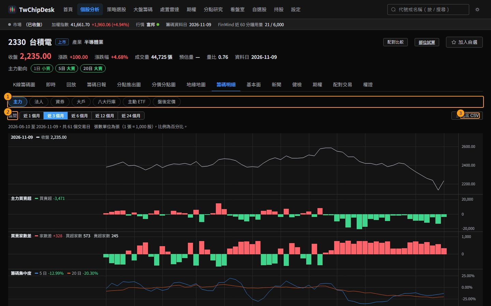
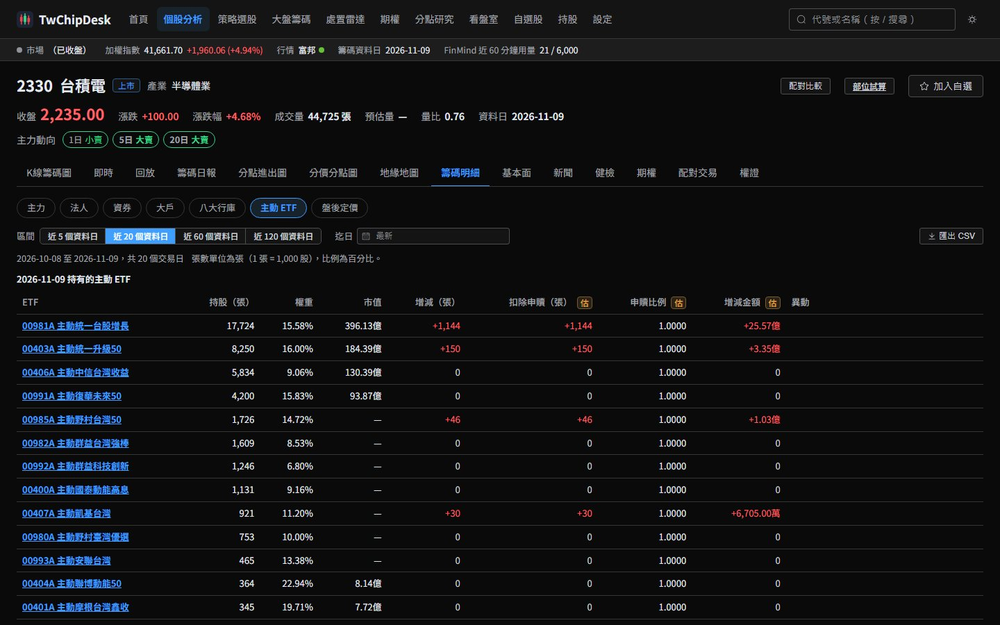

<!-- routes: /stock/:stockId/detail -->
# 個股分析｜籌碼明細

> 位置：個股頁「籌碼明細」分頁（網址 `/stock/2330/detail`，子分頁用 `?tab=main`、`institutional`、`margin`、`holders`、`govBank`、`activeEtf`、`afterHours`）
> 資料更新：分點與主力交易日 18:10 起（三大法人 20:05 到齊後計算）；八大行庫 18:35；三大法人與外資持股 20:05；融資融券、借券 21:05；借券成交 20:30；當沖 21:35；融資維持率 22:35；盤後定價 20:40；主動 ETF 持股 21:20；股權分散每週六、日 10:00

## 這個功能可以做什麼
把一檔股票的各類籌碼依日期列成圖與表：上方是走勢圖，下方是每日（大戶為每週）的明細表，由新到舊。可以切換區間、匯出 CSV，適合逐日核對數字。

## 畫面說明

| 編號 | 名稱 | 說明 |
|---|---|---|
| 1 | 子分頁 | 「主力」「法人」「資券」「大戶」「八大行庫」「主動 ETF」「盤後定價」。目前的子分頁記在網址。 |
| 2 | 區間 | 「近 1 個月」「近 3 個月」「近 6 個月」「近 12 個月」「近 24 個月」（主動 ETF、盤後定價的選項不同，見下方）。下方列出實際起訖與筆數。 |
| 3 | 匯出 CSV | 匯出目前子分頁、目前區間的明細。 |

圖表上方第一列是收盤價，下面依子分頁畫出各項數字；滑鼠移到圖上查看當天數值。圖表右下角的按鈕與 Alt + R 可重設圖表視圖。

## 各子分頁內容
- **主力**：主力買賣超、買賣家數差（買超分點數、賣超分點數）、籌碼集中度（5 日、20 日）、散戶買賣超、中實戶買賣超；下方另有「鉅額交易（分點資料不含）」區塊，列出區間內的鉅額成交與分點。
- **法人**：外資、投信、自營商（自行買賣、避險、合計、避險比、避險淨買占比）的買入、售出、買賣超，三大法人合計、外資持股比例，以及外資、投信、自營商的連買連賣天數。
- **資券**：融資、融券的「買進」「賣出」「現償」、餘額、增減、使用率，券資比、資券互抵、「借券賣出」、當沖量與當沖比、融資維持率；另有借券成交（張數與費率）、不限用途借貸、證券商有價證券融資、當沖券差借券等延伸資料。
- **大戶**：每週一筆。大戶（門檻以上）、散戶（門檻以下）的持股比例、週變化與人數，總股東人數與平均持股張數。可切換「大戶門檻」「散戶門檻」，開啟「顯示各級距人數與持股比例」看各級距明細。
- **八大行庫**：各行庫的買賣超與合計、合計金額。
- **主動 ETF**：持有這檔股票的主動式 ETF，見下方截圖。
- **盤後定價**：盤後定價交易的成交價、成交張數、筆數、金額與未成交買賣張數。區間為近 20、60、120、240 個交易日。

大戶門檻預設 400 張（可選 400、600、800、1,000 張），散戶門檻預設 100 張（可選 5～400 張），門檻存在這個瀏覽器，與 K 線的大戶、散戶副圖共用。滑鼠移到門檻旁的「?」可看參考說明。

主動 ETF 子分頁：區間為近 5、20、60、120 個資料日，可另選「迄日」。上方列出迄日持有這檔的主動 ETF（持股張數、權重、市值、增減、扣除申贖（估）、申贖比例（估）、增減金額（估）、異動），下方為每日合計與各 ETF 的增減。點 ETF 名稱會到大盤籌碼的主動 ETF 頁查看該 ETF。

## 操作步驟
1. 點子分頁切換資料類別。
2. 選「區間」。各子分頁的區間選擇會分別保留；換股票時只換資料。
3. 需要原始數字時按「匯出 CSV」，檔名為「籌碼明細-子分頁-代號-起日-迄日.csv」。

## 欄位與名詞
- 張數單位為張（1 張 = 1,000 股），比例為百分比。
- **避險比**：（自營商避險買入＋避險售出）÷（2 × 當日成交股數）× 100%；**避險淨買占比**：（避險買入－避險售出）÷ 當日成交股數 × 100%。
- **週變化**：本週 − 上週；持股比例的週變化單位為百分點。
- **扣除申贖（估）**：主動 ETF 持股增減扣掉申購買回造成的部分，是估計值；無法估計申贖比例的 ETF 不列入合計並註明。
- **股數事件**：比較期間內有分割、反分割、面額變更、配股或減資的日子，增減含這些事件造成的股數變動（未換算）。
- **當沖券差借券費率**：同一天有多個費率級距時以股數加權平均。

## 注意事項與限制
- 法人、資券在每個交易日盤後更新；股權分散每週更新一次。剛開始回補時可能還沒有資料，回補進度可在「資料狀態」頁查看。
- 八大行庫尚未發布或沒有回補的日子顯示「—」。
- 主動 ETF 持股資料從 2025-05-05 起；功能關閉時顯示說明，可在設定頁「籌碼參數」開啟。不是上市櫃股票時沒有主動 ETF 資料。

## 相關功能
- [K線籌碼圖](kline.md)
- [籌碼日報](report.md)
- [大盤籌碼｜主動 ETF](../market/README.md)
