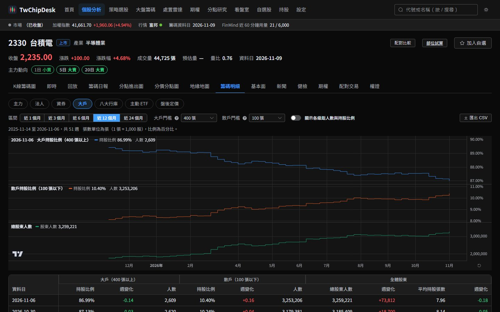
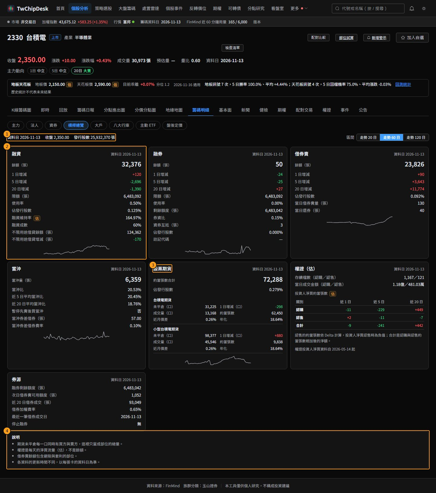
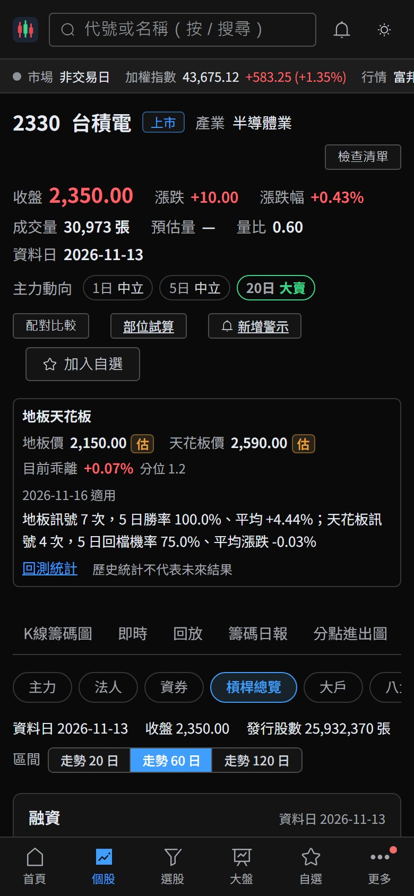

<!-- routes: /stock/:stockId/detail -->
# 個股分析｜籌碼明細

> 位置：個股頁「籌碼明細」分頁（網址 `/stock/2330/detail`，子分頁用 `?tab=main`、`institutional`、`margin`、`leverage`、`holders`、`govBank`、`activeEtf`、`afterHours`）
> 資料更新：分點與主力交易日 18:10 起（三大法人 20:05 到齊後計算）；八大行庫 18:35；三大法人與外資持股 20:05；融資融券、借券 21:05；借券成交 20:30；當沖 21:35；融資維持率 22:35；盤後定價 20:40；主動 ETF 持股 21:20；股權分散每週六、日 10:00

## 這個功能可以做什麼
把一檔股票的各類籌碼依日期列成圖與表：上方是走勢圖，下方是每日（大戶為每週）的明細表，由新到舊。可以切換區間、匯出 CSV，適合逐日核對數字。

## 畫面說明

| 編號 | 名稱 | 說明 |
|---|---|---|
| 1 | 子分頁 | 「主力」「法人」「資券」「槓桿總覽」「大戶」「八大行庫」「主動 ETF」「盤後定價」。目前的子分頁記在網址。 |
| 2 | 區間 | 「近 1 個月」「近 3 個月」「近 6 個月」「近 12 個月」「近 24 個月」（主動 ETF、盤後定價的選項不同，見下方）。下方列出實際起訖與筆數。 |
| 3 | 匯出 CSV | 匯出目前子分頁、目前區間的明細。 |

圖表上方第一列是收盤價，下面依子分頁畫出各項數字；滑鼠移到圖上查看當天數值。圖表右下角的按鈕與 Alt + R 可重設圖表視圖。

## 各子分頁內容
- **主力**：主力買賣超、買賣家數差（買超分點數、賣超分點數）、籌碼集中度（5 日、20 日）、散戶買賣超、中實戶買賣超；下方另有「鉅額交易（分點資料不含）」區塊，列出區間內的鉅額成交與分點。上方的「這檔的關鍵分點」開啟[分點研究｜關鍵分點](../brokers/key.md)並只列這檔股票。
- **法人**：外資、投信、自營商（自行買賣、避險、合計、避險比、避險淨買占比）的買入、售出、買賣超，三大法人合計、外資持股比例，以及外資、投信、自營商的連買連賣天數。
- **資券**：融資、融券的「買進」「賣出」「現償」、餘額、增減、使用率，券資比、資券互抵、「借券賣出」、當沖量與當沖比、融資維持率；另有借券成交（張數與費率）、不限用途借貸、「證金擔保放款」（餘額、增減、「次日限額」，緊接在不限用途借貸之後）、證券商有價證券融資、當沖券差借券等延伸資料。表格下方是「借券成交明細」，見下方「借券成交明細」一節。
- **槓桿總覽**：融資、融券、借券賣、當沖、股票期貨、權證（估）與券源各一張卡，見下方「槓桿總覽」一節。
- **大戶**：每週一筆。大戶（門檻以上）、散戶（門檻以下）的持股比例、週變化與人數，總股東人數與平均持股張數。可切換「大戶門檻」「散戶門檻」，開啟「顯示各級距人數與持股比例」看各級距明細。
- **八大行庫**：各行庫的買賣超與合計、合計金額。
- **主動 ETF**：持有這檔股票的主動式 ETF，見下方截圖。
- **盤後定價**：盤後定價交易的成交價、成交張數、筆數、金額與未成交買賣張數。區間為近 20、60、120、240 個交易日。

大戶門檻預設 400 張（可選 400、600、800、1,000 張），散戶門檻預設 100 張（可選 5～400 張），門檻存在這個瀏覽器，與 K 線的大戶、散戶副圖共用。滑鼠移到門檻旁的「?」可看參考說明。

主動 ETF 子分頁：區間為近 5、20、60、120 個資料日，可另選「迄日」。上方列出迄日持有這檔的主動 ETF（持股張數、權重、市值、增減、扣除申贖（估）、申贖比例（估）、增減金額（估）、異動），下方為每日合計與各 ETF 的增減。點 ETF 名稱會到大盤籌碼的主動 ETF 頁查看該 ETF。

## 槓桿總覽

把一檔股票的信用交易、借券、當沖、股票期貨與權證的最新數字放在同一頁，每個區塊一張卡。只整理公開資料的數字，不做任何判斷。網址 `/stock/2330/detail?tab=leverage`。

| 編號 | 名稱 | 說明 |
|---|---|---|
| 1 | 頁首 | 資料日、收盤、發行股數（張）；右側可選「走勢 20 日」「走勢 60 日」「走勢 120 日」，影響卡片裡的小走勢線。 |
| 2 | 卡片 | 七張卡，桌機三欄、較窄的畫面兩欄、手機一欄。卡片右上角是這個區塊的資料日，比頁首的資料日舊時標「資料較舊」。 |
| 3 | 卡片標題 | 可以點：「融資」「融券」「借券賣」「當沖」連到「資券」子分頁，「股票期貨」連到個股的「期權」分頁，「權證（估）」連到個股的「權證」分頁。 |
| 4 | 「說明」 | 頁面最下方固定四句說明，見下方。 |

各卡片的內容：
- **「融資」**：「餘額（張）」、「1 日增減」「5 日增減」「20 日增減」、「限額（張）」、「使用率」、「佔發行股數」、「融資維持率」（估）、「融資成數」、「不限用途借貸餘額（張）」與增減；小走勢線是融資餘額。
- **「融券」**：「餘額（張）」、三個增減、「限額（張）」、「使用率」、「剩餘額度（張）」（限額 − 餘額）、「券資比」、「資券互抵（張）」、「佔發行股數」、「註記代碼」；小走勢線是融券餘額。註記代碼照來源原樣顯示，沒有官方對照表，這裡不解讀。
- **「借券賣」**：「餘額（張）」、三個增減、「佔發行股數」、「當日借券賣量（張）」、「當日還券（張）」；小走勢線是借券賣餘額。
- **「當沖」**：「當沖量（張）」、「當沖比」、「近 5 日平均當沖比」、「近 20 日平均當沖比」、「暫停先賣後買當沖」（是／否）、「當沖券差借券（張）」與「當沖券差借券費率」；小走勢線是當沖比。
- **「股票期貨」**：「約當張數合計」、「佔發行股數」，下面每個個股期貨商品（一般、小型、調整後）一列：「未平倉（口）」、「1 日增減（口）」、「成交量（口）」、「約當張數」、「近月價差」、「年化」（估）。卡片較窄（例如手機）時改成每個商品一小段。契約乘數未確認的商品不計入約當張數，並註明「有商品的契約乘數未確認，沒有計入約當張數。」
- **「權證（估）」**：「存續檔數（認購／認售）」、「當日成交金額（認購／認售）」，以及「投資人淨買約當張數」（估）近 1、5、20 日的認購、認售與合計。
- **「券源」**：「融券剩餘額度（張）」、「次日借券賣可用額度（張）」、近 N 日借券成交（張）與「借券加權費率」、「最近一筆借券成交日」、「停止融券」期間與原因。

單位與算法：
- 張＝股 ÷ 1,000。借券賣與期貨約當張數可能有小數。
- **佔發行股數**：部位股數 ÷ 不晚於資料日最近一筆的發行股數 × 100%。沒有發行股數的代號（例如部分 ETF）顯示「—」，頁首另註明。
- **增減**：資料日的值減去往前第 1、5、20 個有資料的日子的值；資料不足時顯示「—」。增減只用漲跌色，沒有文字判斷。
- **約當張數**（股票期貨）：未平倉口數 × 契約乘數 ÷ 1,000，只計一般時段、各月份合計。
- **投資人淨買約當張數**（權證，估）：近 1、5、20 個已完成日的投資人約當股數合計 ÷ 1,000，是每天的流量，不是餘額。認售的約當張數依 Delta 計算，投資人淨買認售時為負值；「合計」是認購與認售約當張數相加後的淨額。權證官方資料外掛關閉時沒有 Delta，這三列顯示「—」。
- **次日借券賣可用額度**：來源的可借券賣股數 ÷ 1,000，截去小數（與可轉債套利相同）。來源沒有提供這個數字時也會記成 0，所以「0」可能是額度為 0，也可能是來源沒有給。
- 「近 N 日借券成交」的 N 與期現套利的借券費率回看天數相同，張數加權平均費率；這段期間全市場都還沒有借券成交資料時顯示「—」。
- 停止融券：列出涵蓋今天（回看過去的日子時為那一天）、或之後 5 個交易日內開始的期間；迄日未定時寫「起（迄日未定）」。
- 「權證（估）」卡的資料日是當日成交金額與投資人淨買兩者中較早的一天，「券源」卡是融券剩餘額度與次日借券賣可用額度兩者中較早的一天；任一項比頁首舊就標「資料較舊」（例如權證投資人淨買在 20:05 之後才更新，之前權證卡會標「資料較舊」）。

「說明」區塊的四句：
1. 期貨未平倉每一口同時有買方與賣方，這裡只當成部位的總量。
2. 權證是每天的淨買流量（估），不是餘額。
3. 借券賣餘額包含避險與套利的部位。
4. 各資料的更新時間不同，以每張卡的資料日為準。

資料更新時間：融資、融券、借券賣與券源每個交易日 21:05；當沖 21:35；當沖券差借券 21:20；融資維持率 22:35；股票期貨 15:20 起（18:10 補抓），近月價差 19:00；權證主檔 07:50、權證投資人淨買在個股三大法人（20:05）之後；借券成交 20:30。

沒有資料與關閉時：
- 某個區塊沒有資料時卡片顯示「沒有資料」；整頁都沒有資料時顯示「這檔股票沒有資券、借券、期貨或權證資料」。
- 期權模組關閉時「股票期貨」卡、權證功能關閉時「權證（估）」卡顯示「此功能已關閉」，並寫出要開啟的開關（設定頁「期權」區塊的 Derivatives:Enabled、「籌碼參數」區塊的 Warrant:Enabled），「前往設定」直接跳到該區塊；其他卡片照常。
- 這個子分頁不匯出 CSV；逐日數字可在「資券」子分頁匯出。

手機上卡片排成一欄，每張卡的指標以名稱與數值兩欄排列，股票期貨的商品改成每個商品一小段，不需要左右捲動。

### 借券成交明細
「資券」子分頁表格下方的「借券成交明細」：

- **「未來 60 天到期張數（估）」**：把借券成交依成交時約定的「原始還券日」依週（週一起）加總，只算還券日在今天之後、60 天以內的成交，每週一條橫條（最長的一週為滿格）。只是約定的日期，實際可能提前還券或被出借人召回，續借、轉借也看不到，所以標「估」，不等於實際的還券量。下方寫明涵蓋比例：近 400 天的借券成交中，有幾筆有原始還券日（來源沒有這個欄位的成交不計入到期分布）。
- **借券成交表**：區間內每一筆借券成交，由新到舊：日期、「成交方式」（議借、競價、定價，照來源原文）、「張數」、「費率（%）」、「原始還券日」、「借券天數」（成交時約定的天數）。來源沒有原始還券日或借券天數時顯示「—」。區間內超過 1,000 筆時只列最近 1,000 筆並註明。
- 「匯出 CSV」只匯出上方的資券表，不含這張表。

## 操作步驟
1. 點子分頁切換資料類別。
2. 選「區間」。各子分頁的區間選擇會分別保留；換股票時只換資料。
3. 需要原始數字時按「匯出 CSV」，檔名為「籌碼明細-子分頁-代號-起日-迄日.csv」。

## 欄位與名詞
- 張數單位為張（1 張 = 1,000 股），比例為百分比。
- **避險比**：（自營商避險買入＋避險售出）÷（2 × 當日成交股數）× 100%；**避險淨買占比**：（避險買入－避險售出）÷ 當日成交股數 × 100%。
- **週變化**：本週 − 上週；持股比例的週變化單位為百分點。
- **扣除申贖（估）**：主動 ETF 持股增減扣掉申購買回造成的部分，是估計值；無法估計申贖比例的 ETF 不列入合計並註明。
- **股數事件**：比較期間內有分割、反分割、面額變更、配股或減資的日子，增減含這些事件造成的股數變動（未換算）。
- **當沖券差借券費率**：同一天有多個費率級距時以股數加權平均。
- **證金擔保放款**：證券金融事業以有價證券為擔保的放款（FinMind 的借貸與擔保品餘額資料集）；「餘額」「增減」「次日限額」的單位是張，與不限用途借貸同一個來源與更新時間。當天全市場已有資料但這檔沒有列時為 0，還沒有資料時為「—」。

## 注意事項與限制
- 法人、資券在每個交易日盤後更新；股權分散每週更新一次。剛開始回補時可能還沒有資料，回補進度可在「資料狀態」頁查看。
- 八大行庫尚未發布或沒有回補的日子顯示「—」。
- 槓桿總覽的各區塊更新時間不同，請以每張卡右上角的資料日為準。
- 主動 ETF 持股資料從 2025-05-05 起；功能關閉時顯示說明，可在設定頁「籌碼參數」開啟。不是上市櫃股票時沒有主動 ETF 資料。
- 同一個資料集另有「交割款項融資」，但目前所有股票的餘額都是 0，所以不顯示；槓桿總覽的「不限用途借貸」只列不限用途借貸一類，沒有把各類借貸加總。

## 相關功能
- [K線籌碼圖](kline.md)
- [籌碼日報](report.md)
- [大盤籌碼｜主動 ETF](../market/README.md)
