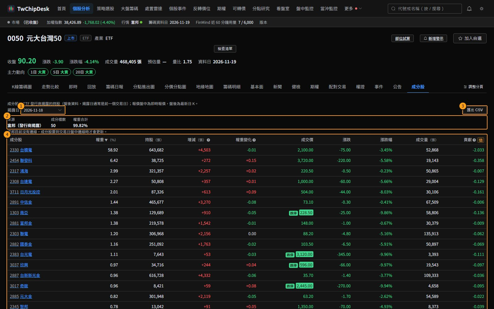

<!-- routes: /stock/:stockId/etf-holdings -->
# 個股分析｜成分股

> 位置：個股頁分頁列的「成分股」，只有 ETF 才有這個分頁，放在最後（網址 `/stock/0050/etf-holdings`）
> 資料更新：成分股為 ETF 發行商的盤後揭露，只在富邦行情外掛可連線的時段抓取（交易日盤中 08:50、10:30、12:50 各一輪，打開頁面時也會補抓這一檔；夜盤時段 15:00～次日 05:00 也可以一次補齊全部 ETF）；報價盤中每 15 秒更新

## 這個功能可以做什麼
列出一檔 ETF 的成分股、權重與持股張數，以及和上一個揭露日相比的增減。盤中再加上每一檔成分股的即時報價，並用揭露的權重估算「成分股加權漲跌」，和 ETF 本身的漲跌幅並排比較。

## 畫面說明

| 編號 | 名稱 | 說明 |
|---|---|---|
| 1 | 揭露日 | 選擇要看的揭露日，預設為最新一天；清單由新到舊，最多 30 天。揭露日是發行商公布持股的日期，通常是前一個交易日。 |
| 2 | 摘要 | 「來源」「成分檔數」「權重合計」。盤中另列「ETF 漲跌幅」「成分股加權漲跌」（估）、「差距」（估）與「報價時間」。 |
| 3 | 匯出 CSV | 匯出表格目前的列與排序。 |
| 4 | 成分股表 | 每一檔成分股一列，欄位見下方「欄位與名詞」。預設依權重由大到小排列。 |

- 摘要上方的說明：成分股是發行商揭露的持股（盤後資料），報價盤中為即時報價，盤後為最新日 K。
- 「權重合計」不一定是 100%：平衡型、槓桿型 ETF 只列出股票部分，其他資產（債券、期貨、現金等）不在表內。
- 盤中的「盤中即時」標籤後面是報價時間與「加權漲跌只算有報價的國內成分股（權重合計 xx%）」。
- 富邦行情外掛沒有連線時，表格上方註明「富邦目前沒有連線，成分股要到交易日盤中連線時才會更新。」，表格照常顯示最近一次抓到的資料。
- 打開頁面時資料不是最新、外掛又連線中，會在背景抓這一檔，畫面顯示「正在取得最新揭露的成分股，稍後自動更新。」，10 秒後自動再查一次。

## 操作步驟
1. 搜尋並進入一檔 ETF（例如 0050），點分頁列的「成分股」。
2. 從「揭露日」選擇要看的日期；選最新一天就回到預設。
3. 點欄名排序（再點一次反向、第三次回到預設）；手機上用表格上方的排序選單。盤中報價更新時列的位置不跳動，順序和最新數字不同時，排序列會出現「重新排序」。
4. 點國內成分股的代號或名稱，進入那一檔的個股頁；海外成分（例如「AAPL UQ」）沒有連結，名稱旁標「海外」。
5. 按「匯出 CSV」下載目前的表格。

## 欄位與名詞
- **權重**：發行商揭露的權重（%）。
- **持股**：揭露的股數 ÷ 1,000，單位為張；海外成分同樣以股數 ÷ 1,000 顯示。
- **增減**、**權重變化**：和這檔 ETF 上一個揭露日相比的張數增減與權重差（百分點）；第一個揭露日沒有增減，顯示「—」。
- **成交價**、**漲跌**、**漲跌幅**、**成交量**（張）：盤中為即時報價，盤後與非交易日為最新日 K。價格在漲跌停價時加底色，當天碰過漲跌停時另有「漲停」「曾漲停」「跌停」「曾跌停」「曾漲跌停」小標記。海外與沒有報價的成分顯示「—」。
- **貢獻（估）**：權重 × 漲跌幅 ÷ 100，單位為 ETF 漲跌的百分點。盤後只有報價日和 ETF 本身相同的成分才算貢獻（停牌或日 K 還沒更新的成分照常顯示價格，貢獻顯示「—」）。
- **成分股加權漲跌（估）**：Σ（權重 × 成分股漲跌幅）÷ 有報價成分股的權重合計；只算國內有報價的成分股。用的是揭露日的權重，和 ETF 實際的淨值變動會有差距。
- **差距（估）**：ETF 漲跌幅 − 成分股加權漲跌（估）。
- **來源**：「富邦（發行商揭露）」為富邦行情的 ETF 持股資料；主動式 ETF 在富邦沒有資料時改用「FinMind（主動 ETF 持股）」，與[籌碼明細](detail.md)「主動 ETF」子分頁同一份資料。

## 資料來源與更新時間
- 成分股：富邦行情的 ETF 持股資料（發行商盤後揭露）。排程與打開頁面時的補抓只在富邦行情外掛已連線時進行，不會為了這個功能另外連線：每個交易日 08:50、10:30、12:50 各一輪，每輪只處理還沒有前一交易日資料的 ETF（自選股與持股中的 ETF 優先，同一層內最久沒抓的先抓）；有人打開某一檔的成分股頁、資料不是最新時，也會在背景補抓這一檔（同一檔 10 分鐘內不重複）。上次抓取失敗的 ETF 到下一個交易日 08:00 後才重抓；上次抓到但沒有新揭露日的，2 小時內不重抓。
- 手動補抓（一次補齊全部 ETF）：畫面上沒有按鈕，由管理者送出 `POST /api/v1/etf-holdings/backfill`（`GET` 同一網址看進度）。只在富邦可連線的時段接受（交易日 08:30～13:45，以及交易日 15:00～次日 05:00 的夜盤；其他時間不接受）；會讓富邦行情外掛為這次補抓連線（夜盤會用掉當晚可連線次數的其中一次，結束後自動中斷），最多等 120 秒連上，依排程的順序與略過規則抓，一次最多 400 檔。同一時間只跑一次，結束後 30 分鐘內不能再開始。
- 第一次抓某一檔時取最近約 30 天的揭露資料，之後只抓新的日子，不補更早的歷史。
- 發行商某天沒有揭露時就沒有那一天的資料。
- 報價：盤中為即時行情（約每 10 秒更新，畫面每 15 秒重新查詢）；盤後與非交易日為最新日 K。

## 注意事項與限制
- 不是 ETF 的股票沒有這個分頁；用網址直接打開時顯示「這檔不是 ETF，沒有成分股。」。
- 債券型、期貨型、商品型、反向型等沒有股票成分的 ETF，顯示「此 ETF 沒有股票成分（例如債券型、期貨型、商品型或反向型 ETF）。」，之後 7 天內不再重抓。
- 還沒有抓過資料、富邦沒有連線時顯示「還沒有這檔 ETF 的成分股資料」與「成分股資料於交易日盤中富邦連線時更新。」；富邦連線中但還沒取得時改為「尚未取得資料，稍後再查看。」。
- 在「成分股」分頁用左側自選清單、頂部搜尋框或上下方向鍵換股票時，進入預設分頁（左側清單為「即時」，其他為 K 線籌碼圖），不留在只有 ETF 才有的「成分股」分頁。
- 富邦行情外掛沒有開啟或沒有連線時不會更新；設定方式見[設定｜行情來源](../settings.md#行情來源)。
- 加權漲跌、差距與貢獻都是用揭露權重算出的估計值（畫面標「估」），不是 ETF 的官方淨值。

## 相關功能
- [籌碼明細](detail.md)「主動 ETF」子分頁：個股被哪些主動式 ETF 持有
- [大盤籌碼｜權值股](../market/index-weight.md)：指數成分股的權重與貢獻點數
- [個股分析](README.md)：分頁一覽與調整分頁
