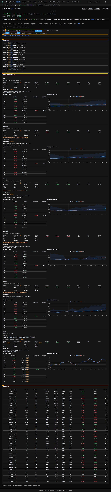

<!-- routes: /stock/:stockId/events -->
# 個股分析｜事件

> 位置：個股頁分頁列的「事件」（網址 `/stock/2330/events`；區間與成本可帶 `?window=0:close,3:close&costs=gross`）
> 資料更新：事件樣本每個交易日 15:40、22:40 更新；所有統計皆為歷史估計

## 這個功能可以做什麼
集中看一檔股票過去與未來的所有事件，以及每一種事件在所選區間的歷史統計：例如這檔過去每次除息前後的漲跌、上漲機率與平均報酬，月營收公布後的表現，以及歷年除權息的權值率、息值率與填權息天數。名詞定義見[個股事件](../events/README.md)的共同用語。

## 畫面說明

| 編號 | 名稱 | 說明 |
|---|---|---|
| 1 | 「區間」「成本」「報酬」 | 與[事件行事曆](../events/calendar.md)相同；換了以後時間軸的「區間淨報酬」與統計卡一起更新。 |
| 2 | 連結 | 「K 線事件標記」（K線籌碼圖，事件標記在圖上）、「權證（N 檔）」（權證分頁）、股期（有股票期貨時，開啟期現套利的除息以期代現）、「個股事件頁」。 |
| 3 | 「事件時間軸」 | 新到舊；未來事件標「未來」，推算的日期標「估」；過去事件列出所選區間的淨報酬，或沒有計入的原因（例如結構事件剔除、尚未到出場日）。月營收與財報另列公布時間與「來源：」（「官方」「FinMind 入庫日」或「估」），數值或日期待確認時加「待核對」。月營收有官方備註時，在說明後面另列「備註：」與公司填寫的原文（與[基本面](fundamental.md)月營收表格的「備註」相同；只是顯示，不影響統計）。法說會、股東會、庫藏股決議的子資訊與[事件行事曆](../events/calendar.md#欄位)相同（股東會含「停止過戶 MM/DD～MM/DD」與「電子投票：」原文，來源沒有時不顯示），滑鼠移上去（手機點一下）看地點全文、擇要訊息或買回目的。 |
| 4 | 「各種事件的歷史統計」 | 這檔有樣本的每種事件一張卡：摘要、最近 3 年與更早、逐日表（T−5～T+5）、平均路徑（T−10～T+20，P25～P75 帶狀）。N 少於 5 標「樣本少」。法說會、股東會、庫藏股決議的卡片註明「資料自 YYYY-MM-DD 起累積」；法說會與股東會另列「最近 5 次」的日期、時間、常會或臨時會與地點（沒有地點時寫「地點未公布」）。時間軸上有這三種事件但還沒有可統計的樣本時，卡片寫「還沒有可統計的樣本」。 |
| 5 | 「歷年除權息」 | 除權息日、種類、現金與股票股利、除權息前收盤、參考價（進位到升降單位、開盤與收盤對參考價用的值；滑過顯示未進位的理論參考價）、權值率、息值率、開盤與收盤對參考價、填權息天數（未填顯示「未填」）。 |

## 操作步驟
1. 在個股頁點「事件」分頁。
2. 選區間（例如「T−1 收→T 開」看參加除權息當天的表現）。
3. 在統計卡看每種事件的上漲機率（N）與平均路徑；在時間軸看每一次的結果。
4. 點「權證（N 檔）」看這檔的權證，或點「K 線事件標記」在 K 線上對照事件位置。

## 注意事項與限制
- 有樣本的進場點早於事件公告時，統計卡註明「部分樣本的進場點早於事件公告（N 筆），只能當事件研究參考。」
- 事件樣本還沒建置時顯示「事件樣本尚未建置」；股票沒有事件資料時顯示「找不到這檔股票的事件資料」。
- 法說會、股東會、庫藏股決議來自官方開放資料，沒有更早的歷史，從設定頁開啟「官方開放資料事件來源」那天起累積；公布時間的規則見[個股事件](../events/README.md)的共同用語。
- 歷史統計不代表未來結果。

## 相關功能
- [個股事件](../events/README.md)
- [個股分析｜K線籌碼圖](kline.md)
- [個股分析｜權證](warrants.md)
