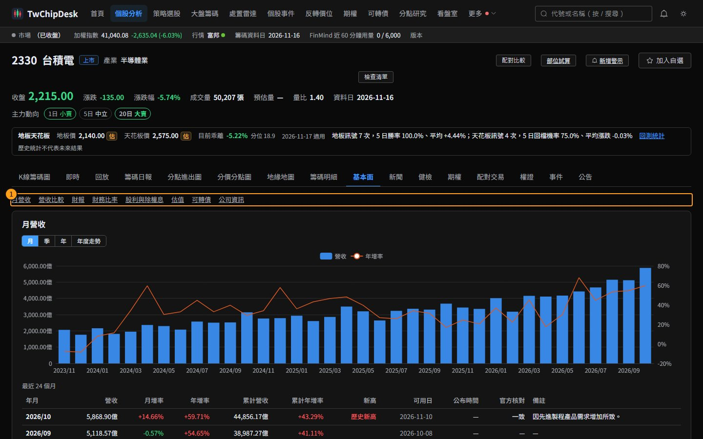
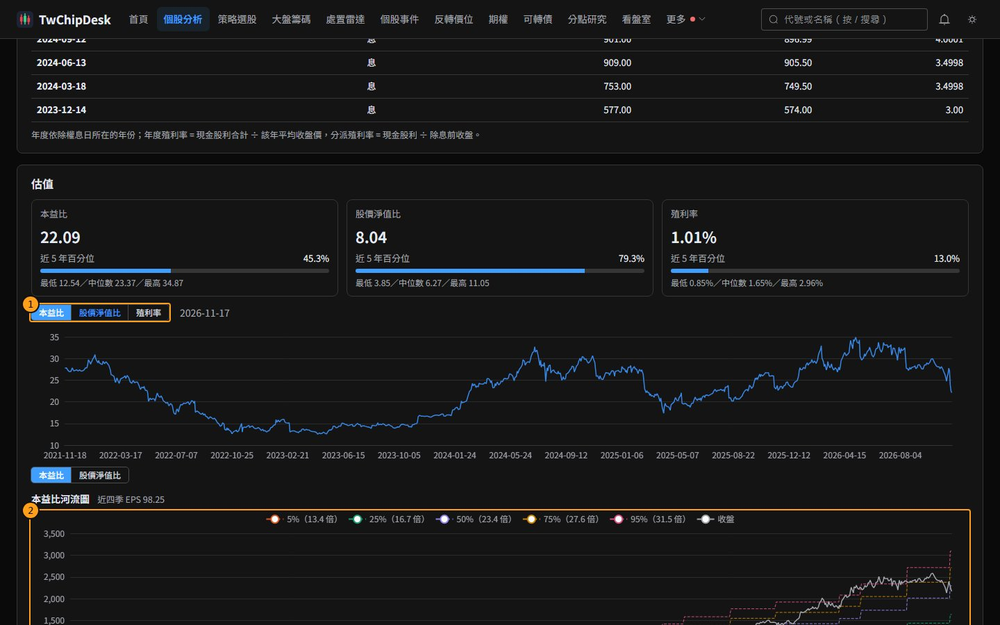
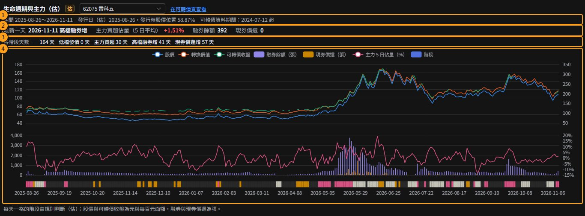

<!-- routes: /stock/:stockId/fundamental -->
# 個股分析｜基本面

> 位置：個股頁「基本面」分頁（網址 `/stock/2330/fundamental`）
> 資料更新：月營收每天 18:30、22:00；財報、股利、除權息結果、減資與分割等交易日 19:00；本益比、股價淨值比、殖利率交易日 18:05；市值與外資持股 21:05～23:35；可轉債交易日 21:30～21:45

## 這個功能可以做什麼
集中看一家公司的營運與估值：月營收與年增率（也可以看季營收、年營收與各年度走勢）、和同族群公司比較營收、財報三表、財務比率、歷年股利與除權息、本益比等估值的歷史位階與河流圖、發行中的可轉債與公司資訊。

## 畫面說明

| 編號 | 名稱 | 說明 |
|---|---|---|
| 1 | 區塊連結 | 「月營收」「營收比較」「財報」「財務比率」「股利與除權息」「估值」「可轉債」「公司資訊」，點一下捲到該區塊。 |

每個區塊各自載入；某個區塊沒有資料或載入失敗時，只影響那一區。

## 各區塊內容

### 月營收
柱狀為月營收、折線為年增率。下方表格列出最近 24 個月的「營收」「月增率」「年增率」「累計營收」「累計年增率」「新高」（「歷史新高」或「N 個月新高」）、「可用日」、「公布時間」、「官方核對」與「備註」。
- 「可用日」是選股與回測使用的日期（營收入庫日，休市日入庫的算進前一個交易日），不受「公布時間」影響。
- 「公布時間」是本系統第一次在證交所、櫃買中心的每月營業收入彙總表看到這個月營收的時間範圍，不是公司實際上傳的精確時間。寫法與[事件行事曆](../events/calendar.md)的「公布時間」相同：兩次抓取在同一天時寫「公布 11/10 16:00 前」，跨天時寫「公布 11/10」，只有日期時也寫「公布 11/10」；滑鼠移上去（手機點一下）看區間。這一欄只顯示官方的時間，沒有官方資料的月份顯示「—」。
- 「官方核對」是彙總表的營收數字與每天入庫的月營收數字比對的結果：「一致」、「不一致」（相差超過 0.1%；同一格下方用小字列出官方數字，例如「官方 29.50億」）、「官方有、入庫資料還沒有」、「日期矛盾」（入庫日期與官方公布時間對不上）；還沒核對或沒有官方資料時顯示「—」。
- 「備註」是公司申報月營收時填寫的說明（例如營收增減的原因、是否含停業單位），來自證交所、櫃買中心的每月營業收入彙總表，照原文顯示；公司沒有填寫時顯示「—」。
- 備註需要設定頁「補充來源」區塊的「官方開放資料事件來源」開啟，每天（含假日）08:00、16:00、22:00 抓取（時間可在設定頁修改）。彙總表只提供最新一個月，所以 2026 年 10 月營收起才有備註，更早的月份都是「—」。公司事後修改備註時，下一次抓取後跟著更新。
- 「營收」等數字仍以每天入庫的月營收資料為準；備註、公布時間與官方核對只是補充說明。公布時間與官方核對同樣需要開啟「官方開放資料事件來源」，從開啟那天起累積，更早的月份都是「—」。
- 備註也會出現在 [K線籌碼圖](kline.md)「營收公布」標記的浮動資訊與[個股事件](events.md)時間軸的月營收列。
- 手機寬度時表格可以左右滑動看所有欄位。

區塊上方可以切換「月」「季」「年」「年度走勢」，預設是「月」（上面說的圖表與表格）。選擇記在這台電腦的瀏覽器，下次打開沿用。
- 「季」：季依曆年計算（1～3 月為第一季，依此類推）。柱狀為季營收、折線為年增率；表格列出最近 12 季的「季別」「季營收」「季增率」（和上一季比）、「年增率」（和去年同一季比）、「當年累計營收」（當年 1 月加到這一季）與「累計年增率」。
- 「年」：柱狀為年營收、折線為年增率；表格列出全部年度的「年度」「年營收」「年增率」。
- 還沒滿三個月的最新一季（或還沒滿 12 個月的今年）在期別下方標「累計至 N 月」，柱子顏色較淡：營收只加到第 N 月，年增率和去年同樣的月份比（例如今年 1～10 月對去年 1～10 月），季增率不計算、顯示「—」。不要把這個數字當成整季或整年的營收。
- 期間中有月份沒有資料時標「缺 N 個月」，柱子顏色較淡：營收只加總有資料的月份，季增率、年增率與累計都不計算、顯示「—」。資料從年中才開始的第一年也算缺月份。
- 「季」「年」不顯示「可用日」「公布時間」「官方核對」「備註」，這幾欄只在「月」。
- 「年度走勢」：一張折線圖，橫軸是 1～12 月，每一年一條線，預設顯示最近 5 個年度（最新年度是粗線）。點圖例的年份可以顯示或隱藏該年度。上方切換「單月營收」或「累計營收」（當年 1 月加到該月；那一年有月份沒有資料時不畫）。滑鼠移到圖上（手機點一下）列出各年度該月的數值與年增率（「累計營收」時是累計年增率）。

### 營收比較
依最新月營收列出同族群規模最大的公司：最新月份、營收、年增率與「近 12 個月年增率」走勢（中線為 0%）。
- 「比較對象」可選「同一子產業」或「同一官方產業」。
- 「加入比較」輸入代號或名稱加入其他股票，最多 10 檔。

### 財報
- 種類：「損益表」「資產負債表」「現金流量表」；期別：「季」「年」；檢視：「數值」「季增率」「年增率」。
- 上方畫主要項目，下方為各期數字與可用日。
- 金融保險業的財報項目與一般產業不同（沒有營業毛利、營業利益）。現金流量表的季資料已由年初累計換算為單季；年度損益為四季合計（四季都有才計算）。

### 財務比率
毛利率、營業利益率、稅後淨利率、每股盈餘（元）、股東權益報酬率、資產報酬率、負債比率，以及獲利率走勢圖。ROE、ROA 以期間淨利 ÷ 期初與期末的平均計算，季資料不年化。

### 股利與除權息
「歷年股利」（現金股利、股票股利、年均股價、殖利率）、「分派明細」（除息日、除權日、發放日）、「除權息結果」（除權息前收盤、參考價、權息值），以及「分割與面額變更」。
- 年度殖利率 = 現金股利合計 ÷ 該年平均收盤價；分派殖利率 = 現金股利 ÷ 除息前收盤。

### 估值
| 編號 | 名稱 | 說明 |
|---|---|---|
| 1 | 走勢指標 | 切換上方近 5 年走勢圖顯示「本益比」「股價淨值比」或「殖利率」。 |
| 2 | 本益比河流圖 | 收盤價與「近四季 EPS × 近 5 年本益比分位數」（5%、25%、50%、75%、95%）的帶狀線；滑鼠移到圖上看當天各帶的價格。 |

- 「本益比」「股價淨值比」「殖利率」各列出「目前」值、「近 5 年百分位」與最低／中位數／最高，可切換近 5 年走勢圖。
- 河流圖的帶狀線以當時已公布（依可用日）的近四季每股盈餘計算；近四季每股盈餘不足四季或不為正時不畫。

### 可轉債
發行中的可轉換公司債：轉換價、發行金額、流通餘額、已轉換、潛在股數與潛在稀釋、收盤（最近有成交的日子）、轉換價值、溢價率、票面利率、轉換狀態、下次賣回、提前贖回、到期下市日、法人 5 日買賣超。
- 潛在稀釋假設全部轉換：流通餘額 ÷ 轉換價 ÷ 最新發行股數。
- 只列已確認標的對應的可轉換公司債，不含交換債。
- 每一檔名稱旁的「套利明細」開啟[可轉債｜套利](../cb/arbitrage.md)並直接打開這一檔的溢價率明細（可轉債收盤、轉換價值與溢價率走勢、區間統計）。

表格下方的「生命週期與主力（估）」（2024-07-12 起的資料）：

| 編號 | 名稱 | 說明 |
|---|---|---|
| 1 | 期間 | 期間、推算的發行日與發行時股價位置、資料期間 |
| 2 | 「最新一天」 | 最新一天的階段、「主力買超佔量（5 日平均）」「融券餘額」「現券償還」 |
| 3 | 「各階段天數」 | 期間內每個階段的交易日數 |
| 4 | 圖表 | 見下方說明 |

- 有多檔可轉債時用「可轉債」選單切換；「在可轉債頁查看」開啟[可轉債｜主力動態](../cb/mainforce.md)並搜尋這一檔。
- 列出期間、推算的發行日與發行時股價位置，以及「最新一天」的階段、「主力買超佔量（5 日平均）」「融券餘額」「現券償還」與「各階段天數」。
- 圖表：上圖為股價（左軸）與轉換價值、可轉債收盤（右軸）；中圖為融券餘額、現券償還（長條，張）與主力 5 日佔量（折線，右軸 %）；最下方一列每天一格，顏色代表當天的階段（估，規則見[可轉債](../cb/README.md)）。
- 這檔可轉債沒有主力資料時顯示「這檔可轉債沒有主力資料（資料自 2024-07-12 起）」。

### 公司資訊
產業、市場別、產業鏈、族群、發行股數、市值、外資持股比例與地址（地址需要啟用公司基本資料外掛）。

在指數權重表裡的股票另有一行「加權指數權重」（上櫃股票是「櫃買指數權重」），例如「第 3 名 2.35%（資料日 2026-10-30）」：這檔在所屬市場指數的官方排名與權重，以及那份權重的資料日。上市的官方權重只有每月最後一個交易日一份，所以月中看到的是上個月底的資料；上櫃每個交易日都有。不在該市場最新一天權重表的股票（沒有資料或已不在成分中）不顯示這一行。點排名與權重會開啟[大盤籌碼｜權值股](../market/index-weight.md)，切到這檔所屬的市場、顯示全部成分股並標示這一檔；權值股頁的權重是依股價調整的估計值，和這裡的官方權重不一定相同。

## 欄位與名詞
- **可用日**：資料入庫日；休市日入庫的算進前一個交易日。回溯與回測只使用可用日不晚於當天的資料。
- **百分位**：目前的值高於近 5 年多少比例的日子。

## 注意事項與限制
- 跨季合計與缺漏的每股盈餘以母公司淨利 ÷ 期末發行股數計算。
- 張數類籌碼在分割、面額變更前後不換算，跨越事件比較時要留意。

## 相關功能
- [健檢](health.md)
- [新聞](news.md)
- [K線籌碼圖](kline.md)（營收與財報事件標記）
- [可轉債｜套利](../cb/arbitrage.md)（可轉債溢價率與轉換價差，估）
- [可轉債｜主力動態](../cb/mainforce.md)（標的主力買超佔量、融券與現券償還、生命週期階段，估）
