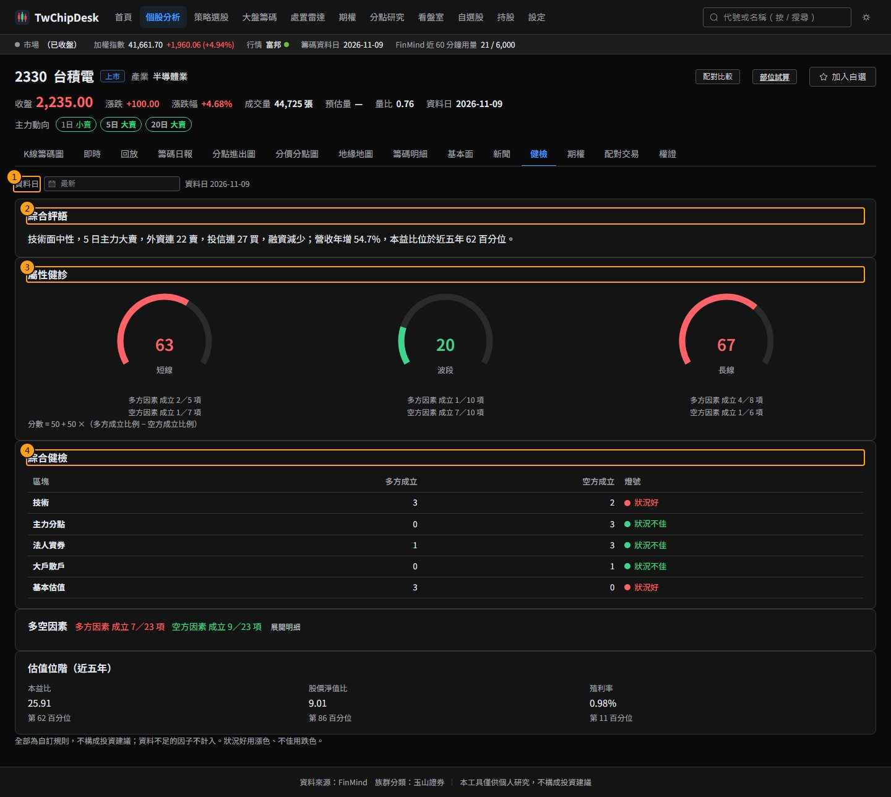

<!-- routes: /stock/:stockId/health -->
# 個股分析｜健檢

> 位置：個股頁「健檢」分頁（網址 `/stock/2330/health`）
> 資料更新：以每晚的選股特徵計算（分點研究 23:50 完成後產生）；當天的選股特徵還沒算好時，改用即時計算的特徵產生並註明

## 這個功能可以做什麼
用一組固定規則，把技術面、主力分點、法人資券、大戶散戶與基本估值的狀況整理成分數、燈號與一句評語，快速掌握這檔股票目前各面向的多空因素各成立幾項。全部是自訂規則的統計結果，只描述狀況。

## 畫面說明

| 編號 | 名稱 | 說明 |
|---|---|---|
| 1 | 資料日 | 留空為「最新」；可選過去的交易日。右側顯示實際的資料日。 |
| 2 | 綜合評語 | 一句話整理技術面、主力、法人、資券、營收與估值的現況。 |
| 3 | 屬性健診 | 「短線」「波段」「長線」三個分數儀表（0～100），下方列出多方因素、空方因素各成立幾項。 |
| 4 | 綜合健檢 | 「技術」「主力分點」「法人資券」「大戶散戶」「基本估值」五個區塊的多方成立數、空方成立數與燈號（「狀況好」「狀況不佳」「持平」）。 |

再往下是：
- **多空因素**：全部多方因素、空方因素各成立幾項；按「展開明細」列出每一條規則的代碼、屬性、條件、狀態（「成立」「不成立」「資料不足」）與數值。
- **估值位階（近五年）**：「本益比」「股價淨值比」「殖利率」目前的值，以及在近五年的第幾百分位。

## 欄位與名詞
- **分數**：50 + 50 ×（多方成立比例 − 空方成立比例）。多方因素全部成立、空方都不成立時為 100。
- **燈號顏色**：狀況好用漲色、狀況不佳用跌色。
- **資料不足**：計算需要的資料還沒有（例如新上市、分點資料不足天數）時，該因子不計入。
- **百分位**：目前的值高於近五年多少比例的日子。

## 注意事項與限制
- 規則全部為本系統自訂，只是把資料整理成統計結果，不代表任何投資意見。
- 選股特徵每晚計算；查看過去的資料日時，使用當天的特徵。

## 相關功能
- [策略選股](../screener/README.md)
- [基本面｜估值](fundamental.md)
