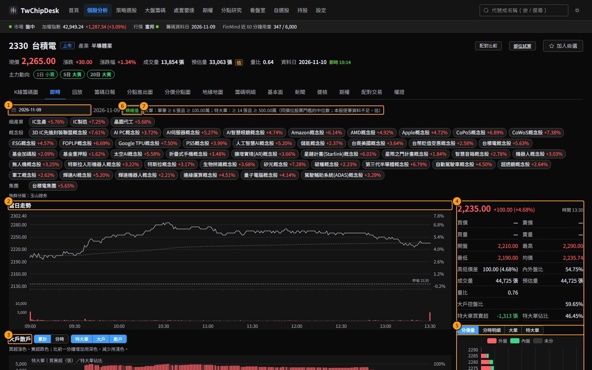
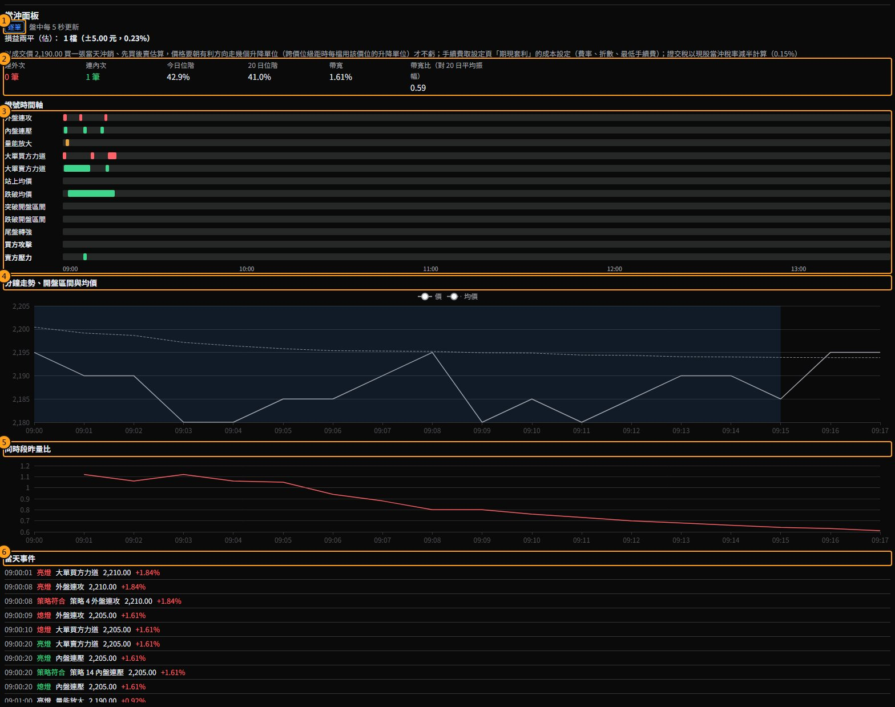

<!-- routes: /stock/:stockId/intraday -->
# 個股分析｜即時

> 位置：個股頁「即時」分頁（網址 `/stock/2330/intraday`，看歷史日期加 `?date=2026-11-09`）
> 資料更新：盤中即時推播，另外每分鐘重新查詢一次補上遺漏的分鐘；收盤後逐筆成交約 15:30 後可以「更新為精確值」；自選股、持股與當天發出訊號的股票在交易日 15:55 自動更新為精確值

## 這個功能可以做什麼
看一檔股票當天的分時走勢與資金結構：價格與均價線、每分鐘成交量、特大單／大戶／散戶的買賣超，右側是報價面板、最佳五檔、分價量、分時明細與大單。也可以選過去的日期，查當天盤中的樣子。

## 畫面說明

| 編號 | 名稱 | 說明 |
|---|---|---|
| 1 | 日期 | 留空為最近一個交易日；可選過去的日期（逐筆自 2018-12-07、分 K 自 2019-01-01 起）。 |
| 2 | 當日走勢 | 成交價線、均價線（虛線）與每分鐘成交量，並畫昨收與漲跌停參考線。 |
| 3 | 大戶散戶 | 特大單、大戶、散戶的買賣超（張）與比例，見下方說明。 |
| 4 | 報價面板 | 成交價、漲跌、買賣價量、開高低、均價、高低價差、內外盤比、成交量、預估量、量比、大戶控盤比、特大單買賣超與佔比。 |
| 5 | 分價量／分時明細／大單／特大單 | 切換右下方的內容。 |
| 6 | 盤中估算／精確值 | 目前數字的來源。滑鼠移上去看說明。 |
| 7 | 大單門檻 | 這檔股票的大單、特大單門檻（估）。 |

截圖為收盤後的畫面；盤中時報價面板上方另有最佳五檔，工具列顯示即時連線狀態。

畫面上方的族群標籤（細產業、概念股、集團）列出這檔所屬的族群與族群當天的漲跌幅，點標籤可以開族群頁。

## 操作步驟
1. 盤中直接開啟「即時」分頁，畫面會自動更新；離開分頁時自動停止接收即時資料。
2. 「大戶散戶」右側：
   - 「累計」「分時」切換累計買賣超或每分鐘買賣超。
   - 「特大單」「大戶」「散戶」可複選（至少一組），每組一張小圖上下排列，各自畫比例線。
   - 買超漲色、賣超跌色；比前一分鐘增加用深色，減少用淺色。
3. 右下方切換：
   - 「分價量」：各價位的外盤、內盤與未分成交量，標出現價。
   - 「分時明細」：時間、價格、漲跌幅、張數、內外盤；可勾「只看大單」，粗體為大單、標「特」的為特大單；「載入更多」看更早的紀錄。
   - 「大單」「特大單」：只列大單或特大單。
4. 收盤後若顯示「盤中估算」，可按「更新為精確值」以逐筆成交重新計算（逐筆成交約 15:30 後提供，之前按鈕停用並提示時間）。
5. 看過去的日期：在日期欄選一天。第一次查看的日子需要向 FinMind 下載逐筆與分 K，請稍候。

## 當沖面板

「即時」分頁最下方的「當沖面板」整理這檔股票同一天的當沖燈號（規則見[當沖監控](../daytrade/README.md)）。看過去的日期時跟著上方的日期切換；分鐘線只保留 10～30 天，更早的日期顯示「這一天沒有當沖面板資料（分鐘線只保留 10～30 天）」。

| 編號 | 名稱 | 說明 |
|---|---|---|
| 1 | 精度與狀態 | 「逐筆」或「估（5 秒快照）」（秒數依設定值）；漲停、跌停鎖住與暫停先賣後買另外標示；盤中寫出更新間隔。 |
| 1a | 「損益兩平（估）」 | 以目前成交價買一張、當天沖銷（先買後賣），價格要朝有利方向走幾檔才不虧，寫成「N 檔（±x.xx 元，y.yy%）」；沒有成交價時顯示「—」。 |
| 2 | 指標 | 「連外次」「連內次」（單位為筆或段）、「今日位階」「20 日位階」「帶寬」「帶寬比（對 20 日平均振幅）」。 |
| 3 | 「燈號時間軸」 | 10 個燈號與 2 個複合燈各一條帶，09:00～13:30 之間亮著的時段塗上顏色（買方力道紅、賣方力道綠、中性橘）；滑鼠移到色塊上看亮與熄的時間，還亮著的寫「仍亮」。 |
| 4 | 「分鐘走勢、開盤區間與均價」 | 每分鐘收盤價與均價線（虛線），開盤區間的時段加底色，區間高低畫水平線；開盤區間還沒結束時註明「開盤區間尚未結束（目前高低）」。 |
| 5 | 「同時段昨量比」 | 每分鐘的同時段昨量比曲線，1 的位置有參考線；沒有昨日資料時顯示說明。 |
| 6 | 「當天事件」 | 這檔當天的亮燈、熄燈、攻擊結束與策略符合。 |

## 欄位與名詞
- **盤中估算**：盤中只計入快照觀察到的大單，大戶散戶與分價量為估計值；收盤後更新為「精確值」（以逐筆成交計算）。
- **大單、特大單門檻（估）**：依這檔股票前 20 個交易日逐筆成交的張數分布，取前 5% 為大單、前 1% 為特大單，並要求最低金額（大單 100 萬元、特大單 500 萬元）。本股逐筆資料不足時用同價位股票門檻的中位數。畫面上會寫出實際採用的規則。
- **大戶**：大單的買賣；**散戶**：其餘成交；**特大單**：特大單的買賣。
- **特大單佔比**：累計特大單量 ÷ 累計總量。**大戶控盤比**、**散戶佔比**：大戶、散戶相對總成交的比例，畫在各組小圖的右軸。
- **內外盤比**：外盤與內盤成交的比例。
- **預估量（估）**、**量比**：與頁首相同，量比 = 預估量 ÷ 前 5 個交易日平均成交量。
- 漲跌停參考線：沒有漲跌幅限制或事件日沒有資料時不畫，並註明；資料集尚無當日值時以昨收計算。
- **損益兩平（估）**：以成交價（盤中為現價，過去日期為最後一分鐘的收盤）買一張、當天反向沖銷，一檔一檔往有利方向找，直到價差扣掉兩邊手續費與證交稅後不虧。跨價位級距時每一檔用該價位的升降單位（例如 49.95 的下一檔是 50.0，再下一檔是 50.1）。手續費取[設定](../settings.md)「期現套利」的成本設定（手續費率、折數、每筆最低手續費）；證交稅以現股當沖稅率減半計算（設定的股票證交稅 ÷ 2），ETF 用 ETF 證交稅率、不減半。到漲停仍無法打平時也顯示「—」。

## 資料來源與更新時間
- 盤中：設定頁啟用的行情來源（FinMind 快照或券商行情）。只有 FinMind 快照時最佳五檔只有最佳一檔；啟用券商行情後顯示完整五檔與試撮（08:30～09:00、13:25～13:30）。
- 收盤後：FinMind 逐筆成交與分 K。

## 注意事項與限制
- 盤中服務重啟或輪詢中斷時，缺少的分鐘以灰底標示「補回中」，補回後自動顯示。
- 盤中才開始輪詢的股票，較早的成交沒有分鐘資料，畫面會註明張數與時間。
- 分時明細在盤中為快照差分，每次有成交的輪詢一列，最多保留 1,000 列；收盤後為逐筆成交（不含鉅額交易）。

## 相關功能
- [當沖監控](../daytrade/README.md)
- [回放](replay.md)
- [K線籌碼圖](kline.md)
- [看盤室](../monitor.md)
