<!-- routes: /stock/:stockId -->
# 個股分析｜K線籌碼圖

> 位置：頂部選單「個股分析」→「K線籌碼圖」分頁（個股頁的預設分頁，網址 `/stock/2330`）
> 資料更新：日 K 每個交易日 13:40 先寫入暫定日 K、17:35 後換成正式日 K；盤中最後一根由即時報價接上。籌碼副圖依各資料的更新時間：分點與主力 18:10 起、八大行庫 18:35、三大法人 20:05、融資融券與借券 21:05、當沖 21:35、融資維持率 22:35、股權分散每週六

## 這個功能可以做什麼
在同一張圖上看價格、均線、技術指標與各種籌碼：主圖是 K 線，下方可以疊任意數量的副圖（成交量、主力買賣超、法人、資券、大戶……），右側的主力面板列出統計期間的主力數字與前 15 名分點。點一根 K 棒或選一段區間，主力面板與底色會跟著改成那段期間，方便回頭看「當時是誰在買」。

## 畫面說明
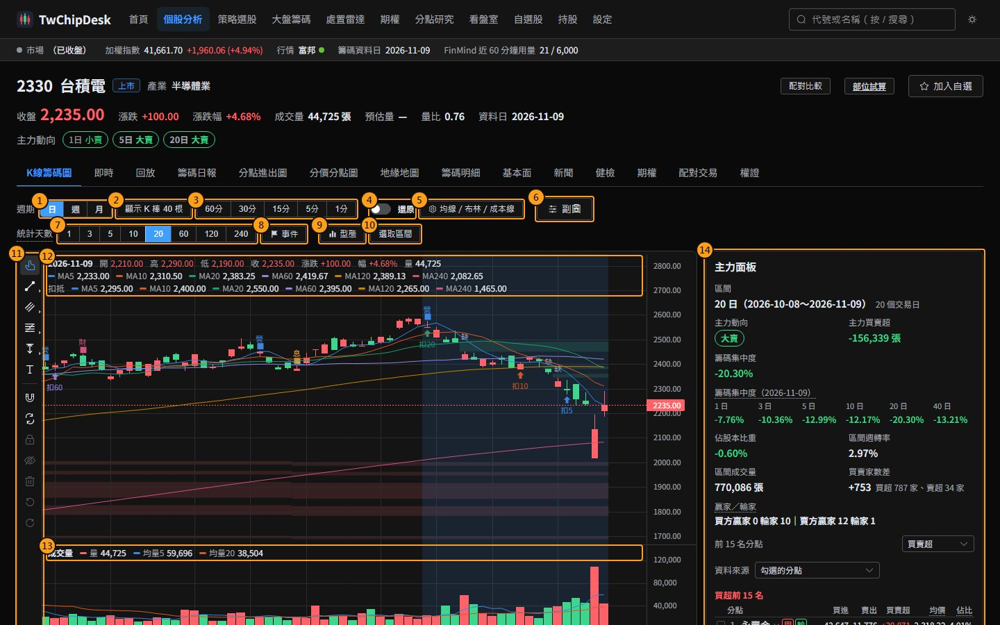

| 編號 | 名稱 | 說明 |
|---|---|---|
| 1 | 週期 | 「日」「週」「月」K。 |
| 2 | 顯示 K 棒 | 圖表一開始顯示最新幾根 K 棒，見「顯示 K 棒與重設視圖」。 |
| 3 | 分 K | 「60分」「30分」「15分」「5分」「1分」，見「分 K」。 |
| 4 | 還原 | 開啟後以還原權息後的價格顯示 K 線與指標。分 K 不適用。 |
| 5 | 均線／布林／成本線 | 打開「均線、布林通道與成本線」設定。 |
| 6 | 副圖 | 新增、移除、排序副圖，套用副圖組合，打開「指標參數」。 |
| 7 | 統計天數 | 1、3、5、10、20、60、120、240 日，決定主力面板與底色區間的天數。也可按數字鍵 1～8 切換。 |
| 8 | 事件 | 除息、除權、營收公布、財報、公告（重大訊息）、注意／處置標記與地板天花板圖層的開關。 |
| 9 | 型態 | 技術型態（K 線型態、缺口、島狀反轉、圖形型態、指標背離）的開關。只在日 K。 |
| 10 | 選取區間 | 按下後在主圖拖曳選起訖日，主力面板改算這段自訂區間。只在日 K。 |
| 11 | 繪圖工具列 | 趨勢線、水平線、通道、斐波那契、測量、文字等繪圖工具。 |
| 12 | 主圖浮動資訊列 | 十字線所在那一根的開高低收、漲跌、量、各均線與扣抵值；有事件或型態時列出名稱。 |
| 13 | 副圖 | 每個副圖左上角是名稱與十字線所在那一根的數值。 |
| 14 | 主力面板 | 統計期間的主力摘要與前 15 名分點，見「主力面板」。 |

## 操作步驟

### 看某一段期間的籌碼（統計視窗）
1. 在「統計天數」選天數，例如「20」。主圖與副圖會用底色標出最近 20 個交易日，主力面板改算這 20 天。
2. 點一根 K 棒，結束日鎖定在那一天（工具列出現「結束日 日期」），區間變成那天往前 20 個交易日。
3. 再點一次同一根 K 棒，看那一天的單日數字。
4. 要自訂起訖：按「選取區間」，在主圖拖曳選範圍（Esc 取消），工具列出現「自訂區間 起～迄」。
5. 按「回到最新」、標籤上的 ×，或按 Esc，回到最新一天。

統計天數與結束日會帶到「籌碼日報」「地緣地圖」與「分價分點圖」的多日模式。

### 鍵盤操作
- 左右方向鍵：移動十字線。
- Esc：回到最新一根（也會取消鎖定的結束日與自訂區間）。
- 數字鍵 1～8：切換統計天數。
- Alt + R：重設圖表視圖。

### 顯示 K 棒與重設視圖
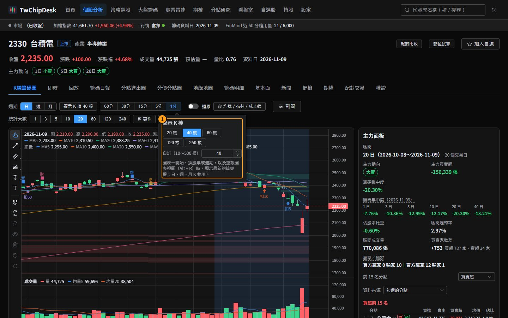

1. 點「顯示 K 棒 40 根」，選 20、40、60、120、250 根，或在「自訂（10～500 根）」輸入。
2. 圖表一開始、換股票或週期、以及重設圖表視圖時，都會顯示最新的這幾根。日、週、月 K 共用。
3. 縮放或拖曳後想回到原本的範圍：按圖表右下角的「重設圖表視圖」按鈕，或按 Alt + R。

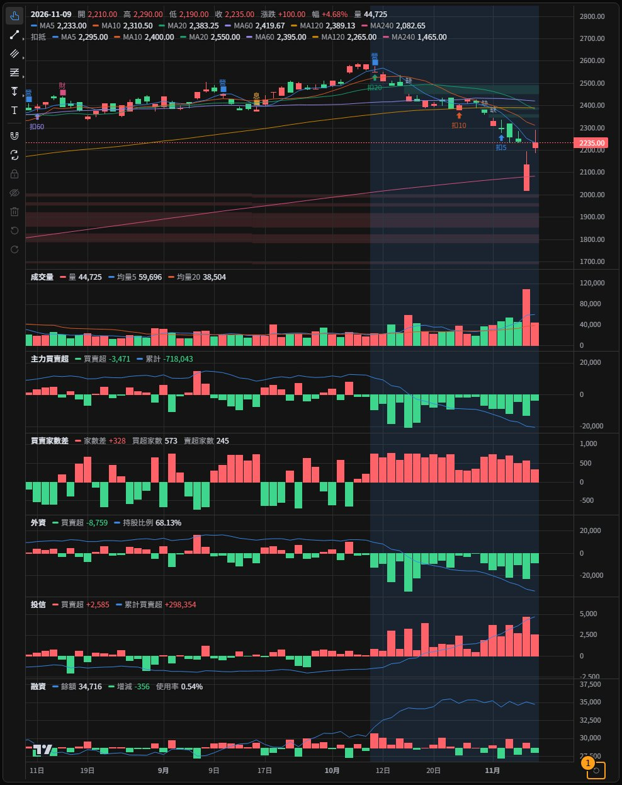

| 編號 | 名稱 | 說明 |
|---|---|---|
| 1 | 重設圖表視圖 | 回到顯示最新幾根 K 棒的範圍（Alt + R）。 |

往左拖曳接近最左邊時，會自動載入更早的 K 線（每次 250 根）。

### 均線、布林通道與成本線
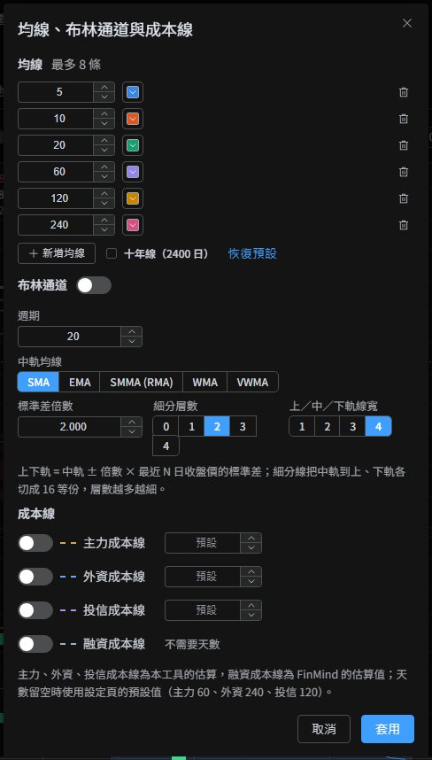

1. 點「均線／布林／成本線」。
2. **均線**：預設 5、10、20、60、120、240 日，最多 8 條；可改天數（2～2,400）、顏色，「新增均線」「十年線（2400 日）」快速加入，「恢復預設」回到預設。
3. **布林通道**：預設關閉。可設「週期」（預設 20）、「中軌均線」（SMA、EMA、SMMA (RMA)、WMA、VWMA）、「標準差倍數」（預設 2）、「細分層數」（0～4，0 為不顯示細分線）與「上／中／下軌線寬」。上下軌 = 中軌 ± 倍數 × 最近 N 日收盤價的標準差；細分線把中軌到上、下軌各切成 16 等份。
4. **成本線**：「主力成本線」「外資成本線」「投信成本線」「融資成本線」「籌碼平均成本線（估）」各自開關，以虛線疊在主圖。天數留空時用設定頁的預設值（主力 60、外資 240、投信 120）；融資成本線與籌碼平均成本線不需要天數。籌碼平均成本線是每天籌碼峰（見「籌碼峰（估）」）的平均成本，圖例名稱為「籌碼平均成本」。
5. 按「套用」生效。

主圖上的「扣5」「扣10」等箭頭是扣抵位置：均線下一根要扣掉的那根 K 線。浮動資訊列的「扣抵」列出各均線的扣抵價。

### 副圖：新增、排序與副圖組合
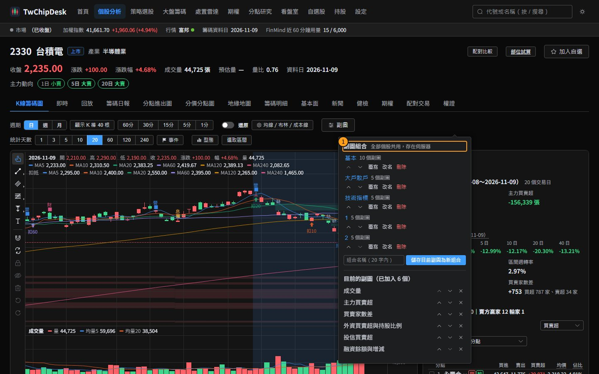

| 編號 | 名稱 | 說明 |
|---|---|---|
| 1 | 副圖組合 | 已儲存的副圖清單。點名稱即套用（以該組取代目前的副圖）；與目前完全相同的組合標「使用中」。 |

組合下方是「目前的副圖（已加入 N 個）」，再往下捲動是「新增副圖」清單、「恢復預設副圖」與「指標參數」按鈕。

1. 點「副圖」打開選單。
2. 「目前的副圖」列出已加入的副圖，可上移、下移、移除。
3. 「新增副圖」依群組列出可加入的副圖，點名稱加入。副圖數量不限（手機版只顯示前兩個）。
4. 「恢復預設副圖」回到預設：成交量、主力買賣超、買賣家數差、外資、投信、融資。
5. 副圖組合：按「儲存目前副圖為新組合」並輸入名稱（20 字內）即可保存，最多 10 組，可「覆寫」「改名」「刪除」與上下移動。組合存在伺服器，全部個股共用。

目前的副圖清單、均線、指標參數、週期等版面設定存在這個瀏覽器，換頁或重新整理後仍保留；換一台電腦或瀏覽器則是各自的設定（副圖組合除外）。

可加入的副圖：

| 群組 | 副圖 |
|---|---|
| 價量 | 成交量 |
| 技術 | KD、MACD、RSI、乖離率 |
| 主力 | 主力買賣超、買賣家數差、籌碼集中度（5 日、20 日、60 日）、散戶買賣超（估）、中實戶買賣超、籌碼峰獲利比例（估） |
| 分點 | 地緣分點買賣超、隔日沖分點買超占比、分點買賣超、權證投資人約當淨買（估）、權證買超前 5 分點合計（估）、權證隔日沖買超（估） |
| 法人 | 外資買賣超與持股比例、投信買賣超、自營商買賣超、三大法人合計、八大行庫買賣超 |
| 資券 | 融資餘額與增減、融券餘額與增減、券資比、「借券賣出餘額」、當沖比、融資維持率 |
| 大戶 | 大戶持股比例、散戶持股比例、總股東人數 |
| 基本 | 月營收與年增率 |
| 期權 | 期現價差、權證投資人淨買（估） |

- 選單裡標「尚未提供」的副圖（目前是「月營收與年增率」）目前不能加入。
- 「期現價差」只在這檔有股票期貨時可用，其他股票標「這檔股票不適用」。
- 「地緣分點買賣超」需要在設定頁啟用公司基本資料外掛，且公司有座標。
- 加入「大戶持股比例」或「散戶持股比例」時，工具列多出「大戶門檻」「散戶門檻」選擇（大戶預設 400 張，可選 400、600、800、1,000 張；散戶預設 100 張）。門檻與籌碼明細的大戶分頁共用。
- **特定分點副圖**：在主力面板點分點名稱 →「加入特定分點副圖」，畫出那個分點每天的買賣超與累計，最多 5 個。
- **分點買賣超副圖**：在主力面板勾選分點（最多 30 個），合計畫在「分點買賣超」副圖；副圖選單的「分開顯示（每個分點一條累計線）」改成每個分點各一條線。資料來源也可改用分點研究建立的「分點群組」。

### 技術指標參數與 KD、RSI 背景色
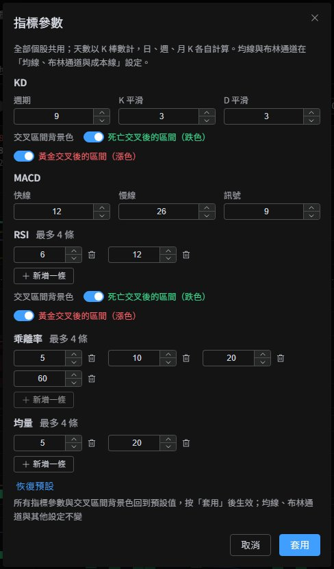

1. 點「副圖」→「指標參數」。
2. 可設定：
   - **KD**：「週期」預設 9、「K 平滑」3、「D 平滑」3（週期 2～400、平滑 1～50）。
   - **MACD**：「快線」12、「慢線」26、「訊號」9（慢線必須大於快線）。
   - **RSI**：預設 6、12 日，最多 4 條。
   - **乖離率**：預設 5、10、20、60 日，最多 4 條。
   - **均量**（成交量副圖上的均量線）：預設 5、20 日，最多 4 條，可以全部移除。
3. **交叉區間背景色**：KD 與 RSI 各有兩個開關，「死亡交叉後的區間（跌色）」與「黃金交叉後的區間（漲色）」，預設都開。RSI 需要兩條以上才會塗色（比較週期最短的兩條）。
4. 按「套用」生效；「恢復預設」把所有指標參數與背景色回到預設值。

參數全部個股共用；天數以 K 棒數計，日、週、月 K 各自計算。副圖名稱會帶上目前的參數，例如「KD(9,3,3)」。

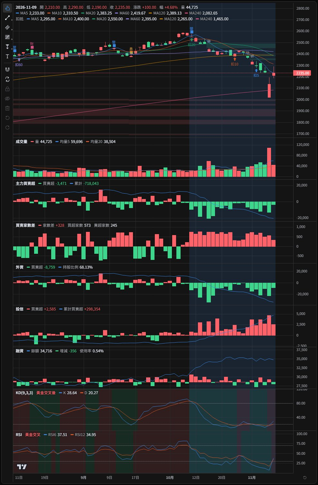

開啟背景色後，KD、RSI 副圖以淺色底標出黃金交叉後與死亡交叉後的區間；副圖名稱旁顯示十字線那一根的狀態（「黃金交叉」「黃金交叉後」「死亡交叉」「死亡交叉後」）。

### 事件標記、注意／處置與處置期間背景
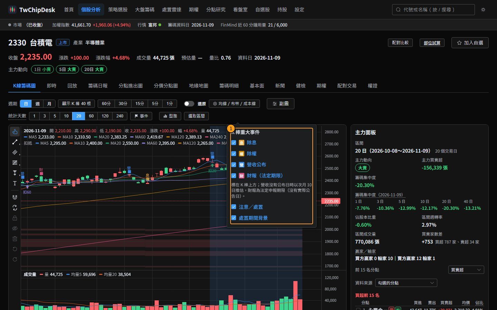

點「事件」可分別開關：
- 「除息」「除權」「營收公布」「財報（法定期限）」：在 K 棒上方標「息」「權」「營」「財」。營收沒有公布日時以次月 10 日推估；財報為法定申報期限，不是實際公告日。滑鼠移到該根 K 棒，浮動資訊列會列出事件內容。
- 「公告（重大訊息）」：在有公告的 K 棒上方標灰色小圓點「公」，同一根不論幾則都只有一個標記；日 K 標在發言日那一根（週末、假日的公告標在之後第一根），週 K、月 K 把同一週、同一月的公告加總。滑鼠移到該根 K 棒，浮動資訊列在事件說明之後（以「；」相接）列出「公告 N 則：［類別］主旨（MM-DD HH:mm）…」，最多 3 則、每則主旨最多 40 字，其餘以「另有 N 則」表示；主旨是公司公告原文。官方每天提供前一天的公告，公告自官方開放資料事件來源開啟那天起累積，沒有更早的標記。預設開啟；完整內容見[個股分析｜公告](material.md)。
- 「注意／處置」：在 K 線下方標出注意日（官方公告為實心藍點、本系統重算的為灰點），處置期間的第一天與最後一天標「處」「迄」。
- 「處置期間背景」：處置期間（含最近三年已結束的處置）的 K 棒以淺紅色背景標示，處置中的畫到最新一根。與「注意／處置」各自開關。

- 「地板天花板」：在主圖加上天花板線（橘）、20 日均線（灰色虛線）、地板線（藍），歷史地板訊號在 K 棒下方標藍色小三角形「地」、天花板訊號在 K 棒上方標橘色小三角形「天」。天花板線、地板線是以這檔股票之前 5 年的乖離分布推算的估計（圖例旁標「估」），數值基準與畫面上的 K 線相同（開啟「還原」時為還原價）。預設關閉。說明見[反轉價位](../reversal/README.md)。

注意／處置、處置期間背景與地板天花板只在日 K 顯示；事件標記與公告標記在日、週、月 K 都顯示，分 K 不顯示。

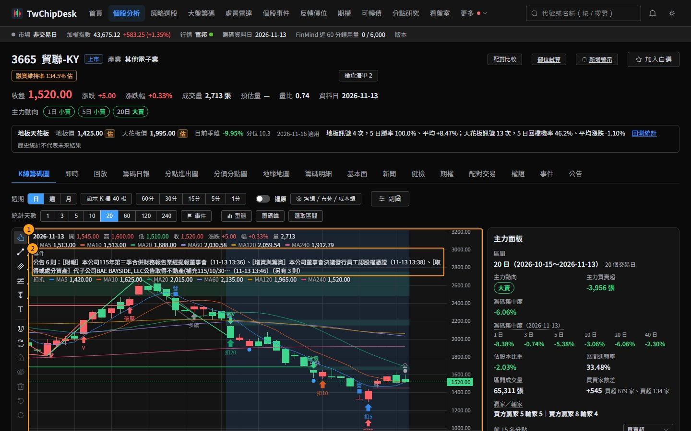

| 編號 | 名稱 | 說明 |
|---|---|---|
| 1 | 「公」標記 | 有公告的 K 棒上方的灰色小圓點。 |
| 2 | 浮動資訊列 | 「事件」那一行接著列出這一根的公告則數、類別、主旨與發言時間。 |

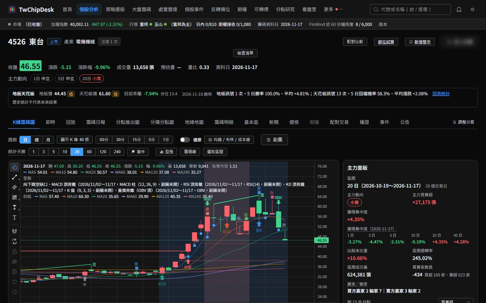

### 技術型態
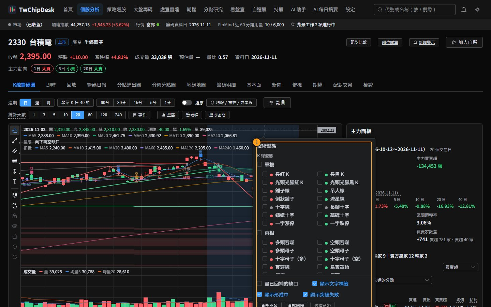

1. 點「型態」，依「K 線型態」（單根、兩根、三根以上）、「缺口與島狀」（缺口、島狀反轉）與「圖形型態與指標背離」（圖形型態、指標背離）分組勾選要顯示的型態，型態旁的色點代表多方、空方或變盤。
2. 預設只開啟一部分型態（截圖中單根、兩根 K 線型態都未勾選；圖形型態只有「擴張三角形」未勾選，指標背離全開）。「畫已回補的缺口」（預設關）「顯示文字標籤」「顯示形成中」「顯示突破失敗」（這三項預設開）控制圖上的呈現；「全部開啟」「全部關閉」「恢復預設」一次切換。
3. K 線型態標在 K 棒上，缺口與島狀以區塊畫在主圖；十字線所在那一根的型態列在浮動資訊列。

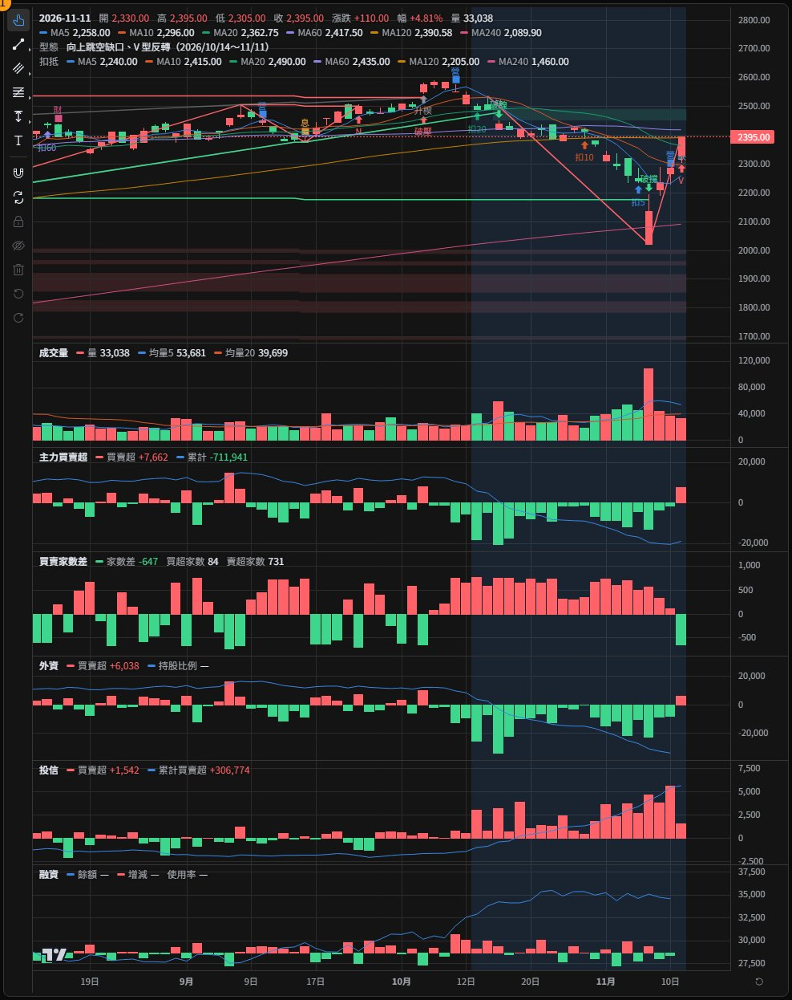

圖形型態與指標背離畫成線：
- **圖形型態**（三角收斂、上升三角形、楔形、矩形整理、通道、旗形、雙重底與雙重頂、三重底與三重頂、頭肩底與頭肩頂、圓弧底與圓弧頂、杯柄，以及 V 型反轉、N 字型、趨勢線、壓力與支撐）：虛線為形成中（到資料日收盤仍在型態內），實線為已向上突破或向下跌破，突破那一根有箭頭與短標籤；灰色為突破後 20 根內收盤回到型態內（突破失敗）。多方型態用漲色、空方型態用跌色、變盤型態用灰色；三角收斂、矩形整理、通道等方向看突破的型態，突破後依突破方向上色。「顯示形成中」關閉時不畫虛線；「顯示突破失敗」關閉時，突破失敗的型態（包括它的突破）都不畫。
- **指標背離**（MACD、RSI、KD、OBV 的底背離與頂背離）：主圖連兩個轉折點的價格；「KD」「MACD」「RSI」副圖開著時，副圖也畫兩個轉折點那兩天的指標值連線。背離固定以 MACD 柱（12、26、9）、RSI(14)、K 值（9、3、3）與 OBV 計算，與「指標參數」的設定無關；OBV 沒有副圖，只畫主圖。
- 浮動資訊列：型態全名，加上狀態（「形成中」「向上突破」「向下跌破」「突破失敗」）、形成區間、突破當天的 5 日量比（例如「量比 1.82」）；背離另列所用的指標，對應的副圖沒開時註明「副圖未開」。

型態以還原日 K 判斷，只在日 K 顯示；盤中不含當天這一根。

### 籌碼峰（估）
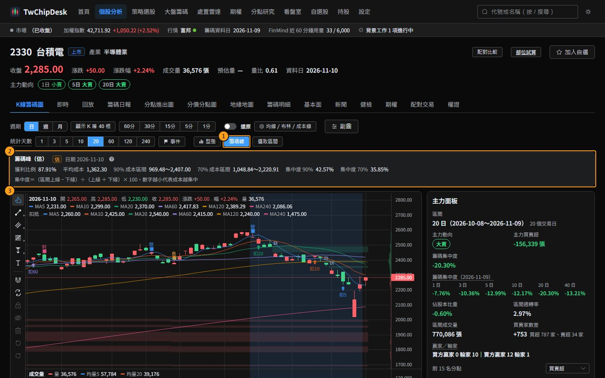

| 編號 | 名稱 | 說明 |
|---|---|---|
| 1 | 籌碼峰 | 工具列的開關，開啟後主圖右側畫出籌碼峰，圖表上方出現摘要框。開關存在版面設定，全部個股共用。 |
| 2 | 摘要 | 顯示那一天的「獲利比例」「平均成本」「90% 成本區間」「70% 成本區間」「集中度 90%」「集中度 70%」，全部標「估」。問號圖示說明推算方式。 |
| 3 | 籌碼峰長條 | 主圖右側的水平長條，每一條是一個價位區間的籌碼占比，與主圖的價格軸對齊。不高於當天收盤的部分用漲色、其餘用跌色，虛線為平均成本。 |

籌碼峰是**依每日換手推算的成本分布模型，不是實際持股**：把過去 500 根日 K 的成交，依每天的換手率逐日疊加、舊的部分逐日衰減，估出目前各價位的成本占比。

1. 點工具列的「籌碼峰」開啟（再點一次關閉）。
2. 預設顯示最新一天。滑鼠移到某根 K 棒（或用左右方向鍵移動十字線）時改顯示那一天。
3. 點一下 K 棒固定那一天（摘要框標「已固定」），再點一次同一根、或按摘要框的「取消固定」回到跟著十字線。點 K 棒同時也會照原本的規則鎖定統計結束日。
4. 「原始」「還原」兩種價格都會與 K 線對齊。

- 週、月 K 只顯示最新一天（摘要框標「週、月 K 只顯示最新一天」）；分 K 不顯示。
- 摘要框下方的附註：「上市以來的日 K 不足回看天數，從第一根日 K 起算」「部分日子沒有流通股數，這些日子不計換手」「沒有流通股數，無法推算籌碼分布」「流通股數取自股票主檔」「沒有日 K 資料」。
- 另有「籌碼峰獲利比例（估）」副圖（每天的獲利比例）與「籌碼平均成本線（估）」成本線，見上面的副圖清單與成本線。

### 繪圖工具
左側的繪圖工具列：
- **游標**：一般瀏覽。
- **線**：「趨勢線」「射線」「延長線」「水平線」「水平射線」「垂直線」。
- **通道與形狀**：「平行通道」「矩形」。
- **斐波那契**：「斐波那契回撤」「斐波那契延伸」。
- **測量**：「價格區間」（顯示價差、漲跌幅與根數）、「日期區間」（顯示根數、天數與價差）。
- **文字**。
- 其他按鈕：「吸附 K 棒高低點」「連續繪製」「鎖定全部」「隱藏全部」「刪除全部」「復原（Ctrl + Z）」「重做（Ctrl + Y）」。

操作方式：
1. 選一個工具，依提示在主圖上點需要的點（兩點的工具也可以按住拖曳），Esc 取消。
2. 點選畫好的圖形可以拖曳；按右鍵開啟選單，可「刪除」「鎖定」「隱藏」「複製」或改「樣式」（顏色、線寬、線型、填色透明度、文字內容、字級、斐波那契的水準）。
3. 「刪除全部」會先確認，刪除後仍可按「復原」還原。

繪圖存在伺服器，同一檔股票的日、週、月 K 共用，一張圖最多 300 個繪圖。繪圖價格不隨「還原」換算，切換還原時繪圖留在原價位。「選取區間」進行中時繪圖工具暫停。

### 分 K
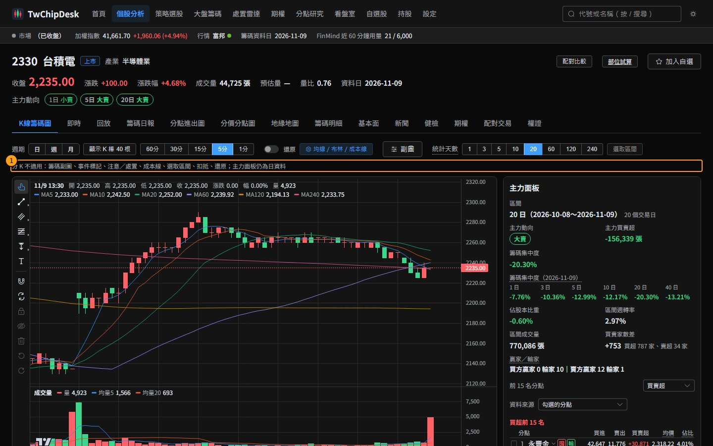

| 編號 | 名稱 | 說明 |
|---|---|---|
| 1 | 分 K 說明 | 列出分 K 不適用的功能。 |

1. 點工具列的「60分」「30分」「15分」「5分」或「1分」。
2. 往左拖曳會載入更早的分 K，最多往前 60 個交易日；第一次看的日子會向 FinMind 下載，需要幾秒。
3. 盤中每 15 秒更新最後幾根。
4. 點「日」「週」「月」回到日資料。

分 K 不適用：籌碼副圖（標「分 K 不適用」）、事件標記（含公告標記）、注意／處置、成本線、選取區間、扣抵、還原（一律原始價格）；主力面板仍為日資料。有跨過、還沒補上的交易日時，畫面下方會列出日期，圖上前後兩天直接相接，可按「補上這幾天」。FinMind 額度不足時會顯示預計恢復時間。

### 主力面板
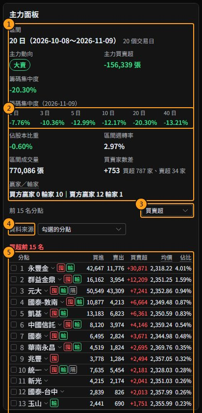

| 編號 | 名稱 | 說明 |
|---|---|---|
| 1 | 摘要 | 「區間」「主力動向」「主力買賣超」「籌碼集中度」等統計期間的數字。 |
| 2 | 集中度列 | 「籌碼集中度（結束日）」：結束日的 1、3、5、10、20、40 日集中度。分點資料不足天數時加「*」。 |
| 3 | 排序 | 「買賣超」（買超、賣超前 15 名兩張表同時顯示）、「買賣合計」「贏家」「輸家」。 |
| 4 | 資料來源 | 分點買賣超副圖用「勾選的分點」或已儲存的分點群組。 |
| 5 | 買超清單 | 前 15 名分點：買入與售出張數、「買賣超」「均價」「佔比」與標籤。 |

- 每列左側的勾選框：把分點加入「分點買賣超」副圖（第一次勾選時會自動加入副圖）。
- 點分點名稱：「加入特定分點副圖」「開啟分點進出圖」「加入自選分點組合」「前往分點頁」。
- 分點名稱旁的標籤：「囤」「出」「作」「地」「贏」「輸」「隔」，滑鼠移上去顯示定義與名次。
- 第一次查看某檔股票時，系統會向 FinMind 補齊最近交易日的分點資料，面板顯示「正在補齊分點資料（N／M 個交易日）」，完成後自動更新。

### 右鍵開啟分價分點圖
在日 K 主圖對一根 K 棒按右鍵，選「分價分點圖（日期）」，直接開啟那一天的[分價分點圖](bubble.md)。

## 欄位與名詞
- **籌碼集中度**：區間主力買賣超 ÷ 區間成交量 × 100%；主力為區間買超前 15 名減賣超前 15 名。
- **佔股本比重**：區間主力買賣超佔發行股數的比例。
- **區間週轉率**：區間成交量 ÷ 發行股數。
- **買賣家數差**：買超分點數 − 賣超分點數。
- **贏家／輸家**：買方、賣方前 15 名中帶「贏」「輸」標籤的家數（損益依近一段交易日計算，估）。
- **佔比**：該分點買賣超張數（不分方向）佔區間成交量的比例。
- **均價**：買超清單為買入均價、賣超清單為售出均價，以分點實際成交價加權。
- **主力成本線**：視窗內買超前 15 名分點的買入金額合計 ÷ 買入股數合計。外資、投信成本線為視窗內買超日的成交均價以買超量加權平均。這三條是本工具的估算；融資成本線為 FinMind 的估算值。
- **籌碼峰（估）**：依每日換手推算的成本分布模型，不是實際持股。每個有成交的日子，換手率＝成交股數 ÷ 流通股數（最多 100%），舊的分布乘上（1 − 換手率），再把換手率這部分依當天最低到最高價、峰值在當天均價的三角形分布加進去。回看 500 根日 K，價位分 200 格。
- **獲利比例（估）**：成本不高於當天收盤的籌碼占比。
- **平均成本（估）**：各價位依占比加權的平均價位。
- **90%／70% 成本區間（估）**：把籌碼依價位由低到高排列，去掉最低與最高各 5%（70% 區間為各 15%）後的價位範圍。
- **集中度 90%／70%（估）**：（區間上緣 − 下緣）÷（上緣 ＋ 下緣）× 100；數字越小代表成本越集中。
- **盤中 K 棒**：盤中在日 K 最後接上今天的 K 棒，量為整股累計（不含零股、鉅額、盤後定價），浮動資訊列標「盤中」；均線與指標以盤中價量即時計算，收盤後以官方日 K 為準。
- **散戶買賣超（估）**、**權證** 相關副圖為估計值，名稱帶「（估）」。

## 資料來源與更新時間
- 日 K、成交量：FinMind，交易日 17:35；13:40 寫入收盤快照的暫定日 K。
- 分點（主力、家數差、集中度、分點副圖）：交易日 18:10 起，個股三大法人 20:05 到齊後計算當日主力資料。
- 八大行庫 18:35；三大法人、外資持股 20:05；融資融券、借券 21:05；當沖 21:35；融資維持率 22:35；股權分散每週六、日 10:00。
- 除權息、財報、處置等事件：交易日 19:00；月營收每天 18:30 與 22:00。
- 分 K：FinMind，依需要下載。
- 籌碼峰：以日 K、成交金額與流通股數（外資持股表的已發行股數，沒有時用股票主檔）推算，開啟時即時計算；「籌碼峰獲利比例（估）」副圖與「籌碼平均成本線（估）」每晚日 K 入庫後重算最近 10 個交易日。

## 注意事項與限制
- 手機版只顯示主圖與前兩個副圖，主力面板移到圖表下方。
- 分點資料只回補一段期間（約 60 個交易日起），120、240 日區間不足時會說明實際的交易日數。
- 盤中那一根沒有籌碼資料。
- 型態、事件、注意／處置、選取區間只在日 K 使用。
- 籌碼峰在週、月 K 只顯示最新一天，分 K 不顯示；所有籌碼峰數字都是模型推算的估計值。

## 常見問題
- **副圖不見了？** 版面存在瀏覽器，換瀏覽器或清除網站資料後會回到預設副圖；可以先把常用組合存成「副圖組合」。
- **主力面板一直顯示補齊中？** 第一次查看的股票要向 FinMind 補分點資料，額度不足時會較慢，完成後會自動更新。

## 相關功能
- [籌碼日報](report.md)、[分點進出圖](broker.md)、[分價分點圖](bubble.md)
- [處置雷達](../disposition/README.md)
- [分點研究](../brokers/README.md)
