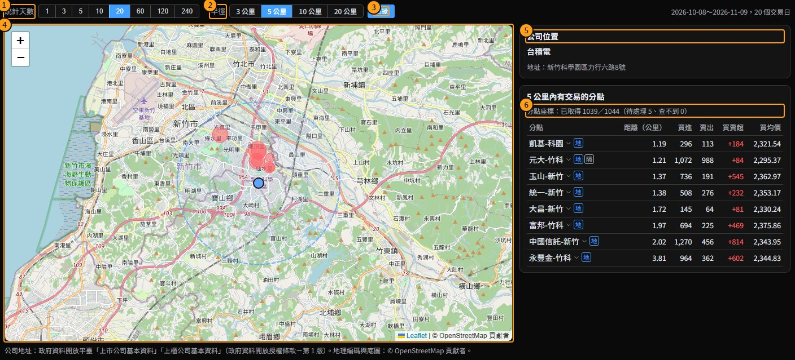

<!-- routes: /stock/:stockId/map -->
# 個股分析｜地緣地圖

> 位置：個股頁「地緣地圖」分頁（網址 `/stock/2330/map`）
> 資料更新：分點資料交易日 18:10 起；公司地址於每週日 08:00 更新（需啟用公司基本資料外掛），地址轉座標每秒處理一筆、結果永久保存

## 這個功能可以做什麼
在地圖上標出公司位置，以及統計期間內在公司附近有交易的分點：買超用漲色、賣超用跌色，圓點大小依張數。用來觀察公司所在地附近的「地緣分點」是否有明顯買賣。

## 畫面說明

| 編號 | 名稱 | 說明 |
|---|---|---|
| 1 | 統計天數 | 1～240 日，與 K線籌碼圖的統計視窗共用（也沿用 K 線鎖定的結束日）。右側顯示實際區間。 |
| 2 | 半徑 | 3、5、10、20 公里，地圖上畫出同心圓。 |
| 3 | 地緣 | 快速切到「地」標籤的距離門檻（預設 5 公里）。 |
| 4 | 地圖 | 藍色標記為公司位置，圓點為有交易的分點。滑鼠移到圓點上顯示分點、距離與買賣超張數；可縮放、拖曳。 |
| 5 | 公司位置 | 公司名稱與地址。 |
| 6 | 分點清單 | 半徑內有交易的分點：「距離（公里）」、買入與售出張數、「買賣超」「買均價」「標籤」等；上方列出分點座標的取得進度。 |

## 操作步驟
1. 選「統計天數」與「半徑」。
2. 點清單的一列，地圖移到該分點；點分點名稱的選單可加入特定分點副圖等。
3. 公司沒有座標時，畫面下方提供「手動輸入座標」：在地圖上點一下帶入，或直接輸入緯度、經度後按「儲存座標」。
4. 有交易但沒有座標的分點會列在清單下方（「有交易但沒有座標的分點（N 家）」），可按「輸入座標」逐一補上。

## 欄位與名詞
- **距離**：公司與分點地址座標的直線距離（公里）。
- **地緣**：與公司距離在門檻內的分點，對應主力面板的「地」標籤。

## 注意事項與限制
- 需要在設定頁的「補充來源」啟用「公司基本資料」外掛。未啟用時，這個分頁顯示啟用步驟與「前往設定」。外掛關閉時不對外連線，其他功能照常。
- 公司地址剛開始轉換時顯示「公司地址正在轉換成座標」，完成後即可顯示。
- 公司地址來自政府資料開放平臺的上市、上櫃公司基本資料；底圖與地理編碼為 OpenStreetMap。

## 相關功能
- [K線籌碼圖](kline.md)（地緣分點買賣超副圖）
- [設定](../settings.md)
