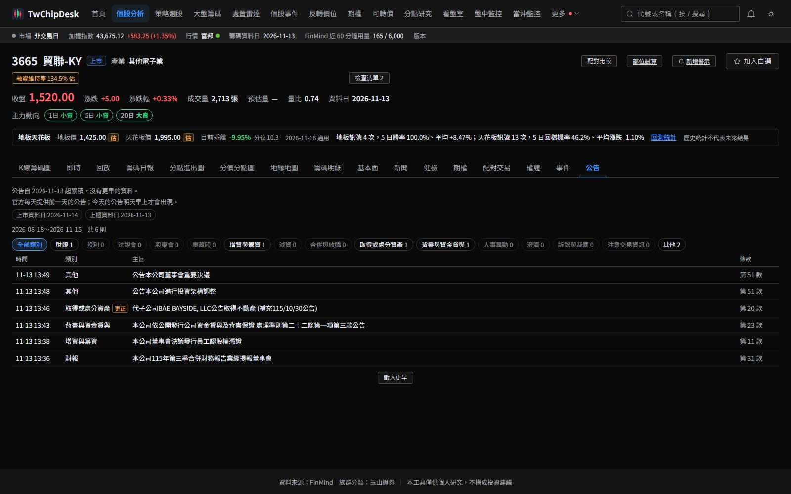

<!-- routes: /stock/:stockId/material -->
# 個股分析｜公告

> 位置：個股頁分頁列的「公告」，接在「事件」之後（網址 `/stock/2330/material`；類別可帶 `?cat=dividend`）
> 資料更新：官方開放資料事件來源開啟時，每天（含假日）08:00、16:00、22:00 抓取；官方每天提供的是前一天整天的公告

## 這個功能可以做什麼
列出這一檔股票最近的重大訊息（公司公告），點一則看說明原文。內容與[個股事件｜重大訊息](../events/material.md)相同，只是固定為這一檔。換股票時清單跟著換。

## 畫面說明

- 最上方是狀態說明：「公告自 YYYY-MM-DD 起累積，沒有更早的資料。」、「官方每天提供前一天的公告；今天的公告明天早上才會出現。」與上市、上櫃各自的資料日；所選期間內有沒抓到資料的日子時另外列出。
- 期間與則數，例如「2026-08-18～2026-11-15」「共 12 則」。
- 類別籤：15 個類別各帶筆數，可複選，筆數 0 的變淡；「全部類別」清除選擇。類別的判斷見[重大訊息｜類別](../events/material.md#類別)。
- 清單：「時間」「類別」「主旨」「條款」，主旨含「更正」或「補充」時加「更正」標記。沒有股票欄。
- 點一列打開詳細（主旨全文、發言時間、事實發生日、條款、類別、市場、說明原文），說明同[重大訊息｜詳細](../events/material.md#詳細)。

## 操作步驟
1. 開啟分頁，預設列出最近 90 天的公告。
2. 捲到最下方按「載入更早」，每次再往前 90 天，最多 400 天；到上限時顯示「已載入最近 400 天」。
3. 點類別籤只看某幾類；點一列看說明，按返回鍵回到清單。

## 注意事項與限制
- 這段期間沒有公告時顯示「這段期間沒有公告。」，上方的累積起點說明照常顯示。
- 公告從開啟「官方開放資料事件來源」那天起累積，沒有更早的資料；主機沒開機的日子抓不到。
- 公告是公司原文，本頁不判讀內容。

## 相關功能
- [個股事件｜重大訊息](../events/material.md)：全市場的公告
- [事件](events.md)：這檔過去與未來的事件與歷史統計
- [新聞](news.md)
