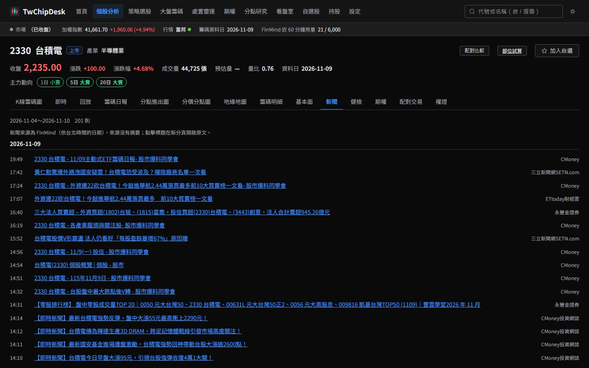

<!-- routes: /stock/:stockId/news -->
# 個股分析｜新聞

> 位置：個股頁「新聞」分頁（網址 `/stock/2330/news`）
> 資料更新：開啟時向 FinMind 查詢，每天的新聞查一次後快取

## 這個功能可以做什麼
依日期列出這檔股票最近的新聞標題、時間與來源，點標題在新分頁開啟原文。

## 畫面說明

- 最上方為目前顯示的日期範圍與則數，例如「2026-11-04～2026-11-10　201 則」。
- 新聞依日期分組，由新到舊；每一列是時間、標題與來源。
- 標題是連結，點了在新分頁開啟原文。

## 操作步驟
1. 開啟分頁，預設載入最近 7 天。
2. 捲到最下方按「載入更早 7 天」看更早的新聞，最多 4 週；到上限時顯示「已顯示最近 28 天」。

## 注意事項與限制
- 新聞來源為 FinMind，日期依台北時間；來源沒有摘要，只有標題。
- 這段期間沒有新聞時顯示「這段期間沒有新聞」。

## 相關功能
- [基本面](fundamental.md)
