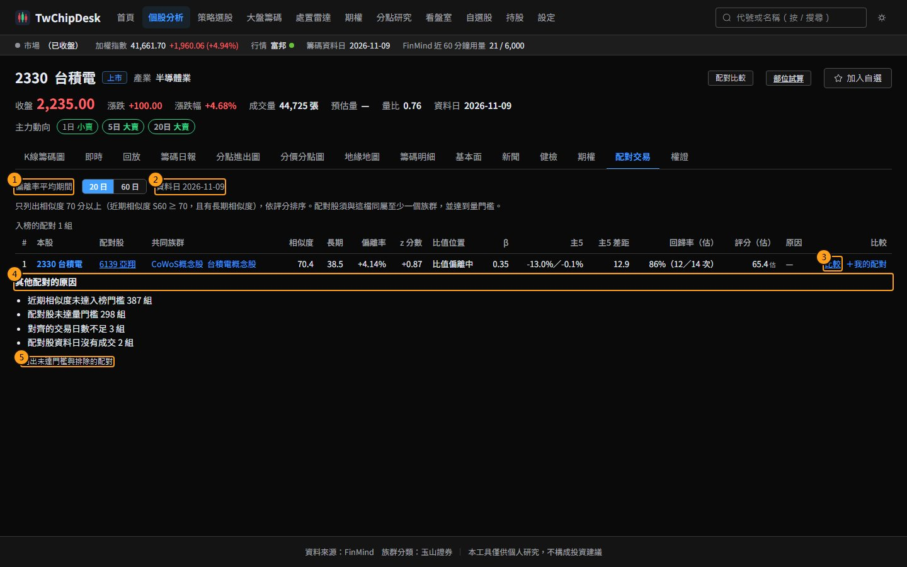

<!-- routes: /stock/:stockId/pairs -->
# 個股分析｜配對交易

> 位置：個股頁「配對交易」分頁（網址 `/stock/2330/pairs`，可加 `?n=20&date=2026-11-09`）
> 資料更新：開啟時以資料日的正式日 K 即時計算（第一次查看約 1 秒，之後一小時內直接顯示）；正式日 K 交易日 17:35 後入庫

## 這個功能可以做什麼
以這檔股票為準（A），找出同族群、近期走勢相似度 70 分以上的配對股（B），列出兩檔價格比值相對平均的偏離、z 分數、β、主5 集中度、回歸率與評分。篩選與評分方式與「處置雷達｜處置配對」相同，只是不限處置股。只描述數值與比值位置。

## 畫面說明

| 編號 | 名稱 | 說明 |
|---|---|---|
| 1 | 偏離率平均期間 | 「20 日」或「60 日」：偏離率、z 分數用的平均期間 N。 |
| 2 | 資料日 | 計算所用的交易日。 |
| 3 | 比較 | 開啟配對比較頁（A = 本股、B = 配對股），看兩檔比值的走勢。旁邊的「＋我的配對」可把這組加入自訂配對，之後每晚與處置配對一起計算。 |
| 4 | 其他配對的原因 | 沒有入榜的配對依原因分類計數，例如「近期相似度未達入榜門檻」「配對股未達量門檻」。 |
| 5 | 列出未達門檻與排除的配對 | 展開列出未入榜的配對與各自原因。 |

表格欄位：「本股」「配對股」「共同族群」「相似度」「長期」「偏離率」「z 分數」「比值位置」「β」「主5」「主5 差距」「回歸率（估）」「評分（估）」「原因」。

## 欄位與名詞
- **相似度**：最近一段交易日、除權息調整後日報酬的相關係數 × 100（近期 S60）。**長期**：較長期間的相似度；新上市不滿一年時沒有值，不能入榜。
- **偏離率**：兩檔還原價的比值（本股 ÷ 配對股）相對最近 N 個交易日平均比值的百分比。
- **z 分數**：比值取對數後，相對最近 N 個交易日平均的標準差倍數。
- **比值位置**：「比值偏高（A 相對 B 偏強）」「比值偏低（A 相對 B 偏弱）」「比值接近平均」「比值偏離中」。
- **β**：本股對配對股日報酬的迴歸斜率。
- **主5**：兩檔的 5 日籌碼集中度（%）；只有分點資料涵蓋的股票才有值。**主5 差距**：兩者差距（百分點）。
- **回歸率（估）**：過去一段期間 |z| 第一次達門檻的事件中，在一定交易日內回到平均附近或正負號反轉的比例，括號內為次數。
- **評分（估）**：近期一致、長期一致與回歸率的加權平均，滑鼠移到數值上看算式。

## 注意事項與限制
- 只開放普通股：ETF、TDR、權證、特別股等不計算配對，畫面會說明。
- 配對股須與這檔同屬至少一個族群，並達到量門檻。
- 資料日的日 K 尚未入庫時（例如收盤後到 17:35 之間）配對還不能計算，畫面會說明，日 K 更新後再查看。
- 頁首的「配對比較」按鈕可以自選任何一檔普通股比較，不受這裡的門檻限制。

## 相關功能
- [處置雷達｜處置配對](../disposition/README.md)
- [個股分析總覽｜配對比較](README.md)
