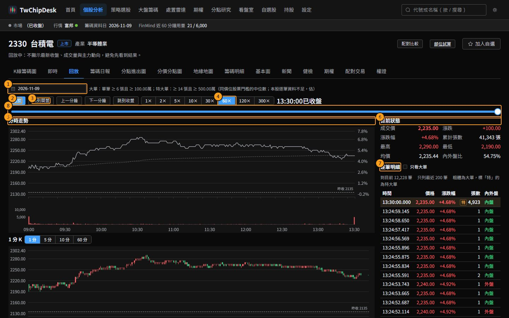

<!-- routes: /stock/:stockId/replay -->
# 個股分析｜回放

> 位置：個股頁「回放」分頁（網址 `/stock/2330/replay?date=2026-11-09`）
> 資料更新：使用 FinMind 的逐筆成交與 1 分 K；第一次看某一天時向 FinMind 下載，之後直接讀取

## 這個功能可以做什麼
把過去某個交易日從開盤重新播放一次：分時走勢、分 K 與逐筆成交隨時間逐步出現，畫面只顯示目前回放時間以前的數字，不會先看到結果。適合練習盤感或回頭檢視某天盤中的變化。回放只在畫面上重算，不會送出任何委託。

## 畫面說明

| 編號 | 名稱 | 說明 |
|---|---|---|
| 1 | 回放日期 | 選要回放的交易日。旁邊列出當天採用的大單、特大單門檻（估）。 |
| 2 | 播放／暫停 | 開始或暫停播放（空白鍵）。 |
| 3 | 跳轉按鈕 | 「回到開盤」「上一分鐘」（←）「下一分鐘」（→）「跳到收盤」。 |
| 4 | 播放速度 | 1×、2×、5×、10×、30×、60×、120×、300×，預設 60×。 |
| 5 | 分時走勢 | 到目前時間為止的成交價、均價與成交量。 |
| 6 | 目前狀態 | 「成交價」「漲跌」「漲跌幅」「累計張數」「最高」「最低」「均價」「內外盤比」。 |
| 7 | 逐筆明細 | 到目前時間為止的逐筆成交，可勾「只看大單」；粗體為大單、標「特」為特大單，只列最近 200 筆。 |
| 8 | 時間軸 | 拖曳到任一時間點；右側顯示回放時間，收盤後顯示「已收盤」。 |

分時走勢下方是分 K 圖，可切換「1分」「5分」「10分」「60分」。

## 操作步驟
1. 選「回放日期」。第一次看這一天會顯示「第一次看這一天要向 FinMind 下載逐筆成交與 1 分 K，請稍候…」。
2. 按「播放」，或按空白鍵。
3. 用速度按鈕調整快慢；用時間軸或「上一分鐘」「下一分鐘」逐分鐘檢視。
4. 想直接看結果時按「跳到收盤」；「回到開盤」重新開始。
5. 換股票、換日期或離開分頁時會自動停止播放。

全部快捷鍵見[快捷鍵](../shortcuts.md)。

## 注意事項與限制
- 在「回放」分頁時，頁首不顯示最新收盤、成交量與主力動向，避免先看到結果。
- 當天停牌、沒有成交或資料來源沒有這一天時，顯示「這天沒有逐筆成交資料」，請改選其他交易日。
- 大單、特大單依當天適用的門檻判斷（估），規則與「即時」分頁相同。

## 相關功能
- [即時](intraday.md)
- [K線籌碼圖](kline.md)
