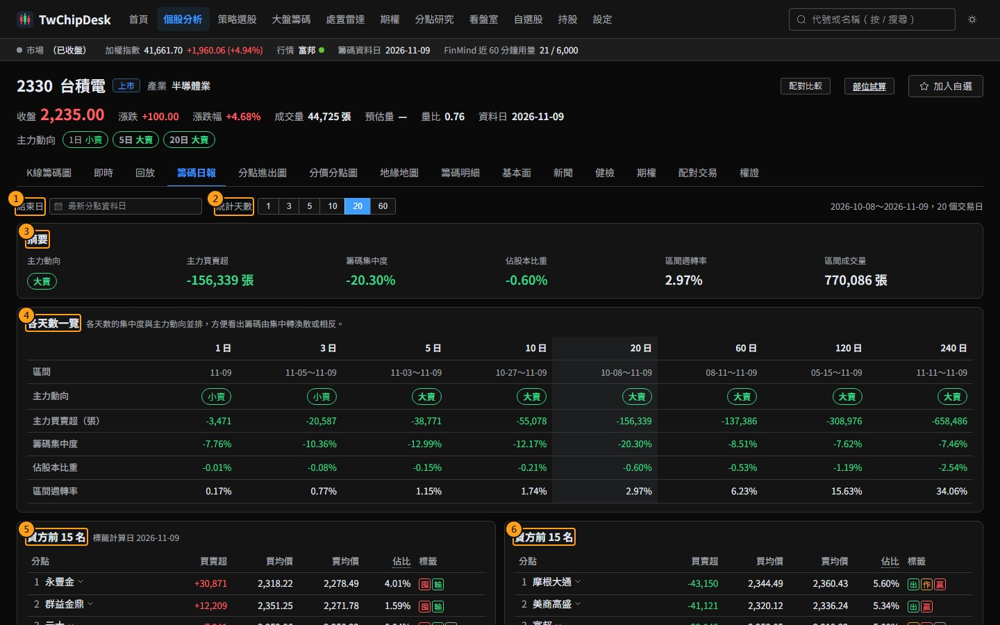
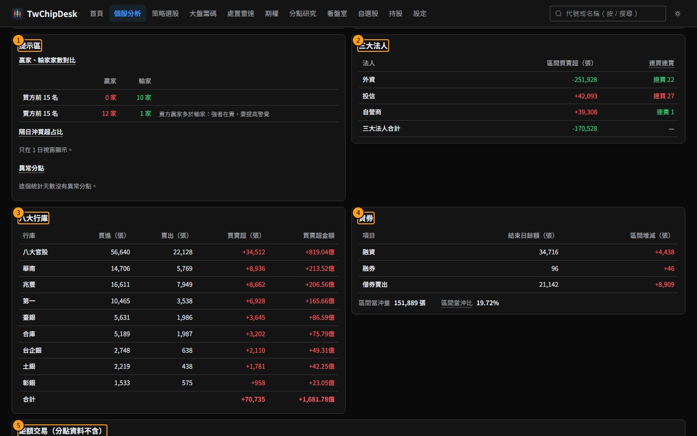

<!-- routes: /stock/:stockId/report -->
# 個股分析｜籌碼日報

> 位置：個股頁「籌碼日報」分頁（網址 `/stock/2330/report`）
> 資料更新：分點資料交易日 18:10 起，個股三大法人 20:05 到齊後計算當日主力；八大行庫 18:35；融資融券與借券 21:05；當沖 21:35；鉅額交易 20:50、鉅額分點 21:40；分點標籤每晚計算

## 這個功能可以做什麼
把一檔股票在某個結束日、某段天數內的籌碼狀況整理成一頁：主力摘要、各天數並排比較、買賣方前 15 名分點與標籤、提示區（贏家輸家、隔日沖、異常分點）、三大法人、八大行庫、資券與鉅額交易。適合每天收盤後快速看一遍。

## 畫面說明

| 編號 | 名稱 | 說明 |
|---|---|---|
| 1 | 結束日 | 留空為「最新分點資料日」；可選過去的日子。 |
| 2 | 統計天數 | 1、3、5、10、20、60 日。右側列出實際區間與交易日數。 |
| 3 | 摘要 | 「主力動向」「主力買賣超」「籌碼集中度」「佔股本比重」「區間週轉率」「區間成交量」。 |
| 4 | 各天數一覽 | 1～240 日的區間、主力動向、主力買賣超（張）、籌碼集中度、佔股本比重、區間週轉率並排，目前的天數以底色標示，方便看出籌碼由集中轉渙散或相反。 |
| 5 | 買方前 15 名 | 區間買超前 15 名分點：「買賣超」「買均價」「賣均價」「佔比」「標籤」。標題旁為標籤計算日。 |
| 6 | 賣方前 15 名 | 區間賣超前 15 名分點，欄位相同。 |

| 編號 | 名稱 | 說明 |
|---|---|---|
| 1 | 提示區 | 「贏家、輸家家數對比」「隔日沖買超占比」「異常分點」，見下方說明。 |
| 2 | 三大法人 | 外資、投信、自營商與合計的「區間買賣超（張）」與結束日的「連買連賣」天數。 |
| 3 | 八大行庫 | 各行庫的買入、售出、買賣超（張）與買賣超金額，以及合計。 |
| 4 | 資券 | 融資、融券、「借券賣出」的「結束日餘額（張）」與「區間增減（張）」，下方為「區間當沖量」與「區間當沖比」。 |
| 5 | 鉅額交易（分點資料不含） | 區間內的鉅額交易天數、張數、金額、佔成交量，以及鉅額買方、賣方分點前 10 名。 |

## 操作步驟
1. 開啟分頁後預設沿用 K線籌碼圖的統計視窗：在 K 線點選的結束日、選的天數會帶過來。
2. 要看別的日子：在「結束日」選日期；按「回到最新」回到最新分點資料日。
3. 切換「統計天數」看不同長度的區間。
4. 點分點名稱旁的箭頭開啟選單，可「加入特定分點副圖」「開啟分點進出圖」「加入自選分點組合」「前往分點頁」。
5. 第一次查看的股票分點資料不齊全時，系統會自動補抓並顯示進度，完成後自動更新。

## 欄位與名詞
- **贏家、輸家家數對比**：買方、賣方前 15 名中帶「贏」「輸」標籤的家數。買方贏家多於輸家、或賣方贏家多於輸家時，表格旁會加上一句提示。
- **隔日沖買超占比**：隔日沖清單內分點當日的淨買合計 ÷ 當日成交量。只在 1 日視窗顯示，占比高於門檻時提示今日的買量可能成為明日的賣壓。清單每晚由分點研究產生，也可在設定頁手動增減。
- **權證隔日沖買超占比（估）**：權證隔日沖清單內分點當日在這檔標的的權證約當淨買合計 ÷ 標的當日成交值。只在 1 日視窗顯示。
- **異常分點**：單一分點的淨買佔區間成交量與張數都達門檻（預設 20%、200 張），且之前一段期間（預設 60 個交易日）幾乎沒有同方向的買賣。只在 1、3、5、10、20 日顯示。
- **連買連賣**：結束日當天的連續買超或賣超天數。
- **區間當沖比**：區間當沖量合計 ÷ 區間成交量。
- **鉅額交易**：一般分點明細不含鉅額交易；佔成交量的分母為含鉅額的成交量。資料未載入的期間會註明「鉅額資料自 … 起」「鉅額資料更新到 …」。
- 其他名詞（籌碼集中度、佔比、均價、標籤）見 [K線籌碼圖](kline.md#欄位與名詞)。

## 注意事項與限制
- 籌碼日報最長 60 日；K 線選了 120、240 日時這裡以 60 日顯示，不會改動 K 線的選擇。K 線的自訂區間不適用於日報。
- 分點資料不足所選天數時，從最早有資料的日子起算，並註明實際天數。

## 相關功能
- [K線籌碼圖](kline.md)
- [分點進出圖](broker.md)
- [分點研究](../brokers/README.md)
