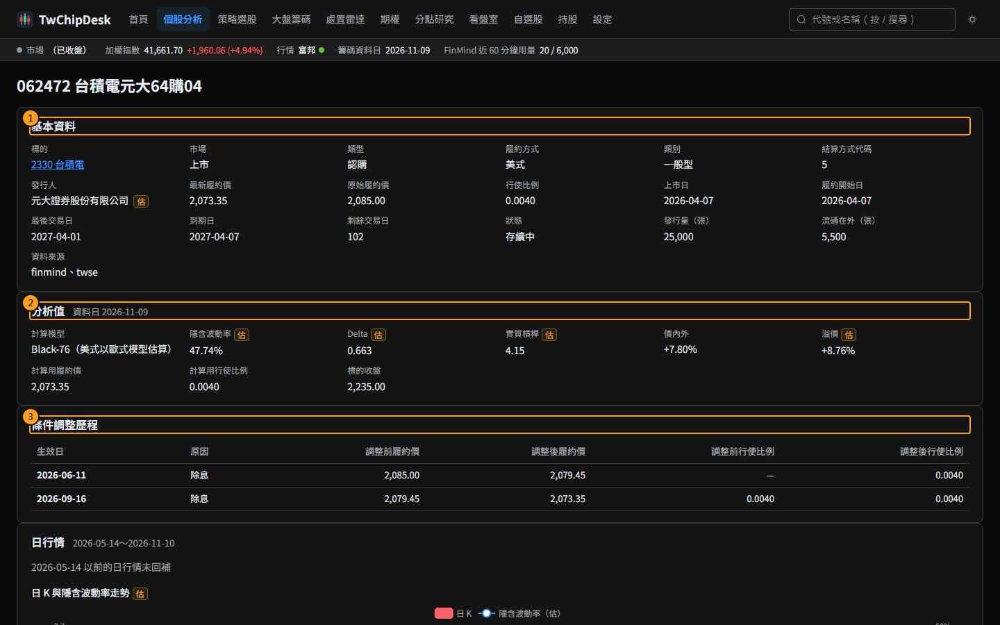
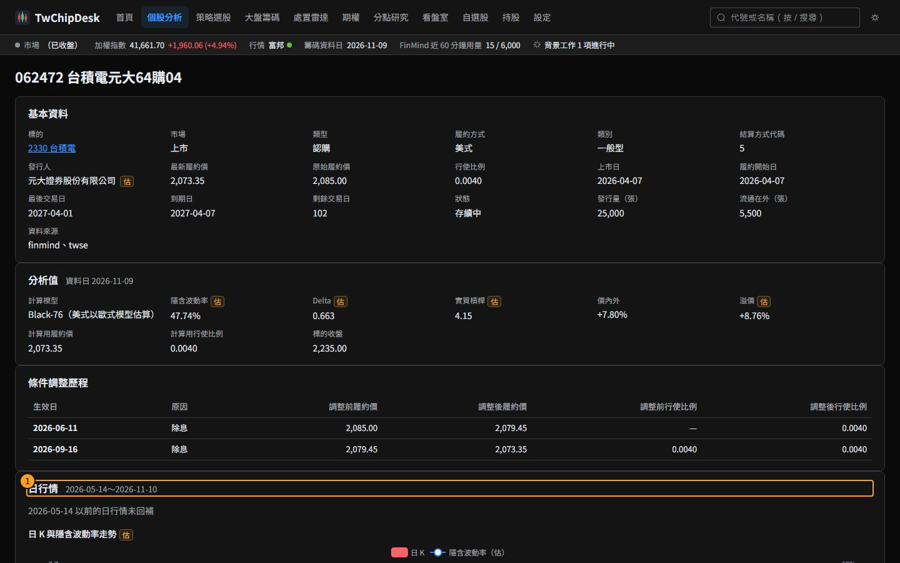
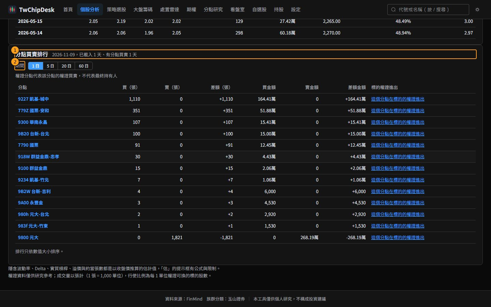

<!-- routes: /warrant/:code -->
# 個股分析｜權證個別頁

> 位置：個股頁「權證」分頁點權證代號，或從大盤籌碼的權證排行、分點頁點權證（網址 `/warrant/062472?listed=2026-04-07`）
> 資料更新：權證主檔交易日 07:50；日行情隨全市場日 K（17:35）寫入，之後計算分析值；權證分點 20:30 起抓取

## 這個功能可以做什麼
看單一權證的完整資料：發行條件、最新的分析值（隱含波動率、Delta、實質槓桿、價內外、溢價）、條件調整歷程、日 K 與隱含波動率走勢、每日行情，以及分點買賣排行與單一分點的逐日明細。

## 畫面說明

| 編號 | 名稱 | 說明 |
|---|---|---|
| 1 | 基本資料 | 標的（可點回個股頁）、市場、類型、履約方式、類別、結算方式代碼、發行人、最新履約價、原始履約價、行使比例、上市日、履約開始日、最後交易日、到期日、剩餘交易日、發行量、流通在外、資料來源與狀態。牛熊證另有上限價、下限價。 |
| 2 | 分析值 | 資料日的「計算模型」「隱含波動率」「Delta」「實質槓桿」「價內外」「溢價」，以及「計算用履約價」「計算用行使比例」「標的收盤」。算不出時列出「未算出的原因」。 |
| 3 | 條件調整歷程 | 除權息等原因造成的履約價、行使比例調整：生效日、原因、調整前後的履約價與行使比例。 |

| 編號 | 名稱 | 說明 |
|---|---|---|
| 1 | 日行情 | 上方為「日 K 與隱含波動率走勢」圖，下方為每日的開高低收、成交量（張）、成交金額、標的收盤、隱含波動率與實質槓桿。只列有成交的日子，新的在上。 |

| 編號 | 名稱 | 說明 |
|---|---|---|
| 1 | 分點買賣排行 | 各分點的「買（張）」「賣（張）」「差額（張）」「買金額」「賣金額」「差額金額」，標題旁為期間與已載入的天數。 |
| 2 | 期間 | 1、5、20、60 日。 |

## 操作步驟
1. 在「分點買賣排行」選期間。
2. 點分點名稱：排行下方顯示這個分點在這一檔的逐日明細（網址加上 `?broker=分點代號`，重新整理後仍在）；再點一次或按「關閉」收起。
3. 點「標的權證進出」欄的連結：開啟該分點在這檔標的所有權證的進出走勢頁。
4. 點基本資料的標的，回到標的股票的個股頁。

## 欄位與名詞
- 分析值的定義與「估」的意思見 [權證](warrants.md#欄位與名詞)；分析值一律標「估」，滑鼠移到「估」可看公式與限制。
- **條件調整**：官方備註沒有這筆調整時，由前後兩次的履約價或行使比例不同推得，標「估」，生效日為資料日。

## 注意事項與限制
- 權證代號會回收重用：網址的 `listed`（上市日）指定是哪一檔，省略時為上市日最晚的一檔；同代號的其他權證會列成連結。
- 權證主檔只收錄最近約 120 個交易日內仍在交易的權證；剛上市的權證會在下一次主檔更新後出現。
- 日行情與權證分點只回補一段期間，更早的日子註明「… 以前的日行情未回補」。
- 權證分點代表該分點的權證買賣，不代表最終持有人；排行只依數值大小排序。

## 相關功能
- [權證](warrants.md)
- [分點研究](../brokers/README.md)
