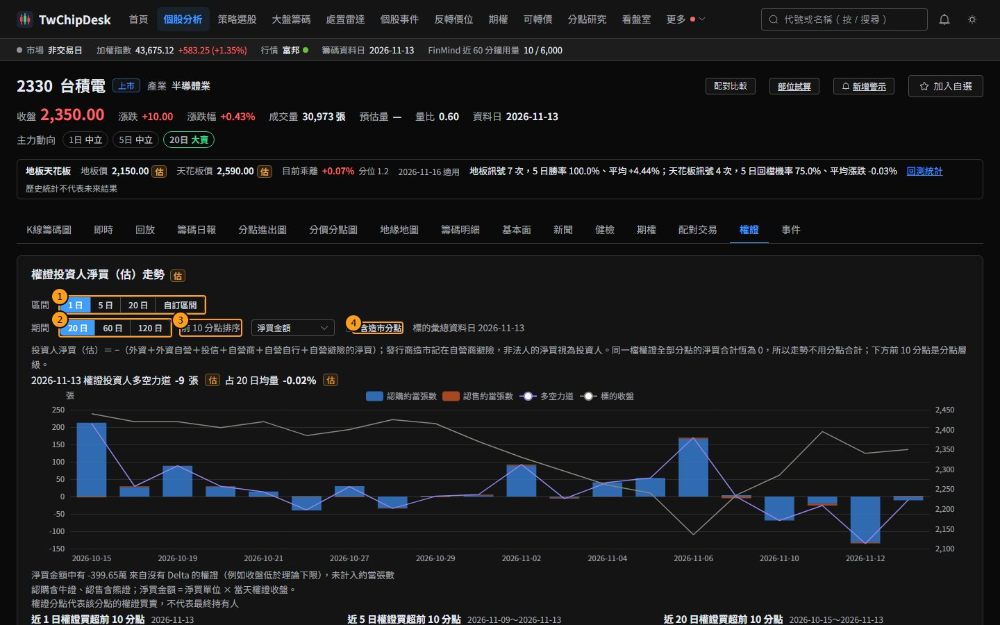
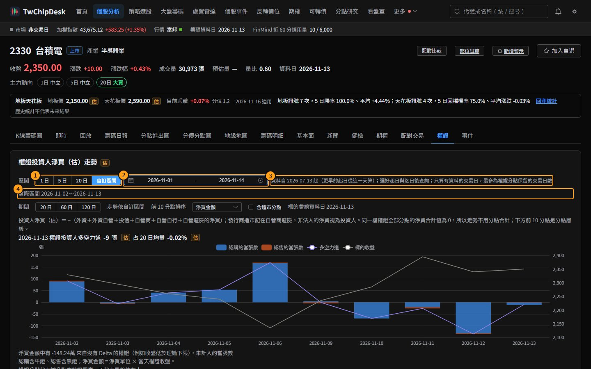
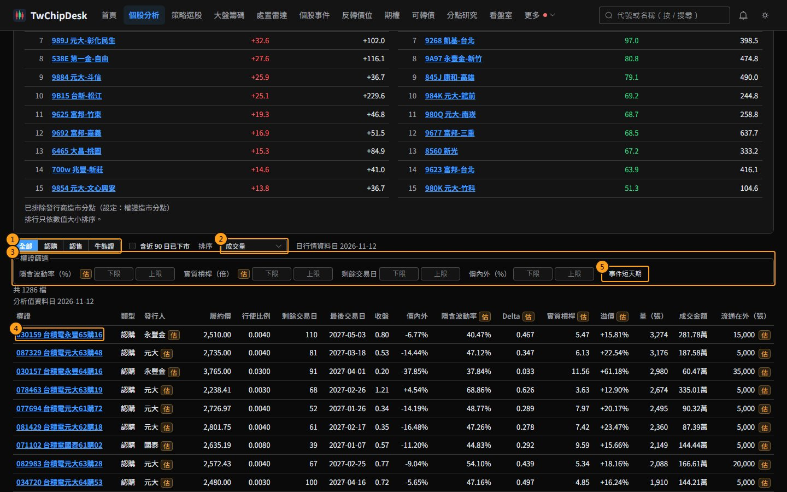
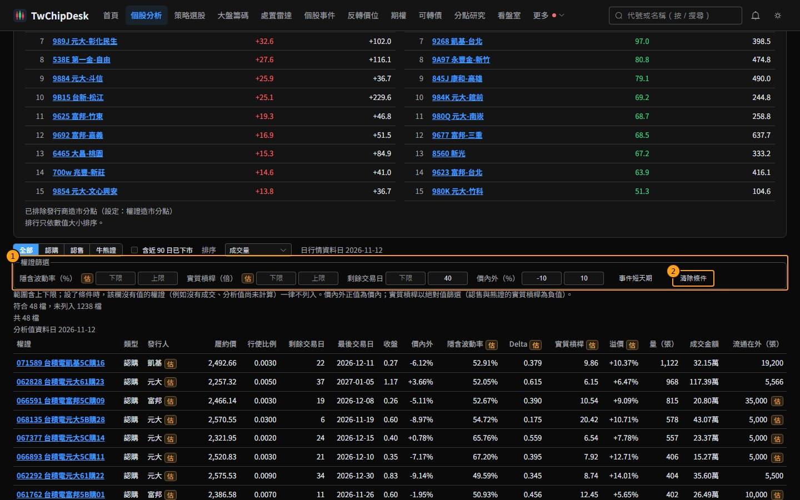

<!-- routes: /stock/:stockId/warrants -->
# 個股分析｜權證

> 位置：個股頁「權證」分頁（網址 `/stock/2330/warrants`）
> 資料更新：權證主檔交易日 07:50；權證日行情隨全市場日 K（17:35）寫入後計算分析值；權證分點 20:30 起抓取，之後計算標的彙總與權證隔日沖；權證投資人淨買在個股三大法人（20:05）與分析值都完成後計算

## 這個功能可以做什麼
看以這檔股票為標的的所有權證：盤中監控開啟時最上方另有「盤中（估）」區塊（見下方），接著是權證投資人淨買（估）的走勢與權證分點排行，下方是權證清單（履約價、行使比例、剩餘交易日、價內外、隱含波動率、Delta、實質槓桿、溢價、成交量等），可依類型、數值範圍篩選。分點排行可選 1、5、20 日或自訂區間。畫面只呈現資料，排序只依數值大小。

臺股指數、電子類指數、金融保險類指數與富櫃200 的權證也有同樣的畫面，見[指數權證明細頁](../market/warrants.md#指數權證明細頁)。

## 畫面說明

### 盤中（估）

只在[盤中監控](../live.md)開啟（設定頁 `Tape:Enabled`）而且在盤中時顯示；盤前、收盤後或盤中監控關閉時整個區塊不出現。

| 編號 | 名稱 | 說明 |
|---|---|---|
| 1 | 涵蓋與監控狀態 | 「焦點權證 N 檔／存續 M 檔，預估涵蓋昨日成交 x%」（估）與「監控中」或「未監控」。這檔標的沒有焦點權證時顯示「這檔標的目前沒有焦點權證」。 |
| 2 | 分鐘圖 | 「累計多方約當（估）」「累計空方約當（估）」與「標的價」，單位萬元。只開啟大額彙總（`Tape:Flow:Enabled`）時改畫「累計現股大額淨額」「累計股期大額淨名目」，並註明權證欄位不計算。 |
| 3 | 當日累計 | 「多方約當（估）」「空方約當（估）」「淨額（估）」「盤中權證力道（估）」「現股大額淨額」「股期大額淨名目」；力道算不出時顯示「—」與原因。 |
| 4 | 「權證盤中列表」 | 這檔標的焦點權證的盤中成交：「權證」「類型」「成交價」「漲跌」「當日金額」「外盤金額（估）」「內盤金額（估）」「盤中隱含波動率（估）」「實質槓桿（估）」「監控」。 |
| 5 | 「大額事件」 | 這檔標的的大額成交與合併，欄位與盤中監控的成交動態相同。 |

- 進入這個分頁時，這檔標的會加入焦點權證的監控（離開後保留 2 分鐘才移出）；同一個畫面最多同時監控 5 檔標的，超過時顯示「同一個畫面最多同時監控 5 檔標的，這一檔目前沒有加入監控」。
- 焦點權證與大額彙總都關閉時只顯示「焦點權證尚未開啟，權證的約當金額與力道不計算（不是 0）。」
- 盤中區塊只在股票與 ETF 的個股頁出現；盤中監控不含指數權證。
- 只含焦點權證，不是這檔標的的全部權證；約當金額、力道、盤中隱含波動率與槓桿都是推估值，算法見[盤中監控](../live.md#欄位與名詞)。

### 權證投資人淨買（估）走勢

| 編號 | 名稱 | 說明 |
|---|---|---|
| 1 | 區間 | 「1 日」（預設）「5 日」「20 日」或「自訂區間」：決定下方認購、認售分點清單的區間；選「自訂區間」再選起日與迄日（見下方「自訂區間」）。 |
| 2 | 期間 | 走勢圖的期間：20、60、120 日；選了自訂區間時走勢依區間，這裡不選並註明「走勢依自訂區間」，改選 20 日等就離開自訂區間。 |
| 3 | 前 10 分點排序 | 依「淨買金額」或「約當張數」排序下方的前 10 分點。 |
| 4 | 含造市分點 | 預設排除發行商造市分點（設定頁的「權證造市分點」清單）；勾選後一併列入。 |

- 走勢圖：認購約當張數、認售約當張數（柱）、多空力道（線）與標的收盤（線）。上方列出最近一日的「權證投資人多空力道」與「占 20 日均量」。
- 下方三張表：「近 1 日」「近 5 日」「近 20 日」權證買超前 10 分點（或約當張數前 10 分點），點分點進入該分點在這檔標的的權證進出走勢頁。選了自訂區間時另加第四張「YYYY-MM-DD～YYYY-MM-DD 權證買超前 10 分點」，三張固定的表照舊。
- 再往下是「認購、認售分開的權證分點買超與賣超」：區間跟著上方的「區間」（1、5、20 日或自訂區間），可選認購（含牛證）或認售（含熊證）、排序依據（淨買金額或約當淨買（估）），列出買超與賣超前 15 分點；標題旁寫出實際的起迄。

### 自訂區間

| 編號 | 名稱 | 說明 |
|---|---|---|
| 1 | 「自訂區間」 | 在「區間」選「自訂區間」後出現日期選擇；選好起日與迄日才重新查詢 |
| 2 | 起日、迄日 | 早於資料起日與晚於今天的日子不能選 |
| 3 | 資料起日 | 「資料自 YYYY-MM-DD 起」：可選的最早一天（權證分點的資料起日） |
| 4 | 實際區間 | 「實際區間 YYYY-MM-DD～YYYY-MM-DD」：起日與迄日對齊到區間內權證分點已計算的交易日 |

- 圖中為選好起日與迄日後的畫面。
- 自訂區間同時用在走勢、第四張前 10 分點表與認購、認售分點清單。
- 區間最多為權證分點保留的交易日數（設定「權證分點保留的交易日數」，預設 250 日）；起日早於資料起日時從資料起日算起（「實際區間」顯示實際使用的起迄）。
- 區間超過上限或區間內沒有已完成的資料時，日期選擇旁顯示「日期區間不正確：」與原因，走勢與各表保留上一次的結果。
- 走勢看權證投資人淨買、前 10 分點與認購認售清單看權證分點，兩者各自對齊到已完成的日子，實際起迄可能差一天，以畫面上的日期為準。
- 清除日期、或改選「1 日」等天數、或改選走勢的 20、60、120 日，就回到原本的期間。

### 權證清單

| 編號 | 名稱 | 說明 |
|---|---|---|
| 1 | 類型 | 「全部」「認購」「認售」「牛熊證」。旁邊的「含近 90 日已下市」把最近下市的權證一起列出。 |
| 2 | 排序 | 「成交量」「成交金額」「最後交易日」「履約價」「代號」。 |
| 3 | 權證篩選 | 「隱含波動率（%）」「實質槓桿（倍）」「剩餘交易日」「價內外（%）」的下限與上限；「清除條件」清空。 |
| 4 | 權證代號 | 點代號或名稱開啟[權證個別頁](warrant-page.md)。 |
| 5 | 「事件短天期」 | 一次套用事件短天期篩選，見下方「事件短天期篩選」。 |

清單預設只列前 50 列（依目前排序），按「顯示全部 N 檔」展開。上方列出日行情資料日與分析值資料日。

### 事件短天期篩選

權證篩選旁的「事件短天期」按鈕會一次設好剩餘交易日 40 日以內、價內外 −10%～+10% 兩組條件（其他條件清空）。從[個股事件](../events/README.md)頁點權證數過來時會自動套用；要看全部權證按「清除條件」。

| 編號 | 名稱 | 說明 |
|---|---|---|
| 1 | 權證篩選 | 套用後「剩餘交易日」上限為 40、「價內外（%）」為 -10～10，其餘欄位空白；下方顯示「符合 N 檔，未列入 M 檔」。 |
| 2 | 「清除條件」 | 清空所有篩選，回到全部權證。 |

## 操作步驟
1. 在走勢區選「期間」與排序，觀察權證投資人的約當淨買變化；要看特定一段日子的分點，在「區間」選「自訂區間」再選起日與迄日。
2. 在清單區選「類型」與「排序」。
3. 要縮小範圍時填「權證篩選」的上下限，例如實質槓桿 3～8 倍、剩餘交易日 60 以上。範圍含上下限；下限大於上限時不套用並提示。
4. 點權證代號看單一權證的詳細資料。

## 欄位與名詞
- **權證投資人淨買（估）**：−（外資＋外資自營＋投信＋自營商＋自營自行＋自營避險的淨買）。發行商造市記在自營商避險，非法人的淨買視為投資人。
- **約當張數（估）**：淨買單位 × 當天行使比例 × Delta ÷ 1,000；認售為負，代表偏空的約當部位。
- **多空力道**：認購＋認售約當張數；**占 20 日均量**：多空力道 ÷ 標的 20 日均量。
- **淨買金額**：淨買單位 × 當天權證收盤。
- **價內外**：認購為 標的收盤 ÷ 履約價 − 1；認售為 履約價 ÷ 標的收盤 − 1；正值為價內。
- **隱含波動率（估）**：以權證收盤 ÷ 行使比例代入 Black-76 反推；美式權證以歐式模型估算，牛熊證不計算。
- **Delta（估）**：權證價值對標的現價的變化率（每 1 股標的）。
- **實質槓桿（估）**：Delta × 行使比例 × 標的收盤 ÷ 權證收盤，即標的變動 1% 時權證約變動多少 %。
- **溢價（估）**：認購為（權證收盤 ÷ 行使比例 + 履約價 − 標的收盤）÷ 標的收盤；認售依此類推。
- **成交量**以張計（1 張 = 1,000 單位）；**行使比例**為每 1 單位權證可換的標的股數。
- 「發行人」「最後交易日」「流通在外」標「估」時為推算值（例如發行人由權證簡稱推得、最後交易日由到期日往前 2 個交易日推得），滑鼠移到「估」看算法。

## 注意事項與限制
- 權證分點代表該分點的權證買賣，不代表最終持有人。
- 沒有成交、收盤低於理論下限等情況算不出分析值，滑鼠移到欄位上會說明原因。分析值資料日早於日行情時會註明較新一天尚未計算。
- 權證功能關閉時顯示說明，可在設定頁「籌碼參數」開啟；官方開放資料外掛關閉時沒有權證名稱、履約價、發行人與流通在外，相關分析值也不計算。
- 設了篩選條件時，該欄沒有值的權證（例如沒有成交）一律不列入。

## 相關功能
- [盤中監控](../live.md)
- [權證個別頁](warrant-page.md)
- [大盤籌碼｜權證排行](../market/warrants.md)，含[指數權證明細頁](../market/warrants.md#指數權證明細頁)
- [分點研究](../brokers/README.md)
