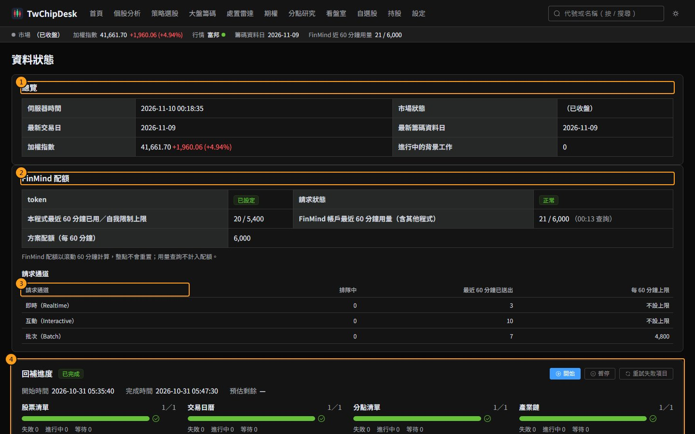

<!-- routes: /system -->
# 系統（資料狀態）

> 位置：畫面上方狀態列的「FinMind 近 60 分鐘用量」點進來，或手機底部「更多」→「資料狀態」（網址 `/system`）。頁面標題是「資料狀態」，不在頂部選單裡
> 資料更新：開啟時即時查詢；回補進行中每 5 秒更新，其他時候每 30 秒

## 這個功能可以做什麼
檢查系統的資料是否正常：最新交易日與籌碼資料日、FinMind 配額用量、初次回補的進度、每個資料集最近 30 個交易日有沒有缺漏、排程工作上次與下次執行時間、最近的警告與錯誤。資料看起來不對或沒有更新時，先來這一頁找原因。

## 畫面說明

| 編號 | 名稱 | 說明 |
|---|---|---|
| 1 | 總覽 | 「伺服器時間」「市場狀態」「最新交易日」「最新籌碼資料日」「加權指數」「進行中的背景工作」。 |
| 2 | FinMind 配額 | token 是否「已設定」、「請求狀態」（「正常」或「暫停中，幾點重新確認配額」與暫停原因）、本程式最近 60 分鐘已用／自我限制上限、FinMind 帳戶最近 60 分鐘用量（含其他程式）、方案配額。配額以滾動 60 分鐘計算，整點不會重置；用量查詢不計入配額。 |
| 3 | 請求通道 | 「即時（Realtime）」「互動（Interactive）」「批次（Batch）」三條通道各自的排隊中、最近 60 分鐘已送出與每 60 分鐘上限。盤中即時用量優先，背景批次工作在其他時段用較多配額。 |
| 4 | 回補進度 | 初次回補各項目（股票清單、交易日曆、分點清單、產業鏈、日 K、法人、分點等）的進度條、完成數／總數、失敗、進行中、等待，以及開始時間、完成時間、預估剩餘。 |

### 資料集狀態矩陣
「資料集狀態（最近 30 個交易日）」以「資料集 × 交易日」的格子表示每天的資料狀態，顏色見表格上方的「圖例」：

| 狀態 | 意思 |
|---|---|
| 完成 | 這一天的資料已入庫（滑鼠移上去看列數）。 |
| 進行中 | 負責的工作正在執行。 |
| 缺漏 | 應該有資料但沒有，負責的工作失敗或沒有執行。 |
| 來源缺漏 | 資料來源這一天沒有提供資料。 |
| 未到更新時間 | 今天的資料還沒到排程時間（例如傍晚看晚上才更新的資料）。 |
| 警告 | 有資料，但筆數偏少或有其他提醒。 |
| 沒有紀錄 | 沒有這一天的狀態紀錄。 |

每個資料集還列出說明、最後完成日、負責的排程工作與下次排程時間。

### 排程工作

「排程工作」列出每個背景工作的名稱、說明、排程、上次執行（時間與結果：成功、失敗、執行中、略過）、下次執行。由其他工作完成後接著執行的，排程欄寫「接在 … 之後」。各工作的時間整理在 [資料來源與更新時間](reference/data-sources.md)。

### 其他區塊
- **期權商品主檔**：期權模組與富邦外掛是否啟用、最近一次同步的摘要、商品與合約數量、富邦與 FinMind 對不上或標的、乘數未確認的商品，以及最近的變動。每個交易日 07:50 與 17:00 同步。
- **官方開放資料事件來源**：見下方。
- **啟動補抓**：服務啟動 1 分鐘後與每天 07:20 自動檢查最近幾個交易日錯過的每日資料，列出檢查範圍與排入的補抓項目；初次回補還沒完成或沒有 token 時會略過。
- **最近的警告與錯誤**：服務啟動後最近 200 筆警告、錯誤、嚴重錯誤；完整紀錄在日誌檔。
- **排程儀表板（Hangfire）**：排程系統本身的管理畫面連結（只在本機電腦開啟，手機版無法開啟）。

### 官方開放資料事件來源

[個股事件](events/README.md)的法說會、股東會、庫藏股決議，以及月營收、財報的官方公布時間，來自證交所與櫃買中心的官方開放資料。這個區塊列出：

- 「狀態：開啟」或「狀態：關閉」。關閉時註明不向來源發送任何請求，可到[設定](settings.md#官方開放資料事件來源)開啟。
- 「每日抓取時間」（預設 08:00、16:00、22:00）與「資料自 YYYY-MM-DD 起累積」（還沒開啟過時寫「還沒有累積資料」）。
- 7 個來源（上市與上櫃每日重大訊息、上市與上櫃股東會資料、上市股東會公告、上市與上櫃月營收彙總表）各一列：「最後抓取」（還沒抓過寫「還沒有抓取過」）、「最後有變更」、「資料日」、「列數」、「暫停到」（被限流時暫停到幾點，以警示色顯示）、「最近錯誤」。
- 「沒有重大訊息資料的日期」：開啟後（最多看 30 天）到昨天之間，完全沒有重大訊息資料的日期。來源主機沒開或那一天沒有抓到時會缺，之後無法補抓。
- 待核對筆數：月營收、財報的官方資料與 FinMind 不一致的筆數（統計仍以 FinMind 為準）；沒有時寫「沒有待核對的資料」。

資料集狀態矩陣另有 `MopsCorporateEvents`（法說會、股東會、庫藏股決議）與 `MopsDisclosureTimes`（月營收、財報公布時間）兩列。

## 會觸發重算或抓資料的按鈕
下列按鈕會讓系統重新抓資料或重算，消耗 FinMind 配額並可能花很久，只在確定需要時使用（手冊截圖沒有按這些按鈕）：

| 位置 | 按鈕 | 做什麼 |
|---|---|---|
| 回補進度 | 「開始」／「繼續」 | 開始或繼續初次回補（向 FinMind 抓歷史資料）。 |
| 回補進度 | 「暫停」 | 暫停回補，之後可按「繼續」。 |
| 回補進度 | 「重試失敗項目」 | 把失敗的項目放回等待，重新抓取。 |
| 資料集狀態 | 點缺漏的格子（「重跑 YYYY-MM-DD」） | 以那一天的日期重跑負責的工作，補抓或重算那一天。 |
| 排程工作 | 「立即執行」 | 立刻排入一次工作；可指定「資料日期」，不指定時由工作依排程規則決定要處理的日期，按「執行」送出。有些工作只能手動執行（例如各種一次性回補與重算），說明欄會寫明。 |

設定頁的「回補」區塊有同一份回補進度與按鈕；「資料維護」區塊的「清除快取」會清掉依需求載入的明細，之後開啟時重新向 FinMind 載入；也會讓族群頁與國際總經的快取失效並在背景重新暖機。

回補全部完成或因失敗項目暫停後，只有這次抓到分點、日 K 或外資持股時，才會在背景重算歷史的 N 日主力：從受影響的最早一天起；只抓到幾檔股票的日 K 或外資持股時只重算那幾檔。這次沒有抓到這些資料時不重算。重算在交易日 08:15～14:00 不執行，遇到時改在當天 14:05 接續。

## 操作步驟
**資料沒更新時**
1. 看「總覽」的「最新籌碼資料日」是否為最近一個交易日。
2. 到「資料集狀態」找那一天的格子：「未到更新時間」就等排程；「來源缺漏」表示來源還沒提供；「缺漏」可點格子重跑。
3. 到「排程工作」看負責的工作上次執行的結果，失敗時在「最近的警告與錯誤」找原因。
4. 「請求狀態」顯示暫停中時，是 FinMind 配額用完，等到寫出的時間後會自動恢復。

## 注意事項與限制
- 本頁只列交易日曆上的交易日；日曆之後改為休市的日子不再顯示，資料不刪除。
- FinMind 帳戶用量包含同一個 token 的其他程式，可能比本程式自己的用量高。
- FinMind 提醒填寫帳戶資料時，本頁會顯示提示與最近一次提醒的時間。

## 常見問題
- **「未到更新時間」和「缺漏」差在哪？** 前者是還沒到排程時間，正常；後者是時間過了卻沒有資料，需要檢查或重跑。
- **按了「立即執行」沒有反應？** 工作已排入背景執行，到「排程工作」看上次執行狀態，或看狀態列的「背景工作 N 項進行中」。

## 相關功能
- [設定](settings.md)
- [資料來源與更新時間](reference/data-sources.md)
- [常見問題](faq.md)
