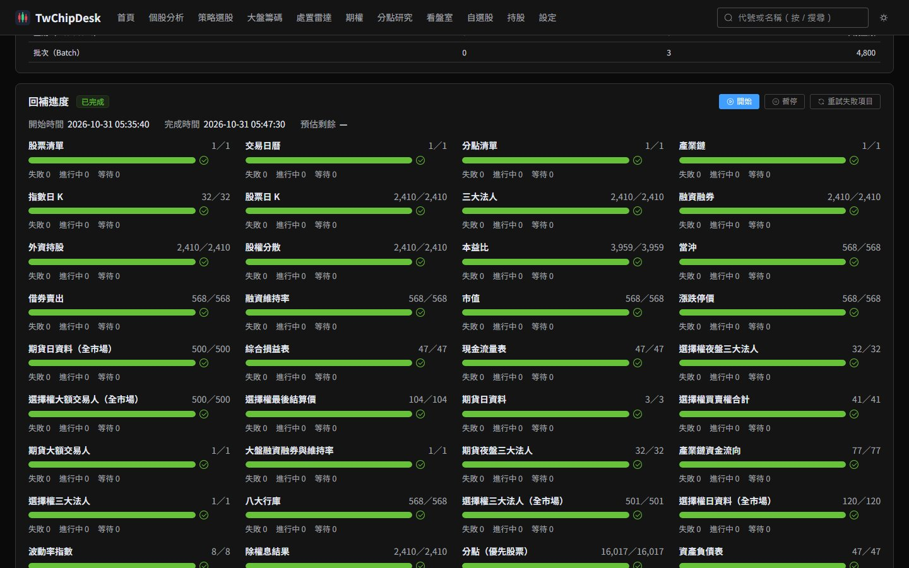
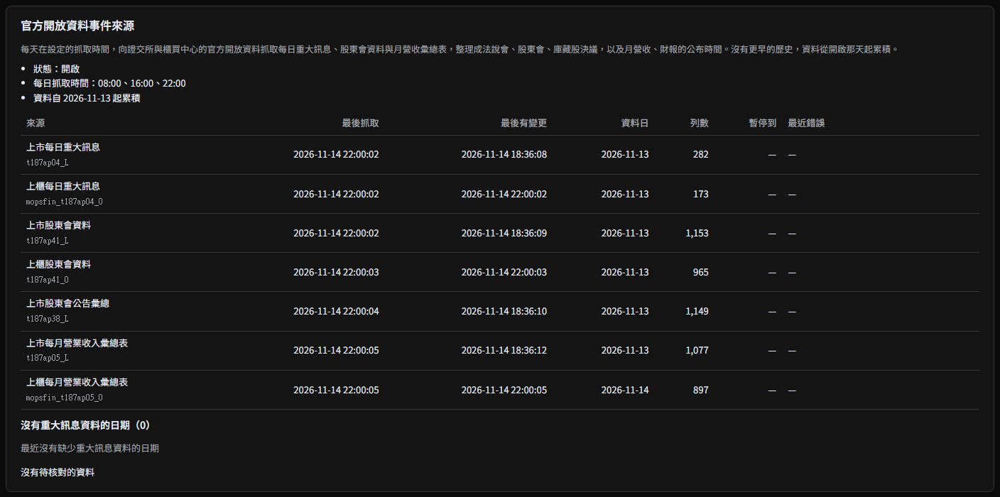
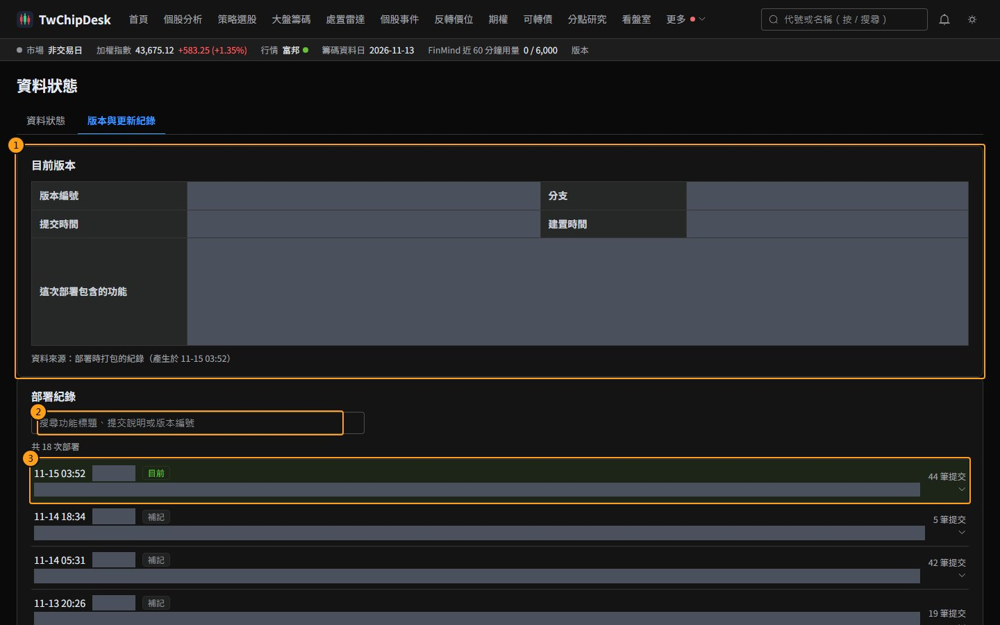
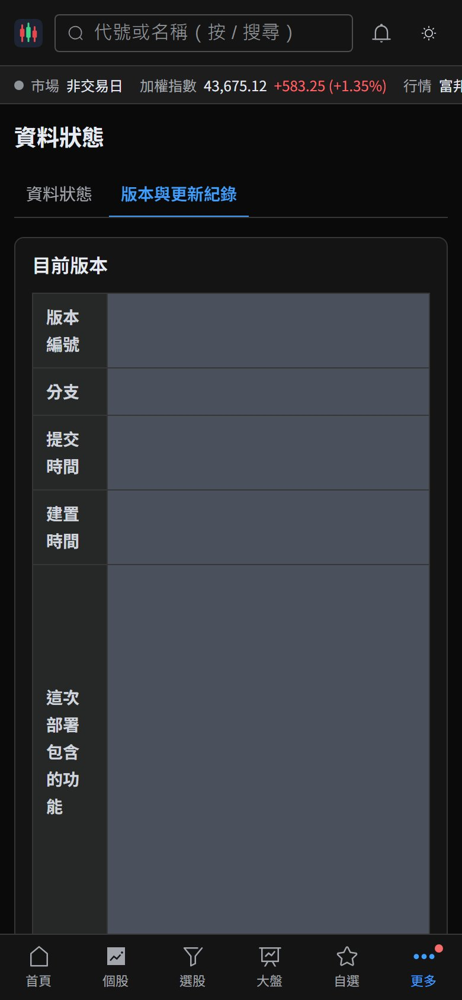
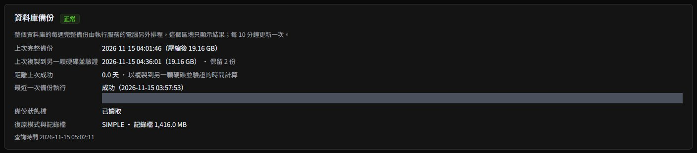

<!-- routes: /system, /system?tab=version -->
# 系統（資料狀態）

> 位置：畫面上方狀態列的「FinMind 近 60 分鐘用量」點進來，或手機底部「更多」→「資料狀態」（網址 `/system`）。頁面標題是「資料狀態」，不在頂部選單裡。頁面上方有兩個分頁：「資料狀態」與「版本與更新紀錄」（網址 `/system?tab=version`，狀態列最後的「版本」點進來就是這個分頁）
> 資料更新：開啟時即時查詢；回補進行中每 5 秒更新，其他時候每 30 秒

## 這個功能可以做什麼
檢查系統的資料是否正常：最新交易日與籌碼資料日、FinMind 配額用量、初次回補的進度、每個資料集最近 30 個交易日有沒有缺漏、排程工作上次與下次執行時間、最近的警告與錯誤。資料看起來不對或沒有更新時，先來這一頁找原因。

## 畫面說明

| 編號 | 名稱 | 說明 |
|---|---|---|
| 1 | 總覽 | 「伺服器時間」「市場狀態」「最新交易日」「最新籌碼資料日」「加權指數」「進行中的背景工作」。 |
| 2 | FinMind 配額 | token 是否「已設定」、「請求狀態」（「正常」或「暫停中，幾點重新確認配額」與暫停原因）、本程式最近 60 分鐘已用／自我限制上限、FinMind 帳戶最近 60 分鐘用量（含其他程式）、方案配額。配額以滾動 60 分鐘計算，整點不會重置；用量查詢不計入配額。 |
| 3 | 請求通道 | 「即時（Realtime）」「互動（Interactive）」「批次（Batch）」三條通道各自的排隊中、最近 60 分鐘已送出與每 60 分鐘上限。盤中即時用量優先，背景批次工作在其他時段用較多配額。 |
| 4 | 回補進度 | 初次回補各項目（股票清單、交易日曆、分點清單、產業鏈、日 K、法人、分點等）的進度條、完成數／總數、失敗、進行中、等待，以及開始時間、完成時間、預估剩餘。 |

### 資料集狀態矩陣
「資料集狀態（最近 30 個交易日）」以「資料集 × 交易日」的格子表示每天的資料狀態，顏色見表格上方的「圖例」：

| 狀態 | 意思 |
|---|---|
| 完成 | 這一天的資料已入庫（滑鼠移上去看列數）。 |
| 進行中 | 負責的工作正在執行。 |
| 缺漏 | 應該有資料但沒有，負責的工作失敗或沒有執行。 |
| 來源缺漏 | 資料來源這一天沒有提供資料。 |
| 未到更新時間 | 今天的資料還沒到排程時間（例如傍晚看晚上才更新的資料）。 |
| 警告 | 有資料，但筆數偏少或有其他提醒。 |
| 沒有紀錄 | 沒有這一天的狀態紀錄。 |

每個資料集還列出說明、最後完成日、負責的排程工作與下次排程時間。

### 排程工作

「排程工作」列出每個背景工作的名稱、說明、排程、上次執行（時間與結果：成功、失敗、執行中、略過）、下次執行。由其他工作完成後接著執行的，排程欄寫「接在 … 之後」。各工作的時間整理在 [資料來源與更新時間](reference/data-sources.md)。

### 其他區塊
- **期權商品主檔**：期權模組與富邦外掛是否啟用、最近一次同步的摘要、商品與合約數量、富邦與 FinMind 對不上或標的、乘數未確認的商品，以及最近的變動。每個交易日 07:50 與 17:00 同步。
- **官方開放資料事件來源**：見下方。
- **啟動補抓**：服務啟動 1 分鐘後與每天 07:20 自動檢查最近幾個交易日錯過的每日資料，列出檢查範圍與排入的補抓項目；初次回補還沒完成或沒有 token 時會略過。
- **最近的警告與錯誤**：服務啟動後最近 200 筆警告、錯誤、嚴重錯誤；完整紀錄在日誌檔。
- **排程儀表板（Hangfire）**：排程系統本身的管理畫面連結（只在本機電腦開啟，手機版無法開啟）。

### 官方開放資料事件來源

[個股事件](events/README.md)的法說會、股東會、庫藏股決議，以及月營收、財報的官方公布時間，來自證交所與櫃買中心的官方開放資料。這個區塊列出：

- 「狀態：開啟」或「狀態：關閉」。關閉時註明不向來源發送任何請求，可到[設定](settings.md#官方開放資料事件來源)開啟。
- 「每日抓取時間」（預設 08:00、16:00、22:00）與「資料自 YYYY-MM-DD 起累積」（還沒開啟過時寫「還沒有累積資料」）。
- 7 個來源（上市與上櫃每日重大訊息、上市與上櫃股東會資料、上市股東會公告、上市與上櫃月營收彙總表）各一列：「最後抓取」（還沒抓過寫「還沒有抓取過」）、「最後有變更」、「資料日」、「列數」、「暫停到」（被限流時暫停到幾點，以警示色顯示）、「最近錯誤」。
- 「沒有重大訊息資料的日期」：開啟後（最多看 30 天）到昨天之間，完全沒有重大訊息資料的日期。來源主機沒開或那一天沒有抓到時會缺，之後無法補抓。
- 待核對筆數：月營收、財報的官方資料與 FinMind 不一致的筆數（統計仍以 FinMind 為準）；沒有時寫「沒有待核對的資料」。

資料集狀態矩陣另有 `MopsCorporateEvents`（法說會、股東會、庫藏股決議）與 `MopsDisclosureTimes`（月營收、財報公布時間）兩列。

## 版本與更新紀錄

「版本與更新紀錄」分頁顯示這台服務目前執行的是哪一個版本，以及歷次部署各包含了哪些更新。內容是每次部署時一起打包進服務的紀錄，不需要任何設定，也不會連到外部網站。

| 編號 | 名稱 | 說明 |
|---|---|---|
| 1 | 目前版本 | 「版本編號」（8 碼短編號，旁邊「在 GitHub 查看」）、「分支」、「提交時間」、「建置時間」與「這次部署包含的功能」。下方一行寫出「資料來源：部署時打包的紀錄（產生於 MM-DD HH:mm）」。 |
| 2 | 搜尋 | 輸入關鍵字後稍等一下就會查詢，比對功能標題、每一筆提交的說明，以及版本編號的開頭（4 碼以上）；不分大小寫。上方寫出「符合 N 次部署」，按輸入框右側的清除鈕回到全部。 |
| 3 | 部署紀錄 | 每次部署一列，新的在上面：第一行是部署時間（不是今年時加上年份）、短編號與標示，第二行是功能標題（最多 3 個，其餘寫「等 N 項」）；右側是「N 筆提交」，搜尋時另外寫「符合 N 筆」。最下面「載入更多」載入更早的部署。 |

**標示**
- 「目前」：這台服務正在執行的版本。
- 「回退」：換回較舊的版本，這一列沒有新的提交，展開後寫「回退到 xxxxxxxx，沒有新的提交」。
- 「補記」：這個功能上線前的部署，由當時留下的版本推回，時間是那一版建置完成的時間，和實際啟動可能差幾秒。

**展開一次部署**
點一列展開這次部署包含的每一筆提交：短編號（點了在新分頁開 GitHub）、時間、標題（主線上的提交用粗體）；有詳細說明時按「顯示完整說明」展開。搜尋中只列符合的提交，按「顯示這次部署的全部提交」看全部。最下面「在 GitHub 看這次部署的全部差異」開啟兩個版本的比較頁。程式庫是私有的，瀏覽器要能開啟這個程式庫才看得到 GitHub 上的內容。

其他情況的文字：
- 「這是最早的一筆紀錄，沒有前一版可以比對」：紀錄中的第一次部署。
- 「這次部署的提交範圍無法還原」：建置時找不到前一版的提交，只知道部署了哪一版。
- 「只列出 300 筆，共 N 筆，其餘請到 GitHub 查看」：一次部署的提交很多時，只保留主線上的提交與最新的提交。
- 「更早的 N 次部署超過保存上限，沒有列出」：紀錄最多保留 150 次部署、合計 3,000 筆提交。

**未知版本**：本機開發、測試環境，或建置時沒有帶版本資訊（例如直接用 `docker compose up --build` 建置）時，分頁顯示「未知版本：這個執行環境建置時沒有帶版本資訊（本機開發或測試環境）。」，部署紀錄寫「沒有部署紀錄」，狀態列寫「版本 未知」；其他功能照常運作。

手機版的版面是單欄，搜尋框佔滿寬度，提交說明預設收合：

## 會觸發重算或抓資料的按鈕
下列按鈕會讓系統重新抓資料或重算，消耗 FinMind 配額並可能花很久，只在確定需要時使用（手冊截圖沒有按這些按鈕）：

| 位置 | 按鈕 | 做什麼 |
|---|---|---|
| 回補進度 | 「開始」／「繼續」 | 開始或繼續初次回補（向 FinMind 抓歷史資料）。 |
| 回補進度 | 「暫停」 | 暫停回補，之後可按「繼續」。 |
| 回補進度 | 「重試失敗項目」 | 把失敗的項目放回等待，重新抓取。 |
| 資料集狀態 | 點缺漏的格子（「重跑 YYYY-MM-DD」） | 以那一天的日期重跑負責的工作，補抓或重算那一天。 |
| 排程工作 | 「立即執行」 | 立刻排入一次工作；可指定「資料日期」，不指定時由工作依排程規則決定要處理的日期，按「執行」送出。有些工作只能手動執行（例如各種一次性回補與重算），說明欄會寫明。 |

設定頁的「回補」區塊有同一份回補進度與按鈕；「資料維護」區塊的「清除快取」會清掉依需求載入的明細，之後開啟時重新向 FinMind 載入；也會讓族群頁與國際總經的快取失效並在背景重新暖機。

回補全部完成或因失敗項目暫停後，只有這次抓到分點、日 K 或外資持股時，才會在背景重算歷史的 N 日主力：從受影響的最早一天起；只抓到幾檔股票的日 K 或外資持股時只重算那幾檔。這次沒有抓到這些資料時不重算。重算在交易日 08:15～14:00 不執行，遇到時改在當天 14:05 接續。

## 操作步驟
**資料沒更新時**
1. 看「總覽」的「最新籌碼資料日」是否為最近一個交易日。
2. 到「資料集狀態」找那一天的格子：「未到更新時間」就等排程；「來源缺漏」表示來源還沒提供；「缺漏」可點格子重跑。
3. 到「排程工作」看負責的工作上次執行的結果，失敗時在「最近的警告與錯誤」找原因。
4. 「請求狀態」顯示暫停中時，是 FinMind 配額用完，等到寫出的時間後會自動恢復。

## 資料庫備份
整個資料庫的完整備份不在這個程式的畫面裡設定，而是在執行服務的電腦上另外設定排程，有設定時才會進行。設定後：

- **頻率**：每週一次，排在週日凌晨 01:00。錯過時（例如電腦那時沒開機），電腦開機後會盡快補做；碰到不能開始的時段時，等之後每天的補做時段（14:30）。這一週完成一次後就不再做，下一週仍回到週日凌晨。平日約 07:35～13:50（交易時段與開盤前）和每天約 21:10～22:35（夜間工作前後）不會開始備份。
- **保留**：最近 4 份通過驗證的備份，放在與資料庫不同的實體硬碟上。新的一份驗證成功後才刪最舊的一份；空間不足或硬碟沒接上時這次不備份，也不刪任何舊備份。
- **驗證**：每份備份都帶檢查碼並做過驗證，複製到另一顆硬碟後再比對內容是否一致；下一次備份時會重新檢查上一份。
- **不影響使用**：備份時服務照常運作，不需要停止。
- **在哪裡看結果**：這一頁的「資料庫備份」區塊（見下方），設定頁「資料維護」的資料庫大小下方也顯示同一份。
- **不包含**：服務自己的日誌，以及解密 token 用的金鑰。只還原資料庫時 token 可能無法使用，到 [設定](settings.md) 重新輸入即可。

### 「資料庫備份」區塊

標題旁的標籤是「正常」或「需要注意」，下面列出：

| 項目 | 說明 |
|---|---|
| 上次完整備份 | 資料庫本身記錄的最近一次完整備份的完成時間，以及壓縮後的大小。 |
| 上次複製到另一顆硬碟並驗證 | 最近一份已經複製到另一顆實體硬碟、確認內容一致的備份的完成時間與大小，以及目前保留幾份。這一項才代表備份真的放到了資料庫以外的硬碟。 |
| 距離上次成功 | 距離上一項（沒有備份狀態檔時改用「上次完整備份」）的天數，並註明是用哪一個時間計算。 |
| 最近一次備份執行 | 最近一次真的開始備份的結果（「成功」「成功，有警告」「失敗」）、時間與原因。 |
| 最近一次檢查 | 之後每天的檢查（例如「未到期」「延後」）；和上一項是同一次時不另外列。 |
| 備份狀態檔 | 執行備份的程式每次結束後留給這個服務讀的狀態檔：「已讀取」、「沒有」（只顯示資料庫本身的備份紀錄）、「讀不到」或「記錄的是另一個資料庫」。 |
| 復原模式與記錄檔 | 資料庫的復原模式與交易記錄檔大小。 |

出現下列情況時標成「需要注意」，並在「警告」列出：

- 還沒有任何一份成功的備份。
- 距離上次成功超過設定的天數（設定頁「資料維護」的「資料庫備份狀態：距離上次成功備份超過幾天」，預設 8 天）。
- 最近一次備份執行失敗，或執行時有警告（警告的內容列在「執行時的警告」）。狀態檔沒有及時送到這個服務的那一類警告不算，下一次送到時就已經解決。
- 備份狀態檔讀不到（包括沒有記錄是哪個資料庫），或記錄的是另一個資料庫。
- 備份狀態檔記錄的完成時間比現在晚超過 1 天（時鐘可能不準）：這個時間不採用，改用「上次完整備份」計算。
- 資料庫是完整復原模式而且交易記錄鏈已啟動（記錄檔不會自動截斷，會持續變大）。
- 交易記錄檔超過設定的大小（預設 8,192 MB）。

這個區塊的內容每 10 分鐘更新一次（備份狀態檔讀不到的結果只保留 30 秒，之後重新開啟這一頁會再讀一次），最下方寫查詢時間。沒有設定每週資料庫備份時（資料庫沒有完整備份的紀錄，也沒有備份狀態檔），只顯示一段說明，不顯示警告。畫面只顯示結果，不能從這裡開始備份或還原。

另外，執行服務的電腦上可以做「還原演練」：把一份備份還原成另一個名稱的暫時資料庫、核對資料表與資料日期後刪掉，確認備份真的能還原；正式資料庫不受影響，演練期間這一頁不會有變化。

自選股、持股等個人資料也可以另外用設定頁「資料維護」的「匯出」保存，見 [設定](settings.md)。

## 注意事項與限制
- 本頁只列交易日曆上的交易日；日曆之後改為休市的日子不再顯示，資料不刪除。
- FinMind 帳戶用量包含同一個 token 的其他程式，可能比本程式自己的用量高。
- FinMind 提醒填寫帳戶資料時，本頁會顯示提示與最近一次提醒的時間。

## 常見問題
- **狀態列的版本編號和 GitHub 上最新的不一樣？** 狀態列顯示的是這台服務目前執行的版本；GitHub 上之後才有的更新，要等下一次部署才會出現在「版本與更新紀錄」。
- **「未到更新時間」和「缺漏」差在哪？** 前者是還沒到排程時間，正常；後者是時間過了卻沒有資料，需要檢查或重跑。
- **按了「立即執行」沒有反應？** 工作已排入背景執行，到「排程工作」看上次執行狀態，或看狀態列的「背景工作 N 項進行中」。

## 相關功能
- [設定](settings.md)
- [資料來源與更新時間](reference/data-sources.md)
- [常見問題](faq.md)
