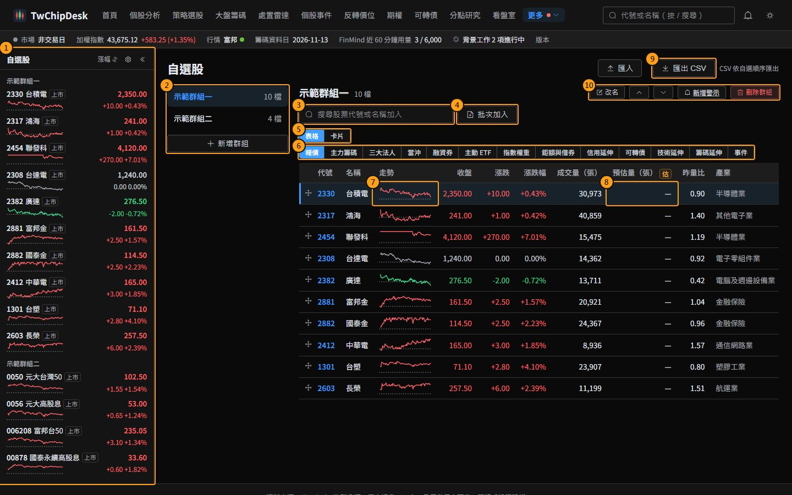
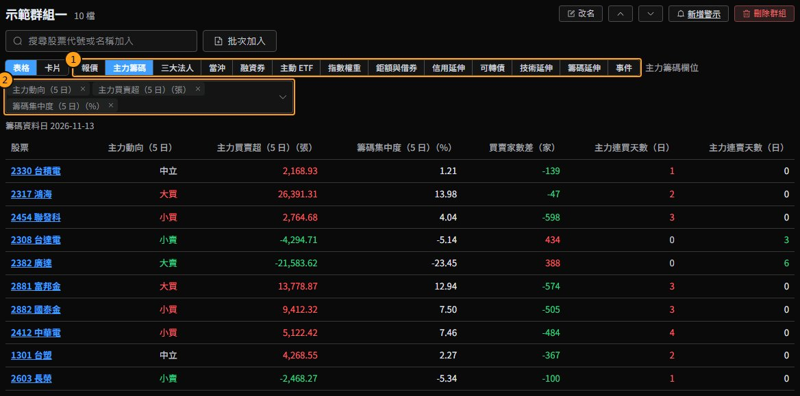
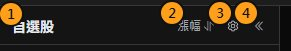

<!-- routes: /watchlist -->
# 自選股（含左側自選欄）

> 位置：頂部選單「自選股」（網址 `/watchlist`）；手機在底部「自選」。左側自選欄在每個頁面的左邊（畫面寬度 1024 像素以上）
> 資料更新：盤中報價即時更新、走勢小圖每分鐘更新；盤後欄位群組取自每晚計算的選股特徵

## 這個功能可以做什麼
把關心的股票分成多個群組管理。表格列出每檔的報價、當日走勢小圖、預估量與昨量比，也能切換到主力籌碼、三大法人、融資券等盤後欄位群組。自選股存在後端資料庫，重新整理或換瀏覽器都還在；左側自選欄讓你在任何頁面一鍵切換股票。

> 截圖中的群組名稱與股票代號、名稱已模糊處理。

## 畫面說明

（截圖中的自選群組與股票是示範資料。）

| 編號 | 名稱 | 說明 |
|---|---|---|
| 1 | 左側自選欄 | 全站共用的快速清單，見下方「左側自選欄」。 |
| 2 | 群組清單 | 所有群組與檔數，點一下切換。最下方「新增群組」。 |
| 3 | 搜尋加入 | 輸入代號或名稱，選擇後加入目前群組；加入後游標留在搜尋框，可連續加入。 |
| 4 | 批次加入 | 貼上多個代號（以空白、逗號或換行分隔，例如 `2330, 2317, 00632R`），先預覽會加入幾檔、哪些格式不正確，再按「加入」。結果會列出找不到與已在群組中的代號。 |
| 5 | 表格／卡片 | 切換「表格」或「卡片」檢視。 |
| 6 | 欄位群組 | 「報價」「主力籌碼」「三大法人」「當沖」「融資券」「主動 ETF」「指數權重」「鉅額與借券」「信用延伸」「可轉債」「技術延伸」「籌碼延伸」「事件」。 |
| 7 | 走勢小圖 | 當日分鐘走勢；虛線為平盤（參考價），最新價在平盤上為漲色、平盤下為跌色、平盤為灰。灰底為盤中重新啟動後還沒補回的時段，補回後自動變完整。 |
| 8 | 預估量（張） | 盤中依目前累計量估算的全日成交量，標「估」；只在盤中有即時報價時顯示。 |
| 9 | 匯入、匯出 CSV | 「匯出 CSV」依自選順序下載目前群組；「匯入」可選 CSV 檔，或直接貼上 CSV 內容或代號清單。 |
| 10 | 群組操作 | 「改名」「群組往前移」「群組往後移」「新增警示」「刪除群組」（刪除前會確認，群組內的股票一併移除）。「新增警示」開啟[警示中心](alerts/README.md)的新增規則表單，範圍為這個群組。 |

### 報價欄位
「代號」「名稱」「走勢」「收盤」「漲跌」「漲跌幅」「成交量（張）」「預估量（張）」「昨量比」「產業」「資料日」，以及每列的操作（上移、下移、移到其他群組、從群組移除）。點列進個股頁。

### 盤後欄位群組

| 編號 | 名稱 | 說明 |
|---|---|---|
| 1 | 欄位群組 | 切到「報價」以外的群組時，表格改列該群組的盤後欄位，表格上方標示「籌碼資料日」。 |
| 2 | 主力籌碼欄位 | 「主力籌碼」群組可多選要顯示的欄位：「主力動向」「主力買賣超（張）」「籌碼集中度（%）」各有 1 日、3 日、5 日、10 日、20 日、60 日，共十八個選項，選單依這三項分組；每選一個就多一欄（依選項順序排列）；預設為三個 5 日欄位。後面固定接券商買賣家數差與主力連買、連賣天數。選擇記在這個瀏覽器；以前存過「主力天數」時，第一次開啟會換成該天數的三個欄位。 |

還沒有選股特徵（每晚計算）時，籌碼欄位暫無資料。卡片檢視的主力動向仍以「主力天數」切換天數。

## 左側自選欄

| 編號 | 名稱 | 說明 |
|---|---|---|
| 1 | 自選股 | 點標題開啟自選股頁。 |
| 2 | 排序 | 「漲幅」按鈕依序切換：漲幅由高到低、由低到高、自選順序；盤中隨即時報價重新排序，沒有報價的排在最後。 |
| 3 | 選擇群組 | 齒輪：勾選要在側欄顯示的群組（新建的群組預設顯示）。 |
| 4 | 收合 | 收起側欄；收合後點左側的展開按鈕再打開。 |

- 每檔顯示代號、名稱（太長會截斷，手機或觸控裝置點名稱看全名）、市場別（上市、上櫃、興櫃）、股價、漲跌、漲跌幅與當日走勢小圖。
- 點一檔開啟個股分析的「即時」分頁；已在個股頁時留在目前的分頁，只換股票。
- 顯示的群組、排序、收合狀態記在這個瀏覽器。
- 畫面寬度小於 1024 像素時不顯示，手機請用底部的「自選」。

## 操作步驟
**建立群組並加入股票**
1. 按「新增群組」，輸入群組名稱（例如「半導體」）。
2. 在搜尋框輸入代號或名稱加入，或按「批次加入」貼上多個代號。
3. 在個股頁也可以按「加入自選」選群組加入。

**調整順序**
1. 拖曳列最左邊的把手，或用每列的上移、下移按鈕。
2. 要搬到別的群組，按「移到其他群組」選擇目標群組。
3. 依欄名排序時只改變顯示順序，不會改寫自選順序；排序中拖曳與上下移會停用，回到預設順序後才能調整。

**鍵盤操作**
- 上下方向鍵依畫面順序切換上一檔、下一檔，Enter 開啟個股頁。
- 目前選的群組記在本機；個股頁的「上一檔／下一檔」依同一個群組切換。

## 欄位與名詞
- **昨量比**：盤中為預估量 ÷ 前一交易日成交量；盤後為成交量 ÷ 前一交易日成交量。
- **預估量**：見 [名詞解釋](reference/glossary.md)。

## 資料來源與更新時間
- 報價與走勢：盤中來自券商即時行情（富邦或玉山）或 FinMind 盤中快照；收盤後為當日資料。
- 盤後欄位群組：選股特徵每晚在盤後資料入庫後計算，見 [資料來源與更新時間](reference/data-sources.md)。

## 注意事項與限制
- 群組名稱有長度上限，超過時會提示。
- 匯出 CSV 依自選順序，不受表頭排序影響。
- 表頭排序記在瀏覽器（各群組共用）。

## 常見問題
- **預估量是空的？** 預估量只在盤中有即時報價時顯示，收盤後看「成交量（張）」。
- **左側自選欄不見了？** 可能被收合，或瀏覽器視窗寬度不到 1024 像素；也可能所有群組都被齒輪隱藏。

## 相關功能
- [看盤室](monitor.md)（可把自選股群組當作策略來源）
- [個股分析](stock/README.md)
- [快速入門](getting-started.md)
